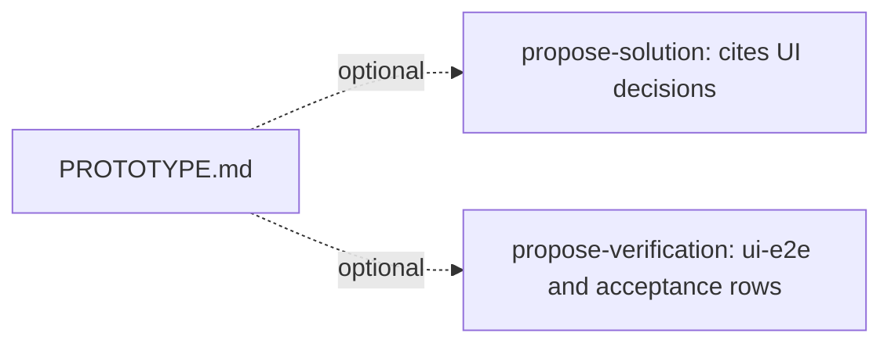

# ADR-0004 — PROTOTYPE.md is an optional input of both readers

> Status: Decided by agent
> Date: 2026-11-24
> Audited: not yet
> Layer: L9
> Context ticket: 207
> Forks: none

## Context

propose-solution and propose-verification read PROTOTYPE.md when it exists (AC-027, AC-028), and run as today without it (AC-029). Their start scripts answer fixed path sets (SDD §14; `design_files.py:136-140`, `verification_files.py:180-207`).

## Driven by

AC-027, AC-028, AC-029, requirement ADR-0003, grill card i-readers.

## Decision

Both start answers add `prototype` and `prototype_exists`. `prototype_exists` is true only when PROTOTYPE.md exists and the INDEX.md `Prototype` row says `chosen`: an unsettled file counts as absent (`prd_files.prototype_chosen`). Neither refuses a missing file, and propose-verification keeps it out of its required files. Each SKILL.md gets an optional input row, and reads the file in its read step and in its proposer brief. propose-solution cites each UI decision in the SDD section it changes. propose-verification derives `ui-e2e` and `acceptance` rows from the Coverage rows, traced by the existing `story` and `criteria` columns.

## Alternatives Considered

| Alternative | Pros | Cons | Reason rejected |
|-------------|------|------|-----------------|
| a required input | always used | blocks every backend-only feature | AC-029 |
| a new SDD UI section | 1 place for UI | changes the template and its gate | requirement ADR-0003 |

## Consequences

- **Positive** — features with no UI run as today.
- **Negative** — a reader may miss that a PROTOTYPE.md is stale; the INDEX row shows its date.
- **Follow-ups** — none.
