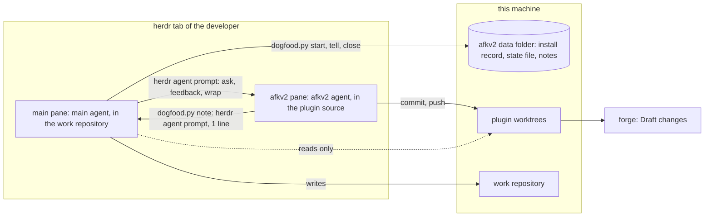
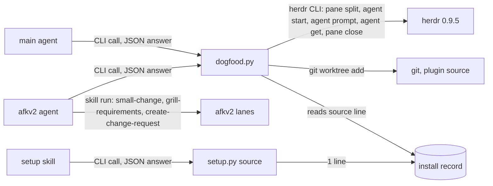
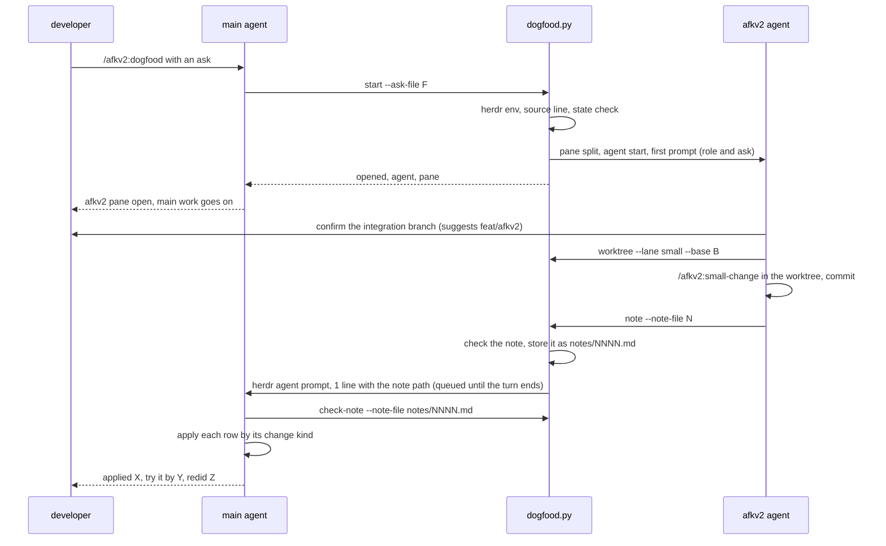
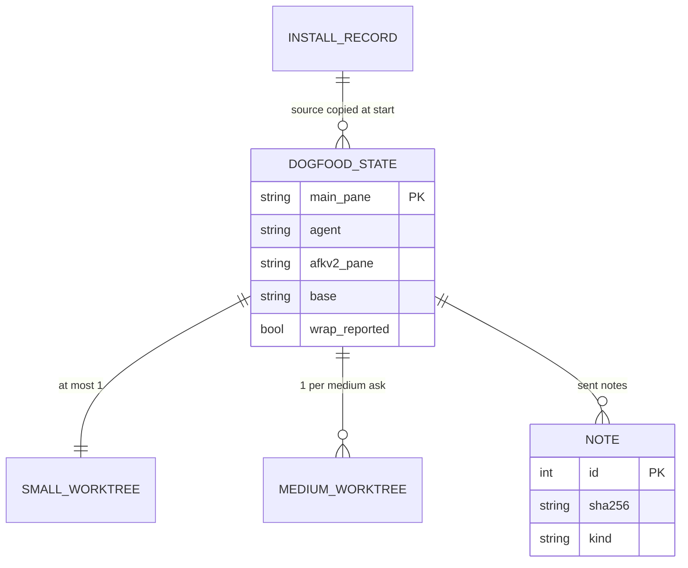
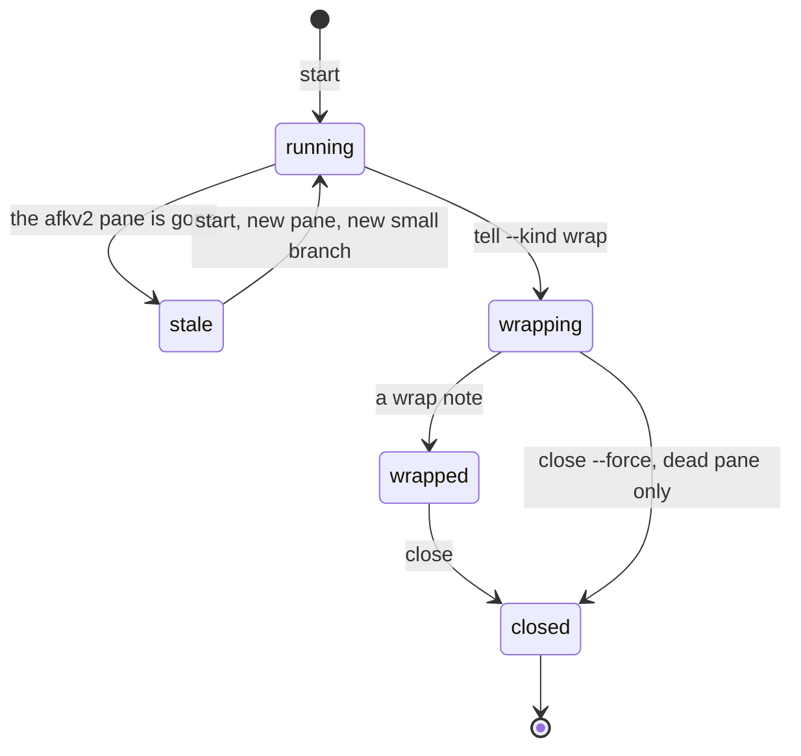
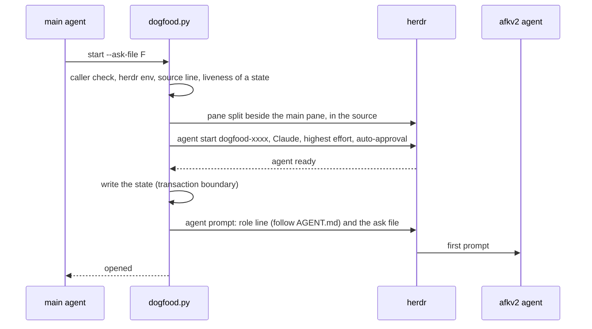
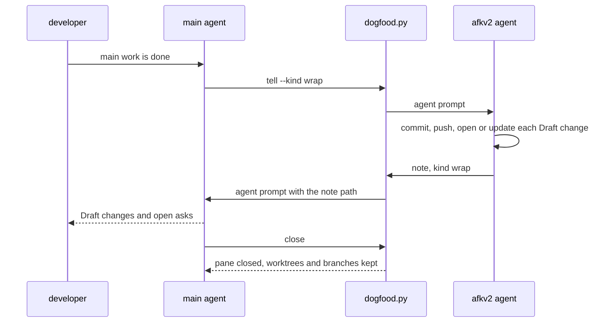
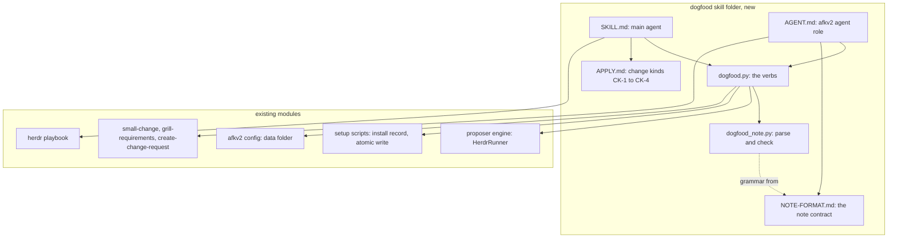

# SDD — /afkv2:dogfood

> Parent PRD: `PRD.md`
> Status: Draft
> Last updated: 2026-11-26

## §0 Binding Contract

This SDD and its accepted ADRs are binding on implementing agents and reviewers.

| Aspect | Locked by SDD/ADR | Executor latitude |
|--------|-------------------|-------------------|
| Pattern choice | yes | no |
| Module public interface | yes | no |
| API contract and schema | yes | no |
| Persisted schema (§4) | yes | no |
| Life cycle states and legal moves (§6) | yes | no |
| Roles per surface (§5) | yes | no |
| Transaction and idempotency strategy | yes | no |
| External-seam contract (§9b) | yes | no |
| File layout inside a named module | no | yes |
| Private helpers, internal names, control flow | no | yes |
| Test fixture structure | no | yes |

**Conflict procedure.** An executor finds a binding decision wrong, infeasible or against reality. A two-way-door correction is recorded in `plan/DECISIONS.md` and built. A one-way door or a tie parks the subtask and returns to `/afkv2:propose-solution` for a new ADR that supersedes the old one. Never override off the record.

**Human sign-off register.** One row per human-locked aspect (`DRAFT.md`).

| Aspect | Section | Status | Signed by / date | Approved wording |
|--------|---------|--------|------------------|------------------|
| HL-1 Persistence and entity design | §4 | signed | the developer / 2026-11-26 | `sign` mark on card i-hl1, round 3, no note: "Sign: 3 pieces of stored state" (install record line, state file, notes folder) |
| HL-2 API surface | §3 | signed | the developer / 2026-11-26 | `sign` mark on card i-hl2, round 3, no note: "Sign: 8 callable surfaces and the note format" |
| HL-3 Authorization and data scoping | §5 | signed | the developer / 2026-11-26 | `sign` mark on card i-hl3, round 3, no note: "Sign: who may run each verb" |
| HL-4 Life cycle and invariants | §6 | signed | the developer / 2026-11-26 | `sign` mark on card i-hl4, round 3, no note: "Sign: the pane session life cycle and 7 invariants" |
| HL-5 Irreversible and outward side effects | §7 | signed | the developer / 2026-11-26 | `sign` mark on card i-hl5, round 3, no note: "Sign: 3 effects outside the feature's own state" |
| HL-6 Change to existing behaviour | §14 | signed | the developer / 2026-11-26 | `sign` mark on card i-hl6, round 3, no note: "Sign: setup changes in 3 places" |

## §1 Context Summary

The developer builds afkv2 while using it for real work in another repository. The design puts the plugin work in a second, peer agent session beside the main session, and connects the 2 sessions through 1 script that holds both pane ids. The main agent applies each milestone from the plugin worktree by instructions alone, because hooks, skill discovery and the core behaviors load from the installed plugin and a reload is ruled out (requirement ADR-0001). The only change to existing behaviour is 1 new setup step that records where the plugin source checkout is (ADR-0004).

## §2 L1 — System Topology

No server and no daemon. 2 interactive agent sessions run as peer panes in 1 herdr tab; herdr, local files and git are the whole backbone. The main agent runs the installed dogfood skill, so the first dogfood version ships through a normal release before it can be dogfooded.



The main agent writes only the work repository; the afkv2 agent writes only the plugin worktrees; every cross-pane prompt goes through dogfood.py.

| Option | Gives | Costs | Verdict |
|--------|-------|-------|---------|
| Peer panes in herdr | the developer talks to each agent (AC-026); the main work never waits | needs herdr (AC-002 refuses outside) | chosen (card i-l1) |
| Background subagent of the main session | no herdr | no pane for the developer; dies with the main turn | rejected |
| Load the plugin from the worktree | hooks apply too | refused by requirement ADR-0001 | rejected |

## §3 L2 — Service Boundaries & Integration



dogfood.py is the mediator: it holds both pane ids, so no agent names the other pane by an argument (ADR-0002, card i-f3).

One ask, from the developer to the applied change:



Every cross-pane step goes through dogfood.py; the note travels as a file and the prompt carries only its path (ADR-0001, card i-f1).

**Contract of every verb.** Run as `<python> <skill folder>/scripts/dogfood.py <verb>`. 1 JSON object on stdout: `{"ok": true, ...}` or `{"ok": false, "error": {"code", "reason"}}`. Exit 0 ok, 1 refused, 2 unreadable input. Caller identity is the environment variable `HERDR_PANE_ID` checked against the 2 pane ids of the state file (§5). No paging: every list is small (§10).

| Surface | Caller | Request and validation | Success answer | Errors | Idempotency |
|---------|--------|------------------------|----------------|--------|-------------|
| `start --ask-file F` | main pane | F is UTF-8, 1 to 8000 characters | `status` opened or existing, `agent`, `pane`, `state` | `outside-herdr` (names: start herdr, run again), `no-source` (names `/afkv2:setup`), `source-broken` (names setup), `in-afkv2-pane`, `ask-unreadable` (exit 2), `herdr-failed`, `agent-not-ready`, `auto-approval-banned` | a live state answers `existing` and forwards the ask to the live agent; never a second pane |
| `tell --kind feedback\|wrap --text-file F` | main pane | F is 1 to 8000 characters; feedback holds the evidence | `sent`, `kind` | `no-pane`, `in-afkv2-pane`, `prompt-blocked` (the agent shows a dialog), `herdr-failed` | no resend; a stall gets 1 Enter (playbook H-6) |
| `worktree --lane small\|medium --base B [--branch N]` | afkv2 pane | B is an existing branch of the source; N is required for medium; names match `[A-Za-z0-9._/-]+` | `path`, `branch`, `lane` | `not-afkv2-pane`, `small-exists`, `bad-branch` (bad form or exists), `base-missing`, `worktree-failed` | the same lane and branch in the state answers the recorded worktree |
| `note --note-file N` | afkv2 pane | N follows the note format, at most 16 KiB | `sent` true or `unconfirmed`, `id`, `path` | `not-afkv2-pane`, `note-check-failed` with `failures`, `main-pane-gone`, `already-sent` | the SHA-256 of the note body is recorded; a repeat refuses |
| `check-note --note-file N` | main pane | N | `note`: the parsed note | `note-check-failed` with `failures`, each `code`, `where`, `reason` | pure; writes nothing |
| `status` | either pane | none | `state`, or `state` null | none | pure |
| `close [--force]` | main pane | `--force` only for a dead afkv2 pane | `pane_closed`, `worktrees`, `branches` (all kept) | `in-afkv2-pane`, `no-wrap-report` | a gone pane or an absent state answers ok |
| `setup.py source [--path P]` | setup skill | P is an absolute path | no P: `status` suggested or none, with `path`; P: `status` written, `path` | `not-main-checkout`, `not-plugin-source`, `not-a-repo` | the same path again answers written, no change |
| install record readers | existing skills | none | unchanged | none | an unknown key is ignored |

Defaults the verbs fill: the small-asks branch is `feat/afkv2-df-<yyyymmdd-hhmm>` (UTC at the `worktree` call); a medium branch is named by the afkv2 agent from its lane; the agent name is `dogfood-<4 hex>`, the first 4 hex digits of the SHA-256 of the main pane id, with the next 4 digits on a clash with a live agent, at most 3 tries.

**The milestone note, the contract between the 2 agents.** The note format text in the skill folder owns it; the afkv2 agent emits it; `dogfood_note.py` parses and checks it for both `note` and `check-note`.

```
afkv2-note v1
kind: milestone | wrap
ask: <ask title, 1 line>
purpose: <the 1 named purpose it is usable for>          (milestone)
changed:                                                  (milestone: 1 row or more)
- <worktree path> | CK-1|CK-2|CK-3|CK-4 | added|changed|removed | <what changed, 1 line>
use: <how to try it, 1 to 5 lines>                        (milestone)
best-effort: <path> - <what may not apply this session>   (1 per CK-4 row)
redo: none | <the delta of earlier work to redo>          (milestone)
changes:                                                  (wrap: 1 row per Draft change)
- <change url> | <branch> | <asks in it>
open-asks: none | <list>                                  (wrap)
```

| Rule code | Fails when | Drives |
|-----------|------------|--------|
| N-HEADER | line 1 is not `afkv2-note v1` | the version |
| N-KIND | the kind is not milestone or wrap | the version |
| N-NO-PATH | a milestone has 0 changed rows | AC-015, AC-023 |
| N-PATH-OUTSIDE | a path is not under a worktree the state lists | AC-015 |
| N-PATH-MISSING | an added or changed path does not exist | AC-023 |
| N-CK | a change kind is not CK-1 to CK-4 | the catalog |
| N-NO-USE | a milestone has no use line | AC-015, AC-023 |
| N-NO-BEST-EFFORT | a CK-4 row has no best-effort line for its path | AC-015, AC-021 |
| N-NO-REDO | a milestone has no redo line (`none` is valid) | AC-016 |
| N-NO-CHANGES | a wrap has 0 changes rows | AC-027 |

Citations of checked facts: the herdr pane verbs and `HERDR_PANE_ID` (herdr playbook SKILL.md lines 34, 42, 65, 81, 96, 111, 118, 133); herdr answers an agent it did not start by pane id (`herdr agent get` on herdr 0.9.5, 2026-11-26); the checker pattern (to-subtasks check_plan.py lines 1-5, 106); create-change-request takes its target from the invocation (create-change-request SKILL.md line 14).

## §4 L3 — Data Architecture

| State | Datastore | Partitioning | Replication | Retention | Schema-evolution policy | PII? | Audited? |
|-------|-----------|--------------|-------------|-----------|-------------------------|------|----------|
| install record line `source` | the install record in the afkv2 data folder | 1 per machine | none | until setup changes it | readers ignore unknown keys; the writer keeps them | no | no |
| dogfood state file | `%LOCALAPPDATA%\afkv2\dogfood-<main pane>.json` | 1 file per main pane | none | deleted at close; a stale file is replaced at the next start | field `version`, now 1; an unknown version refuses | no | no |
| notes folder | `%LOCALAPPDATA%\afkv2\dogfood-<main pane>\notes\NNNN.md` | 1 folder per main pane | none | deleted at close | follows the note format version | no | no |

3 pieces of state, all on this machine, each with 1 writer; nothing goes in the work repository (AC-013) and nothing is committed.

**Install record, 1 new line.**

| Field | Type | Null? | Default | Unit / precision | Constraint | Indexed / unique | Note |
|-------|------|-------|---------|------------------|------------|------------------|------|
| source | absolute path, the rest of the line | absent means not set | absent | none | a main checkout of the plugin source repository when written | 1 per machine | paths may hold spaces; the reader splits at the first space only |

**Dogfood state file.** The main pane id is sanitised for the file name: each character outside `[A-Za-z0-9_-]` becomes `_`. Written atomically by the existing atomic-write helper; dogfood.py is the only writer and re-reads the file before each write.

| Field | Type | Null? | Default | Unit / precision | Constraint | Indexed / unique | Note |
|-------|------|-------|---------|------------------|------------|------------------|------|
| version | int | no | 1 | none | 1 | none | an unknown version refuses |
| main_pane | text | no | `HERDR_PANE_ID` at start | none | herdr pane id | key, the file name | |
| agent | text `dogfood-<4 hex>` | no | from the main pane id | none | herdr agent name rule | unique among live agents | |
| afkv2_pane | text | no | from the pane split | none | herdr pane id | none | the caller check of §5 |
| harness | text | no | `claude` | none | `claude` until the routing of ticket 204 lands | none | AC-005 |
| source | path | no | copied from the install record | none | a main checkout | none | a later setup change does not move a running session |
| base | branch name | yes, until the first worktree | null | none | an existing branch | none | the confirmed integration branch (ADR-0003) |
| worktrees | list of records: path, branch, lane (small or medium), created | no | empty | created in ISO 8601 UTC | at most 1 with lane small | path | requirement ADR-0003 |
| notes | list of records: id, sha256, path, kind, sent_at, paths | no | empty | id an int; sent_at ISO 8601 UTC | sha256 unique per session | id | the applied list after a compaction |
| wrap_reported | bool | no | false | none | set by a wrap note | none | the close guard |
| started | text | no | now | ISO 8601 UTC | none | none | |

**Notes folder.**

| Field | Type | Null? | Default | Unit / precision | Constraint | Indexed / unique | Note |
|-------|------|-------|---------|------------------|------------|------------------|------|
| file name | 4-digit sequence | no | highest id plus 1 | none | NNNN | unique per session | |
| body | note text | no | none | at most 16 KiB | passed the check before it is written | sha256 in the state | |

| Relation | Target | Cardinality | Owning side | On delete / orphan | Fetch posture |
|----------|--------|-------------|-------------|--------------------|---------------|
| main pane to state file | state file | 1 to 0..1 | dogfood.py | close deletes it; a stale one is replaced at start | by file name |
| state to worktrees | git worktrees | 1 to 1 small plus 0..n medium | dogfood.py | worktrees and branches are kept; `/afkv2:gc` cleans them after a merge | listed in the state |
| state to notes | note files | 1 to 0..n | dogfood.py | the folder is deleted at close | by path in the state |
| install record to state | state file | 1 to 0..n | setup.py source | the state keeps its copy | copied at start |



A close removes the state and its notes; worktrees and branches stay (AC-028).

**Surface reachability.** The install record gains 1 line. Its readers read named keys and ignore an unknown one, so no surface that exposes the record changes. `setup.py status` gains the field `source` (§14).

**Migration and backfill.** No existing data changes. A record without the line means not set: setup asks once, and only when the line is missing or broken. Rollback deletes the line; every reader ignores it anyway.

Options weighed: a JSON file per main pane (chosen, card i-hl1); herdr pane labels (no place for the worktree or note lists, a rename breaks it); git config keys of the source (keyed by branch, not by main pane; the AC-004 lookup scans every branch).

## §5 L4 — Cross-Cutting & Quality Attributes

There is no UI. The guard below is the script check; the guard above is the skill text the agent follows.

| Surface | Permitted roles | Denied roles | Guard in the script | Guard in the text | Scope |
|---------|-----------------|--------------|---------------------|-------------------|-------|
| start, tell, close | main agent | afkv2 agent | refuse when `HERDR_PANE_ID` is the afkv2_pane of a state | SKILL.md | its own state file |
| worktree, note | afkv2 agent | main agent | refuse unless `HERDR_PANE_ID` is the afkv2_pane of a state | AGENT.md | the worktrees of its state |
| note target | the main pane only | every other pane | no target argument; the target is read from the state (AC-017) | AGENT.md bans every other prompt | main_pane of the state |
| write a plugin file | afkv2 agent, in its worktrees | main agent | none | APPLY.md (AC-022) | its worktrees |
| write the work repository | main agent | afkv2 agent | none | AGENT.md (AC-013) | none |
| merge | the developer | both agents | none | core behavior: a human merges | none |

The 2 write bans stay instructions with no hook, as round 1 settled (card i-a-constraints).

| Surface | Key shape | Window | Ledger |
|---------|-----------|--------|--------|
| start | the main pane id | while the state is live | the state file |
| note | SHA-256 of the note body | the pane session | `notes` in the state |
| worktree | lane and branch | the pane session | `worktrees` in the state |
| close | the main pane id | always | an absent state or gone pane is ok |

| Call | Attempts | Backoff in s | Timeout in s |
|------|----------|--------------|--------------|
| herdr agent prompt | 1, plus at most 1 Enter on a stall (H-6) | 0 | herdr default |
| herdr agent start | 1 | 0 | 90 |
| git worktree add | 1; the error goes to the developer in the afkv2 pane | 0 | none |
| git push (in the lanes) | 1; a failure goes under open asks in the wrap note | 0 | none |

Concurrency: 1 writer per state file; 2 main panes have 2 files. Rate limit: none needed. Feature flags: none; a developer who never runs dogfood sees no change (distribution law). Observability: each verb answers JSON; the developer sees both panes. Endpoint security: no executable is copied; every process starts as an argument list; no shell sleep.

Secrets: none new; the afkv2 agent pushes with the developer's forge login, as every lane does today.

## §6 L5 — Domain Model

| Invariant | Owner | Guardian | Answer to a violation |
|-----------|-------|----------|-----------------------|
| source is a main checkout of the plugin source repository | setup | `setup.py source`; `start` checks again | `not-main-checkout`, `not-plugin-source`; start answers `source-broken` |
| at most 1 live afkv2 pane per main pane | dogfood.py | `start` | `existing`; the ask is forwarded |
| at most 1 small-asks worktree per pane session | dogfood.py | `worktree` | `small-exists` |
| every sent note passed the check | dogfood_note.py | `note` and `check-note`, 1 parser | `note-check-failed`; the main agent asks for a complete note (AC-023) |
| notes go only to the main pane | dogfood.py | `note` has no target argument | not reachable |
| close only after a wrap note, unless forced | dogfood.py | `close` | `no-wrap-report` |
| no plugin write by the main agent; no work-repository write or merge by the afkv2 agent | both agents | instructions | none |

The pane session life cycle:



Only a wrap note or a forced close on a dead pane ends a session; every other move refuses.

| From | To | Trigger | Who |
|------|----|---------|-----|
| none | running | start | main agent |
| running | stale | the afkv2 pane is gone | herdr |
| stale | running | start: new pane, new small branch | main agent |
| running | wrapping | tell --kind wrap | main agent, on the developer's word |
| wrapping | wrapped | a wrap note | afkv2 agent |
| wrapped | closed | close | main agent |
| wrapping | closed | close --force, dead pane only | main agent |

Liveness: the pane exists and herdr answers the agent name of the state. A stale state never reuses its branch.

Each ask keeps its state in the afkv2 agent's conversation, not on disk (card i-a-lifecycle): queued, building, milestone sent, back to building on feedback, and open at the wrap-up.

Domain events: None.

## §7 L6 — Process & Coordination

No transaction spans herdr, git and the state file. The state is written only after each outside step succeeds, so a crash leaves an orphan pane or worktree, never a state that points at nothing.

**Start (new pane).**



A failed split or start writes no state and closes the pane it opened.

**Milestone and apply.**

```mermaid
sequenceDiagram
  participant A as afkv2 agent
  participant S as dogfood.py
  participant M as main agent
  A->>A: commit in the worktree, write the note in scratch
  A->>S: note --note-file N
  S->>S: check the note; refuse on a failure
  S->>S: write notes/NNNN.md
  S->>M: agent prompt by pane id, 1 line with the path
  S->>S: record id, sha256, paths in the state (transaction boundary)
  M->>S: check-note --note-file notes/NNNN.md
  M->>M: apply by kind: CK-1 follow the worktree skill, CK-2 run its script, CK-3 follow the text, CK-4 best effort
  M->>M: redo the named delta at once
```

The prompt waits until the main agent's turn ends; a skill the main agent runs now switches to the new text at once (AC-019) and the named delta is redone at once (requirement ADR-0002).

**Wrap-up.**



The pane outlives each result until this wrap-up (AC-029); the dogfood skill states this 1 exception to playbook rule H-8.

The other flows: the afkv2 agent confirms the integration branch with the developer at the start of each pane session, then calls `worktree` (ADR-0003); a small ask runs `/afkv2:small-change` in the small-asks worktree, and each ask gets its own section in the one Draft change; a grow or a feature-sized ask gets a medium worktree and runs `/afkv2:grill-requirements` there; a new ask while one is building is queued and announced in the afkv2 pane (AC-012); feedback from the main pane goes by `tell --kind feedback` with the evidence (AC-025); feedback in the afkv2 pane needs no step from the main agent (AC-026).

| Failure point | Detection signal | Automatic recovery | Manual recovery | Owner |
|---------------|------------------|--------------------|-----------------|-------|
| pane split or agent start fails | `herdr-failed`, `agent-not-ready` | nothing written; the opened pane is closed | the developer reads the reason, runs again | dogfood.py |
| first prompt stalls | the agent is not working after the send | 1 Enter (H-6) | the developer looks at the afkv2 pane | dogfood.py |
| base branch missing | `base-missing` | none | the afkv2 agent asks the developer again | afkv2 agent |
| note check fails | `note-check-failed` with failures | none | the afkv2 agent fixes the note | afkv2 agent |
| main pane gone at a note | `main-pane-gone` | none; the work stays committed | the afkv2 agent tells the developer in its pane | afkv2 agent |
| the note prompt is not seen | `sent: unconfirmed` | no resend | the developer checks the main pane | the developer |
| received note fails the check | `check-note` refuses | apply nothing | `tell --kind feedback`: send a complete note (AC-023) | main agent |
| the afkv2 pane shows a dialog | `prompt-blocked` | none | the main agent tells the developer | main agent |
| a push fails at the wrap-up | the lane reports it | none | listed under open asks in the wrap note | afkv2 agent |
| the afkv2 pane is dead at the wrap-up | liveness fails | none | `close --force`; nothing is deleted | main agent |
| the main session ends without a wrap-up | the state is left | the next start from the same pane decides existing or stale | none | dogfood.py |

**Outward side effects (HL-5).**

| Effect | Trigger | Order | Idempotency key | Partial failure leaves | Recovery |
|--------|---------|-------|-----------------|------------------------|----------|
| prompt into the main pane | note | check, write the note file, prompt, record in the state | SHA-256 of the note | a note file without a record, or `sent: unconfirmed` | no resend; the developer sees the pane |
| prompt into the afkv2 pane | start, tell | after the state is written | none; 0 resends | a stall | 1 Enter (H-6) |
| git worktree and branch, push, Draft change | worktree; the lanes | worktree add, then the state | the branch name | a worktree not in the state | listed by close; `/afkv2:gc` after a merge |

Nothing outside the afkv2 data folder is ever deleted by this feature.

## §8 L7 — Module Decomposition



Dependencies point from the new folder to existing modules only; no existing module imports dogfood, so there is no cycle.

| Module | Purpose | Public interface | Depends on |
|--------|---------|------------------|------------|
| SKILL.md | the main agent: refusals, start, the H-8 exception, apply pointer, feedback, wrap-up | trigger and steps | dogfood.py, APPLY.md, herdr playbook |
| APPLY.md | how the main agent applies each change kind | steps per CK-1 to CK-4 | NOTE-FORMAT.md |
| AGENT.md | the afkv2 agent's role, read from the worktree | role steps: branch question, lanes, queue, note, wrap | dogfood.py, NOTE-FORMAT.md, the lanes |
| NOTE-FORMAT.md | the note grammar and rule codes | the `afkv2-note v1` grammar | none |
| dogfood.py | runs the 8 verbs | the verbs of §3; `main(argv, env, runner)` for tests | dogfood_note.py, HerdrRunner, atomic write, install record reader, data folder |
| dogfood_note.py | parses and checks a note | `parse(text)`; `check(note, worktrees)` returns the failures | none |
| setup.py | gains the source verb | verb `source [--path P]`; `status` gains `source` ok, missing or broken | its own 6-line main-checkout test |

## §9 L8 — Tactical Patterns

| Concern | Pattern | ADR |
|---------|---------|-----|
| cross-pane messages | Mediator: dogfood.py holds both pane ids; the agents never address each other by an argument | ADR-0002 |
| who may call a verb | Guard check: each verb first checks `HERDR_PANE_ID` against the state, which herdr sets and no agent types | ADR-0002 |
| note delivery | a file in a fixed format; the prompt carries its path | ADR-0001 |
| note check | 1 parser on send and on receipt (the checker pattern); beat prose rules in each agent | none |
| herdr calls | import the public HerdrRunner with a small private wrapper; beat extracting a shared herdr module, because the engine helpers are private and tied to the 2 proposers (card i-l8) | none |
| apply | instructions in APPLY.md; beat a script that links worktree skills into the install, ruled out by requirement ADR-0001 | none |
| state persistence | versioned JSON, atomic replace; beat an append-only log, because the reader needs only the current state | none |
| test double | in-process fake runner; beat a fake herdr executable, banned by the endpoint security rules | none |

## §9b External Seams & Failure Affordance

| Boundary | Framework at its pin | What it does to our value | Failure surface | Seam test |
|----------|----------------------|---------------------------|-----------------|-----------|
| pane identity | herdr 0.9.5 sets `HERDR_PANE_ID` per pane | the source of truth of the caller role; dogfood.py never takes it from an argument | absent: `outside-herdr` | live: start from the main pane, call `note` from it, expect `not-afkv2-pane` |
| prompt delivery | herdr 0.9.5 `agent prompt` by pane id; herdr detects an agent it did not start | types the 1-line pointer into the main agent's input; the receiving harness queues it until the turn ends (unverified-external) | dialog: `prompt-blocked`; pane gone: `main-pane-gone`; not seen: `sent: unconfirmed` | live, Claude and Codex main agents: a note sent during a working turn is read after the turn ends |
| agent start | claude CLI with `--model` and `--effort`, auto-approval | sets the afkv2 agent's model and effort (AC-005) | `agent-not-ready`; the pane is closed | live: start, then `herdr agent get` answers the name |
| worktree | git `worktree add -b` from the base branch | creates the branch from the confirmed base | `base-missing`, `worktree-failed`; nothing written to the state | unit with the fake runner; live once |
| Draft change target | create-change-request takes the target from the invocation | the confirmed base becomes the target | the lane's own refusal | live: the first small ask opens a Draft change into the base |

Every invariant is enforced in dogfood.py or setup.py, except the 2 write bans, which only the skill text holds.

## §10 NFRs

| Concern | Target | Measurement | Owner |
|---------|--------|-------------|-------|
| start, new pane | at most 120 s (agent start 90 s, split and prompt 30 s), estimated | live run timing | dogfood.py |
| start, existing pane | at most 35 s, estimated | live run timing | dogfood.py |
| note | at most 10 s, estimated | live run timing | dogfood.py |
| setup source suggestion | at most 5 s, estimated | unit and live timing | setup.py |
| note delivery | at the end of the main agent's current turn, inferred | live run | herdr and the harness |
| note size | at most 16 KiB | the note check | dogfood_note.py |
| ask size | 1 to 8000 characters | the start and tell checks | dogfood.py |
| state lookup | at most about 10 state files scanned | unit test | dogfood.py |
| setup candidate search | the current repository, its main checkout, and the children of its parent folder and of the home folder, 2 levels deep; never a recursive scan of a drive | unit test | setup.py |
| sizes | state files: now 0, worst 10; worktrees per state: worst 5; notes per session: worst 50 of at most 16 KiB, under 1 MB | estimated | dogfood.py |

## §11 Out of Scope

From the PRD:

- The release, the merge and the version bump of the afkv2 change: the developer's normal ship path.
- An automated plugin reinstall or reload for a hook change: worked out case by case.
- A manual path outside herdr.
- Cleanup of the worktrees and branches after a merge: `/afkv2:gc`.

From the design:

- A hook that guards the 2 write bans: they stay instructions.
- Extracting a shared herdr module from the proposer engine.
- A Codex afkv2 agent: the afkv2 agent runs as Claude until the routing of ticket 204 lands (AC-005); the main agent may be Claude or Codex.
- A change to the herdr playbook: its H-8 rule stays; the dogfood skill states its own exception.
- The proposer engine's missed Codex startup dialog: a spinoff of this session, not this ticket.

## §12 Reversed Decisions

| Prior ADR | Superseded by | Reason |
|-----------|---------------|--------|
| None | None | no earlier design ADR exists for this ticket |

## §13 Open Questions

| Question | Layer (L1-L9) | Blocks executor? | Owner | Target resolve date |
|----------|---------------|------------------|-------|---------------------|
| Does a prompt typed into a working Claude or Codex main agent wait until its turn ends? (unverified-external; the developer's fact) | L6 | no | the developer, by the live proof of the build | the live proof before ship |

## §14 L9 — Implementation Seams & Change Impact

| Seam | Existing contract | Planned change | Impacted flows | Conventions and landmines | Verdict |
|------|-------------------|----------------|----------------|---------------------------|---------|
| setup.py lines 91-98, `read_install_record` | key and value split at the first space | none; dogfood reads `source` through it | start | a path with spaces stays whole | fits |
| setup.py lines 101-116, record writer | keeps extra keys, sorts them after the first 4 | none; a test proves `prepare` keeps `source` | setup | none | fits |
| setup.py lines 905-945, `main` dispatch | no source verb | add `source`; it needs no repository | setup | add it to the verbs that skip the repository check | extends (ADR-0004) |
| setup.py line 694, `status` | no source field | add `source` ok, missing or broken | setup | callers read named fields (inferred from setup SKILL.md step 1) | extends (ADR-0004) |
| setup SKILL.md lines 26-48 | no source step | detect, suggest, ask, check, write; silent when the line is ok (AC-006 to AC-008) | setup | asks only when the line is missing or broken | extends (ADR-0004) |
| other_provider.py lines 202-210; autopilot end_gate.py line 107 | read the record by key | none; they ignore `source` | the existing readers | none | fits |
| gc cleanup.py lines 134-139 | main-checkout test: git-dir equals git-common-dir | the pattern is copied into setup.py, 6 lines; no import of gc | setup | none | fits |
| plugin markers: plugin.json line 2; root marketplace.json lines 9-10 | the plugin is named afkv2; the root marketplace entry has source `./afkv2` | setup.py source checks both | setup | none | fits |
| proposer_engine.py lines 110-143, `HerdrRunner` | 1 consumer family, the proposers | imported by dogfood.py the way small_lane.py line 22 finds its root | start, tell, note, close | the engine's other helpers stay private | fits |
| herdr playbook SKILL.md lines 118-127, rule H-8 | close a pane once its result is read | none; the dogfood skill states its exception | the pane life | never close the developer's pane | fits |
| small-change SKILL.md lines 12 and 47 | runs in the branch's worktree; a grow names the medium lane | none; AGENT.md routes a grow to a medium worktree | small and medium asks | none | fits |
| create-change-request SKILL.md line 14 | the target comes from the invocation | none; AGENT.md passes the confirmed base | the Draft changes | none | fits |
| hooks.json lines 11 and 25; session-start.cmd line 4 | hooks and core behaviors load from the installed root | none; CK-4 stays best effort | apply | none | fits |

Compatibility findings the developer accepted (card i-hl6, signed): setup only grows; callers of `status` see 1 new named field; not every caller of `status` was enumerated, so the build checks that each one reads fields by name; rollback is a revert, and the extra record line is then ignored.
