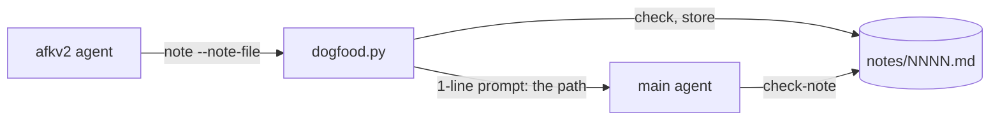

# ADR-0001 — The milestone note travels as a file; the prompt carries its path

> Status: Accepted
> Date: 2026-11-26
> Layer: L2
> Context ticket: 211
> Forks: i-f1

## Context

The afkv2 agent sends each milestone note into the main agent's input by a herdr prompt (SDD §3). A note runs to about 40 lines. Text typed into an agent input can submit early on a newline, and a prompt is lost when the main session compacts. The main agent must check the note with the same parser the sender used (AC-015, AC-023).

## Driven by

AC-014, AC-015, AC-017, AC-023; requirement ADR-0001; page cards i-f1, i-l2-send, i-l2-note, i-hl1.

## Decision

The afkv2 agent writes the note in scratch and runs `note`. dogfood.py checks it, stores it as `NNNN.md` in the notes folder of the session in the afkv2 data folder, and prompts the main pane with 1 line that holds only the path. The main agent runs `check-note` on that file and applies it. The state file lists each sent note, so the main agent can re-read what it applied after a compaction. The notes folder is deleted at close.

## Alternatives Considered

| Alternative | Pros | Cons | Reason rejected |
|-------------|------|------|-----------------|
| The whole note as 1 prompt, newlines flattened | no stored note | a 40-line note in 1 line; an early submit if a newline slips through; lost on compaction; check-note needs the main agent to copy the prompt to a file | the developer picked the file (round 2) |
| The main agent pulls from a background wait on the notes folder | nothing typed into a working agent | Codex has no wake on a background job exit; a job alive for the whole session; against the PRD's plain prompt | the developer picked the file (round 2) |

## Consequences

- **Positive** — a 1-line prompt; both agents check the same bytes; the applied list survives a compaction.
- **Negative** — 1 more stored thing, the notes folder, which the developer signed (HL-1).
- **Follow-ups** — none.
