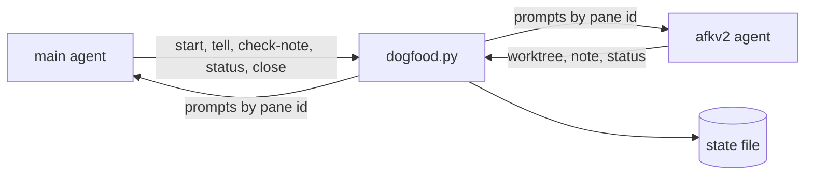

# ADR-0002 — One script mediates both panes through 8 verbs

> Status: Accepted
> Date: 2026-11-26
> Layer: L2
> Context ticket: 211
> Forks: i-f3

## Context

Round 1 listed 5 callable surfaces. The main agent must also reach the afkv2 agent with feedback and the wrap-up (AC-025, AC-027). The integration branch is known only after the afkv2 agent asks the developer, so `start` cannot create the small-asks worktree (ADR-0003). The main agent must re-read the session after a compaction (SDD §3, §5).

## Driven by

AC-004, AC-017, AC-023, AC-025, AC-027; requirement ADR-0003; page cards i-f3, i-a-api, i-hl2, i-hl3.

## Decision

dogfood.py is the Mediator and the only writer of the state file. It answers 7 verbs (start, tell, worktree, note, check-note, status, close), and setup gains the 8th surface, `setup.py source` (ADR-0004). dogfood.py holds both pane ids; no verb takes a target pane. Each verb first checks `HERDR_PANE_ID` against the state, so the main agent and the afkv2 agent each run only their own verbs.

## Alternatives Considered

| Alternative | Pros | Cons | Reason rejected |
|-------------|------|------|-----------------|
| 5 verbs: tell folded into start; the afkv2 agent runs git worktree add and edits the state by instruction | 3 fewer verbs | the state file gets 2 writers with no guard; the target-free send rule of AC-017 weakens | the developer picked 8 (round 2) |
| Each agent prompts the other by name from its instructions | no script for messages | no single place holds the target; a typo reaches another pane | breaks AC-017 |

## Consequences

- **Positive** — 1 writer per state file; a note cannot reach another pane; every guard that a script can check is a script check.
- **Negative** — 3 more verbs to build and test.
- **Follow-ups** — none.
