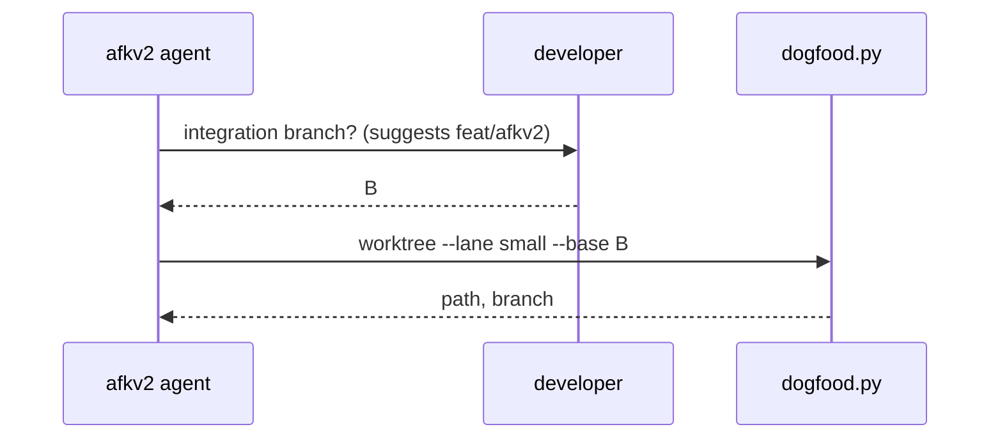

# ADR-0003 — The afkv2 agent asks for the integration branch at the start of each pane session

> Status: Accepted
> Date: 2026-11-26
> Layer: L6
> Context ticket: 211
> Forks: i-target

## Context

Small asks of a pane session share 1 branch and 1 Draft change into the plugin's integration branch (AC-010; requirement ADR-0003). The integration branch changes over time: a major rewrite lives on its own long branch while the default branch stays frozen. The design must name where each afkv2 branch starts and lands (SDD §4 field `base`, §7).

## Driven by

AC-010, AC-011; requirement ADR-0003; page cards i-target, i-hl1, i-hl5.

## Decision

At the start of each pane session, the afkv2 agent asks the developer in its pane which integration branch to use, and suggests `feat/afkv2`. It then runs `worktree --lane small --base <answer>`. dogfood.py records the base in the state. Every later worktree of that session starts from it, and each Draft change targets it.

## Alternatives Considered

| Alternative | Pros | Cons | Reason rejected |
|-------------|------|------|-----------------|
| The repository config base branch | no question | wrong while a long rewrite branch is the integration branch | the developer picked option c (round 1) |
| A fixed branch in the skill text | no question | goes stale at the next rewrite; moving it needs a skill change | the developer picked option c (round 1) |

## Consequences

- **Positive** — each session lands where the developer integrates now.
- **Negative** — 1 question per pane session.
- **Follow-ups** — none.
