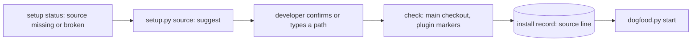

# ADR-0004 — Setup records the plugin source checkout as 1 install record line

> Status: Accepted
> Date: 2026-11-26
> Audited: 2026-11-26
> Layer: L9
> Context ticket: 211
> Forks: none

## Context

dogfood.py must find a main checkout of the plugin source repository on this machine, to open the afkv2 pane and create worktrees there (AC-001, AC-003). The main agent runs in another repository, and the proposer engine creates worktrees of its own working folder, not of the plugin source. Setup already writes a per-machine install record whose readers ignore unknown keys (SDD §4, §14).

## Driven by

AC-001, AC-003, AC-006, AC-007, AC-008; page cards i-a-entities, i-a-migration, i-hl1, i-hl6.

## Decision

Setup gains the verb `source [--path P]` and a step that runs only when `status` reports the line missing or broken. The step suggests a checkout from a bounded search, asks the developer to confirm it or type a path, checks that the path is a main checkout that holds the plugin markers, and writes the line `source <path>`. `start` copies the line into the state and checks it again.

## Alternatives Considered

| Alternative | Pros | Cons | Reason rejected |
|-------------|------|------|-----------------|
| A key in the work repository's afkv2 config | per repository | the same path repeated in every work repository; a write in repositories the plugin does not own | the path belongs to the machine |
| Ask for the path at each dogfood start | no setup change | 1 question per session; no check before the first use | AC-003 names setup as the fix |

## Consequences

- **Positive** — 1 line per machine; existing readers ignore it; rollback deletes it.
- **Negative** — setup gains 1 verb, 1 status field and 1 step (HL-6, signed).
- **Follow-ups** — none.
