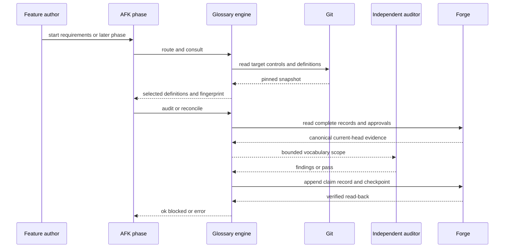

# Design Brief — AFK glossary lifecycle

> Parent ticket: P2P-2067
> Sources: [PRD](./PRD.md) · [SDD](./SDD.md) · [ADRs](./adr/)
> Status: Draft
> Last updated: 2026-10-27
> Audience: technical stakeholders and humans pre-reading the SDD

## §1 Problem

Teams define domain language, but delivery does not consistently consult or recheck it. Requirements can introduce terms without reaching an owner, while later agents can receive too many definitions or miss relevant ones. Reviews lack one reproducible contract for vocabulary findings and closure. Implementation can also change meaning after the initial requirements discussion.

## §2 Shape

AFK gains one synchronous local glossary engine that runs inside the active workflow phase. Skills call a versioned command facade, which reads target-branch glossary controls from Git, keeps temporary pre-Draft evidence outside the working tree, and reads or appends lifecycle records through provider-independent forge adapters. Consultation selects only relevant definitions through deterministic routes and bounded semantic fallback. Audit and reconciliation evaluate immutable snapshots, publish append-only evidence, and require current-head owner decisions before settlement. The main invariant is that every decision, proof record, and transition refers to the same definition hashes, fingerprints, and change head. No service, database, cache, or CI job is added.

Repositories opt in through a prerequisite adoption change. Removing the manifest later disables lifecycle behavior, but preserves definition history in Git and published evidence on the forge. This gives maintainers one explicit rollout and rollback switch without weakening the historical record.

## §3 At a Glance

> One validate-write-read-back flow keeps requirements, audit, reconciliation, Ready, and settlement on the same evidence.

## §4 Key Decisions

| # | Decision | Layer | Why this, not the alternative | ADR |
|---:|---|---|---|---|
| 1 | Split definition, temporary evidence, and publication ledgers | L3-L6 | A committed receipt archive adds maintenance, while a database adds an unjustified operating boundary. | `adr/design/0001-split-definition-and-publication-ledgers.md` |
| 2 | Give each adopted definition stable identity | L3, L5, L9 | Heading text changes, while a separate catalog duplicates state. | `adr/design/0002-stable-markdown-identity-and-adoption.md` |
| 3 | Separate ownership from delivery routing | L3, L9 | One mixed document blurs repository ownership and team delivery policy. | `adr/design/0003-separate-ownership-and-delivery-routing.md` |
| 4 | Reconcile before proof and gate at transition | L6, L9 | A start-only or end-only gate permits stale review or stale transition evidence. | `adr/design/0004-reconcile-before-proof.md` |
| 5 | Add generic forge approval and Draft verbs | L2, L7, L9 | Provider-specific glossary verbs would leak forge semantics into domain rules. | `adr/design/0005-generic-forge-approval-and-draft-verbs.md` |
| 6 | Use a strict solo-owner decision control | L4, L6, L9 | Ordinary choices and Markdown allow evidence shapes that cannot satisfy the human-only contract. | `adr/design/0006-strict-solo-owner-decision-control.md` |
| 7 | Isolate bounded semantic fallback behind one strategy | L5, L8, L9 | Loading every term wastes context, and the current scanner violates tracked-text and evidence requirements. | `adr/design/0007-ordered-selection-with-bounded-semantic-strategy.md` |
| 8 | Pin repository reads and write local evidence atomically | L3, L4, L7, L9 | Working-tree configuration can authorize itself, while committed evidence pollutes product history. | `adr/design/0008-pinned-repository-and-atomic-local-evidence.md` |

## §5 Stakeholder Impact

| Stakeholder | What changes | What they need to do |
|---|---|---|
| Feature authors | Relevant definitions appear before work; unresolved findings or stale evidence can park a phase. | Declare domain areas, resolve findings, and rerun proof after a head change. |
| Independent auditors | Audits use a bounded scope and stable finding contract. | Supply evidence, ownership, closure tests, and independent disposition. |
| Glossary owners | Final meaning is bound to current-head approval or the narrow solo-owner exception. | Approve, reject, delegate, or finalize before settlement. |
| Repository maintainers | Lifecycle enablement requires a separate adoption change. | Install compatible AFK, add stable IDs and ownership controls, then enable the manifest. |
| AFK maintainers | Workflow skills and forge adapters gain shared lifecycle contracts. | Keep registry, adapters, parsers, callers, and conformance tests in lockstep. |
| Operations and CI owners | No runtime component or pipeline job is added. | No action. |

## §6 Out of Scope & Risks

- **Out of scope** — CI enforcement, a network service, database or cache, runtime customer data in semantic search, committed receipt storage, unrelated legacy vocabulary cleanup, and proof of complete newest-suffix comment deletion.
- **Risk** — A manual merge can bypass AFK because CI stays unchanged; teams rely on the delivery workflow and its records.
- **Risk** — Surviving comments cannot prove deletion of the complete newest record suffix; edited records and detectable interior gaps still fail closed.
- **Risk** — GitLab and GitHub approval and Draft behavior, strict interactive choice, semantic selection, and deployment order remain shipment frontiers; mandatory conformance and end-to-end tests close them.

## §7 Where to Go Next

- **Curious about the user-facing problem?** → `PRD.md`
- **Reviewing the full design?** → `SDD.md` (§2 L1 through §9 L8, plus §14 L9)
- **Auditing a specific decision?** → `adr/requirements/NNNN-*.md` for behavior and scope, or `adr/design/NNNN-*.md` for solution decisions
- **Disagree with a decision?** → run `/afk:grill-solution` to draft a superseding ADR; do not edit the existing record in place.
