# SDD — AFK glossary lifecycle

> Parent PRD: `PRD.md`
> Status: Draft
> Last updated: 2026-10-27
> Reading guide: sections follow L1 through L9. Read §0 and §1 first.

## §0 Binding Contract

This SDD and its accepted ADRs bind implementing agents and reviewers.

| Aspect | Locked by SDD/ADR | Executor latitude |
|---|---:|---:|
| Pattern choice | Yes | No |
| Module public interface | Yes | No |
| API contract or schema | Yes | No |
| Persisted schema, relations, migration | Yes | No |
| Lifecycle states and transitions | Yes | No |
| Roles permitted and denied | Yes | No |
| Aggregate boundary | Yes | No |
| Transaction and idempotency strategy | Yes | No |
| External-seam contract | Yes | No |
| File or package layout inside a named module | No | Yes |
| Private helper extraction | No | Yes |
| Internal naming and control flow | No | Yes |
| Test fixture structure | No | Yes |

If an executor finds a binding decision wrong, infeasible, or inconsistent with evidence, the executor follows the plugin decision protocol. A reversible correction goes into the plan decision log. A one-way decision or a tie returns to the solution grill as a design conflict. The executor does not override the contract without a record.

### Human sign-off register

| Aspect | Section | Status | Signed by / date | Approved wording |
|---|---|---|---|---|
| HL-1 Persistence and entity design | §4 | signed | human / 2026-10-27 | "HL-1-R3 sign" |
| HL-2 API surface | §3 | n/a | human / 2026-10-20 | No controller, endpoint, or message contract is added. |
| HL-3 Authorization and data scoping | §5 | signed | human / 2026-10-26 | "HL-3 sign" |
| HL-4 Lifecycle and invariants | §6 and §7 | signed | human / 2026-10-27 | "HL-4-R3 sign" |
| HL-5 Irreversible and outward side effects | §7 | signed | human / 2026-10-26 | "HL-5 sign" |
| HL-6 Change to existing behaviour | §14 | signed | human / 2026-10-27 | "HL-6 sign" |

## §1 Context Summary

AFK needs one repository-independent mechanism that defines terms during requirements, supplies only relevant definitions to later agents, audits changed vocabulary, and reconciles definitions against delivered behavior. Git remains the definition ledger. Forge comments remain the delivery-history ledger. Team configuration stays with its owning team, and CI remains unchanged.

---

## §2 L1 — System Topology

The feature is a synchronous local module inside the installed AFK plugin. It runs inside the active AFK phase, reads repository and forge state, and adds no service, daemon, database, or CI job.

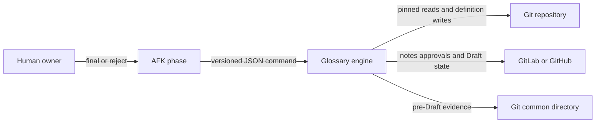

The diagram shows one local control path with three external stores and no new deployable unit.

## §3 L2 — Service Boundaries & Integration

One plugin-wide glossary engine owns lifecycle rules. AFK skills call its command facade directly. A provider-independent forge adapter translates canonical operations to GitLab, GitHub, or the no-forge implementation. Core-services supplies one pointer to team-owned configuration under `tools/payable`; the lifecycle mechanism remains plugin-owned.

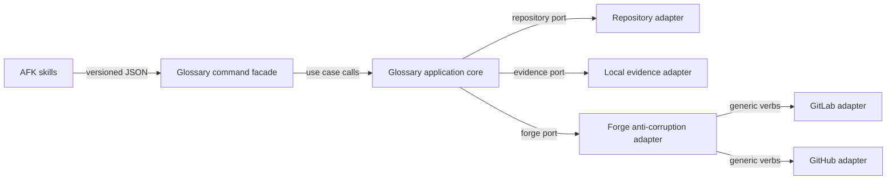

The facade is the only lifecycle entry point; provider details stay behind the forge port.

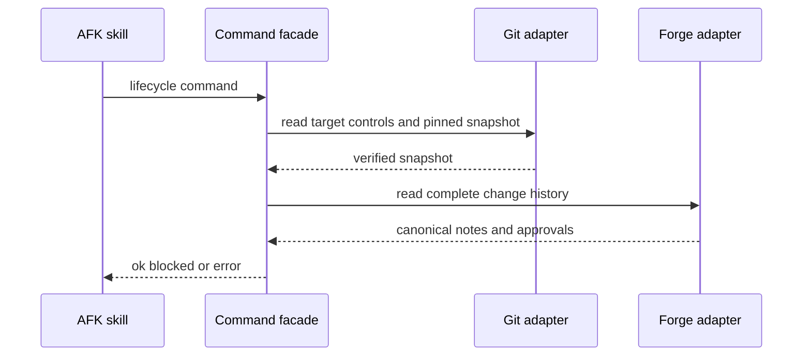

Every phase receives one typed result only after both authoritative inputs are checked.

No controller, network endpoint, or application message is added or changed. The internal facade contract is versioned JSON with commands for definition, consultation, audit, reconciliation, gate, and bootstrap. Results are `ok` with data, `blocked` with ordered blockers, or `error` with one typed error; process exit codes are 0, 2, and 3.

## §4 L3 — Data Architecture

| State | Datastore | Partitioning | Replication | Retention | Schema-evolution policy | PII? | Audited? |
|---|---|---|---|---|---|---:|---:|
| Glossary definitions | Git Markdown beside the owning service | Repository and glossary path | Git remote history | Repository lifetime | Required stable `ID`; optional `Replaces`; readers accept adopted grammar | No | Git history |
| Team routes and owner chains | Git manifest selected by AFK configuration | Repository | Git remote history | Repository lifetime | Optional manifest; compatible target-branch pointer activates lifecycle | Owner account identifiers may occur | Git history |
| Pre-Draft feature evidence | Git common directory | Repository identity, branch, and operation | None | Delete after first successful RE-08 publication; otherwise 30 days after proven inactivity | Versioned records with atomic replacement | Owner account identifiers may occur | Operation and digest fields |
| Published lifecycle history | Immutable forge comments | Change identifier and record namespace | Forge-managed | Change lifetime | Closed codec map; readers accept all emitted versions; writers emit current version | Actor identifiers | Forge edit evidence where available |
| Effective approvals and change state | Forge | Change identifier and head SHA | Forge-managed | Forge policy | Normalized at read time; never copied as authority | Actor identifiers | Provider evidence identifier |

### Definition record

| Field | Type | Null? | Default | Unit / precision | Constraint | Indexed / unique | Note |
|---|---|---:|---|---|---|---|---|
| ID | stable text identifier | No | None | Exact text | Repository-wide unique; immutable after adoption | Unique by validator | Stored on the metadata line |
| Canonical term | Markdown heading text | No | None | Unicode text | One canonical term per entry | No | Parenthetical aliases cannot replace it |
| Definition | Markdown prose | No | None | Unicode text | Non-empty | No | Git is authoritative |
| Replaces | stable text identifier list | Yes | Empty | Exact text | Every target resolves; no replacement cycle | No | Stored on the metadata line |
| Owner | repository owner reference | No | None | Exact text | Resolves through glossary ownership | No | Existing vocabulary metadata |
| Definition hash | digest | No | Derived | Canonical bytes | Recomputed from semantic definition fields | No | Never hand-authored |
| Owner state | provisional or final | No | Derived | Closed enum | Replay and current evidence determine state | No | Never hand-authored in the definition |

Identity is the stable `ID`. Definitions relate to prior definitions through `Replaces`; no database foreign key exists. Existing adopted glossaries receive IDs and parser-compatible metadata in a separate prerequisite change. Git makes the migration reversible by reverting that change, but lifecycle enablement must be removed before reverting stable IDs.

### Feature and publication records

| Record | Identity | Required relation | Retention and migration |
|---|---|---|---|
| RE-01 through RE-07 | Stable operation ID plus feature identity | Bind to applicable fingerprints and head SHA | Local before Draft; copied into first publication; codec version is explicit |
| RE-08 | Change ID, namespace, sequence, and operation ID | Binds audit or reconciliation to head SHA, glossary paths, terms, findings, and actors | Immutable forge comment; upgraded readers accept prior emitted versions |
| Claim | Change ID, namespace, operation ID, and claimed sequence | Precedes one publication attempt | Immutable; incomplete winning claim expires after 5 provider-clock minutes |
| Checkpoint | Change ID, namespace, and highest confirmed sequence | Follows verified publication | Immutable; reconstruction rejects detectable edit and interior gaps |

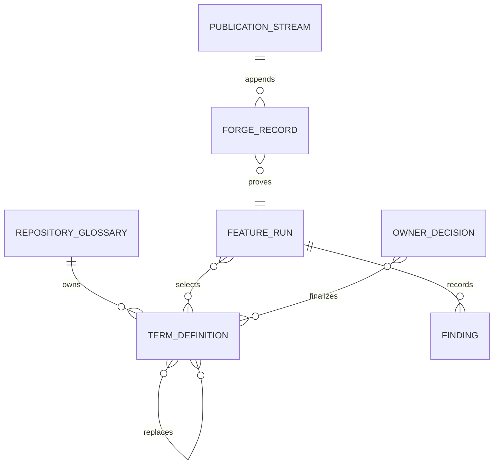

The data model separates definition truth, feature evidence, published history, and owner authority.

Surface reachability: no application entity, public API DTO, import template, export template, or agent tool schema in core-services changes. Glossary parsers, validators, and Lavish term readers all change together because they expose the adopted Markdown record.

## §5 L4 — Cross-Cutting & Quality Attributes

### Authorization and scope

| Surface | Permitted actors | Denied actors | Enforcement point |
|---|---|---|---|
| Propose or revise definition | Feature author; AFK agent | Read-only auditor | Command policy plus repository write boundary |
| Promote signal to finding | Independent auditor | Author of affected definition or contract | Audit-independence specification |
| Finalize single-service term | Non-author owner approval; sole author-owner through valid RE-07 | Unowned developer; AFK agent; author-owner without RE-07 | Owner-decision policy plus current-head forge evidence |
| Finalize cross-service term | Non-author approver from every owner chain; product-domain owner for deadlock | Change author acting alone; solo owner; AFK agent | Owner-chain policy plus current-head forge evidence |
| Approve temporary override | Glossary owner chain | Feature agent; non-owner | Override specification and expiry gate |
| Bootstrap or adopt | Non-author maintainer; sole maintainer through valid RE-07 | Non-maintainer; AFK agent | Target-branch ownership and prerequisite-change policy |
| Settle change | Settlement workflow with final owner evidence | Author without owner evidence | Final current-head glossary gate |

Repository data is scoped to configured tracked-text roots and the explicit feature vocabulary scope. Runtime customer and vendor data is never semantic-search input. Control configuration and owner evidence come from the recorded target-branch merge base; feature-branch controls cannot authorize their own feature.

### Idempotency and consistency

| Surface | Idempotency key | Deduplication window | Side-effect ledger |
|---|---|---|---|
| Local evidence write | Operation ID plus record key | Record lifetime | Stored digest and atomic current record |
| Forge claim | Namespace plus operation ID | Change lifetime | Immutable claim comments |
| Forge lifecycle record | Namespace plus operation ID plus sequence | Change lifetime | Claim, record, and checkpoint comments |
| Ready or Draft transition | Change ID plus desired state | Until verified read-back | Forge current state and operation result |

Local writes use a per-record advisory lock, sibling temporary file, flush, atomic replace, and digest revalidation. Forge writes reconcile by operation ID before retry and read back provider state before advancing.

| Call | Attempts | Backoff | Timeout |
|---|---:|---|---|
| Forge read | 3 maximum | Bounded exponential | Provider command default |
| Forge write after uncertain result | 1 initial write; retry only after operation-ID reconciliation proves absence | Same bounded read backoff | Provider command default |
| Target reference refresh | 1 verified refresh per gate | No blind retry | Git command default |

Rate limits, incomplete pagination, authentication failure, unknown identity, unverifiable target state, and unknown local-evidence activity park the phase. A valid RE-06 can permit intermediate work only; it cannot permit Ready or settlement.

### Observability

| Signal | Detects | Durable? |
|---|---|---:|
| Typed command result | Immediate success, policy blocker, or tool error | No |
| Concise command log | Operation ID, phase, and safe recovery condition | No |
| Immutable glossary comment | Audit, reconciliation, override, owner decision, and compensation history | Yes |
| Git history | Definition, route, owner, and manifest changes | Yes |

No telemetry service, durable log store, cache, or independent feature flag is added. Presence of a compatible target-branch manifest enables lifecycle behavior.

## §6 L5 — Domain Model

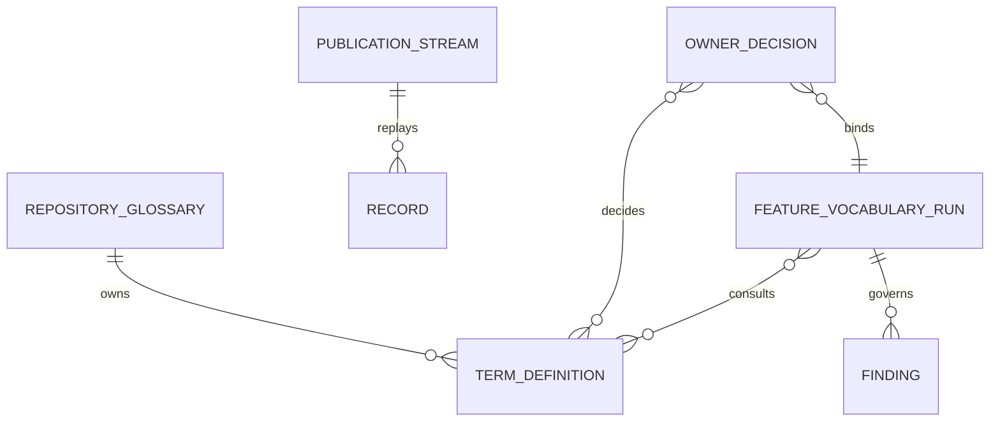

The four aggregate roots keep repository truth, per-feature evidence, publication ordering, and human authority independent.

| Invariant | Owner aggregate | Guardian |
|---|---|---|
| Term IDs are repository-wide unique | Repository glossary | Definition validator |
| Replacement links resolve and do not form a cycle | Repository glossary | Replacement specification |
| RE-03 changes only when its canonical inputs change | Feature vocabulary run | Consultation fingerprint projector |
| RE-04 binds RE-03, inventory, evidence, and audited head | Feature vocabulary run | Audit fingerprint projector |
| Confirmed findings remain open until a named resolution meets the closure test | Feature vocabulary run | Finding-closure specification |
| Override expires at the next gate, fingerprint change, or UTC expiry | Feature vocabulary run | Override-validity specification |
| Auditor independence is evaluated per affected definition or contract | Feature vocabulary run | Independence specification |
| Published records are append-only and replay in sequence | Publication stream | Closed codec and replay reducer |
| Edited records and detectable interior gaps invalidate the ledger | Publication stream | Ledger-validity specification |
| Effective approval binds to current head SHA and evidence ID | Owner decision | Approval specification |
| Cross-service finalization covers every affected owner chain | Owner decision | Owner-chain specification |

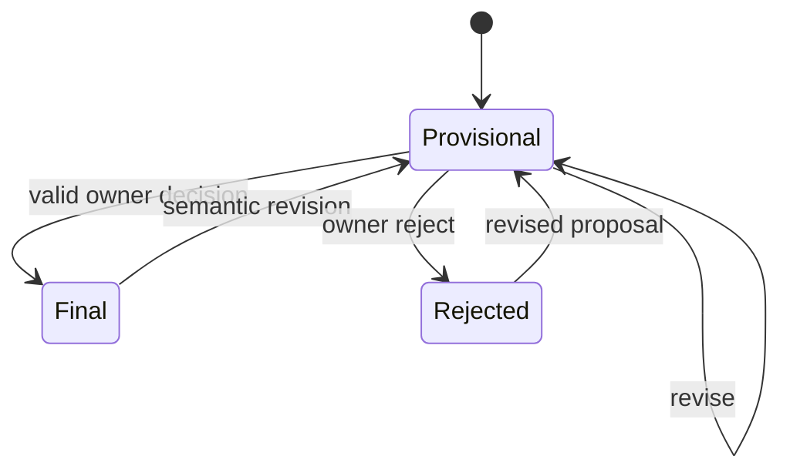

A semantic change reopens owner review; final state never survives a changed definition hash.

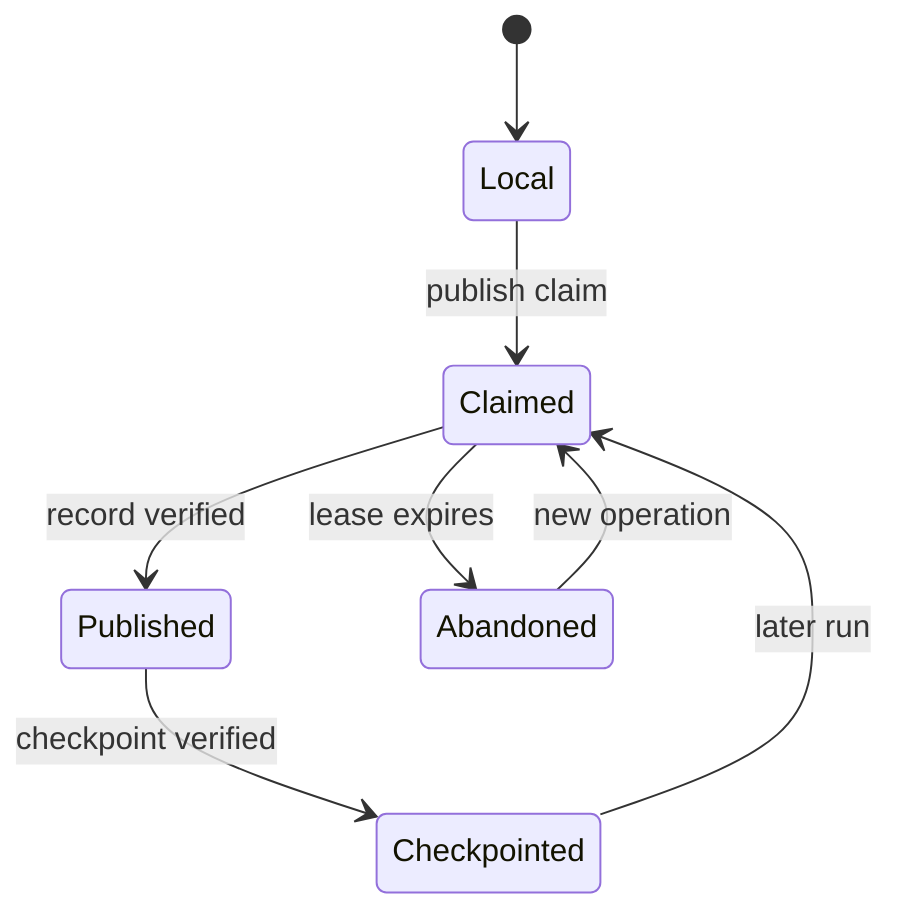

Publication advances only after read-back; recovery appends records instead of mutating history.

No application domain events are emitted. Synchronous phase commands return typed results, and the forge record stream is durable workflow history.

## §7 L6 — Process & Coordination

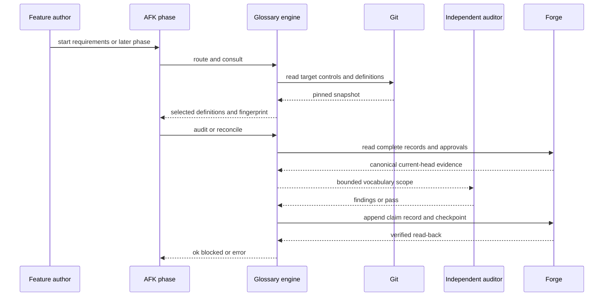

The same validate-write-read-back cycle serves requirements, audit, reconciliation, Ready, and settlement.

| Use case | Trigger | Transaction strategy | Read consistency | Concurrency control |
|---|---|---|---|---|
| Bootstrap or adopt | Repository lacks compatible lifecycle controls | Separate prerequisite change | Pinned target snapshot | Forge approval bound to bootstrap head |
| Consult | Requirements, design, or execution phase starts | Read-only command plus atomic local evidence write | Pinned Git snapshot | Per-record local lock |
| Audit | Applicable vocabulary surfaces changed | One idempotent publication step at a time | Pinned Git plus complete forge replay | Claim lease and operation ID |
| Reconcile | Implementation or glossary meaning changed | One idempotent publication step at a time | Current head plus complete forge replay | Claim lease and operation ID |
| Ready gate | Immediately before Ready transition | Read-only evaluation, then verified state transition | Final pushed head | Head revalidation and read-back |
| Settlement gate | Immediately before settlement | Read-only evaluation; Draft transition only after owner rejection | Final pushed head | Head revalidation and read-back |
| Evidence expiry | Evidence is older than 30 days | Local delete only after complete inactivity proof | Current session and worktree state | Fail closed on unknown activity |

| Failure point | Detection signal | Automatic recovery | Manual recovery | Owner |
|---|---|---|---|---|
| Target ref or merge base cannot be verified | Typed repository error | None | Restore verifiable target state; rerun | Feature author |
| Forge read is incomplete or rate-limited | Typed forge error after bounded reads | Park with retry condition | Restore access or wait for provider | Feature author |
| Forge write result is uncertain | Missing verified operation ID | Re-read and retry only if absence is proved | Append reconciliation or abandonment record | Glossary engine operator |
| Claim winner does not finish within 5 minutes | Provider-clock lease expiry | New operation can claim | Inspect prior operation and append compensation if needed | Glossary owner |
| Owner rejects | Valid reject decision | Return change to Draft | Perform impact analysis and reconcile again | Feature author and owner |
| Head changes after proof | Head mismatch | Invalidate proof | Rerun consultation, audit, and reconciliation | Feature author |
| Local evidence activity is unknown | Inactivity check error | Preserve evidence | Repair ownership evidence and rerun expiry | Repository maintainer |
| Published record is edited or has an interior gap | Replay blocker | None | Publish owner-confirmed superseding record when allowed | Glossary owner |

Outward side effects are limited to glossary file changes, immutable forge comments, verified Ready or Draft transitions, and safe local-evidence deletion. The mechanism never edits or deletes published history and never merges a change.

## §8 L7 — Module Decomposition

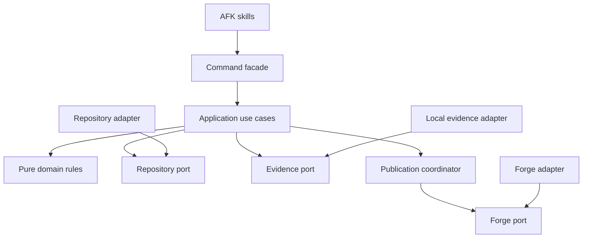

Dependencies point toward application and domain contracts. The command facade creates one command-scoped object graph; there is no service container or global singleton.

| Module | Purpose | Public interface | Depends on | Owner aggregate |
|---|---|---|---|---|
| Command facade | Parse versioned request and serialize typed result | `execute(request) -> result` | Application use cases and adapter factory | None |
| Application use cases | Coordinate definition, consult, audit, reconcile, gate, and bootstrap | One handler per command | Domain rules and injected ports | All four |
| Pure domain rules | Parse definitions, project fingerprints, evaluate specifications, replay state | Pure values and functions | None | All four |
| Repository access | Read pinned controls and definitions; write definitions | Repository port | Git implementation | Repository glossary |
| Local evidence | Atomically read, write, and expire pre-Draft evidence | Evidence port | Filesystem implementation | Feature vocabulary run |
| Publication coordination | Claim, append, verify, checkpoint, and compensate | Publication port | Forge port and codecs | Publication stream |
| Forge anti-corruption adapter | Normalize change, notes, approvals, actors, clocks, and state | Forge port | Generic forge verbs | Owner decision and publication stream |

## §9 L8 — Tactical Patterns

| Concern | Pattern | ADR |
|---|---|---|
| Definition and audit history | Split authoritative stores with append-only publication protocol | ADR-0001 |
| Stable Markdown identity and adoption | Explicit identity metadata plus prerequisite migration | ADR-0002 |
| Ownership and delivery routing | Two-authority manifest model | ADR-0003 |
| Proof freshness | Reconcile-before-proof gate | ADR-0004 |
| Provider differences | Anti-corruption adapter with generic forge verbs | ADR-0005 |
| Solo-owner decision | Strict interactive evidence control | ADR-0006 |
| Semantic fallback | Ordered selection pipeline with one Strategy port | ADR-0007 |
| Repository and local evidence | Pinned snapshot and atomic common-dir adapters | ADR-0008 |

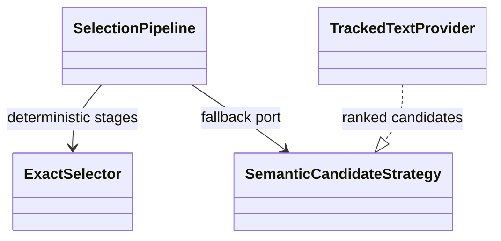

Only semantic candidate discovery varies; merge, deduplication, and limits remain deterministic.

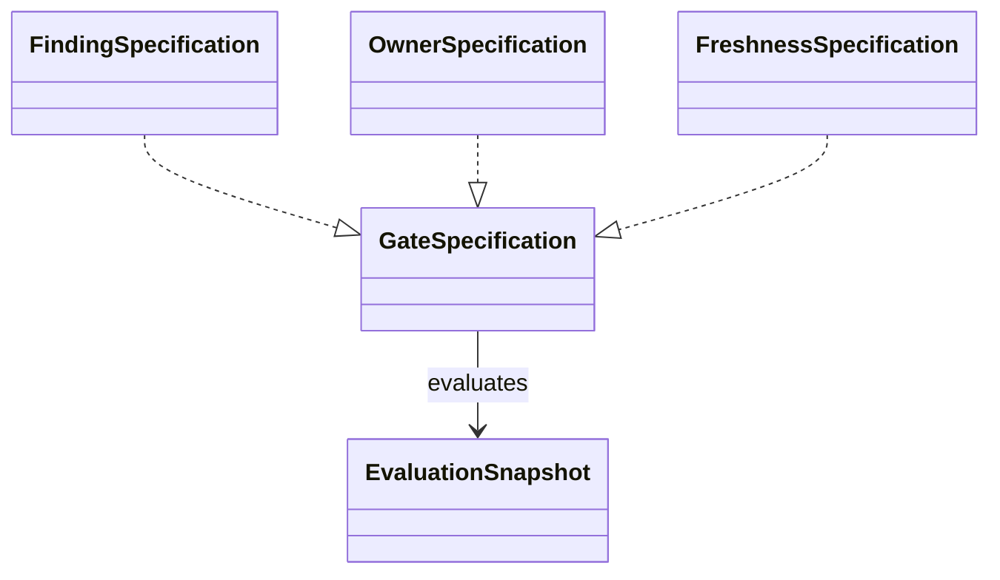

Named pure specifications return every typed blocker in stable order from one immutable snapshot.

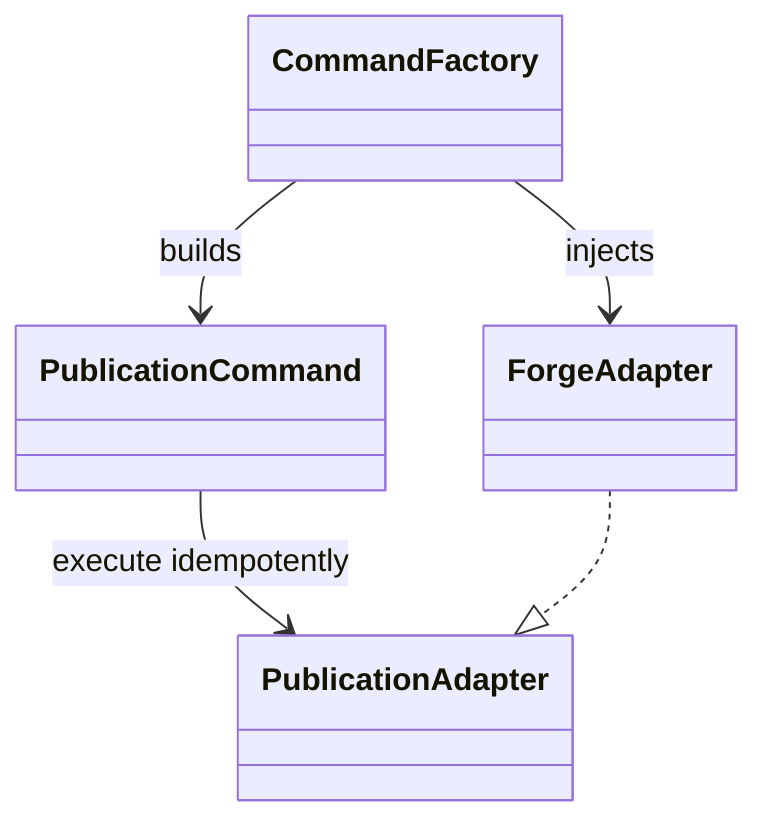

Immutable commands carry operation identity; the factory exists only at the composition root.

## §9b External Seams & Failure Affordance

No application framework version controls this mechanism. The external contracts are Git, the filesystem, the AFK forge family, and Lavish. Their real outputs are tested at the seam.

| Boundary | Contract source | What it does to the value | Failure surface | Seam-test |
|---|---|---|---|---|
| Git tracked-file and ref commands | Git command output | Supplies NUL-safe tracked paths, refreshed target commit, merge base, and pinned file bytes | Nonzero exit, missing ref, malformed output, or changed commit returns typed error | Pinned-ref linked-worktree integration test |
| Filesystem atomic replace and advisory lock | Host filesystem behavior | Makes one evidence record visible only after flush and replace | Lock conflict, replace failure, digest mismatch, or unknown activity parks without deletion | Windows and Unix atomic-evidence integration test |
| Forge note list and comment write | AFK forge adapter contract | Returns complete oldest-first notes and appends UTF-8 glossary records | Incomplete pagination, uncertain write, edit evidence gap, or malformed record blocks replay | GitLab and GitHub glossary-record conformance test |
| Forge approval read | Planned generic forge contract | Will return effective approvers bound to current head SHA and provider evidence IDs | Stale, dismissed, superseded, or unprovable approval blocks | GitLab and GitHub current-head approval test |
| Forge Ready and Draft operations | Existing Ready contract plus planned Draft extension | Will apply desired state idempotently and return verifiable state | Provider success without matching read-back is error | GitLab and GitHub Ready-Draft read-back test |
| Lavish strict choice | Lavish component schema and response runtime | Produces exactly `final` or `reject` with bound evidence and human session data | Write-in, note, agent answer, Markdown fallback, or driven rendering is invalid | Strict-choice render and live response test |
| Semantic candidate provider | Strategy port contract | Returns at most 20 ranked candidates and 3 tracked-text snippets per candidate | Provider error or bound violation is error, not empty success | Tracked-text ranking and bounds contract test |
| Glossary Markdown parser | Adopted definition grammar | Preserves canonical term, ID, replacement links, and vocabulary metadata | Duplicate ID, unresolved link, alias collision, or parser disagreement blocks adoption | Cross-parser golden-corpus test |

## §10 NFRs

| Concern | Target | Measurement | Owner |
|---|---|---|---|
| Semantic candidates per declared domain area | 20 maximum | Provider contract test | Glossary engine |
| Evidence snippets per candidate | 3 maximum | Provider contract test | Glossary engine |
| Forge read attempts | 3 maximum | Adapter fault-injection test | Forge adapter |
| Incomplete claim lease | 5 minutes on provider clock | Provider concurrency test | Publication coordinator |
| Abandoned local-evidence retention | 30 days minimum plus proven inactivity | Expiry fixture test | Local evidence adapter |
| Gate result ordering | 100 percent deterministic for identical snapshot | Property test | Domain rules |
| Published write verification | 100 percent read back before advance | Provider conformance test | Publication coordinator |
| CI configuration changes | 0 | Repository diff check | Feature team |
| New network services or databases | 0 | Architecture review | AFK maintainers |

## §11 Out of Scope

- CI jobs, required pipeline checks, or forge rules that stop a manual merge.
- Runtime customer or vendor data as semantic-search input.
- A committed rebuild directory, receipt store, or root mechanism-state directory.
- Rewriting unrelated legacy vocabulary gaps.
- Updating glossary content beyond terms affected by a feature.
- Adding a network service, database, cache, telemetry service, or application domain event.
- Proving deletion of the complete newest suffix of forge comments.

## §12 Reversed Decisions

| Prior ADR | Superseded by | Reason |
|---|---|---|
| None | None | No prior ticket-local design ADR exists. |

## §13 Open Questions

| Question | Layer (L1-L9) | Blocks executor? | Owner | Target resolve date |
|---|---|---:|---|---|
| note — AFK configuration: INV-012 stops at B14: live GitLab and GitHub approval and Draft behavior, semantic provider behavior, strict-choice prompting, and external deployment order require shipment tests | L9 | No | Implementers and verification owners | Before shipment |
| note — Requirements and glossary skills: INV-012 stops at B14: live GitLab and GitHub approval and Draft behavior, semantic provider behavior, strict-choice prompting, and external deployment order require shipment tests | L9 | No | Implementers and verification owners | Before shipment |
| note — Preflight: INV-012 stops at B14: live GitLab and GitHub approval and Draft behavior, semantic provider behavior, strict-choice prompting, and external deployment order require shipment tests | L9 | No | Implementers and verification owners | Before shipment |
| note — Settlement: INV-012 stops at B14: live GitLab and GitHub approval and Draft behavior, semantic provider behavior, strict-choice prompting, and external deployment order require shipment tests | L9 | No | Implementers and verification owners | Before shipment |
| note — Other glossary consumers: INV-012 stops at B14: live GitLab and GitHub approval and Draft behavior, semantic provider behavior, strict-choice prompting, and external deployment order require shipment tests | L9 | No | Implementers and verification owners | Before shipment |
| note — Forge registry: INV-012 stops at B14: live GitLab and GitHub approval and Draft behavior, semantic provider behavior, strict-choice prompting, and external deployment order require shipment tests | L9 | No | Implementers and verification owners | Before shipment |
| note — Approval read: INV-012 stops at B14: live GitLab and GitHub approval and Draft behavior, semantic provider behavior, strict-choice prompting, and external deployment order require shipment tests | L9 | No | Implementers and verification owners | Before shipment |
| note — Return to Draft: INV-012 stops at B14: live GitLab and GitHub approval and Draft behavior, semantic provider behavior, strict-choice prompting, and external deployment order require shipment tests | L9 | No | Implementers and verification owners | Before shipment |
| note — Comment transport: INV-012 stops at B14: live GitLab and GitHub approval and Draft behavior, semantic provider behavior, strict-choice prompting, and external deployment order require shipment tests | L9 | No | Implementers and verification owners | Before shipment |
| note — Append-only reconstruction: INV-012 stops at B14: live GitLab and GitHub approval and Draft behavior, semantic provider behavior, strict-choice prompting, and external deployment order require shipment tests | L9 | No | Implementers and verification owners | Before shipment |
| note — Glossary Markdown: INV-012 stops at B14: live GitLab and GitHub approval and Draft behavior, semantic provider behavior, strict-choice prompting, and external deployment order require shipment tests | L9 | No | Implementers and verification owners | Before shipment |
| note — Routing: INV-012 stops at B14: live GitLab and GitHub approval and Draft behavior, semantic provider behavior, strict-choice prompting, and external deployment order require shipment tests | L9 | No | Implementers and verification owners | Before shipment |
| note — Git and local evidence: INV-012 stops at B14: live GitLab and GitHub approval and Draft behavior, semantic provider behavior, strict-choice prompting, and external deployment order require shipment tests | L9 | No | Implementers and verification owners | Before shipment |
| note — Semantic provider: INV-012 stops at B14: live GitLab and GitHub approval and Draft behavior, semantic provider behavior, strict-choice prompting, and external deployment order require shipment tests | L9 | No | Implementers and verification owners | Before shipment |
| note — RE-07 prompt: INV-012 stops at B14: live GitLab and GitHub approval and Draft behavior, semantic provider behavior, strict-choice prompting, and external deployment order require shipment tests | L9 | No | Implementers and verification owners | Before shipment |
| note — Bootstrap and adoption: INV-012 stops at B14: live GitLab and GitHub approval and Draft behavior, semantic provider behavior, strict-choice prompting, and external deployment order require shipment tests | L9 | No | Implementers and verification owners | Before shipment |
| note — Packaging: INV-012 stops at B14: live GitLab and GitHub approval and Draft behavior, semantic provider behavior, strict-choice prompting, and external deployment order require shipment tests | L9 | No | Implementers and verification owners | Before shipment |

## §14 L9 — Implementation Seams & Change Impact

| Seam | Existing contract (investigation) | Planned change | Impacted flows (investigation) | Conventions / landmines | Verdict |
|---|---|---|---|---|---|
| AFK configuration | Schema-1 layered configuration has one strict reader (INV-012). | Add optional manifest pointer and committed-at-ref reads. | Config docs, views, setup, and focused tests (INV-012). | Effective feature-branch configuration cannot authorize itself; older AFK rejects unknown keys. | reworked |
| Requirements and glossary skills | Requirements writes verified terms immediately and caller owns commits (INV-012). | Call the facade while preserving verification and commit ownership. | Requirements, to-PRD, lessons, and execute (INV-012). | Consultation follows the glossary commit; engine never commits or pushes. | reworked |
| Preflight | Persisted green steps can resume to direct Ready transition (INV-012). | Reconcile before proof and gate immediately before Ready. | Manual preflight, autopilot, plan, and mission control (INV-012). | Head changes invalidate proof; glossary parking is not a mechanical retry. | extends (ADR-0004) |
| Settlement | Review closure owns settlement and does not change Draft state (INV-012). | Add final glossary gate and named owner-rejection return to Draft. | Settlement, alias, review re-entry, and manual settlement (INV-012). | Gate the final pushed head and preserve review closure. | reworked |
| Other glossary consumers | Consumers discover root, nearest, or direct glossary paths independently (INV-012). | Route lifecycle consumers through facade; plain reads use selected paths. | Design through settlement (INV-012). | Partial migration creates bypasses and divergent vocabulary scope. | reworked |
| Forge registry | Forge kinds declare verbs independently (INV-012). | Add generic approval-read and return-to-Draft verbs with parity tests. | Every forge-family caller (INV-012). | Manifests, contracts, scripts, tests, and conformance records move together. | extends (ADR-0005) |
| Approval read | No approval-evidence verb exists (INV-012). | Return effective approvals bound to current head SHA and evidence ID. | Finalization, owner validation, preflight, settlement, and bootstrap (INV-012). | Stale, dismissed, superseded, or unprovable approvals fail closed. | reworked |
| Return to Draft | Ready has no inverse (INV-012). | Add idempotent return-to-Draft with read-back. | Owner rejection and safety recovery (INV-012). | Already Draft succeeds; provider exit alone is insufficient. | extends (ADR-0005) |
| Comment transport | Notes are complete oldest-first text; comments append plain text (INV-012). | Add separate glossary namespace and operation-ID reconciliation. | Glossary publication (INV-012). | Use safe Windows JSON transport and preserve UTF-8. | fits |
| Append-only reconstruction | Replay detects edits and interior gaps but can accept an older prefix (INV-012). | Add strict glossary codec and reducer with the accepted proof limit. | RE-06 through RE-08 (INV-012). | Comment history cannot prove deletion of its complete newest suffix. | reworked |
| Glossary Markdown | Grammar lacks stable identity and parsers diverge (INV-012). | Add `ID` and optional `Replaces`; migrate parsers together. | Glossary, requirements, Lavish tooltips, and validation (INV-012). | Strip metadata consistently and fix parenthetical alias collision. | reworked |
| Routing | Glossary map owns glossary ownership (INV-012). | Manifest owns changed-path and domain-area routes plus owner chains. | LC-01, LC-02, bootstrap, glossary, and requirements (INV-012). | Every manifest target must resolve through map ownership. | extends (ADR-0003) |
| Git and local evidence | Common-dir and worktree helpers exist without complete adapters (INV-012). | Add pinned-ref reads and atomic common-dir evidence. | Every lifecycle command and linked worktree (INV-012). | Handle NUL paths, linked worktrees, unknown activity, and absolute common-dir paths. | extends (ADR-0008) |
| Semantic provider | Existing scanner includes untracked files and returns paths (INV-012). | Add tracked-text-only ranked candidates within accepted bounds. | LC-02, LC-03, RE-03, and RE-04 (INV-012). | Provider failure is error, not empty success. | extends (ADR-0007) |
| RE-07 prompt | Existing controls permit wrong tokens or free text (INV-012). | Add strict `final` or `reject` control without notes. | Lavish schema, renderer, runtime, tests, and owner decision (INV-012). | Markdown fallback is invalid and driven mode parks. | extends (ADR-0006) |
| Bootstrap and adoption | Glossary files can be created lazily during normal work (INV-012). | Require separate bootstrap and explicit legacy migration. | Glossary, requirements, LC-01, approvals, and setup (INV-012). | Feature-branch controls cannot authorize their own adoption. | reworked |
| Packaging | Caller skills already exist in both manifests (INV-012). | Add shared scripts and update existing skill prose. | Native plugin tree and changelog (INV-012). | No new skill or manifest entry. | fits |

Accepted compatibility finding: forge comment history cannot prove deletion of the complete newest record suffix because the remaining history is also a valid older prefix. The team accepts this limitation to keep audit history in the merge request. Detectable edits and interior gaps still fail closed. Closing the remaining proof gap would require provider audit-event storage outside the selected comment-ledger design.
