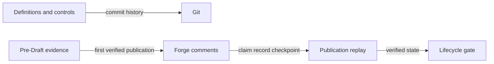

# ADR-0001 — Split definition and publication ledgers

> Status: Accepted
> Date: 2026-10-27
> Layer: L3, L4, L6
> Context ticket: P2P-2067

## Context

Definitions need reviewable source history, while audit and reconciliation evidence belongs to the change that produced it. The system must not add a committed receipt archive, database, or mutable merge-request summary. See SDD §4 and §7.

## Decision

Git is authoritative for definitions and configuration. The Git common directory holds temporary pre-Draft evidence. Immutable forge comments under the glossary namespace hold published lifecycle history. Publication uses claim, record, and checkpoint comments with operation IDs, read-back verification, and a five-minute claim lease. Reconstruction rejects edits and detectable interior gaps. It accepts that a forge cannot prove deletion of the complete newest suffix.

The chosen shape keeps each record in the ledger that owns its meaning.

## Alternatives Considered

| Alternative | Pros | Cons | Reason rejected |
|---|---|---|---|
| Commit generated receipts | Offline and fully Git-visible | Creates maintained mechanism state and noisy diffs | Conflicts with the repository-content decision |
| Store everything in forge comments | One delivery ledger | Definitions become hard to edit and reuse | Git is the better definition ledger |
| Use a database or provider audit-event store | Can prove newest-suffix deletion | Adds service, retention, access, and operating scope | Proof benefit does not justify the new system boundary |
| Split Git, local evidence, and forge comments | Clear ownership and no new service | Has a stated forge proof limit | Chosen |

## Consequences

- **Positive** — Definition history is automatic in Git; delivery evidence stays with the change; no receipt archive is maintained.
- **Negative** — Complete newest-suffix deletion is not detectable from surviving comments.
- **Follow-ups** — Live GitLab and GitHub publication and concurrency tests must pass before shipment.
