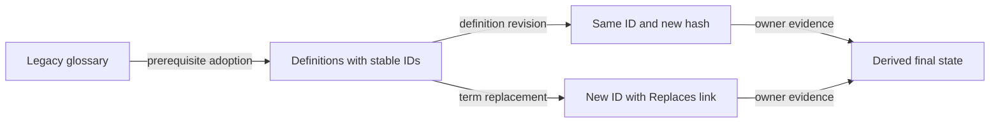

# ADR-0002 — Stable Markdown identity and prerequisite adoption

> Status: Accepted
> Date: 2026-10-27
> Layer: L3, L5, L9
> Context ticket: P2P-2067

## Context

Lifecycle evidence must bind to a term even when its title or definition changes. Existing glossaries have no stable identity field, and their parsers do not share one complete metadata grammar. Partial legacy state cannot authorize itself. See SDD §4, §6, and §14.

## Decision

Every adopted definition carries a repository-wide unique `ID` and optional `Replaces` links on its metadata line. Hash and owner state remain derived. Every parser migrates together, including removal of the canonical-term collision caused by parenthetical aliases. A separate prerequisite adoption change cleans obsolete headers, assigns IDs, adds owner declarations and the manifest, and validates existing content before lifecycle enablement.

Identity survives wording changes, while semantic state still follows the current hash.

## Alternatives Considered

| Alternative | Pros | Cons | Reason rejected |
|---|---|---|---|
| Use heading text as identity | No format change | Rename breaks evidence and links | Identity is not stable |
| Put identity in a separate catalog | Keeps Markdown visually simple | Creates duplicate state and synchronization work | Conflicts with definition-local ownership |
| Add IDs during the first governed feature | Fewer changes | Feature controls authorize their own adoption | Unsafe bootstrap order |
| Metadata IDs plus prerequisite adoption | Stable and reviewable | Requires one migration change | Chosen |

## Consequences

- **Positive** — Records can bind to durable term identity and replacements are explicit.
- **Negative** — Every glossary parser and adopted definition must migrate together.
- **Follow-ups** — Repositories with partial legacy glossaries need an adoption change before feature lifecycle gates run.
