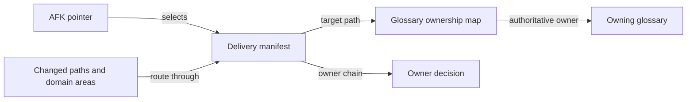

# ADR-0003 — Separate ownership and delivery routing

> Status: Accepted
> Date: 2026-10-27
> Layer: L3, L9
> Context ticket: P2P-2067

## Context

Glossary ownership already has a repository-wide map. The new lifecycle also needs changed-path routes, declared domain-area routes, owner chains, roots, and search exclusions. Giving both documents the same authority would create conflicting ownership. See SDD §4 and §14.

## Decision

The glossary map remains authoritative for which glossary owns a domain. The optional manifest owns delivery routes and owner chains. Every manifest target must resolve through the map. AFK configuration holds only the pointer to the team manifest, and gates read that pointer and manifest from the committed target-branch merge base.

Routing can evolve without redefining glossary ownership.

## Alternatives Considered

| Alternative | Pros | Cons | Reason rejected |
|---|---|---|---|
| Put all routes in the ownership map | One document | Mixes repository topology with team delivery policy | Blurs authority and team ownership |
| Let each team manifest declare ownership | Team autonomy | Conflicting ownership across teams | No repository-wide source of truth |
| Separate authorities with cross-validation | Clear responsibilities | Requires validation across two documents | Chosen |

## Consequences

- **Positive** — Ownership remains stable and repository-wide; delivery configuration remains team-owned.
- **Negative** — Manifest validation must resolve every target through the map.
- **Follow-ups** — Adoption must install a compatible plugin before the target branch adds the pointer.
