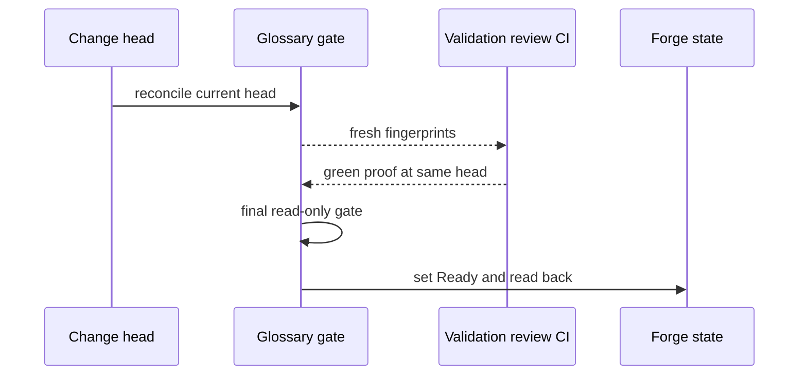

# ADR-0004 — Reconcile before proof and gate at transition

> Status: Accepted
> Audited: 2026-10-27
> Date: 2026-10-27
> Layer: L6, L9
> Context ticket: P2P-2067

## Context

Existing preflight can resume green steps and move a change to Ready. A later glossary or implementation edit can make earlier proof stale. Settlement must evaluate the final pushed head. See SDD §7 and §14.

## Decision

Preflight reconciles glossary state before validation, review, and CI. Any head change invalidates those proof rows. A read-only glossary gate runs immediately before the Ready transition. Settlement gates the final pushed remote head. Only a valid owner rejection can return the change to Draft, after which impact analysis and another reconciliation are required.

Proof and transition always refer to the same head.

## Alternatives Considered

| Alternative | Pros | Cons | Reason rejected |
|---|---|---|---|
| Gate only at the start | Low workflow cost | Later edits make proof stale | Unsafe |
| Gate only immediately before Ready | Protects transition | Review and CI may use wrong vocabulary | Too late |
| Reconcile before proof and gate at transition | Fresh inputs and final protection | Head changes require rerun | Chosen |

## Consequences

- **Positive** — Ready and settlement evidence matches the head it authorizes.
- **Negative** — Any head change can invalidate completed proof and add rerun cost.
- **Follow-ups** — Mission control and plan readers must display invalidated proof without treating glossary parking as a mechanical retry.
