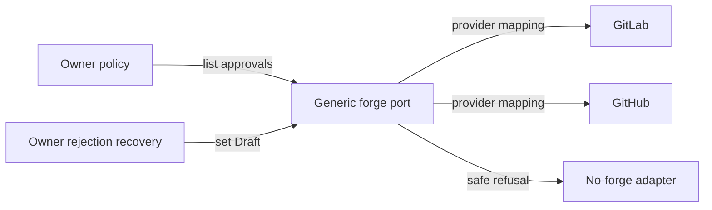

# ADR-0005 — Generic forge approval and Draft verbs

> Status: Accepted
> Audited: 2026-10-26
> Date: 2026-10-27
> Layer: L2, L7, L9
> Context ticket: P2P-2067

## Context

The glossary lifecycle needs current-head approval evidence and an idempotent return to Draft. The forge family has neither operation, and provider-specific glossary verbs would leak GitLab and GitHub semantics into domain rules. See SDD §3, §8, and §14.

## Decision

The forge family adds provider-neutral approval-read and return-to-Draft verbs in registry lockstep for GitLab, GitHub, and no-forge adapters. Approval results bind every effective approval to the current head SHA and a provider evidence ID. Draft transition is idempotent and requires read-back. Existing forge verbs remain unchanged.

Domain rules consume one canonical evidence shape across providers.

## Alternatives Considered

| Alternative | Pros | Cons | Reason rejected |
|---|---|---|---|
| Glossary-specific provider scripts | Fast initial change | Duplicates forge behavior and leaks provider semantics | Poor boundary |
| Infer approval from comments | Uses existing verbs | Cannot prove effective current-head approval | Insufficient evidence |
| Add generic verbs in lockstep | Reusable and testable | Requires provider work and parity tests | Chosen |

## Consequences

- **Positive** — Glossary rules remain provider-independent and other workflows can reuse the verbs.
- **Negative** — Live provider behavior is a shipment frontier until both adapters pass conformance tests.
- **Follow-ups** — Update registry, manifests, contracts, adapters, tests, and provider conformance records together.
