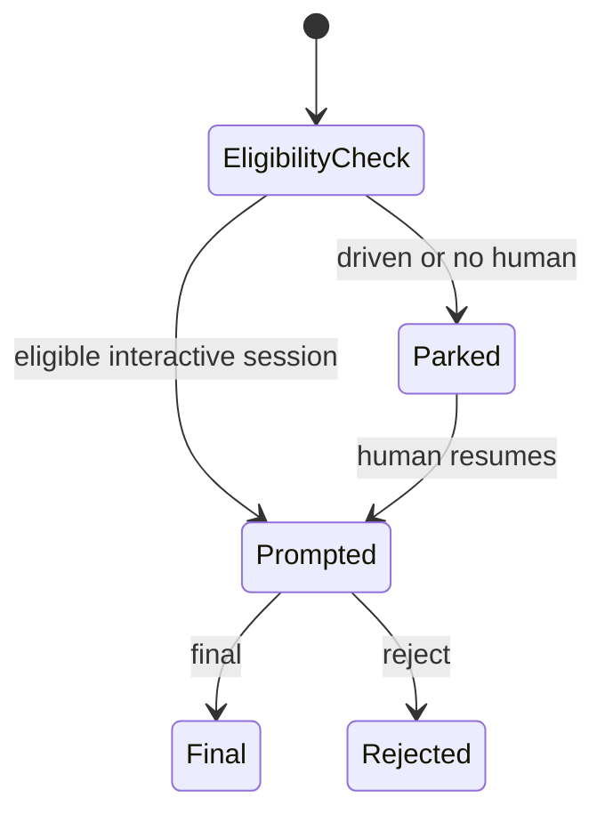

# ADR-0006 — Strict solo-owner decision control

> Status: Accepted
> Audited: 2026-10-27
> Date: 2026-10-27
> Layer: L4, L6, L9
> Context ticket: P2P-2067

## Context

A sole author-owner needs a narrow single-service exception. Existing Lavish controls allow notes or write-ins, Markdown fallback cannot prove an interactive human response, and driven work must not invent the answer. See SDD §5, §7, and §14.

## Decision

RE-07 uses a dedicated Lavish control that displays term IDs, hashes, fingerprints, and head SHA and accepts exactly `final` or `reject`. It has no note or write-in. It never falls back to Markdown. Driven or hands-off work parks before rendering until a human responds. The published record states that the forge cannot prove who typed the answer because the agent publishes with the developer credential.

There is no transition from an agent-supplied or free-text answer.

## Alternatives Considered

| Alternative | Pros | Cons | Reason rejected |
|---|---|---|---|
| Require another owner in every case | Strong separation | Blocks repositories with one owner | Does not meet the accepted exception |
| Reuse normal choice or Markdown prompt | Less component work | Allows invalid evidence shapes and automation | Violates the human-only contract |
| Dedicated strict interactive control | Exact evidence and safe parking | Adds component and live tests | Chosen |

## Consequences

- **Positive** — The exception is narrow, explicit, and bound to exact evidence.
- **Negative** — Work can remain parked without a timeout; identity still depends on the harness and developer account.
- **Follow-ups** — Add schema, renderer, runtime, and live-response tests for both accepted tokens and every rejected input class.
