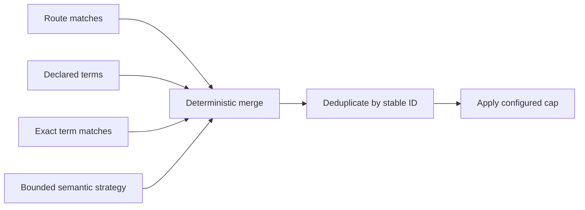

# ADR-0007 — Ordered selection with bounded semantic strategy

> Status: Accepted
> Date: 2026-10-27
> Layer: L5, L8, L9
> Context ticket: P2P-2067

## Context

Agents need relevant definitions without loading every term. Exact routes and declared terms are deterministic, while semantic fallback can vary. The existing scanner includes untracked files and returns paths instead of ranked snippets. See SDD §6, §9, and §14.

## Decision

Selection is a fixed ordered pipeline: route resolution, declared and exact matches, bounded semantic candidates, then deterministic merge, deduplication, and cap. Only semantic candidate discovery is a Strategy port. Its new provider reads tracked text within configured roots and feature scope, records exclusions and truncation, returns at most 20 candidates per domain area and 3 snippets per candidate, and reports provider failure as an error.

Variable discovery is bounded before it enters deterministic selection.

## Alternatives Considered

| Alternative | Pros | Cons | Reason rejected |
|---|---|---|---|
| Load every routed glossary | Complete by construction | Wastes context and obscures relevant terms | Violates scoped consultation |
| Reuse existing bounded scanner | Existing code | Includes untracked files and lacks ranked snippets | Contract mismatch |
| Make every selector pluggable | Flexible | Adds unnecessary variation and test surface | Deterministic stages should stay fixed |
| One bounded semantic Strategy | Isolates uncertainty | Requires a new provider | Chosen |

## Consequences

- **Positive** — Context stays focused and deterministic matches are never truncated.
- **Negative** — Semantic behavior needs provider contract tests and can park the phase on failure.
- **Follow-ups** — Prove tracked-only input, ranking stability, exclusions, candidate limits, snippet limits, and truncation evidence.
