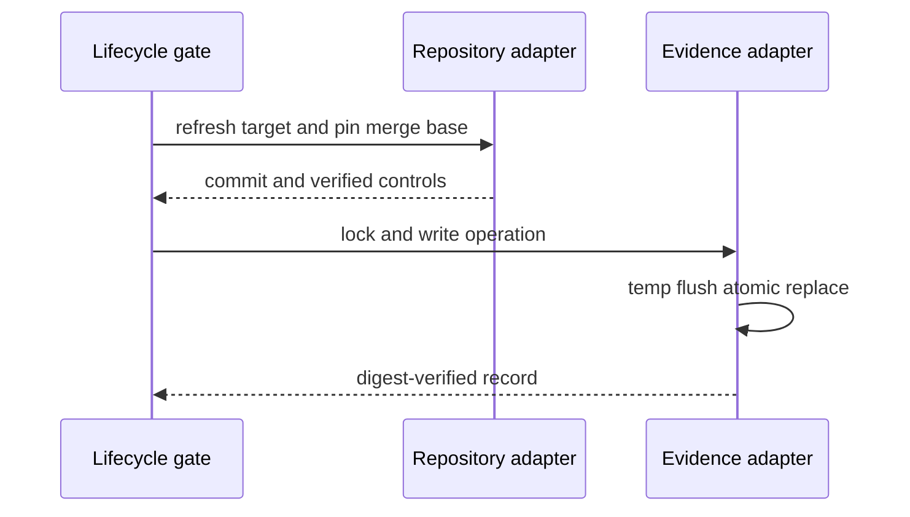

# ADR-0008 — Pinned repository reads and atomic local evidence

> Status: Accepted
> Date: 2026-10-27
> Layer: L3, L4, L7, L9
> Context ticket: P2P-2067

## Context

Lifecycle gates must not let feature-branch controls authorize the same feature. Linked worktrees share a Git common directory, and pre-Draft evidence must survive a working-tree reset without becoming committed state. See SDD §4, §5, §8, and §14.

## Decision

Repository access refreshes and records the target ref, computes the merge base, and reads controls and glossary state from that pinned commit. It handles linked worktrees and NUL-safe paths. Local evidence lives under the absolute Git common directory and uses advisory locking, sibling temporary writes, flush, atomic replace, stable operation IDs, and digest revalidation. Expiry deletes only after 30 days and complete proof that no active session or AFK-owned worktree uses the branch; unknown activity preserves the record.

Authority is pinned before evidence is written, and incomplete local writes never become current.

## Alternatives Considered

| Alternative | Pros | Cons | Reason rejected |
|---|---|---|---|
| Read effective working-tree configuration | Simple | Feature can authorize itself and worktrees can diverge | Unsafe authority |
| Commit pre-Draft evidence | Easy history | Adds maintained mechanism state to product changes | Conflicts with storage requirements |
| Use a user-global cache | Outside repository | Weak repository identity and cleanup ownership | Wrong scope |
| Pinned Git plus common-dir evidence | Correct authority and worktree sharing | Requires careful platform behavior | Chosen |

## Consequences

- **Positive** — Gates use stable target controls and linked worktrees share one safe evidence store.
- **Negative** — Unverifiable refs or activity fail closed and can park work.
- **Follow-ups** — Test linked worktrees, absolute common-dir resolution, NUL paths, Windows and Unix atomic replace, lock contention, and expiry safety.
