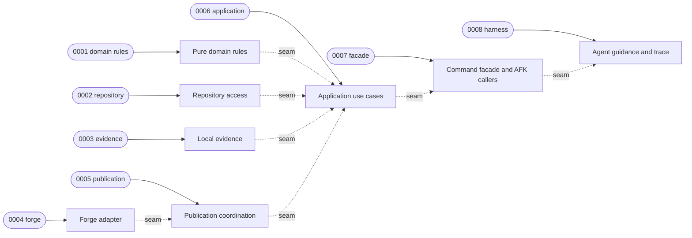

# Execution Plan — AFK glossary lifecycle

> Parent ticket: P2P-2067   Mode: cited
> Sources: [PRD](../PRD.md) · [SDD](../SDD.md) · [ADRs](../adr/)
> Execution repository: `midnightblur/afk-driver` (the core-services branch holds the product record only)
> Branch (for /afk:execute): feat/p2p-2067-glossary-lifecycle
> Last updated: 2026-10-27 (status column maintained by /afk:execute)
> Feature: in-progress
> Review policy: lean

## Execution handoff

Before `0001`, create the AFK-plugin linked worktree and copy this ticket folder to `docs/afk/P2P-2067` on the plugin branch. That plugin copy becomes the sole live execution ledger: `/afk:execute` updates its tracker, journal, reviews, and trace, and every implementation commit belongs to the plugin change. This core-services copy then freezes as the product-record snapshot and later receives only the plugin change link; no execution step writes both repositories.

## Solution map

## Seam register

| § | Seam (SDD §14 row) | Implemented by | Used by |
|---|---|---|---|
| 1 | AFK configuration | 0002-repository-access | 0006-application-use-cases, 0007-command-facade |
| 2 | Requirements and glossary skills | 0007-command-facade | 0008-sync-harness |
| 3 | Preflight | 0007-command-facade | 0008-sync-harness |
| 4 | Settlement | 0007-command-facade | 0008-sync-harness |
| 5 | Other glossary consumers | 0007-command-facade | 0008-sync-harness |
| 6 | Forge registry | 0004-forge-anti-corruption-adapter | 0005-publication-coordination, 0007-command-facade |
| 7 | Approval read | 0004-forge-anti-corruption-adapter | 0006-application-use-cases |
| 8 | Return to Draft | 0004-forge-anti-corruption-adapter | 0006-application-use-cases, 0007-command-facade |
| 9 | Comment transport | 0005-publication-coordination | 0006-application-use-cases |
| 10 | Append-only reconstruction | 0001-pure-domain-rules | 0005-publication-coordination, 0006-application-use-cases |
| 11 | Glossary Markdown | 0001-pure-domain-rules | 0002-repository-access, 0006-application-use-cases |
| 12 | Routing | 0001-pure-domain-rules | 0002-repository-access, 0006-application-use-cases |
| 13 | Git and local evidence | 0003-local-evidence | 0002-repository-access, 0006-application-use-cases |
| 14 | Semantic provider | 0002-repository-access | 0006-application-use-cases |
| 15 | RE-07 prompt | 0007-command-facade | 0006-application-use-cases |
| 16 | Bootstrap and adoption | 0006-application-use-cases | 0007-command-facade |
| 17 | Packaging | 0007-command-facade | 0008-sync-harness |

## Progress tracker

| # | Subtask | Title | Status | Blocked by | Tiers | Seams |
|---|---|---|---|---|---|---|
| 1 | 0001-pure-domain-rules | Pure values, parsing, fingerprints, gates, and replay | done | — | static, unit | impl §10–12 |
| 2 | 0002-repository-access | Pinned repository controls and bounded selection | done | 0001-pure-domain-rules | static, unit, integration | impl §1, §14; use §11–13 |
| 3 | 0003-local-evidence | Atomic common-directory evidence | pending | 0002-repository-access | static, unit, integration | impl §13 |
| 4 | 0004-forge-anti-corruption-adapter | Generic forge approval and state operations | pending | — | static, unit, integration | impl §6–8 |
| 5 | 0005-publication-coordination | Append, replay, verification, and compensation | pending | 0001-pure-domain-rules, 0004-forge-anti-corruption-adapter | static, unit, integration | impl §9; use §6, §10 |
| 6 | 0006-application-use-cases | Lifecycle command handlers and bootstrap | pending | 0001-pure-domain-rules, 0002-repository-access, 0003-local-evidence, 0005-publication-coordination | static, unit, integration | impl §16; use §1, §7–15 |
| 7 | 0007-command-facade | Versioned facade and AFK workflow integration | pending | 0002-repository-access, 0004-forge-anti-corruption-adapter, 0006-application-use-cases | static, unit, integration | impl §2–5, §15, §17; use §1, §6, §8, §16 |
| 8 | 0008-sync-harness | Agent guidance, staple decision, and trace matrix | pending | 0001-pure-domain-rules, 0002-repository-access, 0003-local-evidence, 0004-forge-anti-corruption-adapter, 0005-publication-coordination, 0006-application-use-cases, 0007-command-facade | static | use §2–5, §17 |

Status values: `pending` → `designing` → `developing` → `verifying` → `reviewing` → `done`, or `blocked(<reason>)`.

## Feature smoke gate (minimal)

The implementation runs in `midnightblur/afk-driver`, whose repository configuration declares no build-gate tiers. The shipment gate therefore uses the plugin's own deterministic test and source gates rather than core-services Maven or CI.

| # | Check | Command | Status |
|---|---|---|---|
| 1 | plugin regression | `afk-python -m pytest scripts/tests` | |
| 2 | plugin source gates | `bash hooks/plugin-source-gates.sh` | |

Last run: —
