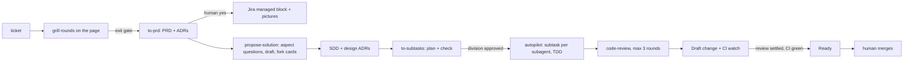
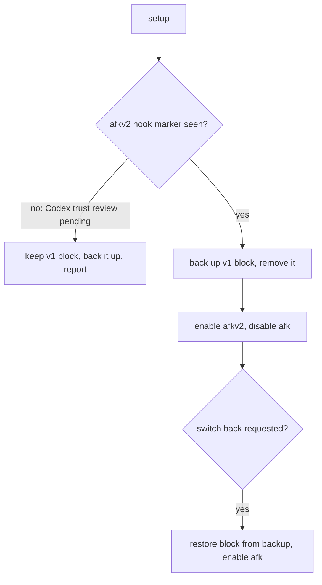

# PRD — afkv2 (AFK 2.0 beta)

Ticket: GitHub issue #153. Source of record: `GRILL-LOG.md` (settled rows, owner notes verbatim) and decisions 1-98 in issue #153. Terms: `afkv2/GLOSSARY.md`.

## Problem Statement

The v1 plugin is too heavy to drive a feature. About 75-85% of merged v1 pull requests repair the plugin's own machinery (issue #153).

- The guard and the commit gates block normal work. Work stops on plugin friction, not on the feature.
- Grill and design rounds cost one hand-built page per round. A slip in the HTML breaks the page in front of the human.
- Rules reach a session through blocks written into the user instruction files. Setup must write them, and cleanup must remove them.
- The human cannot audit a past discussion: the page is thrown away, and the grill log keeps only the outcome.
- No check proves that an instruction file (core behaviors, a repository's AGENTS.md) changes what an agent does.

## Solution

A new plugin, `afkv2` (the AFK 2.0 beta), installed beside v1. One developer takes one ticket through the medium-lane chain (the size class the beta ships) to a Draft change request, on Claude Code and on Codex:

`/afkv2:grill` → `/afkv2:to-prd` → `/afkv2:propose-solution` → `/afkv2:to-subtasks` → `/afkv2:autopilot` (with `/afkv2:code-review`) → `/afkv2:create-change-request` → CI watch → Ready → the human merges.

- A plugin session-start hook loads the core behaviors (the always-loaded rule text). Nothing is written into the user instruction files.
- One page engine draws every grill and design page from a JSON page document that the agent writes. The human annotates anything on the page. Page documents stay in the spec folder, so a past session can be opened again.
- `/afkv2:to-prd` writes the PRD and publishes it, with its diagrams as pictures, into the Jira ticket after the human's yes.
- `/afkv2:autopilot` is the only way to build. It works hands-off, decides two-way doors (choices the branch can undo at low cost), and parks one-way doors for the human.

The beta is P0. P1 (days 5-6) and 2.1 are listed in Out of Scope.

## Catalog

### Skills and parts (P0)

| ID | Part | Responsibility | Settled by |
|----|------|----------------|------------|
| SK-01 | plugin skeleton | 2 native manifests (Claude, Codex), plugin name `afkv2`, config folder `.afkv2`, environment prefix `AFKV2_`, own plugin data folder | C-2 |
| SK-02 | session-start hook | prints the core-behaviors file and stops; under 50 ms; parses no shell command | H-1, H-3 |
| SK-03 | core behaviors | one rule text, at most 8,000 characters, grown from the interim behaviors | K-2, decision 18, owner 2026-10-29 (hook caps) |
| SK-04 | `/afkv2:setup` | runs in any repository, main checkout included; one run serves Claude and Codex; asks for the Jira API token and stores it as v1 does; installs ripgrep (`rg`) and puts it on the path of every shell the agent uses; asks for the ownership config; guides the Codex hook trust review; removes the v1 block after the hook proof | K-1, D-2, D-3, H-4 |
| SK-05 | page engine | turns a page document into the page; component registry grown from the v1 kit | V-1..V-6, V-10, V-11 |
| SK-06 | `/afkv2:visualize` | the authoring guide for page documents: each component, when to use it, how it looks | V-7 + owner note |
| SK-07 | `/afkv2:grill` | reads a ticket with comments and links; optional round 0; requirement rounds on the page; claim ledger; exit gate | K-3, decision 62, 63 |
| SK-08 | `/afkv2:to-prd` | PRD + requirement ADRs from the settled grill; no new questions; publishes the PRD into the Jira ticket | F-2, J-2, Y-1..Y-3 |
| SK-09 | `/afkv2:propose-solution` | critical-aspect questions (CAT-A), top-down draft, fork cards (choice cards with options side by side) on the page; SDD + design ADRs; a slot for a second provider | F-3, K-7, V-9, decision 97 |
| SK-10 | `/afkv2:to-subtasks` | `plan/` with PLAN.md and one contract per subtask, cited to the PRD and SDD; plan check script; waits for the division approval | K-8, A-5 |
| SK-11 | forge and tracker port | GitHub (gh) and GitLab (glab) with the v1 forge commands and JSON answers; GitHub-issue read; Jira read and managed-block write with diagram pictures, through the ported v1 REST client (no acli) | K-15, S-1, S-2, J-2, Y-1, owner 2026-10-29 (L2-3b) |
| SK-12 | `/afkv2:autopilot` | walks the plan one subtask at a time, a fresh subagent each; TDD (test-driven development); commits often; pushes to one Draft change; records two-way doors; parks one-way doors with dependents | K-9, decision 23, 45 |
| SK-13 | `/afkv2:code-review` | picks concerns per subtask; fixes critical and high; posts medium and low on the change; stops after 3 rounds | K-10, decision 25, 46 |
| SK-14 | `/afkv2:create-change-request` + CI watch | Draft change, description, one request per person, proofs, mergeability case, one self-critique; background CI watch after each push; Ready at ship | K-11, K-12, K-13, decision 31 |

### Critical aspects for propose-solution (CAT-A)

Asked in this order: entities, relations, keys, constraints, cascade; then API contract and compatibility, data migration, authorization, entity life cycle and states, other teams' modules, large data (K-7).

### Page document components (CMP)

| ID | Component | Holds |
|----|-----------|-------|
| CMP-1 | round banner | round number, colour, what settled, what it unlocks, parked items |
| CMP-2 | notes and replies | the human's notes and the agent's replies per round; newest round first; each round collapsible |
| CMP-3 | map | any diagram that keeps the high-level view; coloured settled / open / current focus; as many per page as the topic needs |
| CMP-4 | card | one per map node: decided, confirm, debate (fork) or settled |
| CMP-5 | graph | nodes and arrows: maps, flow charts, module structure with grouped boxes |
| CMP-6 | table | rows and cells; a cell may hold any component |
| CMP-7 | sequence diagram | actors and ordered messages |
| CMP-8 | simulated-run strip | the steps of a run in time order, current and proposed |
| CMP-9 | chip and styled text | semantic styles: removed (strike-through, red), kept (grey chip), new or changed (blue chip), proposed (dashed) |
| CMP-10 | freestyle | any HTML or SVG fragment; each use is marked |

Every component may hold others and owns its styling. Every component takes an open style field (any CSS).

## User Stories

1. As a developer, I want to take one ticket through the whole medium-lane chain on Claude or on Codex, so that the agent builds it to a Draft change while I answer only the grill, the design forks and the plan approval.
2. As a developer, I want each grill and design round on one page that shows the whole picture (maps, one card per map node, the full history), so that I can settle a round in one pass.
3. As a developer, I want to note anything on the page and settle a point by a clear note, so that I am not forced through rigid answer controls.
4. As a developer, I want to reopen a past session's page, so that I can check whether an aspect was discussed and what was decided.
5. As a developer, I want the PRD published into the Jira ticket after my yes, so that the product owner and QA read the requirements where they work.
6. As a developer, I want afkv2 to load its rules by itself and to stop them when it is off, so that v1 and v2 never mix in one session.
7. As a plugin owner, I want the chain proven by one smoke run on a toy repository, on both providers, before the demo.

## Acceptance Criteria

### Chain and lane

- [ ] AC-001 A chain smoke run passes when one written test ticket on the toy repository reaches a Draft change with green local tests, on Claude and on Codex, with a human who answers the grill and approves the plan. Any other end state fails the run.
- [ ] AC-002 Each chain skill reads only what earlier skills wrote to disk. A skill run on a spec folder that has the required input succeeds without the earlier skill's session.
- [ ] AC-003 A skill that is run without its required input stops and names the missing file and the skill that writes it.
- [ ] AC-004 The beta offers the medium lane only. No skill asks for a lane or chooses one.
- [ ] AC-005 v2 refuses a v1 plan folder and names the two options: finish on v1, or slice again with `/afkv2:to-subtasks`.

### Install, rules and coexistence

- [ ] AC-010 With afkv2 enabled, a new session holds the core-behaviors text from the session-start hook, on Claude and on Codex. On Codex, this holds after the one-time hook trust review that setup guides (Codex hook docs).
- [ ] AC-011 With afkv2 disabled, a new session holds no afkv2 rule text. (verified: Codex probe 2026-10-29, GRILL-LOG ledger)
- [ ] AC-012 After a compaction, the session holds the core-behaviors text again. The test includes a compaction on Codex. (verified: Claude docs + probe; Codex docs, root sessions only; GRILL-LOG ledger)
- [ ] AC-013 The session-start hook finishes in under 50 ms and prints only the core-behaviors text, in the wrapper the provider requires (plain text, or the provider's JSON). A slower hook or extra output fails.
- [ ] AC-014 The core-behaviors file has at most 8,000 characters. A file with 8,001 characters or more fails the plugin check. In a live session on Claude and on Codex, the full text arrives in context, not a file path with a preview.
- [ ] AC-015 `/afkv2:setup` removes the v1 block from a user instruction file only after the session shows the afkv2 hook marker. Without the marker, setup leaves the block, keeps a backup, and reports why.
- [ ] AC-016 After setup removed the v1 block, the switch-back step restores the block from the backup and turns v1 on.
- [ ] AC-017 On Claude, exactly one of `afk` and `afkv2` is enabled per project. On Codex, exactly one is enabled on the machine. Setup refuses to leave both enabled.
- [ ] AC-018 In a repository with a v1 config, setup offers one copy of the needed values into `.afkv2`. The v1 config file is byte-identical after setup.
- [ ] AC-019 No afkv2 file, environment variable or data folder uses a v1 name (`afk`, `.afk`, `AFK_`).
- [ ] AC-020 In a repository with no ownership config, setup asks for it once. If the developer skips it, the agent asks at its first edit to a file the ticket does not name.
- [ ] AC-021 The core behaviors name one shell search command for every code search: `rg --hidden -g '!.git' PATTERN PATH`, always with a path. Without a path, rg reads stdin and can hang. The command finds untracked and hidden files. In the benchmark repository (about 53,000 files), it returns the same hits as `git grep --untracked` in at most 60% of the time.

### Page engine

- [ ] AC-030 The agent writes only a page document. The engine renders it. A page document that breaks the schema is refused with the item and the field named.
- [ ] AC-031 Every component in CMP renders inside any other component, including a chip inside a table cell and a diagram inside a card.
- [ ] AC-032 A freestyle fragment renders, and the page marks it as freestyle.
- [ ] AC-033 The page order is: round banner, notes and replies (newest round first), maps, cards. Each round's notes and replies collapse and expand.
- [ ] AC-034 Each round has its own colour, and a round chip marks every item that needs the human in that round. No item is removed when a round settles.
- [ ] AC-035 The human can write, edit and delete a note on every element: map node, card, settled item, diagram, freestyle fragment.
- [ ] AC-036 A point settles by a mark, or by a note the agent reads as clear. The agent's reply states its reading for every note-settled point. A note-settled point shows the "settled by note" state, which differs from "settled by mark".
- [ ] AC-037 A point with conflicting signals (a mark and a note that disagree, or two marks that disagree) stays open.
- [ ] AC-038 A note on a settled item reopens it. A note on a map node is recorded as a steer for that node.
- [ ] AC-039 The page document is saved in the feature's spec folder. The engine opens any saved page document to read or to continue it.
- [ ] AC-040 The engine opens a page document of every schema version it ever wrote. An unknown version is refused with its version number.
- [ ] AC-041 A re-render while the human is typing keeps every unsent note.
- [ ] AC-042 In the live browser test, no content is hidden or cut off, and every action works (mark, note, edit and delete a note, collapse, send). The test covers many notes, long text, wide tables, many rounds and big diagrams.
- [ ] AC-043 Before a critical-aspect question, the grill and propose-solution pages show the current state as a picture (code area, data or flow).
- [ ] AC-044 On Claude and on Codex, the agent receives a sent round with no chat message from the developer. (unverified premise: a Codex Stop hook may wait up to 3600 s for the answer; checked live on day 1, fallback one chat message after Send)

### PRD and Jira

- [ ] AC-050 Every acceptance criterion and every worked example in a v2 PRD has a stable id that is never renumbered.
- [ ] AC-051 `/afkv2:to-prd` shows the exact text and pictures it will publish, and writes to Jira only after the human's yes.
- [ ] AC-052 The publish writes only inside the AFK-managed block of the ticket description. All text outside the block is unchanged after the publish.
- [ ] AC-053 The first publish to a ticket with no AFK block appends the block at the end and keeps the rest.
- [ ] AC-054 Each PRD diagram appears in the ticket as a picture. A re-publish replaces the pictures and adds no copies.
- [ ] AC-055 The publish is refused when an acceptance-criterion id or a worked-example id of the PRD is missing from the published text.
- [ ] AC-056 The publish is refused when the ticket changed after the preview. The agent shows the new text and asks again.
- [ ] AC-057 After the publish, a read-back of the ticket matches the published text. A mismatch is reported as a failed publish.
- [ ] AC-058 The publish finds the AFK block only by its full begin and end lines. A begin line without an end line, an end line without a begin line, or 2 or more blocks makes the publish refuse with nothing written, and the agent names the problem.
- [ ] AC-059 The publish never removes ticket text because of its content or its size. A test ticket with a short section before and after the block keeps both sections unchanged.

### Plan and build

- [ ] AC-060 `/afkv2:autopilot` refuses to start when the plan check fails or the division is not approved, and it lists every failure.
- [ ] AC-061 Each subtask runs in a fresh subagent. A finished subtask has its own commits on the run's branch.
- [ ] AC-062 A two-way door is decided and recorded in the decision ledger. A one-way door parks its subtask and every dependent subtask, and the park is recorded for retro.
- [ ] AC-063 `/afkv2:code-review` stops after round 3. Critical and high findings are fixed; medium and low findings are posted on the change.
- [ ] AC-064 The change opens as Draft. At ship, with review settled and CI green, the agent marks it Ready. The agent never merges.
- [ ] AC-065 CI watch reports the CI result without blocking work. A red CI on the feature branch is allowed during work. Ship is refused while CI is red.
- [ ] AC-066 The forge port gives the same commands and JSON answers on GitHub and on GitLab.

### Files and branches

- [ ] AC-070 The spec folder (grill log, PRD, requirement ADRs, SDD, design ADRs, page documents, INDEX.md) is on the feature branch and merges with the change.
- [ ] AC-071 The run branch holds only run files: the plan folder, journal, decision ledger and review telemetry. No spec-folder file is on the run branch.

## Worked examples

### WE-01 — frequent: one ticket through the chain

| Step | Input | Result |
|------|-------|--------|
| grill | ticket with 2 comments and 1 linked ticket | GRILL-LOG.md, page document, glossary terms |
| to-prd | settled grill | PRD.md (AC-NNN, WE-NN ids), adr/requirements/, INDEX.md |
| autopilot | approved plan with 5 subtasks | 5 subtasks done, or 1 parked with its 2 dependents |

### WE-02 — edge: a note settles a point, a second note conflicts

| Round | Human input on card V-5 | Result |
|-------|------------------------|--------|
| 3 | note "yes, notes can settle it", no mark | settled by note; reply: "settled by your note: notes may settle a point" |
| 4 | mark accept on V-5's settled card plus note "only for terms" | open: mark and note disagree; the card returns with both signals shown |

### WE-03 — risky: setup on a machine with v1 installed

### WE-04 — edge: first publish to a ticket written by the product owner

| Ticket before | Action | Ticket after |
|---------------|--------|--------------|
| description "Context from PO" with no AFK block | publish after yes | "Context from PO", then the AFK block with the PRD and its pictures |
| AFK block, and the PO edited the ticket after the preview | publish | refused; new preview shown; asked again |

## Access & validation policy

Actors (A-1): developer, agent (a Claude or Codex session and its subagents), reviewer, plugin owner. Scope is the repository, graded by ownership (A-3). No capability is scoped by company or vendor.

| Capability / User Story | Permitted role(s) | Denied role(s) | Data scope | Key validation rules |
|-------------------------|-------------------|----------------|------------|----------------------|
| answer grill, fork cards, approve division | developer | agent | the ticket's spec folder | a point settles by a mark or a clear note; conflicts stay open |
| commit, push own branch, open or update Draft change, comment, start manual CI jobs | agent | — (reviewer and developer also may, outside the plugin) | own branches | never force-push; never rebase a pushed branch; never push to a protected branch |
| merge a change | reviewer | agent | the change | — |
| mark change Ready | agent | — | the change | review settled and CI green |
| write Jira | agent, through `/afkv2:to-prd` only | agent in every other skill | one ticket: its managed block and its diagram pictures | human yes on the exact preview; ticket unchanged since the preview; all AC and WE ids present |
| create a Jira ticket, change its status, comment on it | — | agent | — | denied in the beta |
| change code | agent | — | by ownership grade: own = free; shared = minimal diff, tell co-owners; not owned = minimal diff, that code's rules, facts in the change | unlisted code counts as not owned; with no ownership config, ask first (AC-020) |
| change files in a main checkout | `/afkv2:setup` | agent in every other skill | — | — |
| release afkv2 | plugin owner | agent | the plugin repository | — |

## Implementation Decisions

- Parts and their duties: Catalog "Skills and parts". The artifact set, names and split of duties stay as in v1 (F-1). INDEX.md stays (F-5).
- One page engine; agents write page documents only, with a freestyle escape → [ADR-0001](adr/requirements/0001-page-engine-documents-only.md).
- A clear note settles a point → [ADR-0002](adr/requirements/0002-a-clear-note-settles-a-point.md).
- Core behaviors load from a plugin session-start hook, never from user files → [ADR-0003](adr/requirements/0003-core-behaviors-from-plugin-hook.md).
- One AFK rule set per session; v2 takes over from v1 → [ADR-0004](adr/requirements/0004-one-rule-set-per-session.md).
- Jira write boundary: the whole PRD with pictures, in one managed block, after a yes → [ADR-0005](adr/requirements/0005-jira-write-boundary.md).
- The spec folder merges with the change; the run branch holds run files only → [ADR-0006](adr/requirements/0006-spec-folder-vs-run-branch.md).
- Evals prove contextual instructions, not AFK skills, and arrive in P1 → [ADR-0007](adr/requirements/0007-evals-prove-contextual-instructions.md).
- The engine grows out of the v1 page kit: its wrapper, send runtime, saved drafts, layout-audit fixes and tooltip layer stay. The fixed components become a component registry, and the round cards become registry components (V-11).
- Ported v1 code: the forge contract (GitHub, GitLab; only the commands the chain calls, rewritten in Python, owner 2026-10-29 FRG-1), the lavish host launcher (pin 0.1.80, owner PIN-2), GitHub-issue read, Jira rich-text conversion and picture upload. Skill text is rewritten, with Matt Pocock's skills as reference (decision 82). The plugin has no bash scripts: Python and PowerShell only (decision 74).
- P0 division (W-2), 5 subtasks per session, smoke run on day 4:

| Session | Subtasks |
|---------|----------|
| S1 | 01 skeleton, manifests, session-start hook (SK-01, SK-02); 02 core behaviors (SK-03); 03 engine core and page-document schema v0 (SK-05); 04 diagram components CMP-5..CMP-8; 05 notes and replies, settle by note, reopen of past sessions, live browser test |
| S2 | 06 `/afkv2:visualize` (SK-06); 07 `/afkv2:grill`; 08 `/afkv2:to-prd` with the Jira publish; 09 `/afkv2:propose-solution`; 10 `/afkv2:to-subtasks` |
| S3 | 11 `/afkv2:setup`; 12 forge and tracker port (SK-11); 13 `/afkv2:autopilot` and execute; 14 `/afkv2:code-review`; 15 `/afkv2:create-change-request` and CI watch |
| S4 | 16 chain smoke run (AC-001), day 4 |

- Seams between sessions, fixed by the seam design pass before the sessions start: page-document schema v0 (S1 to S2, frozen on the morning of day 1), the tracker command shape (S3 to S2, for the publish in 08), the hook marker that setup checks (S1 to S3).
- Build layout: integration branch `feat/afkv2`; the v2 tree in folder `afkv2/`; session branches `feat/afkv2-s1`..`s3` open Draft pull requests into it. During the build, nobody updates the v1 plugin, and each session checks the friction switches at start (D-1).
- No new-staple candidate.

## Testing Decisions

- Test external behaviour: the CLI answers of each script, the rendered page, the published ticket. Do not test internals.
- Python scripts: unit tests, run selectively by change. CI runs the full suite (decision 5).
- Page engine: deterministic tests (schema checks, render snapshots, the response parser), with real page documents from this grill as fixtures. Plus the live browser test of AC-042, with Playwright MCP and Edge (decision 70).
- Forge and tracker port: the ported v1 tests, plus one live round-trip on a real pull request before merge. Stubs alone missed a live bug in v1.
- Jira publish: proven on a throwaway Jira test ticket during the chain smoke run (D-4).
- Chain: the chain smoke run (AC-001) is the end-to-end test.
- Prior art: v1 `scripts/lavish/` tests (about 190), v1 `adapters/forge/` and `adapters/tracker/` tests.

## Out of Scope

- P1 (days 5-6, built by v2):
  - the eval harness and the sync-harness subtask (ADR-0007);
  - gc;
  - the release gate;
  - `/afkv2:propose-verification`;
  - the to-meeting family;
  - durable tooltips;
  - the second provider in propose-solution, with the agent-pane port (decision 97, 98).
- 2.1:
  - small and large lanes, and the rule that picks a lane;
  - the adopt process for a new repository;
  - the skill that drafts eval cases;
  - redaction and `/afkv2:report-issue`;
  - parallel subtasks;
  - adversary;
  - UX review;
  - verify-seams;
  - stacked changes;
  - retro;
  - explain, help, research, write-skill, handoff;
  - guard cost eval;
  - the v1 cleanup command;
  - observability;
  - Jev (the quick-decision model).
- Running v1 plans on v2 (AC-005).
- Harnesses other than Claude Code and Codex. Linux, macOS and WSL.
- Auto-merge. The human merges.

## Further Notes

### Assumptions this PRD rests on

The owner acknowledged these in W-5 (2026-10-29). The seam design pass probed them on 2026-10-29 (H-4); what stays open is listed here.

- Not verified live: a Codex Stop hook may wait up to 3600 s for a page answer, and the developer can still use the chat meanwhile (docs state no maximum) — AC-044.
- Not verified live: Codex re-runs the hook after a compaction (docs say yes, for root sessions; the probe had no login) and Codex subagent sessions — AC-012.
- A separate Codex home folder isolates config and plugins (verified by probe), but it needs its own login or an API key — P1 eval harness (D-5).
- Codex has no proven per-session plugin switch: a config flag probe still listed the plugin as enabled (ledger, 2026-10-29). AC-017 therefore uses one global switch on Codex (H-2).
- Not verified: how Jira shows a very long description. The Jira test ticket in the chain smoke run shows it before the demo.

- Search benchmark, 2026-10-29, Windows, rg 15.2.0, median of 5-7 runs. Repository of about 53,000 files: a full search (with untracked and hidden files) took 2.0 s with rg and 3.8 s with git grep; a search of tracked files only took 1.8 s with rg and 1.4 s with git grep (rg about 25% slower); listing files took 0.2 s with rg and 1.4 s with git. Repository of about 500 files: both tools took under 100 ms. The probe confirmed that rg with no path reads stdin. Not verified: whether each provider's built-in search tool sees hidden files (AC-021).

### Parked

- Q26: the owner gives the demo ticket by day 5.
- D-4: the owner names the Jira project for the throwaway test ticket by day 4.

### Day plan

| Day | Work |
|-----|------|
| 1 morning | seam design pass: schema v0, tracker command shape, hook marker, live probes |
| 1-4 | S1, S2, S3 in parallel |
| 4 | S4 chain smoke run |
| 5-6 | P1, built by v2 |
| 5 | demo ticket from the owner |
