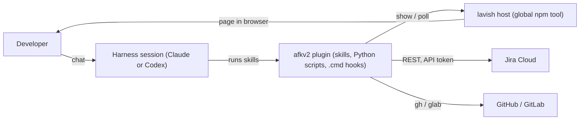
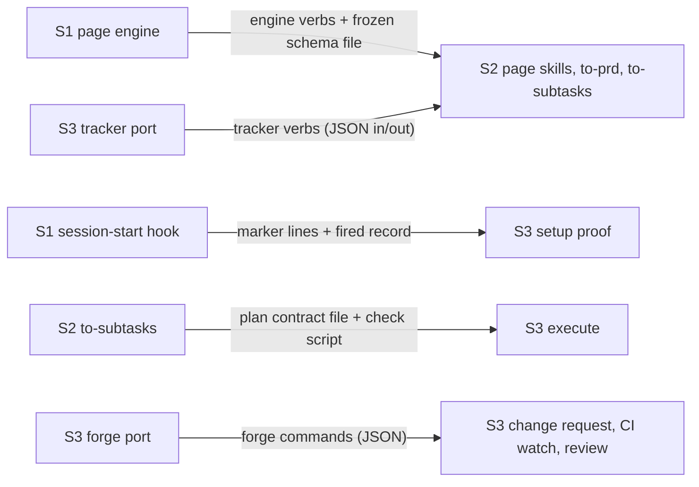
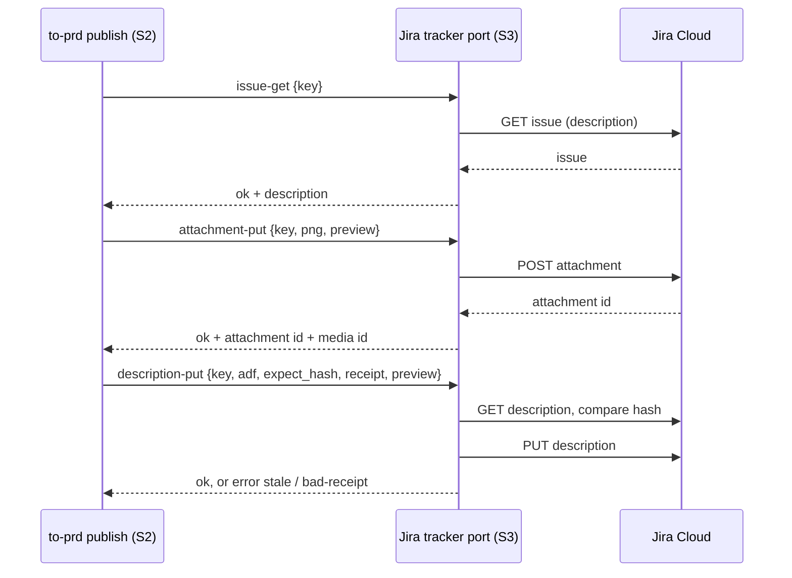
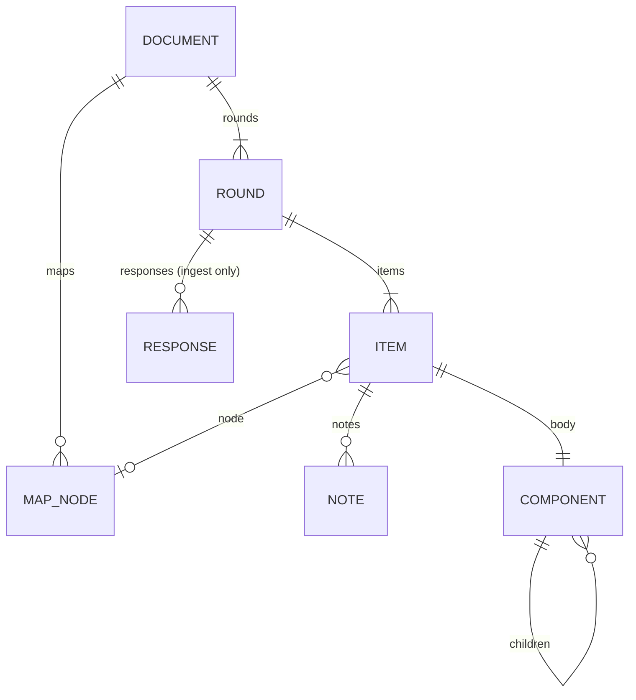
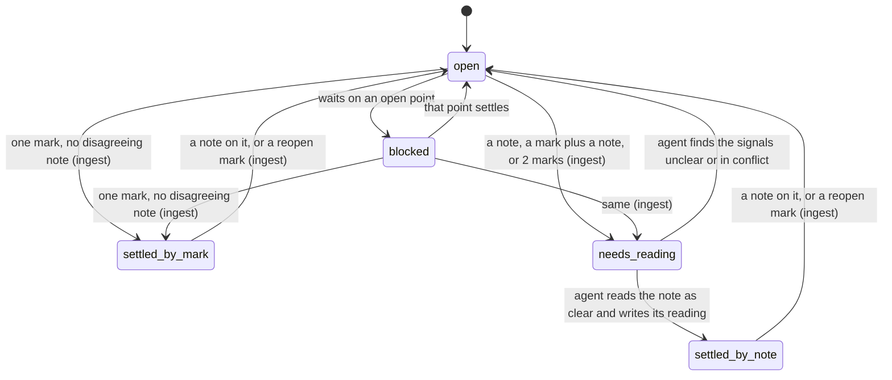
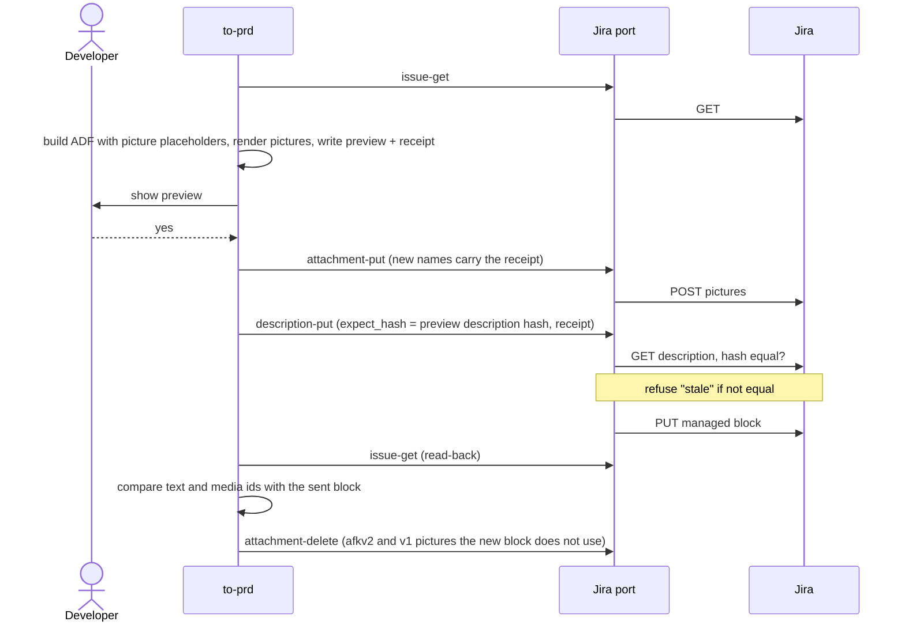
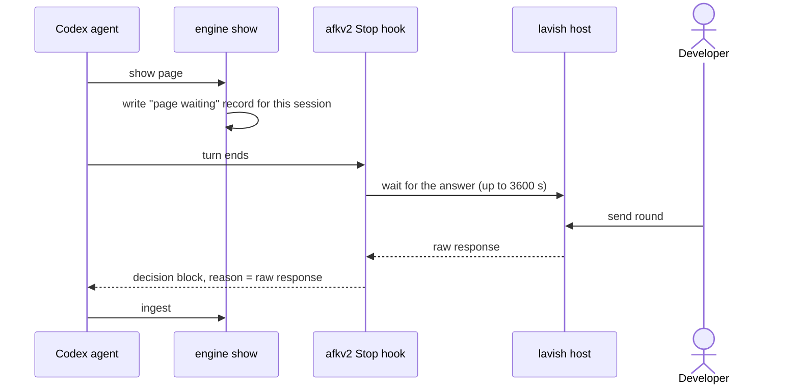
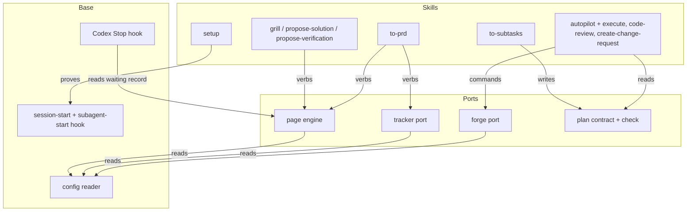
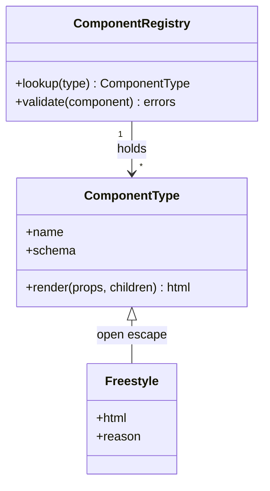

# SDD — afkv2 seam design (AFK 2.0 beta)

> Parent PRD: `PRD.md`
> Status: Draft
> Last updated: 2026-10-29
> Reading guide: sections follow the L1–L9 design-layer ladder, top of the system down to the code
> (L1 topology · L2 service boundaries · L3 data · L4 cross-cutting quality · L5 domain model ·
> L6 processes · L7 modules · L8 patterns · L9 seams into existing code). Skim §0 (what's locked)
> and §1 (why) first; non-implementers can stop there or read the DESIGN-BRIEF instead.

## §0 Binding Contract

This SDD and its accepted ADRs are **binding** on implementing agents and reviewers.

| Aspect | Locked by SDD/ADR | Executor latitude |
|--------|-------------------|-------------------|
| Pattern choice | ✅ | ❌ |
| Module public interface (engine verbs, tracker verbs, forge commands, hook output) | ✅ | ❌ |
| Command contract and answer envelope (§3) | ✅ | ❌ |
| Persisted schema — page document v0 (§4) | ✅ | ❌ |
| Point states + legal transitions (§6) | ✅ | ❌ |
| Who may write to Jira, and where it is enforced (§5) | ✅ | ❌ |
| Jira publish order, stale check, receipt (§7) | ✅ | ❌ |
| External-seam contract (§9b) | ✅ | ❌ |
| Frozen day-1 inputs (§8, "Frozen on day 1") | ✅ | ❌ |
| File / package layout *within* a named module | ❌ | ✅ |
| Private helper extraction | ❌ | ✅ |
| Internal naming, control flow (within the no-v1-name rule) | ❌ | ✅ |
| Test fixture structure | ❌ | ✅ |

**Conflict procedure.** Executor finds a binding decision wrong / infeasible / contradicting reality → classify per the decision protocol (`DECISIONS.md`, workflow plugin root): a two-way-door correction is recorded in `plan/DECISIONS.md` and implemented; a one-way door or a tie exits the subtask with `design_conflict` status quoting the SDD section + the conflict, routed back to `/afk:grill-solution` for a new ADR (Status: Accepted, Supersedes: NNNN). Never override off the record.

**Human sign-off register** (transcribed from `GRILL-LOG.md`, "Solution grill").

| Aspect | Section | Status | Signed by / date | Approved wording |
|--------|---------|--------|------------------|------------------|
| HL-1 page document schema v0 | §4 | signed | owner / 2026-10-29 | "sign" (R-1) |
| HL-2 API surface | §3 | n/a | owner accepted / 2026-10-29 | internal commands only; "accept" (R-1, HL-0) |
| HL-3 Jira write authorization | §5 | signed | owner / 2026-10-29 | "sign" (R-1); stands, R-2 kept the REST client |
| HL-4 point states | §6 | signed | owner / 2026-10-29 | "sign" (R-1) |
| HL-5 outward writes | §7 | signed | owner / 2026-10-29 | "sign" (R-1); changed rows "sign" (R-3); pin 0.1.80 after "I pick 0.1.80. by the time it's implemented it's valid", "sign" (R-5) |
| HL-6 change to existing behaviour | §14 | n/a | owner accepted / 2026-10-29 | v1 code copied, not modified; v1-facing effects are HL-5 rows; "accept" (R-1, HL-0) |

## §1 Context Summary

afkv2 is built in 3 parallel sessions (S1 skeleton, hook, core behaviors, page engine; S2 page skills, to-prd, to-subtasks; S3 setup, ports, autopilot, review, change request), then smoke-tested in S4 (PRD Implementation Decisions). The sessions start together on day 1, so every interface one session builds and another calls must be fixed before then. This SDD fixes only those interfaces — the page engine and its document format, the tracker and forge ports, the session-start hook and its proof, setup's outward writes, and the plan contract — plus how each one reuses v1 code. Everything else is executor latitude inside the subtask that owns it.

---

## §2 L1 — System Topology

Inherited: a local plugin with no server, running inside a Claude Code or Codex session on Windows. Scripts are Python; hooks are `.cmd`, the fastest start on Windows; the harness hook timeout is the only time limit. Pages are shown through the same lavish host as v1 (ADR-0001).

*The plugin is the only new deployable; Jira, the forges and the lavish host are external.*

## §3 L2 — Service Boundaries & Integration

Three seams cross session lines. Every command answers one JSON object on stdout.

*Each edge is a frozen contract; the producer owns it and the consumer tests against a recorded fake.*

**Command contracts** (HL-2 not triggered: these are internal commands, no externally callable surface).

| Command | Verbs | Input | Success envelope | Error envelope | Exit codes |
|---------|-------|-------|------------------|----------------|-----------|
| page engine | check, render, show, poll, ingest | page document path; ingest also takes the raw response text | `{"ok": true, ...}` per verb | `{"ok": false, "error": {"code", "reason"}}` naming item and field | 0 ok · 1 refused · 2 unreadable input |
| Jira tracker | issue-get, md-to-adf, attachment-list, attachment-put, attachment-delete, description-put | one JSON payload | `{"ok": true, ...}`; attachment-put returns attachment id + media id | same shape; codes from an HTTP-status table; description-put refuses `stale`, `bad-receipt` and `bad-block` | 0 · 1 · 2 |
| GitHub issue tracker | issue-get, issue-search | one JSON payload | `{"ok": true, ...}` | same shape | 0 · 1 · 2 |
| forge (GitHub, GitLab) | the commands the chain calls, v1 names and v1 JSON answers (ADR-0007) | v1 arguments | v1 JSON answer inside `{"ok": true, ...}` | same shape (replaces v1's `error: true` at exit 0) | 0 · 1 · 2 |

Contract sources: v1 Jira client and publish script (INV-002), v1 forge adapters (INV-002), v1 page kit (INV-003).

*S2 owns what is written (block, pictures, id check, preview, receipt); S3 owns how it reaches Jira.*

## §4 L3 — Data Architecture

| State | Datastore | Partitioning | Replication | Retention | Schema-evolution policy | PII? | Audited? (Envers) |
|-------|-----------|--------------|-------------|-----------|--------------------------|------|-------------------|
| Page document | JSON file in the feature spec folder (`pages/<skill>-<session id>.json`) | one file per page session | git, with the spec folder | merges with the change; kept in git history | new value `afkv2.page/N`; the engine keeps a reader for every value it wrote and upgrades in memory | no | no |
| Rendered page | HTML build product beside the document | per page | none | not kept; rebuilt | follows the document | no | no |
| Browser draft of unsent answers | browser storage, key = session id + round | per session and round | none | cleared on send | key change only | no | no |
| Hook fired record | afkv2 data folder, one file per provider | per provider | none | overwritten each session | plain text | no | no |
| Setup install record + backups | afkv2 data folder | per machine | none | until switch-back | plain text / file copies | no | no |
| Publish preview + receipt | spec folder run area | per publish | none | until the next publish | JSON | no | no |
| Plan contract | `plan/` on the run branch | per feature | git | run artifact | format file owned by S2 | no | no |

**Entity design — page document v0** (signed HL-1).

Document:

| Field | Type | Null? | Default | Unit / precision | Constraint | Indexed / unique | Note |
|-------|------|-------|---------|------------------|------------|------------------|------|
| schema | string | no | — | — | equals `afkv2.page/0`; an unknown value is refused and named | — | version key |
| session | object {id, skill, feature, ticket, started} | no | — | started: ISO-8601 UTC | skill ∈ grill, propose-solution, propose-verification | id unique per spec folder | |
| maps | list of map | yes | empty | — | each node carries state and the round it last changed | node id unique | updated in place |
| rounds | list of round | no | — | — | exactly one round is current; a settled round is never rewritten | n unique | |

Round:

| Field | Type | Null? | Default | Unit / precision | Constraint | Indexed / unique | Note |
|-------|------|-------|---------|------------------|------------|------------------|------|
| n | integer | no | — | ≥ 1 | in order | unique | |
| state | current \| settled | no | — | — | — | — | |
| colour | string | yes | engine assigns | CSS colour | — | — | |
| banner | object | no | — | — | what settled, what it unlocks, parked items | — | |
| items | list of item | no | — | — | — | id unique across the document | |
| responses | list of {received, raw, signals[]} | yes | empty | received: ISO-8601 UTC | written only by ingest; raw is the exact text | — | |
| replies | list of {text, about[]} | yes | empty | — | — | — | agent replies, shown on top |

Item:

| Field | Type | Null? | Default | Unit / precision | Constraint | Indexed / unique | Note |
|-------|------|-------|---------|------------------|------------|------------------|------|
| id | string | no | — | — | never reused | unique | |
| kind | decided \| confirm \| debate \| signoff \| info | no | — | — | — | — | |
| node | map node id | yes | — | — | must resolve | — | links card to map node |
| state | point state (§6) | no | open | — | — | — | |
| body | component tree | no | — | — | any component may hold others | — | |
| settled | {by: mark \| note, round, signal, reading} | when settled | — | — | reading required when by = note | — | |
| notes | list of {id, round, target, text, deleted} | yes | empty | — | id = `N-<round>-<item>`, minted by the engine; target = any element id | note id unique | |

Component:

| Field | Type | Null? | Default | Unit / precision | Constraint | Indexed / unique | Note |
|-------|------|-------|---------|------------------|------------|------------------|------|
| type | registry name or `freestyle` | no | — | — | unknown type refused | — | |
| id | string | yes | — | — | needed to be a note target | unique when present | |
| props | object | per type | — | — | checked by the type's own schema | — | |
| style | CSS text | yes | — | — | any CSS | — | |
| children | list of component | yes | empty | — | — | — | |
| html | string | freestyle only | — | — | any HTML or SVG; the page marks it as freestyle | — | |

| Relation | Target | Cardinality | Owning side | On delete / orphan | Fetch posture |
|----------|--------|-------------|-------------|--------------------|---------------|
| document → round | round | 1 : N | document | rounds are never deleted | whole file |
| round → item | item | 1 : N | round | items are never removed when a round settles | whole file |
| item → map node | map node | N : 0..1 | item | a node id must resolve | whole file |
| note → element | component or item | N : 1 | note | a deleted note keeps its id with `deleted` | whole file |

**Surface reachability.** No existing surface exposes this entity; it is new. **Migration & backfill.** None: the v1 grill pages of this feature stay in the v1 format and are not converted. Real documents written during this design pass become test fixtures.

*One file per page session holds every round, response and note, so a past session reopens without stitching files.*

## §5 L4 — Cross-Cutting & Quality Attributes

**AuthZ — Jira writes** (signed HL-3). No UI exists; the "surface" is the skill, and the guard below it is the tracker port.

| Surface | Permitted | Denied | Enforced in the skill | Enforced below the skill |
|---------|-----------|--------|-----------------------|--------------------------|
| publish PRD (description block + pictures) | agent in `/afkv2:to-prd`, after the developer's yes | agent in every other skill | to-prd shows the preview and asks | description-put and attachment-put refuse without a receipt that matches the preview hash |
| create ticket, change status, comment | nobody | agent | no skill offers it | the tracker port has no such verb |
| read ticket | agent in any skill | — | — | — |

Data-scoping: not applicable — scope is the repository, graded by ownership (PRD access policy); no company or vendor scope.

**Idempotency.**

| Surface | Key shape | Dedup window | Side-effect ledger |
|---------|-----------|--------------|--------------------|
| Jira publish | receipt = SHA-256 of ticket key + block text + picture hashes | until the next publish | a re-run after success finds an equal read-back and writes nothing |
| v1 rule block removal | the block's begin and end markers | permanent | absent markers = already removed |
| v1 git hook move | the moved file in the backup folder | until switch-back | a present backup = already moved |
| plugin switch | the settings key value | permanent | equal value = no write |

**Retry + timeout.**

| Call | Attempts | Backoff (s) | Timeout (s) |
|------|----------|-------------|-------------|
| Jira REST call | 1 (no retry; a failed publish is re-run by the developer) | — | 60 |
| forge command | 1 | — | per v1 command |
| Codex Stop-hook wait for a page answer | 1 | — | 3600 |
| session-start hook | 1 | — | finishes < 0.05 |

**Secrets.** Jira: `JIRA_BASE_URL`, `JIRA_EMAIL`, `JIRA_API_TOKEN`, looked up as v1 does (environment, then the Claude user config's tracker entry, then the Codex config). Setup asks once and stores them with the developer's own tooling, never in the repository. GitHub and GitLab: `gh` and `glab` logins.

**Search.** Every code search uses `rg --hidden -g '!.git' PATTERN PATH` with an explicit path (PRD AC-021).

Feature flags, rate limits, observability stack: none in the beta.

## §6 L5 — Domain Model

The one domain object with a lifecycle is a **point** (an item on a page). States and transitions are signed (HL-4).

*No state is terminal: any settled point reopens, and the reopen is recorded in the next round.*

Mark table: a lone accept, sign or option mark settles by mark; `reopen`, `changes` and a write-in go to needs-reading. A conflict is 2 lines for one item.

| Invariant | Owner | Guardian | On violation |
|-----------|-------|----------|--------------|
| settled-by-note has a note id and a reading | page document | engine check | document refused, field named |
| only ingest writes responses and signals | page document | engine check (signals carry ingest's stamp) | document refused |
| a settled round is never rewritten | page document | engine check against the last saved copy | document refused |
| exactly one round is current | page document | engine check | document refused |

Domain events: none; ingest writes into the document, and skills read the document.

## §7 L6 — Process & Coordination

**Use case 1 — Jira publish** (signed HL-5, with the R-3 changed rows).

*Nothing is written before the yes; old pictures go only after the read-back passes.*

| Use case | Trigger | Txn strategy | Consistency | Concurrency control |
|----------|---------|--------------|-------------|---------------------|
| Jira publish | `/afkv2:to-prd` after the developer's yes | ordered steps, no transaction; re-run safe by receipt | read-back after write | description hash compared just before the write, after the uploads |
| v1 takeover (setup) | `/afkv2:setup` | ordered steps, each with a backup | hook proof before any removal | one setup run at a time (inferred: single developer) |
| page round | the human sends a round | ingest appends to the document | the document is the record | one current round |
| Codex page wake | the agent ends its turn while a page waits | Stop hook waits, then hands the answer back | the queued answer is read once | one waiting record per session |

**Use case 2 — Codex page wake** (ADR-0006).

*On Claude the agent keeps v1's tracked background poll; only Codex needs the Stop hook.*

**Failure & recovery matrix.**

| Failure point | Detection signal | Automatic recovery | Manual recovery | Owner |
|---------------|------------------|--------------------|-----------------|-------|
| ticket edited after preview | description-put `stale` | none: nothing written | new preview, new yes | to-prd |
| AFK block broken or doubled in the ticket (AC-058) | description-put `bad-block` | none: nothing written | the developer fixes the description by hand; re-run | to-prd |
| picture upload fails | attachment-put error | none | re-run; orphan pictures are removed by the next publish's clean step | to-prd |
| write fails after uploads | description-put error | none | re-run; same receipt is safe | to-prd |
| read-back differs | compare fails | none; old pictures kept | report a failed publish; re-run | to-prd |
| hook did not fire | no fired record newer than the install record | setup keeps the v1 block | follow the Codex hook trust review, then re-run setup | setup |
| core-behaviors text cut to a preview | end marker missing in context | setup keeps the v1 block | shrink the text below 8,000 characters | S1 build check |
| `.cmd` hook refused by a harness | day-1 live check fails | none | Python hook | S1 |
| Codex Stop hook cannot wait long enough | day-1 live check fails | none | one chat message after Send; owner informed | S1 |
| switch back to v1 | developer runs switch-back | restores the block, git hooks, settings and host version from backups | — | setup |

**v1 defects afkv2 must not repeat** (INV-004 and the S1-S3 build run of 2026-10-30; v1 itself stays unchanged).

| v1 defect | afkv2 rule | Proof |
|-----------|------------|-------|
| a git hook file that holds v1's marker string anywhere counts as v1's own, and v1 overwrites it | afkv2 writes no git hook; afkv2 finds its own block or file only by the full begin and end lines, never by a part of a marker | plugin check: no substring or prefix marker match in afkv2 code |
| the near-empty rule deletes a short section of the description that is not the PRD block | the Jira port removes text only between the full AFK block lines; no rule removes text by its content or size | AC-059 test ticket |
| no block found by prefix → a second PRD is appended, and the change comment is lost | append happens only when the description has no afkv2 block and no v1 block (AC-053); a broken or doubled block is refused with `bad-block` (AC-058); the port has no comment step, so the publish result goes to the developer | AC-053, AC-058 tests |
| a mandatory gate that needs a running app parks every subtask of a repository with no app, and the run finds it only after the work and the review | a gate that needs something the repository does not have is decided when the plan is cut: the plan names it not applicable, or the plan check refuses; autopilot never starts a subtask whose gates cannot run | 0010 plan-check test; 0015 start-gate test |
| the review loop runs up to 10 rounds and reopens settled points, so one small subtask takes hours | at most 3 review rounds; only critical and high findings are fixed; the rest stay on the change request as advice | 0013 test |
| the plan check passes a subtask whose checks need a file that neither its Scope nor a subtask it waits on creates | the plan check refuses each check path that no Scope in the subtask's chain owns | 0010 plan-check test |
| the plugin's own commit and CI gates read the whole repository and fail on unrelated files and spec prose, so every commit skips all gates | the plugin check reads only the afkv2 plugin tree; spec-folder prose is never gate input | 0001 plugin-check test |
| a text file the hook prints is turned to CRLF on a Windows checkout, its hash no longer matches its marker, and the check still passes | built files are LF by a `.gitattributes` rule; the plugin check fails on a CR byte or a hash mismatch | 0001 plugin-check test |
| the forge port passes a large thread list or a body as one command argument, so a change with many threads fails with "argument list too long", and carriage returns are doubled on Windows | the forge port pages thread lists and passes every body through a file or stdin, never an argument; text keeps its line ends byte for byte | 0012 port tests: more than 240 threads; a body with CRLF round-trips unchanged |
| two flat script modules with one name shadow each other when one process loads both | every afkv2 script module name is unique across the plugin tree | plugin-check test |

## §8 L7 — Module Decomposition

*Skills depend on ports; ports depend on the config reader; no port depends on a skill.*

| Module | Purpose | Public interface | Depends on | Session |
|--------|---------|------------------|------------|---------|
| page engine | turn a page document into a page; show, poll, ingest | verbs check, render, show, poll, ingest (§3) | config reader, lavish host | S1 |
| tracker port | Jira and GitHub-issue reads; Jira managed-block write | verbs in §3 | config reader, Jira REST | S3 |
| forge port | change requests and CI on GitHub and GitLab | the chain's forge commands (ADR-0007) | config reader, gh, glab | S3 |
| plan contract | the subtask contract format and its check script | format file + check command | — | S2 writes, S3 reads |
| config reader | resolves `.afkv2` values (spec folder, tracker kind, ownership) | one read command, JSON answer | — | S1 (subtask 01) |
| session-start hook | prints the core-behaviors text, writes the fired record | provider hook output (§9b) | prebuilt files | S1 |
| Codex Stop hook | hands a page answer back to Codex | Stop-hook output `decision: block` + `reason` | waiting record, lavish host | S1 |
| setup | install, prove, take over from v1, switch back | `/afkv2:setup`, switch-back step | all of the above | S3 |

**Ported vs new** (verdicts from the L9 seam walk; these seams copy v1 code and change no v1 file).

| Module | v1 source | Verdict | What changes |
|--------|-----------|---------|--------------|
| engine show / poll | v1 page launcher (INV-003) | extends | afkv2 names; provider facts and tooltip glossary re-homed; lavish pin 0.1.80 |
| engine render / check | v1 page kit (INV-003) | reworked | new v0 validator and component-tree compiler; page shell, stylesheet, browser script and exit pattern reused |
| ingest | none (v1 has no response parser, INV-003) | new | §6 mark table; note ids; conflict rule; draft key per session and round |
| tracker port | v1 Jira client (INV-002) | extends | answer envelope; create, transition and comment removed; own credential lookup; markers `afkv2:prd:start/end`; pictures `afkv2-fig-<receipt 8 chars>-<n>.png` |
| forge port | v1 forge adapters (INV-002) | reworked | Python rewrite of the chain's commands (ADR-0007) |
| hook | v1 hook registration (INV-001) | reworked | `.cmd` printing a prebuilt file; subagent start added; fired record |

**Frozen on day 1** (beside schema v0; ADR-0008 for setup's part).

| Input | Frozen value | Writer | Reader |
|-------|--------------|--------|--------|
| plan contract | v1 subtask contract sections without materialized seams; one format file + check script | S2 | S3 execute |
| afkv2 data folder | `%LOCALAPPDATA%\afkv2` on both harnesses | S1 | S3 setup, Stop hook |
| marker hash | first 12 hex characters of SHA-256 over the text between the marker lines | S1 build check | S3 setup proof |
| config reader | `.afkv2` reader in subtask 01 | S1 | every port and skill |
| config file | `.afkv2/config.json` with a required `spec_folder`; setup writes JSON, the reader reads only this file (orchestrator ruling 2026-10-30: the reader decides) | S3 setup | S1 config reader |
| fired record | `%LOCALAPPDATA%\afkv2\fired-<provider>.txt`, written by the hook (orchestrator ruling 2026-10-30: the writer decides) | S1 hook | S3 setup proof |
| publish preview | a preview JSON file (`ticket_key`, `receipt`, `description_hash`, `picture_hashes`) that to-prd writes; attachment-put and description-put name it in `preview`, and the port refuses `bad-receipt` when the receipt, ticket, hash or a picture hash differs, or when the receipt computed again from the written block text differs | S2 to-prd | S3 Jira port |
| Python | setup checks Python 3 on the path and records it; scripts start through it | S3 | every script |
| no-v1-name rule | `afk` or `AFK_` not followed by `v2`, over file names, environment variables, markers, storage keys and CSS classes; each ported module renamed in one pass | all | plugin check |

## §9 L8 — Tactical Patterns

| Concern | Pattern | ADR |
|---------|---------|-----|
| page components | Registry (type name → schema + renderer); freestyle as the open escape | ADR-0001 |
| tracker and forge ports | Adapter with one answer envelope | ADR-0003, ADR-0007 |
| hook output per provider | prebuilt files generated by a build check (one source, provider variants) | ADR-0005 |
| point lifecycle | State machine guarded by the engine check | ADR-0002 |

*A new component is one registry entry; a repeated freestyle use is the signal to add one.*

## §9b External Seams & Failure Affordance

| Boundary | Framework @ pin | What it does to our value | Failure surface | Seam-test |
|----------|-----------------|---------------------------|-----------------|-----------|
| lavish host | lavish-axi 0.1.80 (npm, published 2026-09-29; owner PIN-2) | serves the page, returns the composed response on poll | wrapper exits 64 / 65 / 69 / 127 → Markdown fallback | live browser test (PRD AC-042) on 0.1.80 asserts the raw response text that ingest reads |
| Claude session-start hook | Claude Code hooks (docs) | adds plain stdout to context; above 10,000 characters gives a file path + 2,000-character preview | text cut to a preview | live session finds the end marker (AC-014) |
| Claude subagent-start hook | Claude Code hooks (docs) | adds context only from JSON `hookSpecificOutput.additionalContext` | no context in subagents | live subagent finds the end marker |
| Codex session-start / subagent-start hook | Codex hooks (docs) | adds plain stdout; about 2,500 tokens before a file + preview; untrusted hook skipped silently | no rules in the session | live session finds the end marker after the trust review |
| Codex Stop hook | Codex hooks (docs: decision `block` + `reason` starts a continuation prompt; timeout default 600 s, no stated maximum) | the reason text becomes the next prompt | wait refused or cut → fallback one chat message | day-1 live check: a page answer sent after 10 minutes reaches the agent (unverified premise until then) |
| Claude plugin switch | Claude Code settings (docs: project local overrides shared project overrides user) | `enabledPlugins` in `.claude/settings.local.json` | wrong file → team affected | setup test reads back the effective value |
| Codex plugin switch | Codex config (global) | one switch per machine | not verified: a command-line enable/disable; else config edit with backup | setup test lists the plugin state after the switch |
| Jira REST | Jira Cloud REST v3 | stores ADF; returns media id via the attachment redirect | 4xx/5xx mapped to error codes; ADF normalised on read (unverified) | read-back compare on text and media ids, on the D-4 test project |

## §10 NFRs

| Concern | Target | Measurement | Owner |
|---------|--------|-------------|-------|
| session-start hook time (ms) | < 50 | hook timing on Windows, median of 7 | S1 |
| core-behaviors size (characters) | ≤ 8,000 | build check | S1 |
| full code search, 53,000-file repository (s) | ≤ 60% of `git grep --untracked` (measured 2.0 vs 3.8) | benchmark rerun | S1 core behaviors |
| Codex page answer wait (s) | up to 3600 | day-1 live check | S1 |
| Jira REST call timeout (s) | 60 | client setting | S3 |

## §11 Out of Scope

- PRD Out of Scope applies in full.
- acli (owner R-2): no acli in P0.
- Forge commands the chain does not call (ADR-0007).
- A second, afkv2-only copy of the lavish host.
- Converting v1 page documents to v0.
- Locking a Jira ticket during publish (Jira has no lock; If-Match support not verified).

## §12 Reversed Decisions

| Prior ADR | Superseded by | Reason |
|-----------|---------------|--------|
| issue #153 decision 40 (acli is the Jira tool; not an ADR) | ADR-0003 | acli cannot upload pictures; owner chose the v1 REST client (R-2) |

## §13 Open Questions

| Question | Layer (L1-L9) | Blocks executor? | Owner | Target resolve date |
|----------|---------------|------------------|-------|---------------------|
| Can a plugin register a `.cmd` hook on Claude and on Codex? | L8 | no: day-1 live check with a named fallback (§7 matrix) | S1 | 2026-10-30 |
| How long can a Codex Stop hook wait, and can the developer type in chat meanwhile? | L8 | no: day-1 live check with a named fallback | S1 | 2026-10-30 |
| Does Jira normalise ADF on read, and what is the description size limit? | L8 | no: read-back compares text and media ids; measured on the D-4 test project | S3 | 2026-11-02 |
| Does Codex have a command-line plugin enable/disable? | L8 | no: fallback is a config edit with backup | S3 | 2026-10-31 |

Seam-gate notes, 2026-10-29:

note — v1 rule block written by install_block: INV-004 left unverified, not load-bearing: the hit set holds every reference to install_block, install-git-hooks, build_description over the name forms this pass searched

note — v1 rule block written by install_block: INV-004 left unverified, not load-bearing: Whether the human sees the --quiet stderr refusal notice at SessionStart depends on the harness: run-hook.py passes stderr through and exits 0 under --soft, but harness display of a SessionStart handler's stderr was not checked.

note — v1 rule block written by install_block: INV-004 left unverified, not load-bearing: How Jira renders a media node whose attachment was deleted (v1 block left in place while its afk-fig pictures go) was not checked: no network

note — v1 rule block written by install_block: INV-004 left unverified, not load-bearing: Whether a disabled v1 plugin's files stay at the root recorded in the stub, so that the stub still finds its gate, is not verified here.

note — v1 rule block written by install_block: INV-004 stops at B14: another repository, deployment manifest, or live consumer

note — v1 git hook stubs from install-git-hooks: INV-004 left unverified, not load-bearing: the hit set holds every reference to install_block, install-git-hooks, build_description over the name forms this pass searched

note — v1 git hook stubs from install-git-hooks: INV-004 left unverified, not load-bearing: Whether the human sees the --quiet stderr refusal notice at SessionStart depends on the harness: run-hook.py passes stderr through and exits 0 under --soft, but harness display of a SessionStart handler's stderr was not checked.

note — v1 git hook stubs from install-git-hooks: INV-004 left unverified, not load-bearing: How Jira renders a media node whose attachment was deleted (v1 block left in place while its afk-fig pictures go) was not checked: no network

note — v1 git hook stubs from install-git-hooks: INV-004 left unverified, not load-bearing: Whether a disabled v1 plugin's files stay at the root recorded in the stub, so that the stub still finds its gate, is not verified here.

note — v1 git hook stubs from install-git-hooks: INV-004 stops at B14: another repository, deployment manifest, or live consumer

note — v1 PRD block written by build_description: INV-002 stops at B14: another repository, deployment manifest, or live consumer

note — v1 PRD block written by build_description: INV-002 was traced at 22ab4de0ff03, and the tree is at 8e6ef1cfd1bd

note — v1 PRD block written by build_description: INV-004 left unverified, not load-bearing: the hit set holds every reference to install_block, install-git-hooks, build_description over the name forms this pass searched

note — v1 PRD block written by build_description: INV-004 left unverified, not load-bearing: Whether the human sees the --quiet stderr refusal notice at SessionStart depends on the harness: run-hook.py passes stderr through and exits 0 under --soft, but harness display of a SessionStart handler's stderr was not checked.

note — v1 PRD block written by build_description: INV-004 left unverified, not load-bearing: How Jira renders a media node whose attachment was deleted (v1 block left in place while its afk-fig pictures go) was not checked: no network

note — v1 PRD block written by build_description: INV-004 left unverified, not load-bearing: Whether a disabled v1 plugin's files stay at the root recorded in the stub, so that the stub still finds its gate, is not verified here.

note — v1 PRD block written by build_description: INV-004 stops at B14: another repository, deployment manifest, or live consumer

## §14 L9 — Implementation Seams & Change Impact

Rows are the places where afkv2 changes v1 state at runtime. Ported code changes no v1 file; its verdicts are in §8.

| Seam (class/method/contract) | Existing contract (INV-NNN) | Planned change | Impacted flows (INV-NNN) | Conventions / landmines | Verdict |
|------------------------------|-----------------------------|----------------|--------------------------|-------------------------|---------|
| v1 rule block written by install_block | (INV-004) | setup removes the block from both user instruction files after the hook proof; backup; switch-back restores | (INV-004): one writer pair (setup install, setup teardown), one reader (session-start drift check, silent when the markers are gone) | bytes outside the block stay unchanged; remove from both files in one run, because a later v1 setup re-adds a block missing from one file only (inferred, INV-004) | reworked |
| v1 git hook stubs from install-git-hooks | (INV-004) | setup moves the pre-commit and reference-transaction stubs aside in each repository it runs in; switch-back restores | (INV-004): v1 rewrites missing stubs at every v1 session start; a file holding v1's marker string counts as v1's own | afkv2 writes no git hook and never copies v1's marker string; a set `core.hooksPath` stops the stubs anyway | reworked |
| v1 PRD block written by build_description | (INV-002), (INV-004) | the first afkv2 publish replaces a v1 `afk:prd` block with the afkv2 block and deletes v1 pictures after the read-back | (INV-002), (INV-004): v1 finds its block by the `afk:prd:start` prefix only and never deletes `afkv2-fig-*` pictures | text outside the block stays unchanged | reworked |

Accepted findings (INV-004), with rationale:

- On Claude, the plugin switch is per project, but the v1 rule block lives in the user-level files. Removing it stops v1's rules in every project where v1 is still enabled. Accepted: requirement ADR-0004 makes afkv2 take over the user instruction files; switch-back restores the block.
- After switch-back, a v1 re-publish on a ticket that afkv2 published finds no `afk:prd` block and appends a second PRD. Accepted: v1 is off while afkv2 is on; switch-back reports the tickets afkv2 published, so the developer knows where not to run v1's publish.
- v1 defects found on the way: afkv2 rules against each are in §7, "v1 defects afkv2 must not repeat".

Every compatibility-audit finding from the seam walk changed the design (§3, §4, §6, §7, §8, §9b).
