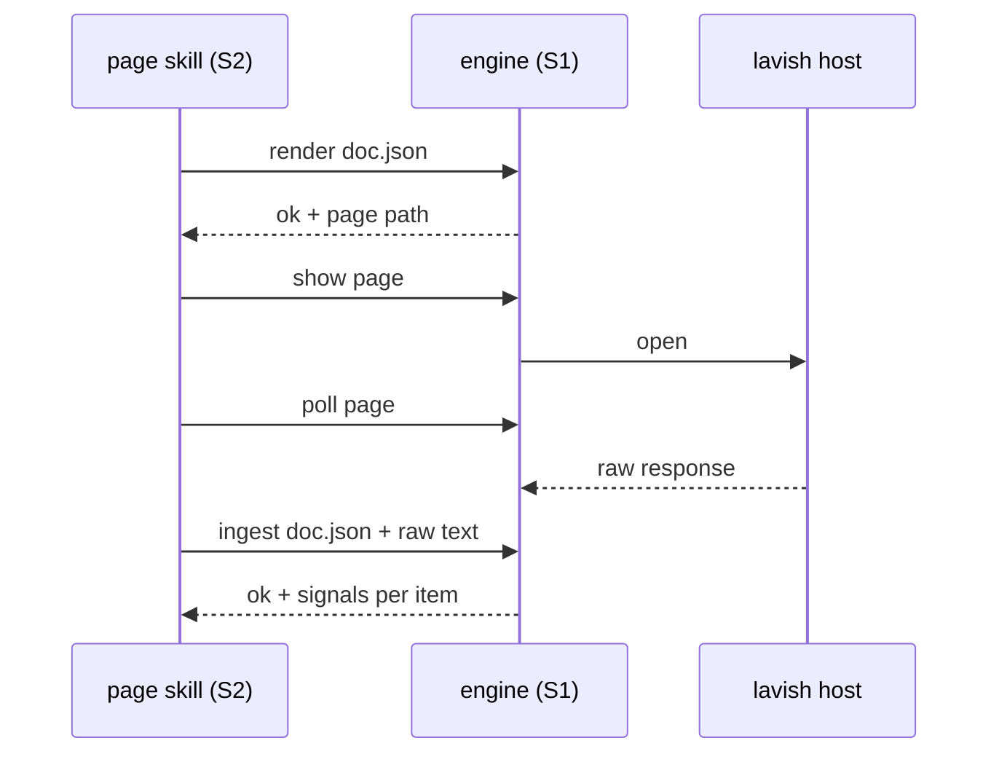

# ADR-0001 — Page engine: one command, five verbs, schema v0

> Status: Accepted
> Date: 2026-10-29
> Audited: 2026-10-29
> Layer: L2
> Context ticket: GitHub #153

## Context

S1 builds the page engine and S2's five page skills call it from day 1 (SDD §3, §4). v1 has a closed page format, no response parser, and a draft key that ignores the round (INV-003).

## Decision

The engine is one command with verbs check, render, show, poll and ingest, each answering one JSON object with exit 0, 1 or 2. Page documents follow schema `afkv2.page/0` (signed HL-1), stored in the spec folder; HTML is a build product. The renderer is new work; the launcher behind show and poll is ported. ingest reads the raw response and writes it, with per-item signals and conflicts, into the document without judgement.

## Alternatives Considered

| Alternative | Pros | Cons | Reason rejected |
|-------------|------|------|-----------------|
| S2 imports the engine's Python modules | no command layer | ties 2 sessions to internal names that change during the build | session isolation |
| Keep v1's prose fold of responses | no new code | not repeatable; settle-by-note audits rest on a model's reading | ADR-0002 (requirements) needs a stored raw response |
| Stretch the v1 validator to accept v0 | reuse | two formats in one closed validator | v0 changes every level v1 closes |

## Consequences

- **Positive** — S2 tests against a recorded fake from day 1; every round's raw response is auditable.
- **Negative** — subtask 03 is sized as new work, not a port.
- **Follow-ups** — a schema change is a new `afkv2.page/N` with a reader kept for every value written.
