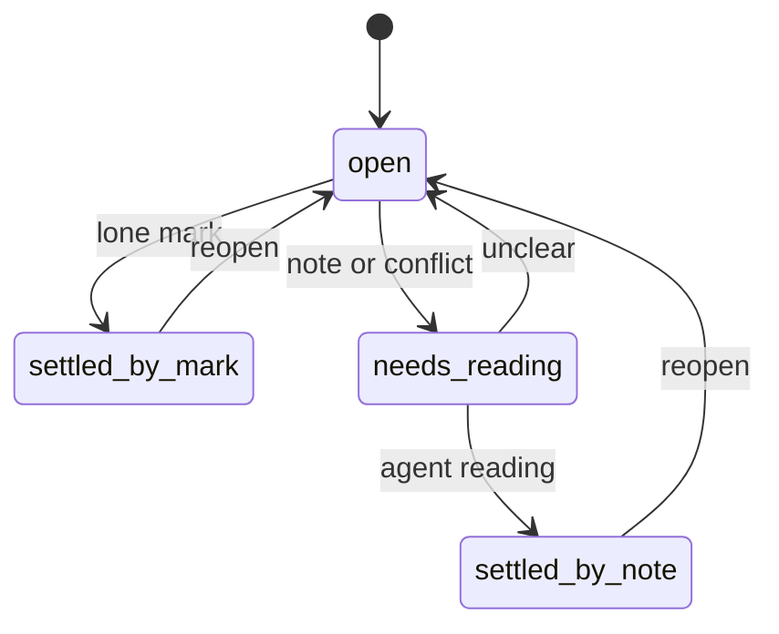

# ADR-0002 — Point states and the ingest mark table

> Status: Accepted
> Date: 2026-10-29
> Audited: 2026-10-29
> Layer: L5
> Context ticket: GitHub #153

## Context

The requirement ADR-0002 (a clear note settles a point) needs "settled by mark" and "settled by note" to differ; v1 has 3 states (SDD §6, signed HL-4).

## Decision

A point is open, blocked, needs-reading, settled-by-mark or settled-by-note. ingest settles a lone accept, sign or option mark; a note, a mark plus a note, 2 marks, reopen, changes or a write-in go to needs-reading, where the agent writes its reading or returns the point to open. The engine refuses settled-by-note without a note id and a reading, and refuses a rewrite of a settled round.

## Alternatives Considered

| Alternative | Pros | Cons | Reason rejected |
|-------------|------|------|-----------------|
| v1's 3 states | no change | cannot tell a mark from a note | requirement ADR-0002 |
| ingest settles notes too | one step less | a note's meaning needs judgement | ingest stays deterministic |

## Consequences

- **Positive** — an audit can tell every settled point's source.
- **Negative** — one agent step per note.
- **Follow-ups** — none.
