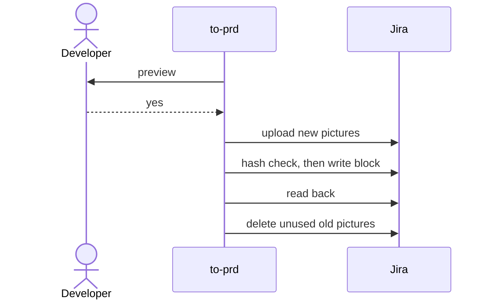

# ADR-0004 — Jira publish order: yes first, description-hash stale check, clean after read-back

> Status: Accepted
> Date: 2026-10-29
> Layer: L6
> Context ticket: GitHub #153

## Context

v1 deletes old pictures and uploads new ones before the confirmation prompt, has no stale check and no read-back (INV-002). An upload may change the ticket's updated time (not verified), so a check on that field could refuse the publish's own writes (SDD §7, signed HL-5 and its R-3 changed rows).

## Decision

Preview (read the ticket, build the block with picture placeholders, render pictures, write the receipt) → developer yes → upload new pictures under receipt-carrying names → description-put compares a hash of the current description with the preview's, read just before the write, then writes only the managed block → read-back compares text and media ids → delete afkv2 and v1 pictures the new block does not use. The receipt is the idempotency key. A v1 `afk:prd` block is replaced on the first afkv2 publish.

## Alternatives Considered

| Alternative | Pros | Cons | Reason rejected |
|-------------|------|------|-----------------|
| v1 order | known code | a no or a failed write leaves dead pictures | the defect this fixes |
| stale check on the updated time | one field | uploads may move it (not verified) | could refuse our own writes |
| lock the ticket | no window | Jira has no lock; If-Match support not verified | not available |

## Consequences

- **Positive** — nothing is written before the yes; every failure is safe to re-run.
- **Negative** — an edit outside the description in the seconds before the write is not detected (and not overwritten).
- **Follow-ups** — measure ADF normalisation and the description size limit on the D-4 test project.
