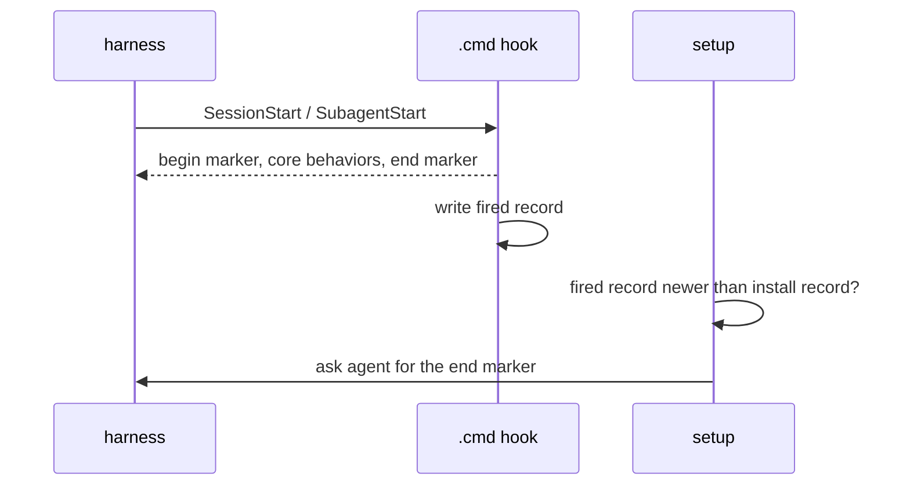

# ADR-0005 — Session-start hook: .cmd printing a prebuilt file, marker proof

> Status: Accepted
> Date: 2026-10-29
> Audited: 2026-10-29
> Layer: L4
> Context ticket: GitHub #153

## Context

The core behaviors reach every session and subagent through a plugin hook (requirement ADR-0003, PRD AC-013/AC-014). Amended 2026-10-30: the owner removed the 50 ms limit; `.cmd` stays because it starts fastest. On this machine `.cmd` started in 35 ms, Python in 60 ms, Git Bash in 97 ms (median). v1 has no "hook fired" signal (INV-001). Claude's subagent hook takes JSON only (SDD §9b).

## Decision

Per provider, a `.cmd` hook prints a prebuilt file and writes a fired record; it runs on session start (startup, resume, clear, compact) and on subagent start. The text starts and ends with `afkv2-core-behaviors begin|end <sha12>`. A build check makes the provider variants, enforces 8,000 characters and refuses a stale file. Setup proves the hook: the fired record is newer than setup's install record, and the agent finds the end marker. Day 1 opens with a live check that both harnesses accept a `.cmd` hook; if not, a Python hook.

## Alternatives Considered

| Alternative | Pros | Cons | Reason rejected |
|-------------|------|------|-----------------|
| Python hook | reads hook input | 60 ms median | slower start for every session and subagent (the 50 ms rule was removed 2026-10-30) |
| marker only, no fired record | simpler | rests on the agent's self-report alone | weak proof |

## Consequences

- **Positive** — a cut text shows as a missing end marker.
- **Negative** — the `.cmd` registration is unverified until day 1.
- **Follow-ups** — none.
