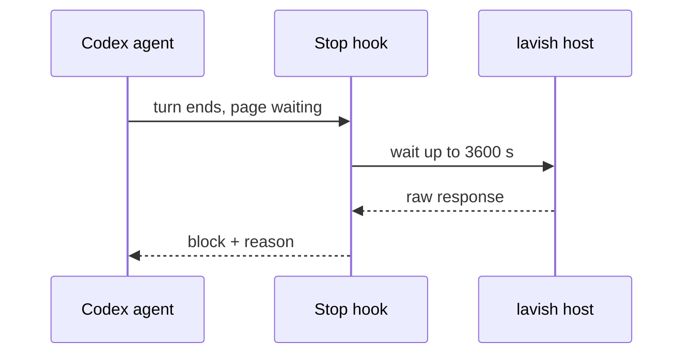

# ADR-0006 — Codex page wake through a Stop hook

> Status: Accepted
> Date: 2026-10-29
> Audited: 2026-10-29
> Layer: L6
> Context ticket: GitHub #153

## Context

Under Codex a page answer reaches the poll but does not start a new agent turn (v1 issue #137); v1 PR #147 makes Codex refuse to poll. The owner chose to make the page wake Codex in P0 (R-4 "fix-resume"). Codex docs: a Stop hook that returns decision `block` with a `reason` starts a continuation prompt whose text is the reason; timeout default 600 s, no stated maximum (SDD §7, §9b).

## Decision

On Codex, show writes a "page waiting" record for the session. An afkv2 Stop hook, when that record exists, waits for the page answer (timeout 3600 s) and returns `block` with the raw response as reason. Claude keeps v1's tracked background poll. If the day-1 live check fails, the fallback is one chat message after Send, reported to the owner. Owner accepted the mechanism in R-5.

## Alternatives Considered

| Alternative | Pros | Cons | Reason rejected |
|-------------|------|------|-----------------|
| page + one chat message | proven by #137 | one extra message per round | owner chose fix-resume |
| chat-only rounds on Codex | v1 runs it | no notes on elements, no maps | weaker page flow |

## Consequences

- **Positive** — one page flow on both harnesses (PRD AC-044).
- **Negative** — one more Codex hook to trust; wait limits are unverified until day 1.
- **Follow-ups** — none.
