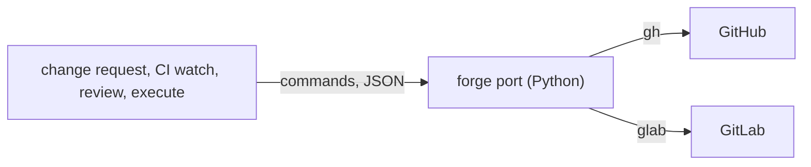

# ADR-0007 — Forge port: Python rewrite of the commands the chain calls

> Status: Accepted
> Date: 2026-10-29
> Layer: L7
> Context ticket: GitHub #153

## Context

Each v1 forge adapter is one bash script of about 750 lines with 18 commands, using v1 names and needing Git Bash on Windows (INV-002). Decision 74 says the plugin has no bash (SDD §8).

## Decision

Rewrite in Python only the forge commands the chain calls, for GitHub and GitLab, keeping v1's command names and JSON answers inside the afkv2 envelope. Owner, R-3: "python-used".

## Alternatives Considered

| Alternative | Pros | Cons | Reason rejected |
|-------------|------|------|-----------------|
| port the bash scripts | renames only | Git Bash dependency; breaks decision 74 | owner kept decision 74 |
| no port; skills call gh and glab | least code | forge differences leak into every skill | weak seam |

## Consequences

- **Positive** — no Git Bash; one answer envelope with the tracker port.
- **Negative** — new code in subtask 12.
- **Follow-ups** — the remaining v1 commands, if a 2.1 skill needs them.
