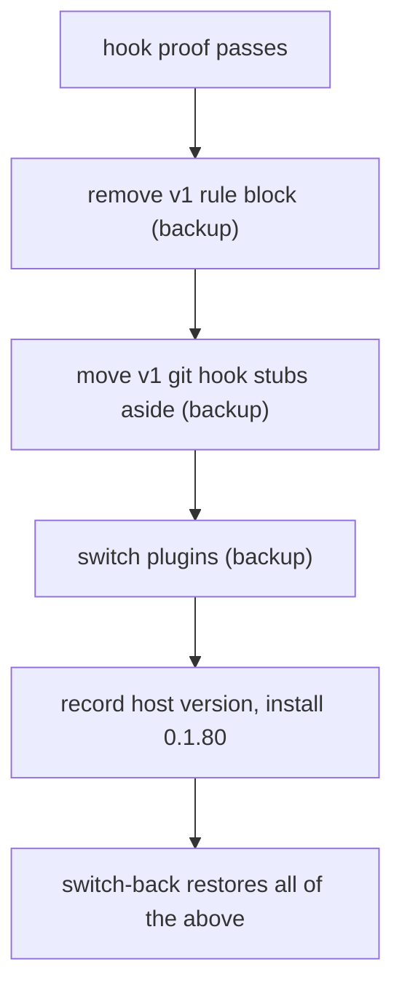

# ADR-0008 — Setup takes over from v1 with a backup for every write

> Status: Accepted
> Date: 2026-10-29
> Layer: L6
> Context ticket: GitHub #153

## Context

One rule set per session (requirement ADR-0004). v1 leaves 3 things active when its plugin is off: the rule block in the user instruction files, the git hook stubs in each repository, and the machine-wide lavish host version (SDD §7, §14; signed HL-5 rows R-1, R-3, R-5).

## Decision

After the hook proof (ADR-0005), setup removes the v1 rule block, moves the v1 pre-commit and reference-transaction stubs aside, writes the plugin switch on Claude to the project's personal settings file (never the shared one) and globally on Codex, installs lavish host 0.1.80 after recording the installed version, and installs rg. Every write keeps a backup; switch-back restores each one.

## Alternatives Considered

| Alternative | Pros | Cons | Reason rejected |
|-------------|------|------|-----------------|
| remove the v1 block first | simpler | an untrusted hook leaves a session with no rules | requirement ADR-0004 |
| leave v1 git hooks | no write | v1 commit rules gate afkv2 work | one rule set per session |
| a second, afkv2-only host copy | v1 keeps 0.1.63 | one global command and session folder; side by side not verified | not proven |

## Consequences

- **Positive** — one rule set per session; every change reversible.
- **Negative** — v1 runs host 0.1.80 while afkv2 is installed.
- **Follow-ups** — confirm a Codex command-line plugin switch, else edit its config with a backup.
