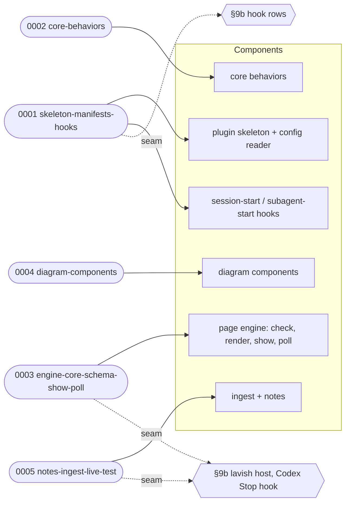

# Execution Plan — afkv2 S1 — skeleton, hooks, core behaviors, page engine

> Parent ticket: GitHub #153   Mode: cited
> Sources: [PRD](../PRD.md) · [SDD](../SDD.md) · [ADRs](../adr/)
> Branch (for /afk:execute): feat/afkv2-s1
> Last updated: 2026-10-30 (status column maintained by /afk:execute)
> Feature: in-progress   <!-- /afk:smoke-test stamps "complete (smoke green …)" iff a smoke gate exists -->
> Review policy: lean   <!-- lean | full — slice review-gate roster; semantics owned by skills/afk/review/SKILL.md "Gate policy". Seeded lean; flip to full by hand for the full roster on every slice; absent (older plans) reads full -->

This is one of 4 plan folders for afkv2 (`plan-s1`..`plan-s4`, decision D-S-4).
Sessions S1, S2 and S3 run in parallel on their own branches into `feat/afkv2`;
S4 runs on day 4 after their pull requests merged. Citation tags: `(PRD §AC-NNN)`
and similar name a PRD id; `(ADR-NNNN design)` is `adr/design/`,
`(ADR-NNNN requirements)` is `adr/requirements/`.

Cross-session rule: an input another session builds is fixed by the SDD
(§3 command contracts, §4 schema v0, §8 "Frozen on day 1"). Until the producer's
pull request merges into `feat/afkv2`, test against a recorded fake built from
that contract (SDD §3: "the consumer tests against a recorded fake"). After the
merge, merge `feat/afkv2` into this branch and run the same tests against the
real producer; S4 subtask 0016 repeats that run for every session.

## Inputs

| Input | Value | Source |
|-------|-------|--------|
| Benchmark repository (AC-021) | `C:\Users\mvu\IdeaProjects\core-services` (about 53,000 files) | benchmark of 2026-10-29 |
| v1 round documents for engine fixtures | `C:\Users\mvu\AppData\Local\Temp\claude\C--Users-mvu-PersonalProjects-afk-driver\23e372bc-cde6-4631-9ea7-43a4a91d8684\scratchpad\grill\grill-final.json`, `...\grill\sdd.json` (copy into the fixtures folder; the scratchpad is temporary) | SDD §4 "Migration & backfill" |
| Toy repository, written test ticket | owner names it by day 4 | PRD AC-001 |
| Jira test project (D-4) | owner names it by day 4 | PRD Further Notes, Parked |
| Demo ticket (Q26) | owner gives it by day 5 | PRD Further Notes, Parked |

## Decisions taken at slicing (two-way doors, reversible on the branch)

| Id | Decision | Why | Reverse |
|----|----------|-----|---------|
| D-S-1 | Run branch = `<feature branch>-run`, an orphan branch with `plan/` at its root | AC-071 needs one name both S2 (writer) and S3 (reader) use; the SDD fixes the layout but not the name | rename in 0010 + 0015 |
| D-S-2 | Division approval = PLAN.md header line `> Division: approved <YYYY-MM-DD>`, written by to-subtasks after the developer's mark | AC-060 needs one record both S2 and S3 read; not in SDD §8 "Frozen on day 1" | change in 0010 + 0015 |
| D-S-3 | Published-ticket log = `%LOCALAPPDATA%\afkv2\published-tickets.txt`, one line `<ISO-8601 UTC> <ticket key> <receipt 8 chars>` per publish | the SDD §14 switch-back report needs a source; S2 writes it, S3 reads it | change in 0008 + 0011 |
| D-S-4 | 4 plan folders (`plan-s1`..`plan-s4`); subtask ids numbered 0001-0017 across all of them, so an id is unique feature-wide | one folder per session branch avoids merge conflicts on PLAN.md; the session numbering of the PRD division is kept | merge into one `plan/` |
| D-S-5 | Inside S3, code-review and create-change-request come before autopilot (0013, 0014, 0015) | autopilot calls both; a producer must rank before its consumer | — |
| D-S-6 | The page engine (one SDD §8 module) is cut in 3 slices along the SDD §8 "Ported vs new" rows and the registry: 0003 render / check + show / poll, 0004 diagram registry entries, 0005 ingest | owner-approved division W-2; each slice is one public verb set or registry entries | merge 0003-0005 |
| D-S-7 | `## Seams` lists only SDD §14 rows (the plan check requires a §14 row + its investigation); §9b rows go to `## Acceptance`, `## Verification` and the seam register below | the v1 plan check grounds every `## Seams` bullet on §14 | — |
| D-S-8 | Codex live checks (hook after the trust review, compaction, Stop-hook wait) are owner-run steps: they need afkv2 enabled in the owner's global Codex config | a global switch on the owner's machine is the owner's call; no credentials are copied | the agent runs them with the owner's approval |
| D-S-9 | One `0017-sync-harness` subtask, in plan-s4 only, not one per plan | 4 harness syncs would edit the same AGENTS.md lines; S4 runs after all sessions merged | — |

## Owner-run live checks (day 1-2, before S2 and S3 rely on them)

Steps are written by 0001 and 0003 to `afkv2/tests/live/CODEX-LIVE-CHECKS.md`.

| # | Check | Pass | On fail |
|---|-------|------|---------|
| 1 | Codex accepts the `.cmd` session-start hook after the trust review; a new session reports the end marker with the right sha12 | marker + sha12 match | Python hook; the 50 ms limit goes back to the owner (SDD §7) |
| 2 | Codex re-runs the hook after a compaction | marker present after compaction | record as AC-012 gap; owner decides |
| 3 | Codex Stop hook: a page answer sent after 10 minutes reaches the agent with no chat message | answer arrives | fallback: one chat message after Send (ADR-0006) |
## Solution map

*Every S1 slice builds one part of the base or the engine; the hook and host
seams are the ones S2 and S3 depend on.*

## Seam register

| § | Seam (SDD row) | Implemented by | Used by |
|---|----------------|----------------|---------|
| §9b | "lavish host" | 0003-engine-core-schema-show-poll (seam-test), 0005 (live test) | S2 0007, 0009 (show / poll) |
| §9b | "Claude session-start hook" | 0001-skeleton-manifests-hooks | 0002, S3 0011 (hook proof) |
| §9b | "Claude subagent-start hook" | 0001-skeleton-manifests-hooks | — |
| §9b | "Codex session-start / subagent-start hook" | 0001-skeleton-manifests-hooks (owner-run check 1, 2) | S3 0011 |
| §9b | "Codex Stop hook" | 0003-engine-core-schema-show-poll (owner-run check 3) | S2 0007, 0009 |

## Progress tracker

| # | Subtask | Title | Status | Blocked by | Tiers | Seams |
|---|---------|-------|--------|------------|-------|-------|
| 1 | 0001-skeleton-manifests-hooks | skeleton manifests hooks | done | — | static, unit, integration | — |
| 2 | 0002-core-behaviors | core behaviors | done | 0001-skeleton-manifests-hooks | static, unit, integration | — |
| 3 | 0003-engine-core-schema-show-poll | engine core schema show poll | pending | 0001-skeleton-manifests-hooks | static, unit, integration | — |
| 4 | 0004-diagram-components | diagram components | pending | 0003-engine-core-schema-show-poll | static, unit | — |
| 5 | 0005-notes-ingest-live-test | notes ingest live test | pending | 0003-engine-core-schema-show-poll, 0004-diagram-components | static, unit, e2e/browser | — |

Status values: `pending` → `designing` → `developing` → `verifying` → `reviewing` → `done`,
or `blocked(<reason>)`. <!-- status set: lockstep copy — owned by /afk:execute (progress-tracker status column) -->
`/afk:execute` advances the row it is working and writes
the date in the header; everything else in PLAN.md is yours to edit.

## Feature smoke gate (minimal)

`.afk/config.yaml` declares no `verification.tiers`, and the repository has no
build-gate kind: the app-start, e2e and api rows are dropped. The two rows below
name the afkv2 tree directly.

| # | Check | Command | Status |
|---|-------|---------|--------|
| 1 | compile | `afk-python -m compileall -q afkv2` | |
| 2 | regression | `afk-python -m pytest afkv2/tests -q` (the afkv2 tree is the changed module) | |

Last run: —
