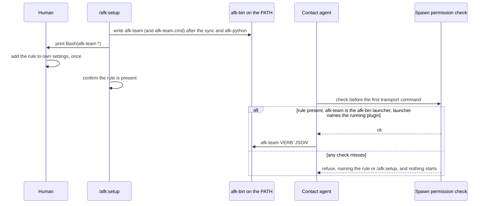

# ADR-0017 — The spawn allow rule names the afk-team command, which setup writes into afk-bin

> Status: Accepted
> Date: 2026-10-26
> Layer: L4
> Context ticket: agent-team-topology

## Context

This record supersedes ADR-0005. The human decided it in round 47 (R-47): settled rows S-247 and S-248 (terminal answers of 2026-10-26), and packets HL3-4, HL5-7 and HL6-10, signed "sign" on 2026-10-26 (`GRILL-LOG.md:747-756`).

ADR-0005's rule, `Bash(afk-python "${AFK_PLUGIN_ROOT}/scripts/afk-team.py" *)`, names the plugin folder. That folder changes with every plugin update, so the human pastes a new rule after each update. On Claude Code 2.1.308 the rule never matched, because no rule matches a command that holds a variable (`plan/JOURNAL.md:368`). The trial of 2026-10-26 on Claude Code 2.1.310 and 2.1.311 (`GRILL-LOG.md:746`) found these facts:
- The session rule `Bash(afk-team *)` ran `afk-team agent-list '{}'` with no prompt in default mode.
- In auto mode the rule decided before the auto-mode check (permissionDecisionMs=6).
- A joined command is checked part by part, so an uncovered part prompts.
- A plugin's bin/ folder reached the Bash PATH only through Claude Code's shell snapshot. The snapshot hit its 10 s limit in 3 of 4 sessions (exit 127, 'afk-team: command not found').
- The auto-mode classifier refused an agent's write of settings or of a hook file 3 times: trial T7, the hook-file trial, and the setup-write trial.

SDD §3 'Auth: harness permission', §5, §7 E13, §8 'Spawn permission check' and §9b hold the design.

## Decision

The team entry script runs as a command on the operating-system PATH: agents run `afk-team VERB 'JSON'`, where VERB is one of the six transport verbs and JSON is its one JSON object. The allow rule is `Bash(afk-team *)`, which names no path, so a plugin update does not change it. The human adds the rule once. `/afk:setup` prints it, waits and confirms it, and never writes a settings file (S-247). `/afk:setup` writes the afk-team launcher into afk-bin, beside afk-python, in its Python runtime step, after the environment sync and after afk-python is placed. The launcher is afk-team (a shell script for Bash) and, on Windows, afk-team.cmd. Each holds one line that runs the team script of the plugin folder that ran setup. Setup writes a staged file, moves it into place in one step, and writes only when the bytes differ (S-248, HL5-7). Before a run's first transport command, the spawn permission check proves 3 things: the rule is in the user's settings; afk-team on PATH is the launcher in afk-bin; the launcher names the plugin folder that is running. On a miss it refuses, names the rule or `/afk:setup`, and nothing starts. The check runs on Claude Code only; other harnesses pass (HL3-4).

Caption: setup places the command and the human grants the rule once; every run proves the rule and the launcher before it starts anything.

## Alternatives Considered

| Alternative | Pros | Cons | Reason rejected |
|-------------|------|------|-----------------|
| Setup writes the rule into the user's settings | No manual step | The auto-mode check refused an agent's settings edit 3 times: trial T7, the hook-file trial, and the setup-write trial, which it refused before it started | Refused by the harness (HL3-4) |
| A plugin hook that answers allow | Shipped by the plugin, no rule | The hook file write was refused the same way | Refused by the harness (HL3-4) |
| The plugin's own bin/ folder | No setup step; documented to be on the Bash PATH while the plugin is enabled | Not reliably on PATH on this machine: it reaches PATH only through the shell snapshot, which hit its 10 s limit in 3 of 4 sessions | Rejected by the human (S-248) |
| The old full-path rule, printed fresh on every setup run | Works; no new file | A manual paste after every plugin update | Rejected by the human (HL3-4, HL6-10) |
| A launcher in afk-bin, rule Bash(afk-team *), 3-part run check (chosen) | afk-bin is on PATH at the operating-system level; the rule names no path and survives updates | One setup run after each plugin update; the rule trusts the first afk-team on PATH, which the check guards | — |

## Consequences

- **Positive** — the human adds one rule, once; a plugin update does not change it. The rule decides before the auto-mode check, so a team run works in default and auto mode.
- **Negative** — after a plugin update, team runs refuse until `/afk:setup` runs once. The rule matches any arguments to afk-team, which is the same reach as before. Another file named afk-team earlier on PATH would run under the rule; the run check refuses when afk-team is not the afk-bin launcher. The old full-path rule, if present, stops being used and can be removed. The path convention "plugin files are named by `${AFK_PLUGIN_ROOT}/...`" gains one stated exception, the afk-team command.
- **Follow-ups** — not tried: the auto-mode check may refuse setup's launcher write when setup runs in auto mode (SDD §13 Q55); afk-team.cmd under a Codex agent on Windows (SDD §13 Q56). The launcher subtask proves each with a live row in providers/CONFORMANCE.md before it merges.
