# Execution Plan — Agent team topology and multi-model

> Parent ticket: agent-team-topology   Mode: cited
> Sources: [PRD](../PRD.md) · [SDD](../SDD.md) · [ADRs](../adr/)
> Branch (for /afk:execute): feat/agent-team-topology
> Last updated: 2026-10-20 (status column maintained by /afk:execute)
> Feature: in-progress   <!-- /afk:smoke-test stamps "complete (smoke green …)" iff a smoke gate exists -->
> Review policy: lean   <!-- lean | full — slice review-gate roster; semantics owned by skills/afk/review/SKILL.md "Gate policy". Seeded lean; flip to full by hand for the full roster on every slice; absent (older plans) reads full -->

Agent decisions taken while slicing are in [DECISIONS.md](DECISIONS.md) (D-1 to D-39). The plan was re-sliced in place against 1210110, which holds the main merge (D-13). Five seams rest on investigations left partial under the human's exception of 2026-10-02 (GRILL-LOG.md:711): Step 10.5 (INV-035), the report-file writers (INV-036), the lesson id mint (INV-034) and both /afk:bug rows (INV-038); each is an Acceptance row on its owning subtask, and its §13 checks must pass before that subtask merges (D-5, D-17). A §14 row whose citation the plan validator cannot read is an Acceptance seam bullet on its owner (D-9, D-14).

## Solution map

```mermaid
flowchart LR
  subgraph Foundation
    C1[config reader + CONFIG.md]
    C2[run manifest]
    C3[knowledge store]
    C4[pattern resolver + BP-1..BP-5]
    C5[glossary]
  end
  subgraph Transport
    C6[transport family: subagent, headless, multiplexer + herdr]
    C7[desktop tool + 1DevTool]
    C8[wait script]
    C9[spawn permission]
  end
  subgraph Team
    C10[team entry script]
    C11[job supervisor]
    C12[cleanup]
    C13[team skill + manifests]
    C14[SessionStart charter pointer]
  end
  subgraph Doctrine
    C15[model equivalence + Codex stub names]
    C16[DELEGATION.md + BEHAVIORS.md short form]
    C17[stage-skill spawn points]
  end
  subgraph Roles
    C18[review gate]
    C19[adversary]
    C20[subagent fallback writers]
    C21[fix afk-lite]
    C22[bug legs]
  end
  subgraph Surfaces
    C23[lesson ledger lock]
    C24[status set + journal reasons]
    C25[dashboard team section]
  end
  T1([0001 glossary-terms]) --> C5
  T2([0002 config keys]) --> C1
  T3([0003 manifest]) --> C2
  T4([0004 knowledge]) --> C3
  T5([0005 resolver + records]) --> C4
  T6([0006 transport + herdr]) --> C6
  T7([0007 desktop tool]) --> C7
  T8([0008 wait script]) --> C8
  T9([0009 spawn permission]) --> C9
  T10([0010 entry script]) --> C10
  T11([0011 supervisor]) --> C11
  T12([0012 cleanup]) --> C12
  T13([0013 providers + Codex]) --> C15
  T14([0014 delegation]) --> C16
  T15([0015 team skill]) --> C13
  T16([0016 SessionStart]) --> C14
  T17([0017 spawn steps]) --> C17
  T18([0018 review gate]) --> C18
  T19([0019 adversary]) --> C19
  T20([0020 fallback writers]) --> C20
  T21([0021 fix afk-lite]) --> C21
  T22([0022 bug legs]) --> C22
  T23([0023 lesson lock]) --> C23
  T24([0024 status set]) --> C24
  T25([0025 dashboard]) --> C25
  T26([0026 sync-harness]) --> C13
  T8 -. seam .-> S1{{§9b 1-2 background job wake and end}}
  T7 -. seam .-> S3{{§9b 3 TR-4 close}}
  T12 -. seam .-> S4{{§9b 4 OS job}}
  T6 -. seam .-> S5{{§9b 5, 8, 9, 15, 18, 20, 21 herdr and harness}}
  T13 -. seam .-> S6{{§9b 6 Codex lookup}}
  T9 -. seam .-> S7{{§9b 7 auto-mode classifier}}
  T10 -. seam .-> S10{{§9b 10, 11, 14, 22, 23 names, session id, markers, dialogs, pane creation}}
  T16 -. seam .-> S12{{§9b 12 SessionStart output}}
  T22 -. seam .-> S13{{§9b 13 tracker server}}
  T17 -. seam .-> S16{{§9b 16 named agents, pinned models}}
  T18 -. seam .-> S17{{§9b 17 file reads}}
  T20 -. seam .-> S19{{§9b 19 report-file write}}
  T7 -. seam .-> S24{{§9b 24 1DevTool}}
```

## Seam register

Rows are the SDD §9b boundaries, in SDD order. A row with no SDD §14 seam row is carried as an Acceptance bullet plus its seam test on the implementer (D-5).

| § | Seam (SDD §9b row) | Implemented by | Used by |
|---|--------------------|----------------|---------|
| 1 | "Harness wake on a background job's exit" | 0008-inbox-wait-script | 0010-team-entry-script, 0014-delegation-doctrine, 0015-team-skill-and-manifests |
| 2 | "Background job at session end" | 0008-inbox-wait-script | 0012-cleanup |
| 3 | "Desktop-tool terminal close verb (TR-4)" | 0007-desktop-tool-transport | 0012-cleanup |
| 4 | "Operating-system job owning a process tree" | 0012-cleanup | 0006-transport-family-and-herdr |
| 5 | "Terminal multiplexer install" | 0006-transport-family-and-herdr | 0015-team-skill-and-manifests |
| 6 | "Codex agent lookup" | 0013-provider-layer-codex | 0017-spawn-steps |
| 7 | "Claude Code auto-mode classifier" | 0009-spawn-permission-check | 0010-team-entry-script |
| 8 | "Harness update check at an agent's start" | 0006-transport-family-and-herdr | 0010-team-entry-script |
| 9 | "herdr message delivery" | 0006-transport-family-and-herdr | 0010-team-entry-script |
| 10 | "herdr agent name and pane label" | 0010-team-entry-script | 0012-cleanup, 0025-dashboard-team-section |
| 11 | "herdr harness session id" | 0010-team-entry-script | 0022-bug-pane-legs |
| 12 | "SessionStart hook output" | 0016-sessionstart-handlers | — |
| 13 | "Plugin tracker server in a pane agent" | 0022-bug-pane-legs | 0021-fix-afk-lite |
| 14 | "Provider marker variables in a pane agent" | 0010-team-entry-script | — |
| 15 | "Stop gates in a pane session" | 0006-transport-family-and-herdr | 0019-adversary-pane-agent |
| 16 | "Named agent definitions and pinned models in a pane agent" | 0017-spawn-steps | 0010-team-entry-script, 0014-delegation-doctrine |
| 17 | "File reads in a pane agent" | 0018-review-gate-pane-workers | 0019-adversary-pane-agent, 0021-fix-afk-lite |
| 18 | "Busy pane message order" | 0006-transport-family-and-herdr | 0010-team-entry-script |
| 19 | "Subagent report-file write" | 0020-subagent-fallback-report-writers | 0018-review-gate-pane-workers, 0019-adversary-pane-agent |
| 20 | "Capture time limit and pane close" | 0006-transport-family-and-herdr | 0012-cleanup |
| 21 | "Codex pane-agent launch flags" | 0006-transport-family-and-herdr | 0021-fix-afk-lite |
| 22 | "First-run dialogs at an agent's start" | 0010-team-entry-script | — |
| 23 | "Claude Code auto-mode classifier, pane creation" | 0010-team-entry-script | 0009-spawn-permission-check |
| 24 | "1DevTool delivery and tabs" | 0007-desktop-tool-transport | — |

## Progress tracker

| # | Subtask | Title | Status | Blocked by | Tiers | Seams |
|---|---------|-------|--------|------------|-------|-------|
| 1 | 0001-glossary-terms | Glossary terms the design defines | done | — | static | — |
| 2 | 0002-config-transport-and-pattern-keys | Configuration reader learns the transport, switch and pattern keys | done | — | static, unit | — |
| 3 | 0003-manifest-module | Run manifest: record, move, read under one lock | done | — | static, unit | — |
| 4 | 0004-knowledge-store | Knowledge store: entries, finished stamp, debate release | done | — | static, unit | — |
| 5 | 0005-pattern-resolver-and-builtin-records | Pattern resolver and built-in patterns BP-1 to BP-5 with their charters | reviewing | 0002-config-transport-and-pattern-keys | static, unit | — |
| 6 | 0006-transport-family-and-herdr | Transport family, herdr recipe, machine probe, multiplexer setup row | pending | 0002-config-transport-and-pattern-keys | static, unit, integration | impl §5, §8, §9, §15, §18, §20, §21; use §4 |
| 7 | 0007-desktop-tool-transport | Desktop-tool kind and the 1DevTool recipe, after its trial | pending | 0006-transport-family-and-herdr | static, unit, integration | impl §3, §24 |
| 8 | 0008-inbox-wait-script | The wait job: one per run, checks the contact inbox every 10 seconds | pending | — | static, unit, integration | impl §1, §2 |
| 9 | 0009-spawn-permission-check | Spawn permission check and the setup offer of the allow rule | pending | — | static, unit | impl §7; use §23 |
| 10 | 0010-team-entry-script | The team entry script: six verbs, checks, names, charter files, launch prompts | pending | 0003-manifest-module, 0005-pattern-resolver-and-builtin-records, 0006-transport-family-and-herdr, 0008-inbox-wait-script, 0009-spawn-permission-check | static, unit, integration | impl §10, §11, §14, §22, §23; use §1, §7, §8, §9, §16, §18 |
| 11 | 0011-job-supervisor | Job supervisor: one per agent, sends exited or parked | pending | 0010-team-entry-script | static, unit | — |
| 12 | 0012-cleanup | Cleanup: five fixed steps, survivors reported by name | pending | 0003-manifest-module, 0004-knowledge-store, 0006-transport-family-and-herdr, 0010-team-entry-script | static, unit, integration | impl §4; use §2, §3, §10, §20 |
| 13 | 0013-provider-layer-codex | Model equivalence sentence and Codex stub names | pending | — | static, unit, integration | impl §6 |
| 14 | 0014-delegation-doctrine | DELEGATION.md states the pane-agent rule once; its BEHAVIORS.md short form | pending | 0008-inbox-wait-script | static, unit, integration | use §1, §16 |
| 15 | 0015-team-skill-and-manifests | The team skill, in both plugin manifests | pending | 0010-team-entry-script, 0011-job-supervisor, 0012-cleanup, 0013-provider-layer-codex, 0014-delegation-doctrine | static, integration | use §1, §5 |
| 16 | 0016-sessionstart-handlers | SessionStart: the charter pointer after a compaction | pending | 0010-team-entry-script | static, unit, integration | impl §12 |
| 17 | 0017-spawn-steps | Stage-skill spawn points start role agents through the contact agent | pending | 0001-glossary-terms, 0014-delegation-doctrine, 0015-team-skill-and-manifests | static, unit, integration | impl §16; use §6 |
| 18 | 0018-review-gate-pane-workers | Review gate workers as pane agents, in Step 10 and PF-3 | pending | 0001-glossary-terms, 0015-team-skill-and-manifests | static, unit, integration | impl §17; use §19 |
| 19 | 0019-adversary-pane-agent | The adversary as a pane agent, blind diet kept | pending | 0015-team-skill-and-manifests, 0018-review-gate-pane-workers | static, integration | use §15, §17, §19 |
| 20 | 0020-subagent-fallback-report-writers | Under the subagent fallback, the starter writes the report file | pending | 0017-spawn-steps, 0018-review-gate-pane-workers, 0019-adversary-pane-agent | static, integration | impl §19 |
| 21 | 0021-fix-afk-lite | /afk:fix runs the afk-lite team | pending | 0005-pattern-resolver-and-builtin-records, 0015-team-skill-and-manifests | static, unit, integration | use §13, §17, §21 |
| 22 | 0022-bug-pane-legs | /afk:bug publisher, fixer and retester as pane agents | pending | 0020-subagent-fallback-report-writers, 0021-fix-afk-lite | static, unit, integration | impl §13; use §11 |
| 23 | 0023-lesson-ledger-lock | Lesson ledger id mint under a folder lock | pending | — | static, unit, integration | — |
| 24 | 0024-status-set-and-journal-reasons | The unrecorded_agent status everywhere; the unhomed_product_debt reason | pending | 0017-spawn-steps | static, unit | — |
| 25 | 0025-dashboard-team-section | Mission control: team section and feature review-round count | pending | 0003-manifest-module | static, unit | use §10 |
| 26 | 0026-sync-harness | Sync the harness for the shipped feature | pending | 0001-glossary-terms, 0002-config-transport-and-pattern-keys, 0003-manifest-module, 0004-knowledge-store, 0005-pattern-resolver-and-builtin-records, 0006-transport-family-and-herdr, 0007-desktop-tool-transport, 0008-inbox-wait-script, 0009-spawn-permission-check, 0010-team-entry-script, 0011-job-supervisor, 0012-cleanup, 0013-provider-layer-codex, 0014-delegation-doctrine, 0015-team-skill-and-manifests, 0016-sessionstart-handlers, 0017-spawn-steps, 0018-review-gate-pane-workers, 0019-adversary-pane-agent, 0020-subagent-fallback-report-writers, 0021-fix-afk-lite, 0022-bug-pane-legs, 0023-lesson-ledger-lock, 0024-status-set-and-journal-reasons, 0025-dashboard-team-section | static | — |

Status values: `pending` → `designing` → `developing` → `verifying` → `reviewing` → `done`,
or `blocked(<reason>)`. <!-- status set: lockstep copy — owned by /afk:execute (progress-tracker status column) -->
`/afk:execute` advances the row it is working and writes
the date in the header; everything else in PLAN.md is yours to edit.

## Feature smoke gate (minimal)

No VERIFICATION-PLAN.md exists, and this repository declares no `verification.tiers`. Rows 1 and 3 use the repository's own checks; app-start, the e2e suite and the api suite are dropped, since this plugin has no app, no browser suite and no api suite (D-10).

| # | Check | Command | Status |
|---|-------|---------|--------|
| 1 | compile | `afk-python -m compileall -q scripts hooks skills adapters` and `bash -n` on every changed `.sh` file | |
| 3 | regression | `afk-python -m pytest scripts/tests skills -q` and `bash hooks/tests/hook-smoke.sh` | |

Last run: —
