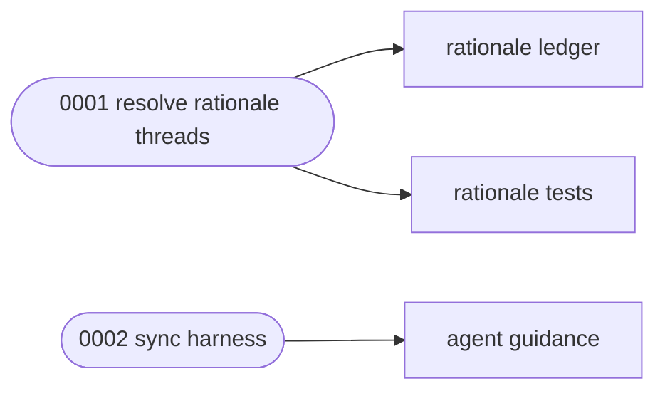

# Execution Plan — Resolve rationale threads

> Parent ticket: auto-resolve-rationale   Mode: uncited
> Sources: [PRD](../PRD.md)
> Branch (for /afk:execute): feat/session-b1f2ca52
> Last updated: 2026-10-26 (status column maintained by /afk:execute)
> Feature: in-progress
> Review policy: lean

## Solution map

## Progress tracker

| # | Subtask | Title | Status | Blocked by | Tiers | Seams |
|---|---------|-------|--------|------------|-------|-------|
| 1 | 0001-resolve-rationale-threads | Resolve rationale threads | blocked(test_fail: Windows CI browser helper produced no result) | — | static, unit | — |
| 2 | 0002-sync-harness | Sync harness | pending | 0001-resolve-rationale-threads | static | — |

Status values: `pending` → `designing` → `developing` → `verifying` → `reviewing` → `done`,
or `blocked(<reason>)`.
`/afk:execute` advances the row it is working and writes
the date in the header; everything else in PLAN.md is yours to edit.

## Feature smoke gate (minimal)

| # | Check | Command | Status |
|---|-------|---------|--------|
| 1 | compile | `afk-python -m py_compile skills/afk/review/scripts/forge_ledger.py` | |
| 2 | regression | `afk-python -m pytest -q scripts/tests/test_rationale_ledger.py` | |

Last run: —
