# SDD — setup-per-repo

> Parent PRD: `PRD.md`
> Status: Draft
> Last updated: 2026-10-21
> Reading guide: sections follow the L1–L9 design-layer ladder, top of the system down to the code
> (L1 topology · L2 service boundaries · L3 data · L4 cross-cutting quality · L5 domain model ·
> L6 processes · L7 modules · L8 patterns · L9 seams into existing code). Skim §0 (what's locked)
> and §1 (why) first; non-implementers can stop there or read the DESIGN-BRIEF instead.

## §0 Binding Contract

This SDD and its accepted ADRs are **binding** on implementing agents and reviewers.

| Aspect | Locked by SDD/ADR | Executor latitude |
|--------|-------------------|-------------------|
| Pattern choice | ✅ | ❌ |
| Module public interface | ✅ | ❌ |
| API contract / schema | ✅ | ❌ |
| Persisted schema — fields, relations, migration (§4) | ✅ | ❌ |
| Lifecycle states + legal transitions (§6) | ✅ | ❌ |
| Roles permitted/denied per surface (§5) | ✅ | ❌ |
| Aggregate boundary | ✅ | ❌ |
| Txn / idempotency strategy | ✅ | ❌ |
| External-seam contract (§9b: framework I/O shape, field source-of-truth, enforcement point, failure surface) | ✅ | ❌ |
| File / package layout *within* a named module | ❌ | ✅ |
| Private helper extraction | ❌ | ✅ |
| Internal naming, control flow | ❌ | ✅ |
| Test fixture structure | ❌ | ✅ |

**Conflict procedure.** Executor finds a binding decision wrong / infeasible / contradicting reality → classify per the decision protocol (`DECISIONS.md`, workflow plugin root): a two-way-door correction is recorded in `plan/DECISIONS.md` and implemented; a one-way door or a tie exits the subtask with `design_conflict` status quoting the SDD section + the conflict, routed back to `/afk:grill-solution` for a new ADR (Status: Accepted, Supersedes: NNNN). Never override off the record.

**Human sign-off register.** Transcribed from `GRILL-LOG.md` "## Solution grill" signoff rows. A later delta signature covers only its changed rows; the earlier signature stands for the rest.

| Aspect | Section | Status | Signed by / date | Approved wording |
|--------|---------|--------|------------------|------------------|
| HL-1 stored state | §4 | signed | {user} / 2026-10-19; delta 2026-10-21 | "I sign"; delta: "I sign" |
| HL-2 command surface | §3 | signed | {user} / 2026-10-19; delta 2026-10-21 | "sign"; delta: "I sign" |
| HL-3 access | §5 | signed | {user} / 2026-10-20 (amended); delta 2026-10-21 | "I sign"; delta: "I sign" |
| HL-4 lifecycle and rules | §6 | signed | {user} / 2026-10-20 | "I sign" |
| HL-5 irreversible effects | §7 | signed | {user} / 2026-10-20 (amended); narrowed row 2026-10-21; delta 2026-10-21 | "I sign"; narrowed: "I sign"; delta: "I sign" |
| HL-6 changed behaviour | §14 | signed | {user} / 2026-10-21 | "I sign" |

Superseded signatures (voided by drift, then re-signed): HL-3 2026-10-19, HL-3-corrected 2026-10-20, HL-5 2026-10-20.

## §1 Context Summary

Agents put new worktrees inside the main checkout, `/afk:setup` configures only the repository the session stands in, and one machine holds one forge login per host and one Jira sign-in. This design adds a machine-wide repository list, one worktree root with a fixed layout, a per-setting owner rule applied inside the one settings reader, a forge account per repository, and a Jira sign-in per site. It reuses the plugin's existing shape: no new running program, files read at the moment of use, shared code in the scripts folder, agents bound by the command guard. The WHAT is `PRD.md`.

---

## §2 L1 — System Topology

Inherited: the plugin runs as harness hooks, skills and scripts started per command; no daemon, no network service (R-1 L1.1). The feature touches four units outside the plugin: git, the forge command-line tools, the Jira site and the harness.

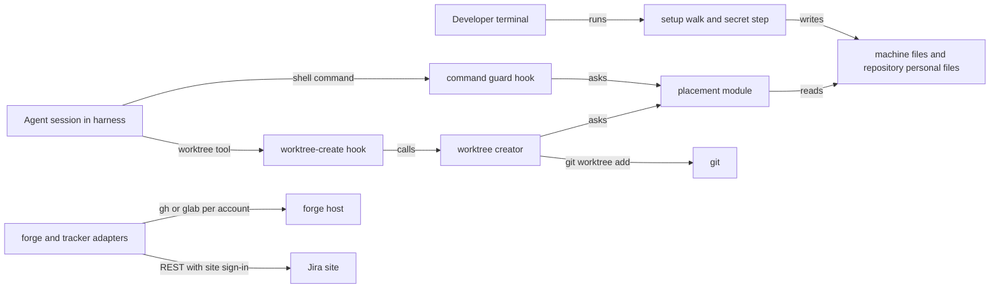

Caption: every new piece is a library or a file read at the moment of use; git, the forge host and Jira stay outside the plugin.

## §3 L2 — Service Boundaries & Integration

Owners (R-1 L2.1..L2.9, accepted):

| Concern | Owner | Integration style |
|---|---|---|
| Owner rule, ignored values, "is set up" | settings reader | library call; command `afk-config.py` |
| Repository list and short-name markers | repository list module; setup is the only writer | library call |
| Worktree folder of a listed repository | placement module | library call from creator, move helper, guard |
| Forge host and account per repository | forge account helper | library call; each forge wrapper fetches its own token |
| Jira sign-in per site | Jira adapter sign-in load | in-process call at each sign-in load |
| Spec folder | repository-files notes kind, always | existing resolve |
| Harness worktree tools | `claude`: worktree-create hook; `codex`: the guard plus a shown setup step for the `codex` app root | harness hook, guard |

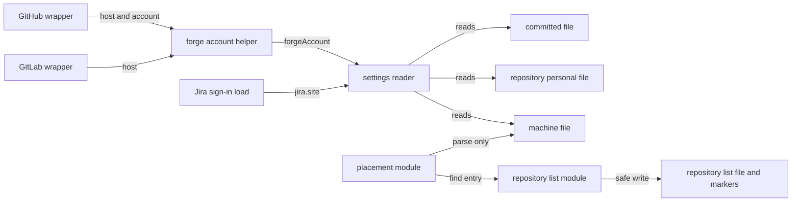

Caption: placement reads only the machine file and the list, so the guard never pays for the full settings merge.

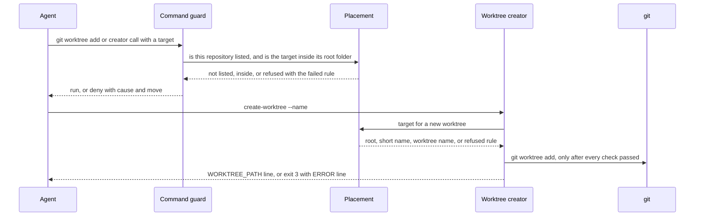

Caption: the guard and the creator ask one placement module, so the folder the guard allows is the folder the creator picks.

**API contract table** (HL-2, signed; delta rows marked Δ). These surfaces are commands, hooks and the guard; there is no HTTP API and no schema artifact. Exit codes are process exit statuses.

| Surface | Called by | Permitted / denied | Input and check | Success answer | Error answers | Repeat | Existing callers |
|---|---|---|---|---|---|---|---|
| `/afk:setup` (no argument) | developer | developer / teammate; an agent on its own initiative | none | one report table: per repository complete, asked, or failed with cause and rerun command | a forge host refuses or cannot be reached: that repository failed, nothing saved for it, walk goes on | asks only what is missing; nothing missing asks nothing | compatible: base, audit and teardown keep their meaning |
| `/afk:setup repo <short name or path>` | developer | as above | a listed short name, or a path whose main checkout is listed; an unlisted path is offered for adding; an unknown short name is refused with the list of names; the developer may name one setting to change | as above, one repository | as above | as above | new |
| `create-worktree --name <name>` | worktree-create hook, launch helper, move helper, agents | agent, developer / none | unchanged name check; the root passes every catalog R rule | last stdout line `WORKTREE_PATH=<path>`, exit 0; listed repository lands at `<root>/<short name>/<name>`; unlisted: inside the main checkout as today | root fails a rule, including a relative or `~` root: exit 3, `ERROR=worktree root: <rule> <reason> - run /afk:setup`; Δ the line names the failing rule and the fixing command, through the creator's own exit path, not the error trap; every other failure: exit 1, `ERROR=<reason>` | an existing destination is refused; a refused run leaves no worktree | path changes for listed repositories; every code caller reads the `WORKTREE_PATH=` line (INV-001) |
| `create-worktree --branch <b> --dir <d> [--parent <p>]` | `/afk:settle-change`, `/afk:execute`, developer | agent under `<root>/<short name>`, developer anywhere / an agent with a target outside it | for a listed repository and an agent session (the plugin's agent detector): `--parent` resolves inside `<root>/<short name>`; `~` and relative paths are made absolute first; without an agent session `--parent` works as today | as above | `--parent` outside the folder for an agent: exit 3, `ERROR=parent <path> is outside <root>/<short name>` plus the fixing command | as above | breaking for an agent `--parent` outside the root and for a set worktree base value; skills naming the base value change in the same commit |
| worktree-create hook (`claude`) | harness | harness / none | as the creator | the bare path, exit 0 | creator fails: non-zero exit, no output | as the creator | compatible: same output shape |
| command guard on `git worktree add` and `git worktree move` | harness, before every agent shell command | an agent command whose real target is inside `<root>/<short name>` / an agent command whose target is outside it or cannot be worked out | the target of add and the destination of move, resolved against the command's folder, its `-C` folder and links; a target in a variable counts as not worked out; Δ add has its own parser knowing `-b`, `-B`, `--orphan`, `--reason` | nothing: the command runs | the harness deny answer: `refused to create a worktree outside the worktree root. Cause: <target> is outside <root>/<short name>. Move: create it under <root>/<short name>, or ask the developer.` No bypass line | read only | breaking for agents in listed repositories; two tests pinning "a plain worktree add passes" reverse for listed repositories; unlisted: unchanged |
| Δ command guard on the creator call | harness | as above | for a listed repository, the creator's `--parent` or `--dir`; outside `<root>/<short name>` is refused | runs | deny answer as above | read only | new refusal |
| Δ command guard on inline variables | harness | none for agents | an agent command that sets `AFK_WORKTREE_FOLDER` or `AFK_ALLOW_PROTECTED` in front of itself | — | deny answer naming the variable | read only | new refusal; a session the developer launches with `AFK_ALLOW_PROTECTED=1` keeps lifting every guard rule |
| `afk-config.py resolve worktreeRoot` | worktree creator, setup | any caller / none | none; the confirmed root, else the suggestion, each checked against catalog R | the root path, exit 0; a stderr note when it is the suggestion | neither passes: exit 1, the failed rule on stderr | read only | replaces `resolve worktreeBasePath`; callers move in the same commit |
| `afk-config.py validate` | setup, developer, plugin-issue reporter | any caller / none | the merged files | `configuration is valid`, then one warning line per ignored value (setting, file, rule), exit 0 | unknown keys refused as today; `jira.credentials-env` warns `jira.credentials-env was removed; delete this key` | read only | compatible: ignored values do not change the exit status |
| `afk-config.py get`, `effective`, `export-shell`, `resolve` | every reader | any caller / none | the merged files | an ignored value is absent from the answer | unchanged | read only | the answer changes only where a value sat at a file its owner does not read |
| Δ forge sign-in check (`auth-status` verb of both forge adapters) | setup, adapters | any caller / none | the repository's forge account when set | exit 0 when that account's token is available | `account not available`, non-zero; never falls back to the default login | read only | new failure shape when an account is set; unset: unchanged |
| `setup_secrets.py jira --site <address>`, `forge --host <host> --account <name>`, `longpaths` | developer, own terminal | developer / every agent shell, piped input | input and output are a terminal; no agent session by the agent detector | writes the sign-in; bare run prints the three commands and exits | refused with the reason; a second site whose name key matches a different site's is refused naming both | rerun replaces the value; one backup kept | breaking for a bare run that signed in once, and for runs under `codex` or with piped input |
| tracker server tools | agents | unchanged | unchanged | unchanged | refusals name the site and the folder read | unchanged | compatible: the account choice happens inside the adapter |

## §4 L3 — Data Architecture

| State | Datastore | Partitioning | Replication | Retention | Schema-evolution policy | PII? | Audited? (Envers) |
|-------|-----------|--------------|-------------|-----------|--------------------------|------|-------------------|
| repository list | JSON file `~/.afk/repositories.json` | one per user per machine | none | until the developer removes an entry | `schema` integer; a higher number is refused with an update message | local paths | no |
| short-name marker | file `<root>/<shortName>/.afk-repository` | one per listed short name | none | until its entry is removed and the folder is empty | none | local path | no |
| worktree root | key `developer.worktreeRoot` in the machine file | per machine | none | until changed | additive key | local path | no |
| team settings | committed file; repository personal file when none is committed | per repository | git, for the committed file | until removed | settings schema stays 1; additions, the owner rule, one removed key that warns | none | no |
| personal settings | repository personal file; machine file as a default | per repository; per machine | none | until removed | additive keys | account names, email | no |
| Jira sign-in | harness settings block (`~/.claude.json`, `~/.codex/config.toml`) | per Jira site | none | until replaced; one backup | additive names | email, secret | no |
| forge secret | the forge tool's own store | per host and account | vendor | vendor | vendor | secret | no |

**Entity design** (HL-1, signed; Δ = R-7 delta rows).

Repository list file (new). Identity: `entry.path`.

| Field | Type | Null? | Default | Unit / precision | Constraint | Indexed / unique | Note |
|-------|------|-------|---------|------------------|------------|------------------|------|
| `schema` | integer | no | 1 | — | must be 1; higher refused | — | |
| `repositories` | list of entries | no | empty list | — | order is the order added | — | |
| `entry.path` | absolute path of a main checkout, links resolved | no | none | — | a worktree path is stored as its main checkout | unique; compared without case on Windows | |
| `entry.shortName` | one folder name: letters, digits, dot, dash, underscore | no | the main checkout's folder name | — | its folder under the root carries the matching marker | unique in the list | |

Short-name marker (new). Identity: its folder.

| Field | Type | Null? | Default | Unit / precision | Constraint | Indexed / unique | Note |
|-------|------|-------|---------|------------------|------------|------------------|------|
| `path` | the same normalized path as `entry.path` | no | none | — | written when setup takes the short name; written under the list's lock, so no lock file sits in the folder | one per folder | removed when the entry is removed and the folder holds no worktree |

Machine file `~/.afk/config.yaml` (changed).

| Field | Type | Null? | Default | Unit / precision | Constraint | Indexed / unique | Note |
|-------|------|-------|---------|------------------|------------|------------------|------|
| `developer.worktreeRoot` | absolute path | yes | absent: not confirmed, the suggestion `~/repo-worktrees` applies | — | catalog R on write and on every read | — | new, machine-owned |
| `developer.worktreeBasePath` | path | yes | — | — | read as the root only while `worktreeRoot` is absent and the value passes catalog R | — | old; setup offers to write `worktreeRoot` and delete it |
| `notes`, `obsidian.vault`, `notion.parent-page-id` | unchanged | yes | unchanged | — | machine-owned; a repository-file value is ignored with a warning | — | |
| `developer.trackerAssignee`, `mrReviewer`, `mrAssignee` | unchanged | yes | unchanged | — | personal; a default for every repository; a repository personal file value wins | — | shown per repository to confirm, then written to its personal file |

Repository personal file `<git common dir>/afk/config.yaml` (changed).

| Field | Type | Null? | Default | Unit / precision | Constraint | Indexed / unique | Note |
|-------|------|-------|---------|------------------|------------|------------------|------|
| every team key | as in `CONFIG.md` | yes | the built-in default | — | read only when the repository has no committed file; ignored with a warning when it has one | — | |
| `developer.forgeAccount` | account name on the forge host | yes | absent: the tool's default login | — | saved only after the host accepts it | — | new; the host is derived from the forge remote on every read |
| `github.remote`, `gitlab.remote` | remote name | yes | the only remote | — | personal; asked only when the clone has more than 1 remote | — | was team |
| `worktree.copy`, `copy-personal`, `copy-ignored-claude-md` | unchanged | yes | built-in default | — | personal; Δ a committed value of the two switches is ignored with a warning | — | was team |
| `developer.worktreeBasePath` | path | yes | — | — | ignored with a warning | — | setup offers to delete it |
| Δ `schema` | — | — | — | — | never written here; the reader refuses it | — | |

Committed file `.afk/config.yaml` (the consuming repository's contract, changed).

| Field | Type | Null? | Default | Unit / precision | Constraint | Indexed / unique | Note |
|-------|------|-------|---------|------------------|------------|------------------|------|
| `jira.site` | URL | yes | absent: the one existing sign-in and its address | — | team | — | new |
| `jira.credentials-env` | — | — | — | — | removed: ignored; validate warns to delete it | — | |
| `developer.*`, `github.remote`, `gitlab.remote`, `worktree.copy` keys | — | — | — | — | personal: ignored with a warning naming the setting | — | |
| `notes`, `obsidian.vault`, `notion.parent-page-id` | — | — | — | — | machine: ignored with a warning naming the setting | — | |
| Δ `schema`, `toolkit-version` | unchanged | — | — | — | team | — | |
| Δ `report-issue.auto-publish` | Boolean | — | — | — | stays ignored everywhere, as today | — | |
| every other key | unchanged | — | — | — | team | — | |

Jira sign-ins (harness settings block).

| Field | Type | Null? | Default | Unit / precision | Constraint | Indexed / unique | Note |
|-------|------|-------|---------|------------------|------------|------------------|------|
| `JIRA_BASE_URL`, `JIRA_EMAIL`, `JIRA_API_TOKEN` | strings | yes | — | — | the sign-in for the site in `JIRA_BASE_URL` | — | unchanged |
| `JIRA_SITE_<KEY>_EMAIL`, `JIRA_SITE_<KEY>_API_TOKEN` | strings | yes | — | — | `KEY` is the site host in capitals, every character other than a letter or digit an underscore; one sign-in comes whole from one source | unique key per site; a key collision between two sites is refused | new |

| Relation | Target | Cardinality | Owning side | On delete / orphan | Fetch posture |
|----------|--------|-------------|-------------|--------------------|---------------|
| list entry → marker | marker in `<root>/<shortName>` | 1 to 1 | list module | marker kept while the folder holds a worktree; empty folder and marker deleted | read per add, remove, placement check |
| list entry → main checkout | git repository | 1 to 1 | list module | folder gone: entry reported missing; removed only on the developer's answer | read per setup run |
| repository → Jira sign-in | sign-in for `jira.site` | many to 1 | settings | — | read per sign-in load |
| repository → forge account | `developer.forgeAccount` on the remote's host | 1 to 0..1 | personal file | unset: default login | read per forge call |

**Surface reachability.** `get`, `effective`, `export-shell`, `resolve`: change — the new keys appear and ignored values are absent. `validate`: changes — warnings per ignored value. Tracker server tool schemas: no change, because the site and account are chosen inside the adapter. Import or export templates: none exist for settings.

**Migration & backfill** (HL-1, signed; ignore at once, ADR-0007).

| Value today | After the upgrade | Reversible? |
|---|---|---|
| machine `developer.worktreeBasePath` | the root while no root is confirmed, if it passes catalog R; setup offers to write `worktreeRoot` and delete the old key | yes: type it again |
| `developer.worktreeBasePath` in a repository personal file | ignored with a warning; setup offers to delete it; the root is asked fresh | yes |
| the one Jira sign-in | kept; setup asks which listed repositories use its site and writes `jira.site` to the personal file of each one without a committed file | yes |
| a personal value in a committed file | ignored with a warning; setup asks for the developer's own value | yes |
| a team value in the machine file | ignored with a warning; setup offers to copy it into each listed repository's personal file | yes |
| personal copies of team values once a committed file holds a real value | deleted without asking, listed in the report (§7) | from the report |
| existing worktrees | untouched | — |
| the repository list | starts empty; setup asks to paste each path | — |

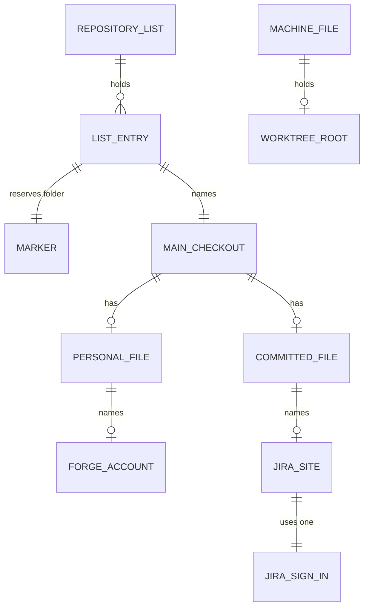

Caption: one machine file and one list serve every repository; each repository adds its own personal file.

No cache.

## §5 L4 — Cross-Cutting & Quality Attributes

AuthN: no new identity. Forge calls act as `developer.forgeAccount` through the forge tool's stored sign-in; Jira calls use the site's personal sign-in.

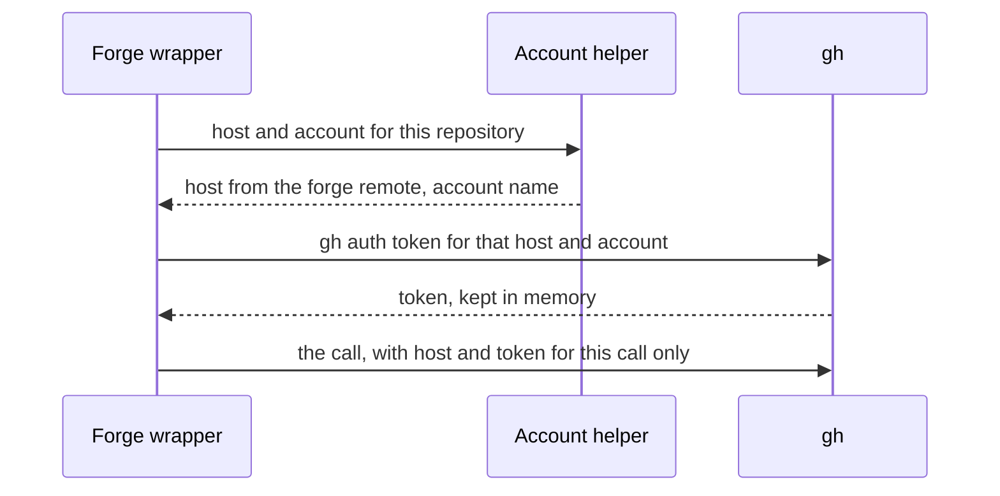

Caption: the token never leaves the wrapper's process and is never printed or written.

**AuthZ** (HL-3 amended, signed; Δ = R-7 delta rows). The UI side is the agent's instructions; the backend side is scripts and hooks.

| Action | Permitted | Denied | Enforced in instructions | Enforced below them |
|---|---|---|---|---|
| add or remove a list entry | developer; an agent recording the developer's answer | teammate; an agent on its own initiative | setup asks before every change | instruction only: no script tells an agent's own initiative from the developer's answer |
| write team settings to a personal file | developer; an agent recording the answer | teammate; an agent on its own initiative | setup asks per value | only setup scripts write it; the guard refuses a direct edit under another repository's git folder (INV-007) |
| save a forge account or an assignee | developer; an agent recording the answer | an agent on its own initiative; teammate | setup asks, then checks with the host | saved only after the host accepts it |
| store a secret | developer, own terminal | every agent shell; teammate | setup prints the command, never runs it | the secret step refuses without a terminal on input and output or in an agent session |
| set the worktree root or note-taking app | developer | an agent on its own initiative; teammate | setup asks | catalog R on every write and read |
| create a worktree of a listed repository | an agent under `<root>/<short name>`; developer anywhere from their own terminal | an agent anywhere else | skills name the worktree creator | creator refuses (exit 3); guard refuses `git worktree add`, `move` and Δ the creator call outside the folder, and Δ inline `AFK_WORKTREE_FOLDER` / `AFK_ALLOW_PROTECTED`; Δ a session the developer launches with `AFK_ALLOW_PROTECTED=1` lifts this rule, as it lifts every guard rule |
| read another listed repository's settings | the setup walk the developer started | an agent session outside that walk | skills read only the current repository | the reader resolves only the session's repository; the list's read-all call is used only by setup |
| delete personal copies of team settings | the setup run, without asking | an agent outside a setup run; teammate | setup deletes and lists each setting, file and value | only through the setup scripts (INV-007) |
| remove a worktree inside another repository | developer, confirming each | an agent on its own initiative | setup shows each clean worktree as idle or Δ unknown, and asks | `git worktree remove` without force, which refuses changed files; the guard refuses an agent's remove of a changed or occupied worktree; the plugin remover is not used (INV-009) |
| Δ trust a comment author in the review ledger | every account the forge tool holds on that host, plus `--trust` | any other author | — | review ledger trusted set |
| trust the root in a harness | developer | an agent | setup shows the step | the harness's own trust prompt |

**Data scope.**

| Data | Scope | How the scope holds |
|---|---|---|
| repository list, worktree root, note-taking app | this machine, this user | files under `~/.afk` and the root |
| settings of one repository | one main checkout and its worktrees | the personal file under that repository's git common folder |
| forge account | one repository | the repository personal file |
| Jira sign-in | one Jira site | the sign-in block, one set per site |
| company or vendor scope | none | not applicable: a tool for one developer |

**Idempotency.**

| Surface | Key shape | Dedup window | Side-effect ledger |
|---|---|---|---|
| add a repository | normalized main checkout path | permanent | the list; a marker already holding this path is reused |
| settings write | setting key | permanent | the file itself: setting a value twice changes nothing |
| secret step | site key or host plus account | permanent | the harness file; one backup copy |
| setup walk | repository and step | per run | none: a rerun asks only what is missing |

**Retry + timeout.**

| Call | Attempts | Backoff (ms) | Timeout (ms) |
|---|---|---|---|
| safe writer file swap on Windows | 10 | 50 | — |
| safe writer lock wait | until the wait ends | — | 2000 |
| setup account check (forge host or Jira site) | 1 | — | 20000 |
| guard placement check | 1 | — | budget 50 added on add and move |

Secrets: never in a repository file; Jira sign-ins in the harness block, owner-only file access on Linux and macOS, one backup replaced each run; forge secrets in the vendor store, fetched per call into memory.

Feature flag: none. Listing a repository is the only switch; an unlisted repository behaves as today.

Sync vs async: every operation is synchronous; the longest is one account check at 20000 ms.

| Signal | What it detects |
|---|---|
| validate warning line per ignored value | a value at a file its owner does not read (§7 row "value at wrong place") |
| setup report row `failed` with reason and rerun command | an account check or step failure (§7) |
| creator exit 3 with `ERROR=` | a root or placement refusal (§7) |
| guard deny answer | an agent worktree outside the root (§7) |

## §6 L5 — Domain Model

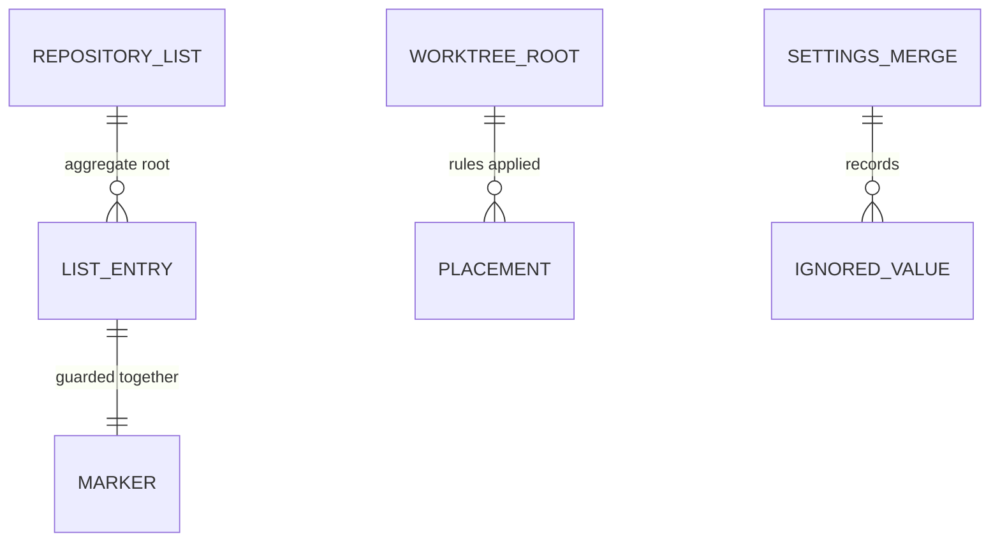

Caption: two aggregates own stored rules — the repository list (entries and markers) and the settings merge (owner rule); placement is a pure check over both.

**Invariants** (HL-4, signed).

| Invariant | Owner | Guardian | Who asks it |
|---|---|---|---|
| a listed path is unique and is a main checkout | repository list | list module | setup |
| a short name is unique and its folder's marker holds that path | repository list | list module | setup, placement |
| the root passes every catalog R rule | worktree root | placement module | creator, guard, setup, `resolve worktreeRoot` |
| an agent's worktree of a listed repository sits at `<root>/<short name>/<name>` | placement | placement module | creator (exit 3), guard (add, move, creator call), worktree-create hook |
| a setting is read only from its owner's file | settings merge | settings reader | every reader |
| a Jira sign-in comes whole from one source | Jira sign-in | Jira sign-in load | tracker server |
| a forge account is saved only after the host accepts it | personal settings | setup account check | setup |
| a secret is written only from the developer's own terminal | sign-ins | secret step | setup prints the command |
| a write never loses another write | every file written | safe writer | list module, settings writer, secret step |

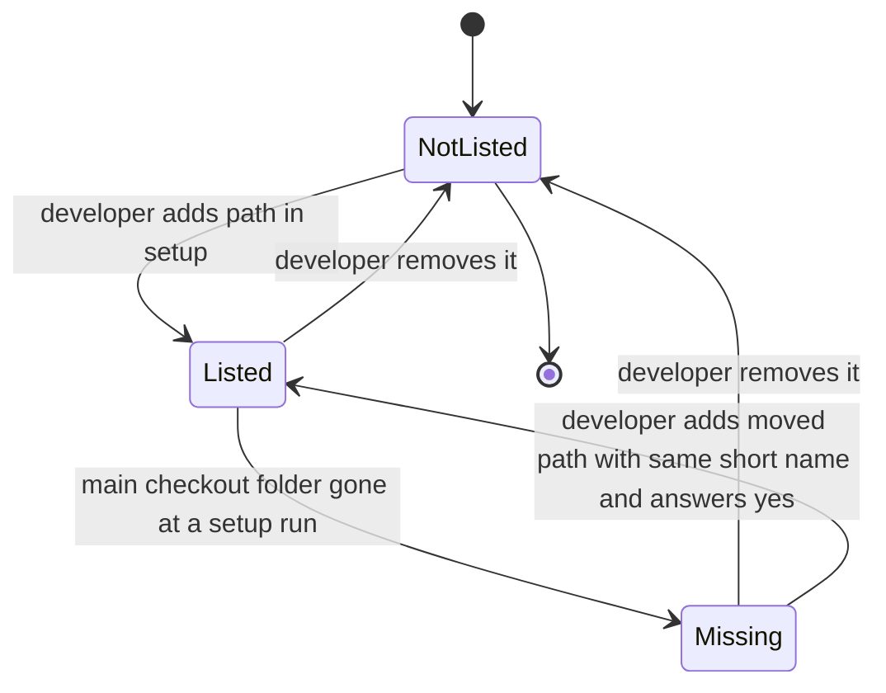

Caption: repository list entry; removal keeps the marker while the folder holds a worktree.

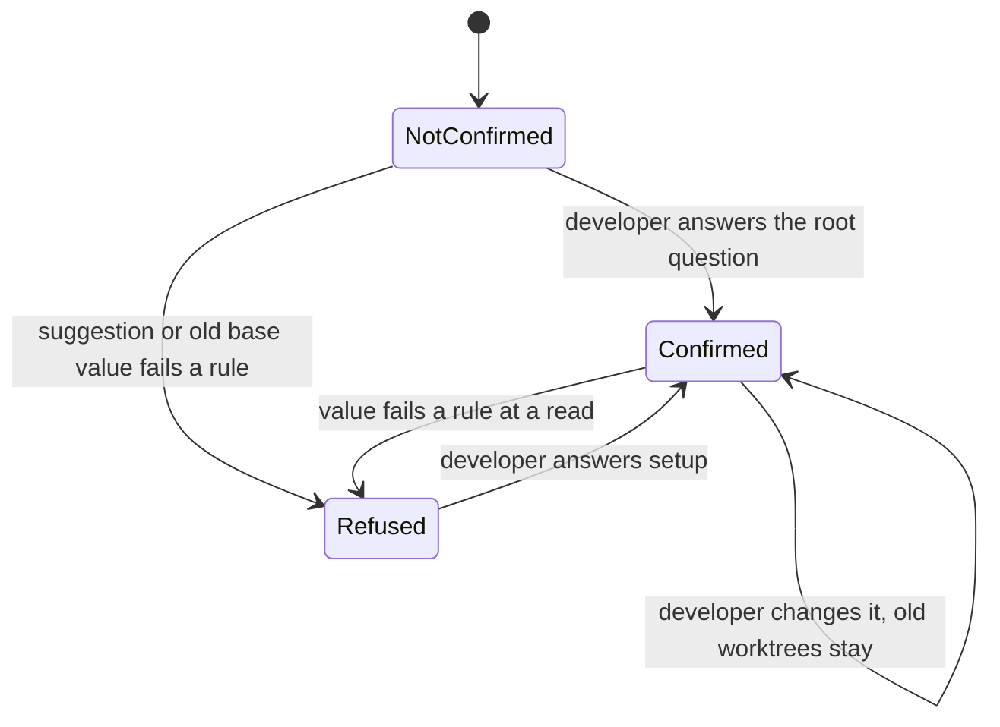

Caption: worktree root; in Refused, agents refuse to create a worktree and say to run setup.

| Thing | States | Rule |
|---|---|---|
| forge account per repository | unset, saved | saved only after the host accepts it; unset means the default login |
| Jira sign-in per site | absent, stored, replaced | written only by the secret step; one backup |

Domain events: none.

## §7 L6 — Process & Coordination

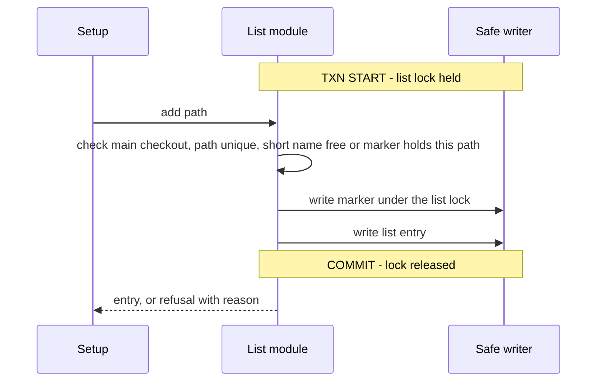

Caption: the marker is written before the entry, so a stopped run leaves a marker the next run reuses.

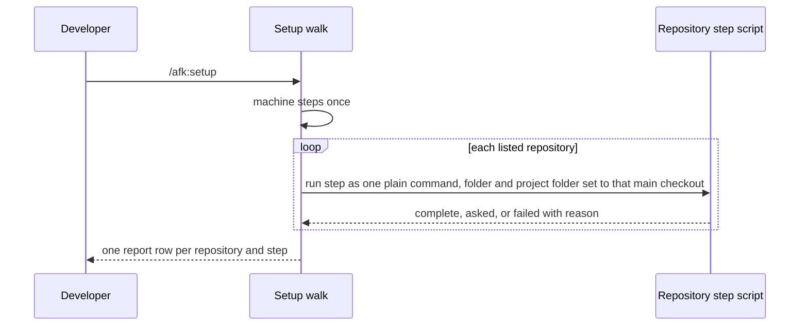

Caption: every per-repository step runs in its target main checkout; a failure is recorded and the walk goes on.

| Use case | Trigger | Txn boundary | Consistency per read path | Concurrency control |
|---|---|---|---|---|
| add or remove a repository | developer in setup | single lock on the list file | read-after-write | list lock; safe writer refuses a changed file |
| set a value | setup answer | one key per safe write | read-after-write | file lock, re-read, compare |
| setup walk | developer | per step, no cross-step transaction; rerun is the recovery | each step reads current files | per-file locks |
| create a worktree | agent, hook, skill | checks before anything is made; then git | placement reads current files | none needed: read only before git |
| copy deletion | setup run | per key safe write | — | file lock |
| worktree cleanup | developer yes per worktree | per worktree `git worktree remove` | liveness read at the moment of removal | guard check on the remove |
| root migration | developer answers the root question | write `worktreeRoot`, read back, then offer deletion | new key wins while both exist | safe writer |
| secret step | developer, own terminal | re-read harness file under the lock, change only its own keys | — | file lock |

**Failure & recovery matrix.**

| Failure point | Detection signal | Automatic recovery | Manual recovery | Owner |
|---|---|---|---|---|
| file swap busy on Windows | replace error | 10 retries at 50 ms | rerun setup | safe writer |
| lock held past 2000 ms | lock wait ends | fail naming the file, temp deleted, nothing changed | rerun setup | safe writer |
| file changed during an update | compare after re-read | refuse, nothing changed | rerun setup | safe writer |
| run stops after marker, before entry | marker with this path, no entry | next add reuses the marker | — | list module |
| forge host refuses or unreachable | account check result | nothing saved; walk goes on | `/afk:setup repo <name>` | setup |
| account token not available | sign-in check | `account not available`; no fallback | sign in with the forge tool, rerun | forge adapters |
| root fails a rule | placement result | creator exit 3, guard deny, nothing made | `/afk:setup` | placement |
| value at wrong place | owner table at merge | value ignored, warning in validate and setup | setup offers to copy it to its owner's file | settings reader |
| step fails in one repository | step exit | status `failed` with reason; walk goes on | rerun command in the report | setup walk |
| root migration stops between write and deletion | both keys present | new key wins | rerun setup | setup |
| main checkout folder gone | path check | reported missing | remove or new path | list module |

**Side effects** (HL-5 amended, signed; narrowed and Δ rows from R-7).

| Effect | When | Safeguard | Undo |
|---|---|---|---|
| delete personal copies of team settings | setup, once the committed file holds a real value for that setting and no worktree of the repository is on a branch without the committed file | deleted without asking; each deleted setting, file and value listed in the report; kept otherwise, with the reason | type the value again from the report |
| remove a worktree inside another repository | setup, on the developer's yes per worktree | clean, and Δ idle (every recorded session dead) or unknown (no record), marked as such; `git worktree remove` without force; the guard checks again; branch kept | `git worktree add` from the kept branch |
| delete the old worktree base value | setup, after the new root reads back; Δ per repository, on yes | offered, not automatic | set it again |
| write a Jira sign-in or token into harness settings | the secret step, own terminal | fresh read under the lock; owner-only file; one backup | the backup, or rerun the step |
| install git hooks in another repository | setup walk, per listed repository | existing step, run in that repository | delete the hooks by hand (INV-011) |
| delete a marker and its empty folder | setup, when its entry is gone and the folder is empty | only an empty folder | add the repository again |
| ask a forge host or Jira site who the developer is | setup account check | read-only call; 1 try, 20000 ms | — |
| trust the root in a harness; set the `codex` app root | shown by setup | the developer does it | the harness's own settings |

Not done: any write to a forge, a Jira ticket or a notes app; moving an existing worktree; deleting a branch.

## §8 L7 — Module Decomposition

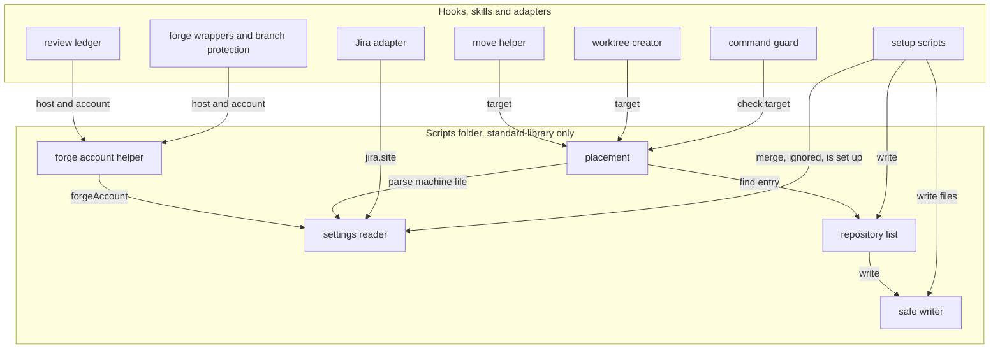

Caption: dependencies point from callers into the scripts folder, and inside it toward the safe writer; no cycle.

| Module | Purpose | Public interface | Depends on | Owner aggregate |
|---|---|---|---|---|
| settings reader (changed) | merge files with the owner rule | merged settings as a plain dictionary (unchanged); ignored values (setting, file, rule); is a repository set up (committed file or personal file); single-file parse | standard library | settings merge |
| repository list (new) | the list and its markers | find entry for a path; all entries (setup only); add; remove; repoint a short name | safe writer | repository list |
| placement (new) | root rules and worktree folder | root with state (confirmed, suggested, refused with rule); target for a new worktree; check a chosen target (yes or refusal with rule) | list, single-file parse | worktree root |
| safe writer (moved) | locked read-modify-write | one call: lock, give current text, write back the returned text, refuse when the file changed; owner-only option; its own error type | standard library | every written file |
| forge account helper (new) | host and account per repository | host and account name for a repository; never a token | settings reader, the guard's host lookup | personal settings |
| instruction-file installer (changed) | unchanged role | unchanged names; turns the safe writer's error into its own existing error | safe writer | — |

## §9 L8 — Tactical Patterns

| Concern | Pattern | ADR |
|---------|---------|-----|
| owner rule | Registry: one owner table beside the key and default tables, applied as a filter in the merge | `adr/design/0001-owner-rule-in-the-reader.md` |
| root and short-name rules | Chain of Responsibility: one check per catalog R row, first failure returned | `adr/design/0002-one-placement-guardian.md` |
| Jira sign-in sources | ordered source list, first complete sign-in for the site wins | `adr/design/0004-jira-sign-in-per-site.md` |
| forge calls | Adapter per forge kind sharing one account helper | `adr/design/0003-forge-account-per-call.md` |
| file writes | Template Method: one locked update, caller supplies the transform | `adr/design/0005-shared-safe-writer.md` |

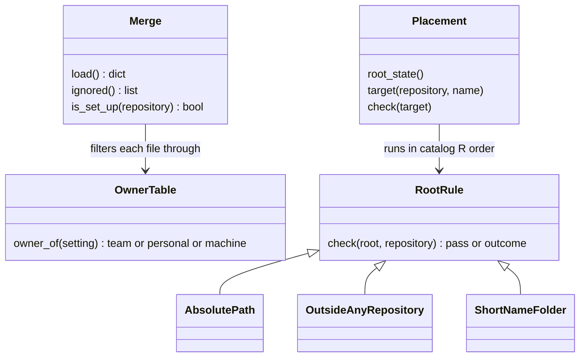

Caption: the owner table and the rule chain each keep one rule in one place; callers ask, never re-apply.

## §9b External Seams & Failure Affordance

| Boundary | Framework @ pin | What it does to our value | Failure surface | Seam-test |
|----------|-----------------|---------------------------|-----------------|-----------|
| gh token per account | gh 2.92.0, installed tool, not a pinned dependency | `gh auth token --hostname <h> --user <a>` prints that account's token ("The account to output the token for", `gh auth token --help`) | non-zero exit → `account not available` | forge wrapper test with a stub gh holding two accounts on one host, the default differing from the account |
| gh host and token variables | gh 2.92.0 | `GH_TOKEN` applies to `github.com` and `ghe.com` hosts; a GitHub Enterprise Server host reads `GH_ENTERPRISE_TOKEN` (`gh help environment`); the wrapper passes the token in the variable gh documents for the host kind | wrong variable → call acts as the stored login | wrapper test asserting the variable set for a `github.com` host and for an Enterprise Server host |
| glab host | glab 1.89.0, installed tool | `GITLAB_HOST` selects the host (docs.gitlab.com/cli); `glab auth status` ignores it (gitlab-org/cli issue 8065), so the account check calls `glab api --hostname <h> user` | login differs → setup saves nothing, names the signed-in account | setup account check test with a stub glab |
| glab accounts per host | glab 1.89.0 | one account per host (unverified-external, acknowledged in the requirements grill) | mismatch refused at setup | as above |
| git worktree | git, installed | `git worktree add` creates the folder and branch; the creator runs it only after every check passed | git error → exit 1, unchanged | creator tests cutting real worktrees under, beside and inside a checkout, relative and `~` paths, a space |
| `claude` worktree-create hook | `claude`, harness | calls the hook and uses its printed path; a non-zero exit or a missing path fails the creation (code.claude.com/docs/en/hooks, INV-019) | non-zero exit, no output | live check before build: hook exit 3 creates no worktree |
| `codex` app worktree root | `codex` app | keeps its own root, set in its settings screen (unverified-external) | none: setup shows the step | none: shown step only |
| harness folder trust | `claude`, `codex` | trust extends to subfolders (unverified-external, AC-045) | an extra trust prompt | live check before build |
| harness settings file | `~/.claude.json` | the harness may rewrite it while the secret step waits; the step re-reads under the lock | changed file → refuse, nothing changed | secret step test with a concurrent writer |
| Jira REST | Jira Cloud | a token belongs to one Atlassian account (unverified-external, AC-035) | 401 at the account check → failed row | Jira adapter test with a stub site per sign-in source |

Field sources of truth: account names from the forge host's `user` endpoint; the Jira site from `jira.site`; the host from the forge remote through the guard's host lookup. Relied-on invariants are enforced on both sides per the §5 table.

---

## §10 NFRs

| Concern | Target | Measurement | Owner |
|---------|--------|-------------|-------|
| guard added time on `git worktree add` and `move`, listed repository (ms) | ≤ 50, no network call | timing in the guard seam test; measured 2 to 13 over 21 runs, 1 cold run 57 (L9-S2) | placement |
| guard added time on any other command (ms) | 0 new file reads | guard test asserts no read | guard |
| owner rule added time per load (ms) | ≤ 10 | reader timing test | settings reader |
| placement import plus machine-file parse (ms) | ≤ 20 | measured 18 plus under 1 (L7.5) | placement |
| setup account check (ms) | 1 try, ≤ 20000 | stub host timeout test | setup |
| safe writer swap retries (count, ms) | 10 at 50 | Windows test | safe writer |
| platforms | Windows and Linux | full suite on both before push | every module |

## §11 Out of Scope

- PRD Out of Scope, all rows.
- Rolling back a creator failure after git added the worktree, and the move helper's half-made folder on retry: issue #119.
- The other defects found by the investigations: issues #118, #120, #121, #122.
- A fallback that keeps reading values the owner rule ignores (L9.1 ignore at once).
- A GitHub Issues tracker repository on a host other than the forge remote's host: refused by setup.
- Moving `~/.claude.json` under `CLAUDE_CONFIG_DIR`: not checked (INV-015).

## §12 Reversed Decisions

| Prior ADR | Superseded by | Reason |
|-----------|---------------|--------|
| none | — | first design ADRs for this ticket |

## §13 Open Questions

| Question | Layer (L1-L9) | Blocks executor? | Owner | Target resolve date |
|----------|---------------|------------------|-------|---------------------|
| Live check: the `claude` worktree tool creates no worktree when the hook exits 3 (AC-052); the vendor hook docs say a non-zero exit or a missing path fails the creation (code.claude.com/docs/en/hooks, INV-019) | L9 | no: documented; the build's first worktree subtask confirms it live | build | first worktree subtask |
| Live check: harness trust extends to subfolders of the root (AC-045) | L4 | no: acknowledged; setup shows the step either way | build | setup subtask |
| Re-measure the guard's added time against the 50 ms budget; 1 cold run measured 57 | L4 | no: the seam test records it | build | guard subtask |
| The committed spec files fail the plugin-source gates over `main..HEAD` (harness names, a personal path in a ledger's run block) | L9 | no: spec files, not plugin source an executor builds | {user} | before the change opens |

Seam-gate notes (printed by the seam-investigation gate; none blocks the executor):

```text
note — `afk-config.py` merge in `afk_config` (`load`, `validate`, `get`, `resolve`): INV-004 left unverified, not load-bearing: the hit set holds every reference to shared_overlay over the name forms this pass searched
note — `afk-config.py` merge in `afk_config` (`load`, `validate`, `get`, `resolve`): INV-004 left unverified, not load-bearing: An unreadable `.git` file or commondir raises an uncaught OSError in shared_overlay rather than a ConfigError.
note — `afk-config.py` merge in `afk_config` (`load`, `validate`, `get`, `resolve`): INV-004 stops at B14: another repository, deployment manifest, or live consumer
note — `afk-config.py` merge in `afk_config` (`load`, `validate`, `get`, `resolve`): INV-004 was traced at 17ec32239853, and the tree is at 2e934894cd49
note — `afk-config.py` merge in `afk_config` (`load`, `validate`, `get`, `resolve`): INV-005 left unverified, not load-bearing: the hit set holds every reference to AFK_CONFIG, shared_overlay, afk_config_load over the name forms this pass searched
note — `afk-config.py` merge in `afk_config` (`load`, `validate`, `get`, `resolve`): INV-005 stops at B14: consuming repositories and installed plugin cache copies (e.g. ~/.claude/plugins/cache/afk-toolkit/afk/<version>) carry their own copies of these readers, outside this tree
note — `afk-config.py` merge in `afk_config` (`load`, `validate`, `get`, `resolve`): INV-013 left unverified, not load-bearing: the hit set holds every reference to credentials-env, worktreeBasePath, GITHUB_REMOTE, GITLAB_REMOTE, copy-personal, parent-page-id, spec-dir over the name forms this pass searched
note — `afk-config.py` merge in `afk_config` (`load`, `validate`, `get`, `resolve`): INV-013 stops at B14: another repository, deployment manifest, or live consumer
note — `afk-config.py init` in `afk_config`: INV-004 left unverified, not load-bearing: the hit set holds every reference to shared_overlay over the name forms this pass searched
note — `afk-config.py init` in `afk_config`: INV-004 left unverified, not load-bearing: An unreadable `.git` file or commondir raises an uncaught OSError in shared_overlay rather than a ConfigError.
note — `afk-config.py init` in `afk_config`: INV-004 stops at B14: another repository, deployment manifest, or live consumer
note — `afk-config.py init` in `afk_config`: INV-004 was traced at 17ec32239853, and the tree is at 2e934894cd49
note — `afk-config.py init` in `afk_config`: INV-013 left unverified, not load-bearing: the hit set holds every reference to credentials-env, worktreeBasePath, GITHUB_REMOTE, GITLAB_REMOTE, copy-personal, parent-page-id, spec-dir over the name forms this pass searched
note — `afk-config.py init` in `afk_config`: INV-013 stops at B14: another repository, deployment manifest, or live consumer
note — `afk-config.py init` in `afk_config`: INV-005 left unverified, not load-bearing: the hit set holds every reference to AFK_CONFIG, shared_overlay, afk_config_load over the name forms this pass searched
note — `afk-config.py init` in `afk_config`: INV-005 stops at B14: consuming repositories and installed plugin cache copies (e.g. ~/.claude/plugins/cache/afk-toolkit/afk/<version>) carry their own copies of these readers, outside this tree
note — `create-worktree` `--name`, `--branch`, `--dir`, `--parent`: INV-014 left unverified, not load-bearing: the hit set holds every reference to create-worktree, worktreeBasePath, WORKTREE_PATH, h2_move, worktree_owner, remove-worktree, worktree-create over the name forms this pass searched
note — `create-worktree` `--name`, `--branch`, `--dir`, `--parent`: INV-014 left unverified, not load-bearing: unverified: which two tests PRD.md:200 means by 'two existing tests pin a plain git worktree add passes the guard'; the PRD names no file, and the search found one guard-side pin and one backstop pin.
note — `create-worktree` `--name`, `--branch`, `--dir`, `--parent`: INV-014 left unverified, not load-bearing: unverified: a worktree on a second Windows drive was not exercised (this machine has only C:); the code compares `normcase(realpath())` strings and runs git with absolute paths, so it reads as drive-safe, untested.
note — `create-worktree` `--name`, `--branch`, `--dir`, `--parent`: INV-014 stops at B14: harness behaviour on a WorktreeCreate exit 3; consuming repositories' WorktreeCreated scripts; the developer's real ~/.afk files; rationale lookup not run
note — `create-worktree` `--name`, `--branch`, `--dir`, `--parent`: INV-019 left unverified, not load-bearing: the hit set holds every reference to create-worktree, h2_move, decide over the name forms this pass searched
note — `create-worktree` `--name`, `--branch`, `--dir`, `--parent`: INV-019 left unverified, not load-bearing: The harness-side consumers of the deny output and the typed /cd line are outside this repository and were not checked.
note — `create-worktree` `--name`, `--branch`, `--dir`, `--parent`: INV-019 left unverified, not load-bearing: Where a harness tool lands when the worktree-create hook fails or is missing (PRD.md:132, :220; providers/CONFORMANCE.md:456) is harness behaviour outside the tree (B14), not checked here.
note — `create-worktree` `--name`, `--branch`, `--dir`, `--parent`: INV-019 left unverified, not load-bearing: unverified: harness-side readers (`claude`'s WorktreeCreate envelope fields name/cwd/session_id, its use of the bare path on stdout, both harnesses' handling of the deny JSON) live outside this repository (B14)
note — `create-worktree` `--name`, `--branch`, `--dir`, `--parent`: INV-019 stops at B14: the harness reads the WorktreeCreate hook's stdout and decides on exit 0 with empty stdout; consuming repositories' .afk/hooks.json WorktreeCreated scripts; humans running the creator from a terminal; the harness (`claude`, `codex`) consuming the deny JSON, stderr and additionalContext, and the live herdr pane receiving the typed /cd line, are outside this repository
note — guard `decide` on `git worktree add`, `move`, the `create-worktree` call, inline variables: INV-007 left unverified, not load-bearing: the hit set holds every reference to decide over the name forms this pass searched
note — guard `decide` on `git worktree add`, `move`, the `create-worktree` call, inline variables: INV-007 stops at B14: live harness: the cwd each harness reports after a `cd` in an earlier call; other repositories' layouts (separate-git-dir, bare, core.hooksPath, a .git above the home folder); live forge protection answers
note — guard `decide` on `git worktree add`, `move`, the `create-worktree` call, inline variables: INV-014 left unverified, not load-bearing: the hit set holds every reference to create-worktree, worktreeBasePath, WORKTREE_PATH, h2_move, worktree_owner, remove-worktree, worktree-create over the name forms this pass searched
note — guard `decide` on `git worktree add`, `move`, the `create-worktree` call, inline variables: INV-014 left unverified, not load-bearing: unverified: which two tests PRD.md:200 means by 'two existing tests pin a plain git worktree add passes the guard'; the PRD names no file, and the search found one guard-side pin and one backstop pin.
note — guard `decide` on `git worktree add`, `move`, the `create-worktree` call, inline variables: INV-014 left unverified, not load-bearing: unverified: a worktree on a second Windows drive was not exercised (this machine has only C:); the code compares `normcase(realpath())` strings and runs git with absolute paths, so it reads as drive-safe, untested.
note — guard `decide` on `git worktree add`, `move`, the `create-worktree` call, inline variables: INV-014 stops at B14: harness behaviour on a WorktreeCreate exit 3; consuming repositories' WorktreeCreated scripts; the developer's real ~/.afk files; rationale lookup not run
note — guard `decide` on `git worktree add`, `move`, the `create-worktree` call, inline variables: INV-019 left unverified, not load-bearing: the hit set holds every reference to create-worktree, h2_move, decide over the name forms this pass searched
note — guard `decide` on `git worktree add`, `move`, the `create-worktree` call, inline variables: INV-019 left unverified, not load-bearing: The harness-side consumers of the deny output and the typed /cd line are outside this repository and were not checked.
note — guard `decide` on `git worktree add`, `move`, the `create-worktree` call, inline variables: INV-019 left unverified, not load-bearing: Where a harness tool lands when the worktree-create hook fails or is missing (PRD.md:132, :220; providers/CONFORMANCE.md:456) is harness behaviour outside the tree (B14), not checked here.
note — guard `decide` on `git worktree add`, `move`, the `create-worktree` call, inline variables: INV-019 left unverified, not load-bearing: unverified: harness-side readers (`claude`'s WorktreeCreate envelope fields name/cwd/session_id, its use of the bare path on stdout, both harnesses' handling of the deny JSON) live outside this repository (B14)
note — guard `decide` on `git worktree add`, `move`, the `create-worktree` call, inline variables: INV-019 stops at B14: the harness reads the WorktreeCreate hook's stdout and decides on exit 0 with empty stdout; consuming repositories' .afk/hooks.json WorktreeCreated scripts; humans running the creator from a terminal; the harness (`claude`, `codex`) consuming the deny JSON, stderr and additionalContext, and the live herdr pane receiving the typed /cd line, are outside this repository
note — move helper `h2_move` hint: INV-014 left unverified, not load-bearing: the hit set holds every reference to create-worktree, worktreeBasePath, WORKTREE_PATH, h2_move, worktree_owner, remove-worktree, worktree-create over the name forms this pass searched
note — move helper `h2_move` hint: INV-014 left unverified, not load-bearing: unverified: which two tests PRD.md:200 means by 'two existing tests pin a plain git worktree add passes the guard'; the PRD names no file, and the search found one guard-side pin and one backstop pin.
note — move helper `h2_move` hint: INV-014 left unverified, not load-bearing: unverified: a worktree on a second Windows drive was not exercised (this machine has only C:); the code compares `normcase(realpath())` strings and runs git with absolute paths, so it reads as drive-safe, untested.
note — move helper `h2_move` hint: INV-014 stops at B14: harness behaviour on a WorktreeCreate exit 3; consuming repositories' WorktreeCreated scripts; the developer's real ~/.afk files; rationale lookup not run
note — move helper `h2_move` hint: INV-019 left unverified, not load-bearing: the hit set holds every reference to create-worktree, h2_move, decide over the name forms this pass searched
note — move helper `h2_move` hint: INV-019 left unverified, not load-bearing: The harness-side consumers of the deny output and the typed /cd line are outside this repository and were not checked.
note — move helper `h2_move` hint: INV-019 left unverified, not load-bearing: Where a harness tool lands when the worktree-create hook fails or is missing (PRD.md:132, :220; providers/CONFORMANCE.md:456) is harness behaviour outside the tree (B14), not checked here.
note — move helper `h2_move` hint: INV-019 left unverified, not load-bearing: unverified: harness-side readers (`claude`'s WorktreeCreate envelope fields name/cwd/session_id, its use of the bare path on stdout, both harnesses' handling of the deny JSON) live outside this repository (B14)
note — move helper `h2_move` hint: INV-019 stops at B14: the harness reads the WorktreeCreate hook's stdout and decides on exit 0 with empty stdout; consuming repositories' .afk/hooks.json WorktreeCreated scripts; humans running the creator from a terminal; the harness (`claude`, `codex`) consuming the deny JSON, stderr and additionalContext, and the live herdr pane receiving the typed /cd line, are outside this repository
note — safe writer `_atomic_write_locked` from `install_block`: INV-010 left unverified, not load-bearing: the hit set holds every reference to write_block, write_json_atomic, _target_lock, _atomic_write_locked, atomic_write, write_atomically, _write_atomic, lesson-append, record_pre over the name forms this pass searched
note — safe writer `_atomic_write_locked` from `install_block`: INV-010 stops at B14: harness processes and other plugin versions writing the same <git common dir> state, other repositories, and human edits of LEDGER.jsonl are outside this tree
note — safe writer `_atomic_write_locked` from `install_block`: INV-015 left unverified, not load-bearing: Whether the harness moves ~/.claude.json under CLAUDE_CONFIG_DIR is not checked; setup_secrets.py and api.py always use Path.home()/.claude.json
note — safe writer `_atomic_write_locked` from `install_block`: INV-015 stops at B14: another repository, deployment manifest, or live consumer
note — safe writer `_atomic_write_locked` from `install_block`: INV-020 left unverified, not load-bearing: the hit set holds every reference to install_block, _atomic_write_locked, write_block, developer_values, setup_secrets, install-git-hooks over the name forms this pass searched
note — safe writer `_atomic_write_locked` from `install_block`: INV-020 stops at B14: another repository, deployment manifest, or live consumer
note — settings writer `write_block` in `developer_values`: INV-010 left unverified, not load-bearing: the hit set holds every reference to write_block, write_json_atomic, _target_lock, _atomic_write_locked, atomic_write, write_atomically, _write_atomic, lesson-append, record_pre over the name forms this pass searched
note — settings writer `write_block` in `developer_values`: INV-010 stops at B14: harness processes and other plugin versions writing the same <git common dir> state, other repositories, and human edits of LEDGER.jsonl are outside this tree
note — settings writer `write_block` in `developer_values`: INV-015 left unverified, not load-bearing: Whether the harness moves ~/.claude.json under CLAUDE_CONFIG_DIR is not checked; setup_secrets.py and api.py always use Path.home()/.claude.json
note — settings writer `write_block` in `developer_values`: INV-015 stops at B14: another repository, deployment manifest, or live consumer
note — settings writer `write_block` in `developer_values`: INV-020 left unverified, not load-bearing: the hit set holds every reference to install_block, _atomic_write_locked, write_block, developer_values, setup_secrets, install-git-hooks over the name forms this pass searched
note — settings writer `write_block` in `developer_values`: INV-020 stops at B14: another repository, deployment manifest, or live consumer
note — secret step `setup_secrets`: INV-008 left unverified, not load-bearing: the hit set holds every reference to JIRA_API_TOKEN, JIRA_EMAIL, JIRA_BASE_URL, setup_secrets, tracker_registration, the `claude` session marker, CODEX_SANDBOX over the name forms this pass searched
note — secret step `setup_secrets`: INV-008 rests partly outside what the run reached (B14:adapters/forge/branch_protection.py:140): Plain-text secret files in this partition: no adapter, the tracker server or scripts/tracker_api.py writes any file holding a secret; the Jira values are read in plain text from ~/.claude.json and ~/.codex/config.toml (their writer and file mode belong to the setup scripts, outside this partition); branch_protection reads gh hosts.yml / glab config.yml whole into memory but keeps host names only.
note — secret step `setup_secrets`: INV-008 stops at B14: harness env injection and scope choice; Jira Cloud token scope; gh and glab token storage, file mode and host choice
note — secret step `setup_secrets`: INV-015 left unverified, not load-bearing: Whether the harness moves ~/.claude.json under CLAUDE_CONFIG_DIR is not checked; setup_secrets.py and api.py always use Path.home()/.claude.json
note — secret step `setup_secrets`: INV-015 stops at B14: another repository, deployment manifest, or live consumer
note — secret step `setup_secrets`: INV-020 left unverified, not load-bearing: the hit set holds every reference to install_block, _atomic_write_locked, write_block, developer_values, setup_secrets, install-git-hooks over the name forms this pass searched
note — secret step `setup_secrets`: INV-020 stops at B14: another repository, deployment manifest, or live consumer
note — Jira sign-in load `load_creds`, `resolve_creds_env`: INV-008 left unverified, not load-bearing: the hit set holds every reference to JIRA_API_TOKEN, JIRA_EMAIL, JIRA_BASE_URL, setup_secrets, tracker_registration, the `claude` session marker, CODEX_SANDBOX over the name forms this pass searched
note — Jira sign-in load `load_creds`, `resolve_creds_env`: INV-008 rests partly outside what the run reached (B14:adapters/forge/branch_protection.py:140): Plain-text secret files in this partition: no adapter, the tracker server or scripts/tracker_api.py writes any file holding a secret; the Jira values are read in plain text from ~/.claude.json and ~/.codex/config.toml (their writer and file mode belong to the setup scripts, outside this partition); branch_protection reads gh hosts.yml / glab config.yml whole into memory but keeps host names only.
note — Jira sign-in load `load_creds`, `resolve_creds_env`: INV-008 stops at B14: harness env injection and scope choice; Jira Cloud token scope; gh and glab token storage, file mode and host choice
note — Jira sign-in load `load_creds`, `resolve_creds_env`: INV-016 left unverified, not load-bearing: the hit set holds every reference to load_creds, resolve_creds_env, CRED_KEYS over the name forms this pass searched
note — Jira sign-in load `load_creds`, `resolve_creds_env`: INV-016 stops at B14: another repository, deployment manifest, or live consumer
note — Jira sign-in load `load_creds`, `resolve_creds_env`: INV-021 left unverified, not load-bearing: the hit set holds every reference to load_creds, resolve_creds_env over the name forms this pass searched
note — Jira sign-in load `load_creds`, `resolve_creds_env`: INV-021 stops at B14: the live values sit outside the repository: exported variables, ~/.claude.json, ~/.codex/config.toml; any other plugin's jira server is foreign and skipped (api.py:78-80)
note — forge wrappers `_gh`, `forge_user`, `project_from_remote`, `auth-status`, branch protection, GitHub Issues tracker; `GH_TOKEN` per call: INV-006 left unverified, not load-bearing: the hit set holds every reference to gh, glab over the name forms this pass searched
note — forge wrappers `_gh`, `forge_user`, `project_from_remote`, `auth-status`, branch protection, GitHub Issues tracker; `GH_TOKEN` per call: INV-006 left unverified, not load-bearing: Repository-declared hook handlers in .afk/hooks.json, the configured npm worktree command and AFK_LEDGER_ADAPTER_CMD can name any binary; their values live outside the plugin code (empty .afk/hooks.json here), so gh or glab reached that way is not checked.
note — forge wrappers `_gh`, `forge_user`, `project_from_remote`, `auth-status`, branch protection, GitHub Issues tracker; `GH_TOKEN` per call: INV-006 stops at B1: B1: values outside this repository: commands a consuming repository declares in .afk/hooks.json (run by hooks/run-hook.py repo-list), the AFK_LEDGER_ADAPTER_CMD value, and the configured npm worktree command (scripts/create-worktree) may run gh/glab and are not in this tree; every name form in name_forms is enumerated (wire: q-74e1adb9, q-41931807, q-c8e6c351; import-alias: q-f99e88e1)
note — forge wrappers `_gh`, `forge_user`, `project_from_remote`, `auth-status`, branch protection, GitHub Issues tracker; `GH_TOKEN` per call: INV-006 stops at B2: B2: dispatch to values outside this repository: commands a consuming repository declares in .afk/hooks.json (run by hooks/run-hook.py repo-list), the AFK_LEDGER_ADAPTER_CMD value, and the configured npm worktree command (scripts/create-worktree) may run gh/glab and are not in this tree (frontier nodes hooks/run-hook.py:193/196/197, hooks/precommit-gates.sh:185, hooks/lib/adapter.sh:111, scripts/create-worktree:513)
note — forge wrappers `_gh`, `forge_user`, `project_from_remote`, `auth-status`, branch protection, GitHub Issues tracker; `GH_TOKEN` per call: INV-006 stops at B14: another repository, deployment manifest, or live consumer
note — forge wrappers `_gh`, `forge_user`, `project_from_remote`, `auth-status`, branch protection, GitHub Issues tracker; `GH_TOKEN` per call: INV-008 left unverified, not load-bearing: the hit set holds every reference to JIRA_API_TOKEN, JIRA_EMAIL, JIRA_BASE_URL, setup_secrets, tracker_registration, the `claude` session marker, CODEX_SANDBOX over the name forms this pass searched
note — forge wrappers `_gh`, `forge_user`, `project_from_remote`, `auth-status`, branch protection, GitHub Issues tracker; `GH_TOKEN` per call: INV-008 rests partly outside what the run reached (B14:adapters/forge/branch_protection.py:140): Plain-text secret files in this partition: no adapter, the tracker server or scripts/tracker_api.py writes any file holding a secret; the Jira values are read in plain text from ~/.claude.json and ~/.codex/config.toml (their writer and file mode belong to the setup scripts, outside this partition); branch_protection reads gh hosts.yml / glab config.yml whole into memory but keeps host names only.
note — forge wrappers `_gh`, `forge_user`, `project_from_remote`, `auth-status`, branch protection, GitHub Issues tracker; `GH_TOKEN` per call: INV-008 stops at B14: harness env injection and scope choice; Jira Cloud token scope; gh and glab token storage, file mode and host choice
note — forge wrappers `_gh`, `forge_user`, `project_from_remote`, `auth-status`, branch protection, GitHub Issues tracker; `GH_TOKEN` per call: INV-017 left unverified, not load-bearing: the hit set holds every reference to forge_user, project_from_remote, AFK_FORGE_TIMEOUT, _gh, forgeAccount over the name forms this pass searched
note — forge wrappers `_gh`, `forge_user`, `project_from_remote`, `auth-status`, branch protection, GitHub Issues tracker; `GH_TOKEN` per call: INV-017 stops at B14: gh/glab CLI semantics (gh auth token --user by version, GH_TOKEN vs GH_ENTERPRISE_TOKEN on a GHES host, GH_HOST inside a clone, ambient GH_TOKEN precedence, glab GITLAB_HOST with -R and :id); live forges; consuming repositories; gh and glab behaviour, forge accounts and the CI runner sit outside this repository; local gh 2.92.0 and glab 1.89.0 help text read as evidence (p2-evidence/cli-help.txt); live multi-account behaviour not run
note — review ledger `forge_ledger` trusted `forge_user` login and cache: INV-017 left unverified, not load-bearing: the hit set holds every reference to forge_user, project_from_remote, AFK_FORGE_TIMEOUT, _gh, forgeAccount over the name forms this pass searched
note — review ledger `forge_ledger` trusted `forge_user` login and cache: INV-017 stops at B14: gh/glab CLI semantics (gh auth token --user by version, GH_TOKEN vs GH_ENTERPRISE_TOKEN on a GHES host, GH_HOST inside a clone, ambient GH_TOKEN precedence, glab GITLAB_HOST with -R and :id); live forges; consuming repositories; gh and glab behaviour, forge accounts and the CI runner sit outside this repository; local gh 2.92.0 and glab 1.89.0 help text read as evidence (p2-evidence/cli-help.txt); live multi-account behaviour not run
note — review ledger `forge_ledger` trusted `forge_user` login and cache: INV-022 left unverified, not load-bearing: the hit set holds every reference to forge_ledger, forge_user over the name forms this pass searched
note — review ledger `forge_ledger` trusted `forge_user` login and cache: INV-022 stops at B14: gh/glab CLI session store and forge server answers (which login `gh api user` / `glab api user` returns); live notes on forge changes; other repositories
note — setup walk over `setup_secrets`, `developer_values`, `install-git-hooks` register rows: INV-002 stops at B14: another repository, deployment manifest, or live consumer; user-home and harness files the documents name are outside this repository: ~/.afk/config.yaml, ~/.claude.json, ~/.claude/settings.json, ~/.claude/CLAUDE.md, ~/.codex/config.toml, ~/.codex/AGENTS.md, ~/.codex/agents/, %LOCALAPPDATA%/afk, <git common dir>/afk/config.yaml
note — setup walk over `setup_secrets`, `developer_values`, `install-git-hooks` register rows: INV-002 was traced at 17ec32239853, and the tree is at 2e934894cd49
note — setup walk over `setup_secrets`, `developer_values`, `install-git-hooks` register rows: INV-011 left unverified, not load-bearing: unverified: whether the harness reads its user MCP config from CLAUDE_CONFIG_DIR when that is set, which would make setup_secrets.py register the tracker in a file the harness does not read; harness behaviour not checked.
note — setup walk over `setup_secrets`, `developer_values`, `install-git-hooks` register rows: INV-011 rests partly outside what the run reached (B14:skills/afk/setup/MANIFEST.md:788): O3's one repository-owned step, codex_marketplace_ref.py, removes only the marketplaces.afk-toolkit ref line after a timestamped backup and an atomic replace, and exits 0 without writing when the config is missing or holds no pin; the other O3 fix commands (codex plugin marketplace add/upgrade, codex plugin add/remove) are run as given and nothing in the repository decides what they write.
note — setup walk over `setup_secrets`, `developer_values`, `install-git-hooks` register rows: INV-011 stops at B14: uv (installer idempotence, update-shell registry write, sync atomicity and locking), harness PATH pickup and restart, harness hook-trust prompts, herdr installer and integration, npm and winget installs and uninstalls, the HKLM long-path flag; `codex` CLI's own write and rerun behaviour for `codex plugin marketplace add/upgrade` and `codex plugin add/remove` (O3, MANIFEST.md:786-792), outside this repository
note — setup walk over `setup_secrets`, `developer_values`, `install-git-hooks` register rows: INV-018 left unverified, not load-bearing: the hit set holds every reference to setup_secrets, developer_values, install-git-hooks, needs-human, credentials-env, worktreeBasePath over the name forms this pass searched
note — setup walk over `setup_secrets`, `developer_values`, `install-git-hooks` register rows: INV-018 left unverified, not load-bearing: Unverified: whether a team value in the machine file (tracker or forge in ~/.afk/config.yaml, which init reads at CONFIG.md:57-62) stays read or is ignored; ADR 0002 states the rule for personal and machine values only.
note — setup walk over `setup_secrets`, `developer_values`, `install-git-hooks` register rows: INV-018 left unverified, not load-bearing: unverified: whether plain `git worktree remove` deletes a worktree holding only ignored files was not run (the session guard refuses git outside this worktree); git's own clean test is believed to skip ignored files.
note — setup walk over `setup_secrets`, `developer_values`, `install-git-hooks` register rows: INV-018 rests partly outside what the run reached (B14:hooks/lib/protected_branch_guard.py:568): A walk that runs each step for Y in one call as `cd <Y> && <script>` is not stopped by the init hold, whatever folder the harness reports; a walk written as separate calls after one `cd <Y>` depends on which folder the harness then reports, which is frontier node B14:hooks/lib/protected_branch_guard.py:568.
note — setup walk over `setup_secrets`, `developer_values`, `install-git-hooks` register rows: INV-018 stops at B14: harness: whether `claude` and `codex` report Y as the call folder after a cd in an earlier call (decides the init hold); real layouts: a home folder inside a git repository (guard then refuses root, list and marker writes), core.hooksPath set (backstop not installed, install-git-hooks.sh:47-50), separate-git-dir or bare layouts; live forge: the protected lookup a remove of a worktree on a branch makes, and the forge account checks; node B14:hooks/lib/protected_branch_guard.py:568 carries the harness-folder question
note — setup walk over `setup_secrets`, `developer_values`, `install-git-hooks` register rows: INV-020 left unverified, not load-bearing: the hit set holds every reference to install_block, _atomic_write_locked, write_block, developer_values, setup_secrets, install-git-hooks over the name forms this pass searched
note — setup walk over `setup_secrets`, `developer_values`, `install-git-hooks` register rows: INV-020 stops at B14: another repository, deployment manifest, or live consumer
note — commit gates `config.yaml` test: INV-004 left unverified, not load-bearing: the hit set holds every reference to shared_overlay over the name forms this pass searched
note — commit gates `config.yaml` test: INV-004 left unverified, not load-bearing: An unreadable `.git` file or commondir raises an uncaught OSError in shared_overlay rather than a ConfigError.
note — commit gates `config.yaml` test: INV-004 stops at B14: another repository, deployment manifest, or live consumer
note — commit gates `config.yaml` test: INV-004 was traced at 17ec32239853, and the tree is at 2e934894cd49
note — commit gates `config.yaml` test: INV-005 left unverified, not load-bearing: the hit set holds every reference to AFK_CONFIG, shared_overlay, afk_config_load over the name forms this pass searched
note — commit gates `config.yaml` test: INV-005 stops at B14: consuming repositories and installed plugin cache copies (e.g. ~/.claude/plugins/cache/afk-toolkit/afk/<version>) carry their own copies of these readers, outside this tree
```

## §14 L9 — Implementation Seams & Change Impact

| Seam (class/method/contract) | Existing contract (INV-NNN) | Planned change | Impacted flows (INV-NNN) | Conventions / landmines | Verdict |
|------------------------------|-----------------------------|----------------|--------------------------|-------------------------|---------|
| `afk-config.py` merge in `afk_config` (`load`, `validate`, `get`, `resolve`) | one merge of six layers returning a plain dictionary; 12 sites skip `load()` (INV-004, INV-005, INV-013) | owner table filters each file; ignored list and is-set-up calls; new keys `jira.site`, `developer.worktreeRoot`, `developer.forgeAccount`; `jira.credentials-env` warns; `load()` keeps returning a plain dictionary | nine importers of `load()`; sites that skip it move onto it where the owner rule changes their value; the creator's IDE lookup no longer sees a committed `developer.ideBinary`; the redactor reads the top-level key list (INV-005, INV-013) | keep the top-level key list a literal; never write `schema` in the personal file; owner drift test against `CONFIG.md` | reworked (ADR-0001, ADR-0007) |
| `afk-config.py init` in `afk_config` | writes the committed file from a template (INV-004, INV-013) | fills the new committed file from the personal file's team values | setup's copy deletion waits for a real committed value (INV-005, INV-013) | setup, not `init`, writes the personal file | reworked |
| `create-worktree` `--name`, `--branch`, `--dir`, `--parent` | computes the folder itself; every failure exits 1 through one trap (INV-014, INV-019) | asks placement; refusal exit 3 through its own exit path; an agent `--parent` outside the folder refused | worktree-create hook, launch helper, move helper, settle-change, execute (INV-014, INV-019) | all checks before anything is made; a relative `--parent` made absolute first | reworked (ADR-0002) |
| guard `decide` on `git worktree add`, `move`, the `create-worktree` call, inline variables | add passes; move checked only against protected resources; inline `LAVISH_AXI_HOST` already refused (INV-007, INV-014) | own add parser knowing `-b`, `-B`, `--orphan`, `--reason`; listed repositories only; placement by path prefix first, git only for unusual layouts; links and drive-letter case resolved on both sides | every agent shell command; two tests pinning "a plain add passes" reverse for listed repositories (INV-014, INV-019) | `AFK_ALLOW_PROTECTED` from the launch environment still returns before `decide`; refusal text names cause and move | reworked (ADR-0002) |
| move helper `h2_move` hint | prints a path computed beside the creator (INV-014, INV-019) | takes the path from the same placement call as the creator | sessions refused in the main checkout (INV-014, INV-019) | load placement only when it plans a move | reworked |
| safe writer `_atomic_write_locked` from `install_block` | lock wait 2000 ms, change refusal, temp then replace, keeps file mode, lock file kept (INV-010, INV-015) | moved to the scripts folder with its own error type; the installer wraps it into its existing error | installer callers and tests (INV-015, INV-020) | the installer keeps its names and error type | extends (ADR-0005) |
| settings writer `write_block` in `developer_values` | rewrites only the `developer:` block; 5 keys; several `KEY=VALUE` per call (INV-010, INV-015) | any key to its owner's file, one key at a time; special first characters quoted; a heading with a note recognised; machine refusal follows the owner table | setup steps writing values (INV-015, INV-020) | no `schema` line in the personal file; the writer's catch names the safe writer's own error, not only the installer's (INV-015) | reworked |
| secret step `setup_secrets` | bare run signs in once and fixes long paths; no terminal check (INV-008, INV-015) | subcommands `jira --site`, `forge --host --account`, `longpaths`; terminal and agent-session refusal; fresh read under the lock; owner-only file; one backup | setup prints its commands; the W5 long-path register line names `longpaths` (INV-015, INV-020) | the agent detector, not two variable names | reworked (ADR-0004) |
| Jira sign-in load `load_creds`, `resolve_creds_env` | fills each field from the first source that has it (INV-008, INV-016) | takes the first complete sign-in for `jira.site`; same name, no argument, same three values; finds the repository itself | tracker server, publishers, init hint, assignee suggestion; the mixed-source test is rewritten (INV-016, INV-021) | refusals name the site and the folder read | reworked (ADR-0004) |
| forge wrappers `_gh`, `forge_user`, `project_from_remote`, `auth-status`, branch protection, GitHub Issues tracker; `GH_TOKEN` per call | every gh or glab call uses the default login; branch protection caches without an account (INV-006, INV-008, INV-017) | per-call host and account; `account not available` when its token is missing; branch protection passes the account and keys its cache by it | every forge verb; branch-protection lookup; GitHub Issues adapter (INV-006, INV-017) | the plugin-issue reporter keeps the default login; the host comes from the remote the wrapper already uses | reworked (ADR-0003) |
| review ledger `forge_ledger` trusted `forge_user` login and cache | trusts only the current login; cache key has no account (INV-017, INV-022) | trusts every account the forge tool holds on the host, plus `--trust`; cache and rationale scope include the account | changes already in review (INV-017, INV-022) | a failing login lookup on GitHub fails every ledger command, review commands exit 2, with no test today; add one with the account check (INV-022) | reworked (ADR-0003) |
| setup walk over `setup_secrets`, `developer_values`, `install-git-hooks` register rows | each step acts on the working folder; multi-line shell probes in the register (INV-002, INV-011, INV-018) | scope mark per row; loop over listed repositories; each repository check a script run in that main checkout with the project folder set; status `failed` | every setup step; `CONFIG.md`, README section 4 and about 30 doc lines rewritten; the freshness registry gains rows for the four new modules (INV-018, INV-020) | never run `init` in another repository; never a chained shell line | extends (ADR-0006) |
| commit gates `config.yaml` test | tests the `.afk` folder (INV-004) | runs when the reader says set up, or the `.afk` folder exists | repositories with only repository hooks keep their gates (INV-004, INV-005) | no Python on the commit path; one test pins both answers | extends |

Accepted compatibility-audit findings (not resolved by a design change):

- Placement on unusual layouts (a `GIT_DIR` variable, a `core.worktree` setting, a submodule) starts git and may exceed the 50 ms budget. Accepted: these layouts are rare, and a text-only check there would misjudge the target (R-7 F-2).
- One term changes meaning: "worktree root" now names only the folder holding every worktree; one worktree's own folder becomes "the worktree's top folder" (the folder `git rev-parse --show-toplevel` prints) in about 7 places (R-7 L9-15b). Accepted as a doc rewrite in the setup-walk subtask.
