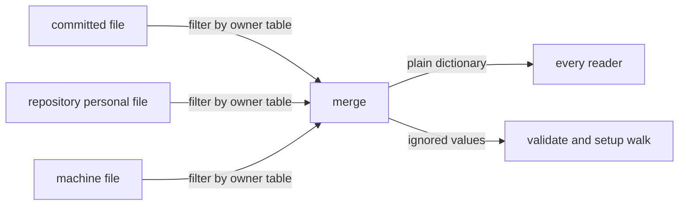

# ADR-0001 — Owner rule applied inside the settings reader

> Status: Accepted
> Date: 2026-10-21
> Audited: 2026-10-19
> Layer: L2
> Context ticket: setup-per-repo

## Context

Every setting has one owner (PRD catalog S, requirement ADR 0002): team, personal or machine. About 20 places read settings, 12 of them without the reader's merge (INV-005). SDD §3, §4, §9.

## Decision

The settings reader applies the owner rule while it merges the files. One owner table sits beside the reader's key and default tables and gives every setting its owner. The merge passes each file through the table: a value at a file its owner does not read is dropped and recorded as ignored. `validate` and the setup walk list the ignored values; every other read stays silent. `load()` keeps returning a plain dictionary. A test pins the table against `CONFIG.md`.

## Alternatives Considered

| Alternative | Pros | Cons | Reason rejected |
|-------------|------|------|-----------------|
| owner rule applied in the reader (chosen) | one answer for every reader | the reader's merge changes for 9 importers | — |
| filter in the setup writer only | the reader stays unchanged | hand-edited or old values still count | readers would disagree with setup |
| owner per top-level block | smaller table | the GitHub remote is personal, the rest of the GitHub block is team | wrong for mixed blocks |
| each caller checks the owner | no reader change | copies of one rule in about 20 places | the copies drift |

## Consequences

- **Positive** — every reader gets the same value and the same ignored list; the 12 sites that skip the merge move onto it where the owner rule changes their value.
- **Negative** — answers change wherever a value sits in the wrong file; this release is a major version (ADR-0007).
- **Follow-ups** — none.
