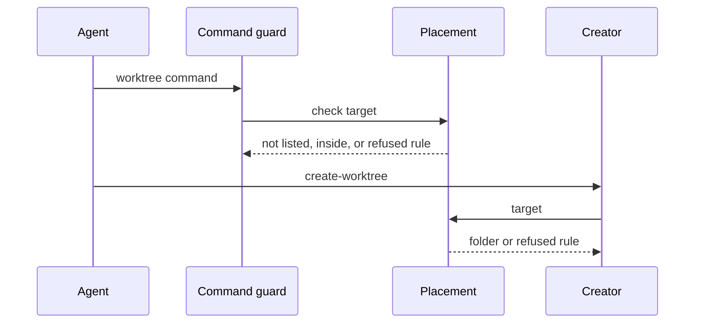

# ADR-0002 — One placement module guards every worktree folder

> Status: Accepted
> Date: 2026-10-21
> Audited: 2026-10-19
> Layer: L2
> Context ticket: setup-per-repo

## Context

An agent's worktree of a listed repository must land at `<root>/<short name>/<worktree name>` (PRD AC-050, AC-053). Today the worktree creator and the move helper each compute a folder (INV-001), and the command guard does not check `git worktree add` (INV-014). An agent controls the environment of any script it runs, so a check inside the creator alone stops only a well-behaved agent (R-7 A-1). SDD §3, §6, §9.

## Decision

One placement module owns the root rules (one check per catalog R row, first failure returned) and the worktree folder. The creator, the move helper and the command guard all ask it. The creator runs every check before anything is made and refuses with exit 3. The guard, which reads its own environment, refuses an agent's `git worktree add`, `git worktree move` and creator call whose target is outside `<root>/<short name>`, and an agent command that sets `AFK_WORKTREE_FOLDER` or `AFK_ALLOW_PROTECTED` inline. Placement reads only the machine file and the repository list, compares by path text first, and starts git only for unusual layouts. Unlisted repositories are not checked.

## Alternatives Considered

| Alternative | Pros | Cons | Reason rejected |
|-------------|------|------|-----------------|
| one placement module, guard plus creator (chosen) | one rule; the guard is outside the agent's reach | the guard gains a parser for `git worktree add` | — |
| each caller computes the folder | no new module | three copies of one rule | the guard would refuse folders the creator picks |
| a git hook checks where a worktree lands | sees every route | also runs for the developer's own terminal | requirement ADR 0004 leaves the developer unchecked |
| check in the creator only | simpler | an agent clears its markers or sets the flag inline | stops only a well-behaved agent |

## Consequences

- **Positive** — the folder the guard allows is the folder the creator picks.
- **Negative** — two tests pinning "a plain worktree add passes" reverse for listed repositories; unusual layouts may exceed the guard's 50 ms budget.
- **Follow-ups** — creator rollback after git added the worktree: issue #119.
