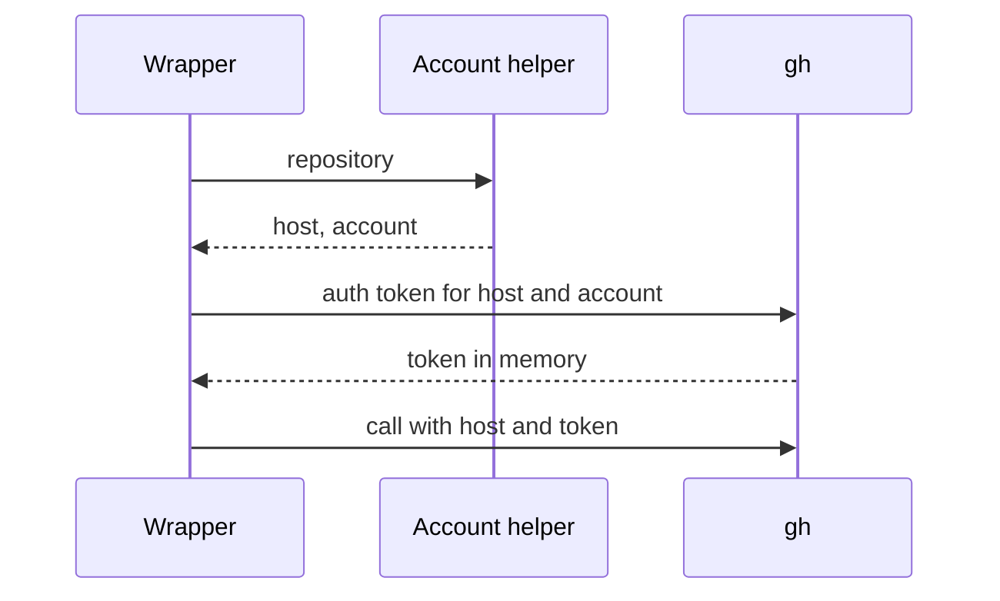

# ADR-0003 — Forge account chosen per call

> Status: Accepted
> Date: 2026-10-21
> Layer: L4
> Context ticket: setup-per-repo

## Context

Agents in a repository act as that repository's forge account (PRD AC-033). Every gh or glab call uses the tool's default login today (INV-006, INV-017). gh holds several accounts per host and prints one account's token with `gh auth token --hostname <host> --user <account>` (gh 2.92.0 help). glab holds one account per host (unverified-external, acknowledged). SDD §5, §9b, §14.

## Decision

A forge account helper returns the host and account name for a repository, never a token. The host comes from the forge remote through the guard's existing host lookup. Each forge wrapper fetches the token itself right before a GitHub call and passes it, with the host, to that one call in the variable gh documents for the host kind. The GitLab wrapper sets the host only; setup's account check refuses a glab login that differs from the account. Branch protection and the GitHub Issues tracker use the account. With an account set, the sign-in check fails with `account not available` and never falls back to the default login. The review ledger trusts every account the forge tool holds on the host, plus `--trust`, and keys its cache by the account. The plugin-issue reporter keeps the default login.

## Alternatives Considered

| Alternative | Pros | Cons | Reason rejected |
|-------------|------|------|-----------------|
| token fetched per call by the wrapper (chosen) | token stays in one process | 1 extra gh call per GitHub call | — |
| helper prints the token | 1 call | the token crosses a pipe and can reach a log | secret exposure |
| fetch once per session into the environment | fewer calls | every child process inherits the token | secret exposure |

## Consequences

- **Positive** — a personal repository uses the personal account; a change in review survives an account switch.
- **Negative** — one extra gh call per GitHub call; GitLab is limited to one account per host.
- **Follow-ups** — none.
