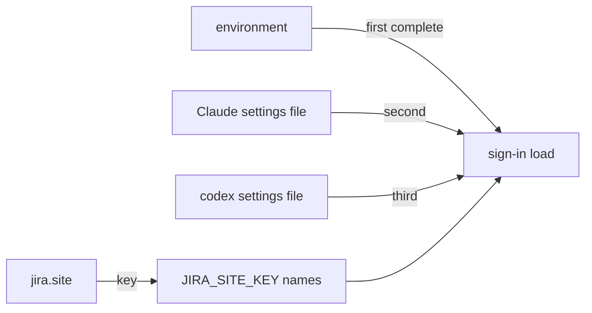

# ADR-0004 — One Jira sign-in per site, stored under per-site names

> Status: Accepted
> Date: 2026-10-21
> Layer: L4
> Context ticket: setup-per-repo

## Context

Every repository on one Jira site uses that site's one account; two sites can use two accounts (PRD AC-035). The adapter holds one sign-in today and fills each field from the first source that has it (INV-008, INV-016). The tracker server is registered once. SDD §4, §5, §14.

## Decision

The team setting `jira.site` names the site. Sign-ins for further sites live in the existing tracker block as `JIRA_SITE_<KEY>_EMAIL` and `JIRA_SITE_<KEY>_API_TOKEN`; `KEY` is the site host in capitals with every other character an underscore. The existing three names stay the sign-in for their own site. The sign-in load tries each source in its existing order and takes the first one holding a complete sign-in for the site; a partial source is skipped and named in the error. The secret step writes sign-ins only from the developer's terminal with `jira --site <address>`, refuses a site whose key collides with another site's, re-reads the harness file under the lock, sets owner-only access and keeps one backup.

## Alternatives Considered

| Alternative | Pros | Cons | Reason rejected |
|-------------|------|------|-----------------|
| per-site names in the existing block (chosen, human) | same files and server as today | plain text, as today | — |
| one tracker server entry per site | native separation | the harness picks one entry across scopes (unverified-external) | registration risk |
| per-field fill across sources | today's behaviour | can mix two accounts' fields | wrong account |

## Consequences

- **Positive** — two sites, two accounts; no server change.
- **Negative** — a sign-in mixing fields from two sources stops working; per-site secrets stay in plain text as today.
- **Follow-ups** — none.
