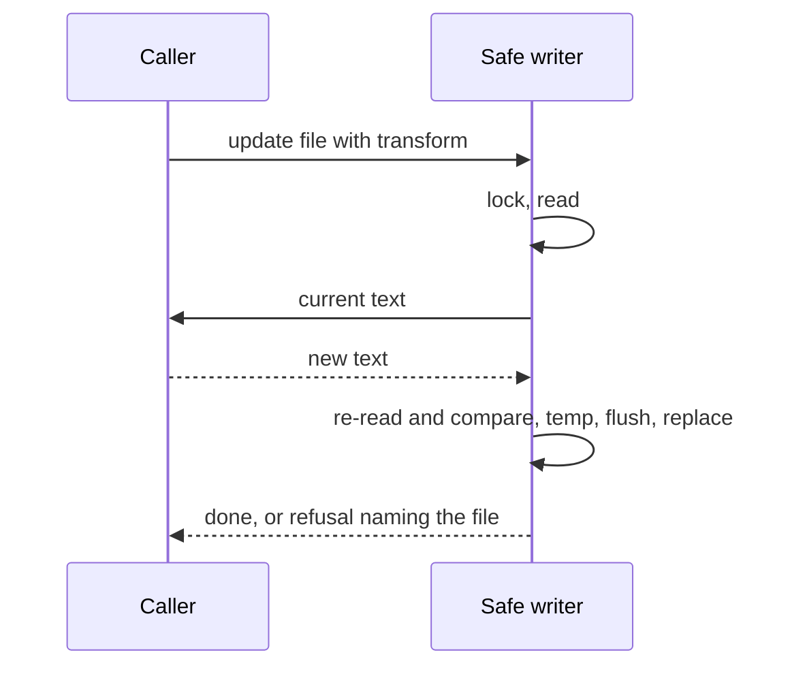

# ADR-0005 — One shared safe writer for every file this feature writes

> Status: Accepted
> Date: 2026-10-21
> Audited: 2026-10-20
> Layer: L6
> Context ticket: setup-per-repo

## Context

Settings writes can lose each other's values when two run at once (INV-010). The instruction-file installer already has a locked writer: lock, re-read, temp file, flush, replace (INV-015). SDD §7, §8.

## Decision

The installer's locked writer moves to the scripts folder as the safe writer. The repository list, the markers, the settings writer and the secret step use it. One call locks the file, hands the caller its current text, writes back the returned text, and refuses when the file changed meanwhile; an option sets owner-only access. On Windows the swap retries 10 times at 50 ms; a lock waits 2000 ms; a failure names the file, deletes the temp file and changes nothing. The writer raises its own error; the installer turns it into its existing error, so its callers see what they see today. Markers are written under the list's lock, so no lock file sits in a folder under the root.

## Alternatives Considered

| Alternative | Pros | Cons | Reason rejected |
|-------------|------|------|-----------------|
| move the installer's writer (chosen) | proven code, one home | the installer loads it from a new folder | — |
| a copy per writer | no move | four copies drift | DRY |
| keep it in the installer and load from there | no move | the list module would reach into a skill; the guard never loads skills | dependency direction |

## Consequences

- **Positive** — no lost writes; one retry and error policy.
- **Negative** — the installer's tests cover the moved code from a new place.
- **Follow-ups** — none.
