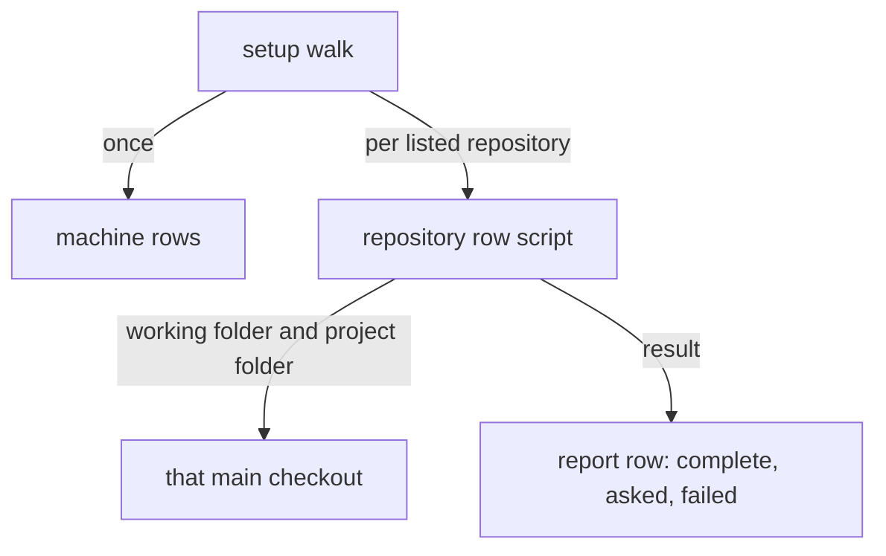

# ADR-0006 — The setup walk runs each repository step in that main checkout

> Status: Accepted
> Date: 2026-10-21
> Audited: 2026-10-21
> Layer: L2
> Context ticket: setup-per-repo

## Context

Setup runs from any folder and walks every listed repository (PRD AC-012). Every per-repository step acts on the working folder's repository today; only the developer-values step takes another (INV-002). Settings readers prefer the session's project folder over the working folder, and the register's checks are multi-line shell lines the guard cannot read as one plain command (R-7 A-5, INV-018). SDD §7, §14.

## Decision

Register rows carry a scope mark, machine or repository. Machine rows run once. For each listed repository, each repository row runs as one plain command, a script, with that main checkout as its working folder and as the session's project folder. The register's inline shell checks move into those scripts. The walk never runs `init` in another repository and changes another repository's files only through its scripts. A failed step records status `failed` with its reason and rerun command, and the walk goes on.

## Alternatives Considered

| Alternative | Pros | Cons | Reason rejected |
|-------------|------|------|-----------------|
| run each step in the target checkout (chosen) | steps keep reading the working folder | each check becomes a script | — |
| a repository option on every step | explicit target | every step and reader changes | larger change, same result |
| keep the inline shell checks | no new scripts | the guard refuses lines it cannot read; readers resolve the session's repository | wrong repository checked |

## Consequences

- **Positive** — one run configures every repository; a failure in one does not stop the rest.
- **Negative** — the register's probes move into scripts; `CONFIG.md` and README section 4 are rewritten.
- **Follow-ups** — none.
