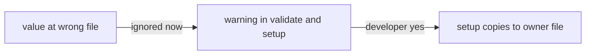

# ADR-0007 — Misplaced values stop counting at once; the release is major

> Status: Accepted
> Date: 2026-10-21
> Layer: L9
> Context ticket: setup-per-repo

## Context

The owner rule (ADR-0001) ignores values that sit in a file their owner does not read: team values in the machine file, personal values in the committed file. The plugin's review bar says "Change published contracts expand → migrate → contract, never in one step" (`skills/afk/review/checklists/api-contract.md:29`). `CHANGELOG.md:22-26` makes an incompatible `.afk/config.yaml` change a major version, decided by the human. SDD §4, §14.

## Decision

Values the owner rule ignores stop counting in this release. `validate` and the setup walk warn about each one, and setup offers to copy each value to the file its owner reads. No fallback code reads them. The release is the next major version, with a changelog upgrade section listing every changed behaviour (SDD §14, HL-6) and "run /afk:setup once on each machine".

## Alternatives Considered

| Alternative | Pros | Cons | Reason rejected |
|-------------|------|------|-----------------|
| ignore at once, major version (chosen, human) | no fallback code; one rule from day one | settings at the wrong place stop counting until setup runs | — |
| read misplaced values for one release with a warning | follows the expand, migrate, contract bar | fallback code in the reader; two answers during the window | the human chose ignore at once |
## Consequences

- **Positive** — one owner rule with no exception code.
- **Negative** — every consuming repository with a misplaced value loses it until setup runs; major version.
- **Follow-ups** — changelog upgrade section in the release.
