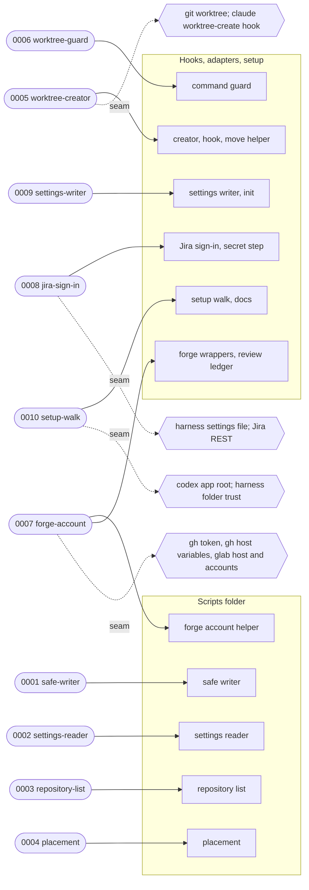

# Execution Plan — setup per repository

> Parent ticket: setup-per-repo   Mode: cited
> Sources: [PRD](../PRD.md) · [SDD](../SDD.md) · [ADRs](../adr/)
> Branch (for /afk:execute): feat/setup-per-repo
> Last updated: 2026-10-28 (status column maintained by /afk:execute)
> Feature: in-progress   <!-- /afk:smoke-test stamps "complete (smoke green …)" iff a smoke gate exists -->
> Review policy: lean   <!-- lean | full — slice review-gate roster; semantics owned by skills/afk/review/SKILL.md "Gate policy". Seeded lean; flip to full by hand for the full roster on every slice; absent (older plans) reads full -->

## Solution map

Each subtask and the modules it builds or changes; dotted edges are external seams.

Caption: the shared modules land first (0001–0004, 0007); every caller subtask asks them and re-applies no rule.

## Seam register

| § | Seam (SDD §9b row) | Implemented by | Used by |
|---|--------------------|----------------|---------|
| 1 | "gh token per account" | 0007-forge-account | — |
| 2 | "gh host and token variables" | 0007-forge-account | — |
| 3 | "glab host" | 0007-forge-account | — |
| 4 | "glab accounts per host" | 0007-forge-account | — |
| 5 | "git worktree" | 0005-worktree-creator | — |
| 6 | "`claude` worktree-create hook" | 0005-worktree-creator (live check) | — |
| 7 | "`codex` app worktree root" | 0010-setup-walk (shown step) | — |
| 8 | "harness folder trust" | 0010-setup-walk (shown step, live check) | — |
| 9 | "harness settings file" | 0008-jira-sign-in | — |
| 10 | "Jira REST" | 0008-jira-sign-in | — |

Every seam is reached only through its implementer's own code: callers (the setup walk, the guard) call that code, not the external tool.

SDD §14 rows each subtask implements: 0001 safe writer; 0002 reader merge, commit gates test; 0005 creator, move helper; 0006 guard `decide`; 0007 forge wrappers, review ledger; 0008 Jira sign-in load, secret step; 0009 settings writer, `init`; 0010 setup walk.

## Progress tracker

| # | Subtask | Title | Status | Blocked by | Tiers | Seams |
|---|---------|-------|--------|------------|-------|-------|
| 1 | 0001-safe-writer | shared safe writer + verification tiers | done | — | static, unit, smoke | §14 safe writer |
| 2 | 0002-settings-reader | owner rule in the settings reader | done | 0001 | static, unit, smoke | §14 reader merge, commit gates |
| 3 | 0003-repository-list | repository list and short-name markers | done | 0001 | static, unit | use §14 safe writer |
| 4 | 0004-placement | one placement module: root rules, worktree folder | done | 0002, 0003 | static, unit | use §14 reader merge |
| 5 | 0005-worktree-creator | creator, worktree-create hook, move helper ask placement | blocked(review_fail: round-10 stalemate, f123-f128 open, f129-f135 smell) | 0004 | static, unit, smoke | impl §5, use §6 |
| 6 | 0006-worktree-guard | guard refuses an agent's worktree outside the root | pending | 0004 | static, unit, smoke | §14 guard `decide` |
| 7 | 0007-forge-account | every forge call acts as the repository's account | pending | 0002 | static, unit, smoke | impl §1–§4 |
| 8 | 0008-jira-sign-in | one Jira sign-in per site; secret step from the terminal | pending | 0001, 0002 | static, unit, smoke | impl §9, §10 |
| 9 | 0009-settings-writer | one key to its owner's file; init; copy deletion | pending | 0001, 0002 | static, unit, smoke | §14 settings writer, init |
| 10 | 0010-setup-walk | `/afk:setup` walks every listed repository | pending | 0003, 0004, 0007, 0008, 0009 | static, unit, smoke | impl §7, §8 |
| 11 | 0011-smoke-e2e | journey tests in the acceptance file | pending | 0001–0010 | static, unit | — |
| 12 | 0012-smoke-api | contract checks in the acceptance file | pending | 0001–0011 | static, unit | — |
| 13 | 0013-sync-harness | AGENTS.md sync + trace matrix | pending | 0001–0012 | static | — |

Status values: `pending` → `designing` → `developing` → `verifying` → `reviewing` → `done`,
or `blocked(<reason>)`. <!-- status set: lockstep copy — owned by /afk:execute (progress-tracker status column) -->
`/afk:execute` advances the row it is working and writes
the date in the header; everything else in PLAN.md is yours to edit.

## Feature smoke gate

> Gate: /afk:smoke-test   Suite: scripts/tests (one black-box acceptance file, `test_setup_per_repo_acceptance.py`)   Target env: local
> Run (e2e/browser): the `unit` tier from `verification.tiers`, scoped to `scripts/tests/test_setup_per_repo_acceptance.py` (this repository declares no `e2e` tier; journeys run as pytest, VERIFICATION-PLAN.md header)
> Run (api): the `unit` tier from `verification.tiers`, scoped to the same file (this repository declares no `api` tier)
> Source: ../VERIFICATION-PLAN.md   Built by: 0011-smoke-e2e (UI) · 0012-smoke-api (API) — terminal, blocked by all
> Last run: — (date + target; maintained by /afk:smoke-test)

Run history: <!-- append-only; one line per run, appended by /afk:smoke-test -->

Integrated verification scenarios that decide "feature complete", seeded from
`VERIFICATION-PLAN.md` (one row per scenario, both modalities). Here a `ui-e2e`
row is an end-to-end journey through the entry points a developer or a harness
reaches, and an `api` row is a contract check of one command, hook or guard rule;
both run as pytest in the one acceptance file. `/afk:smoke-test` owns the Status
column + the header `Feature:` line. An `env-limited` row (L1–L7, live runs)
carries that flag from `VERIFICATION-PLAN.md` — the gate excludes it from its
green verdict. `Requires target` carries over verbatim.

| # | Scenario (integrated) | Modality | Traces to | Spec | Requires target | Status |
|---|-----------------------|----------|-----------|------|-----------------|--------|
| 1 | U1 Setup over 3 repositories from outside them: asks only what is missing, reports complete / asked / failed, goes on after one fails | ui-e2e | PRD User Story 1 · AC-001, AC-010, AC-012, AC-014, AC-015, AC-030, AC-031 | scripts/tests/test_setup_per_repo_acceptance.py ▸ "test_u1_…" | any | pending |
| 2 | U2 Every agent route puts a worktree under root/short name; every agent route outside is refused naming the folder | ui-e2e | PRD User Story 2 · AC-042, AC-050–AC-056, AC-060 | scripts/tests/test_setup_per_repo_acceptance.py ▸ "test_u2_…" | any | pending |
| 3 | U3 Forge account saved only after the host accepts it; every forge call then acts as it | ui-e2e | PRD User Story 3 · AC-026, AC-030, AC-032–AC-034 | scripts/tests/test_setup_per_repo_acceptance.py ▸ "test_u3_…" | any | pending |
| 4 | U4 Repository list: add a pasted path, refuse bad paths, two clones apart, repair a gone folder | ui-e2e | PRD User Story 4 · AC-002–AC-007; PRD catalog R R-05, R-06 | scripts/tests/test_setup_per_repo_acceptance.py ▸ "test_u4_…" | any | pending |
| 5 | U5 Change one setting of one repository; nothing else asked | ui-e2e | PRD User Story 5 · AC-011 | scripts/tests/test_setup_per_repo_acceptance.py ▸ "test_u5_…" | any | pending |
| 6 | U6 No committed AFK file: works from the personal file; a later committed file deletes the copies it replaces | ui-e2e | PRD User Story 6 · AC-020–AC-022, AC-024, AC-025 | scripts/tests/test_setup_per_repo_acceptance.py ▸ "test_u6_…" | any | pending |
| 7 | U7 `codex` app installed: setup shows the step naming the root; not installed: shows nothing | ui-e2e | PRD User Story 7 · AC-046 | scripts/tests/test_setup_per_repo_acceptance.py ▸ "test_u7_…" | any | pending |
| 8 | U8 Jira sign-in per site; only the developer's own terminal stores one | ui-e2e | AC-013, AC-027, AC-035, AC-036 | scripts/tests/test_setup_per_repo_acceptance.py ▸ "test_u8_…" | any | pending |
| 9 | U9 Upgrade from the previous release: misplaced values stop counting, setup offers each move, old worktree base used only while it passes the rules | ui-e2e | AC-023, AC-037, AC-043, AC-044, AC-061 · ADR design 0007 | scripts/tests/test_setup_per_repo_acceptance.py ▸ "test_u9_…" | any | pending |
| 10 | U10 Worktree root asked once, suggested in the home folder, each root rule gives its outcome | ui-e2e | PRD User Story 2 · AC-040, AC-041, AC-045 | scripts/tests/test_setup_per_repo_acceptance.py ▸ "test_u10_…" | any | pending |
| 11 | U11 An ordinary session reads only its own repository and writes working files only into its spec folder | ui-e2e | AC-070, AC-071, AC-080 | scripts/tests/test_setup_per_repo_acceptance.py ▸ "test_u11_…" | any | pending |
| 12 | L1 Two real GitHub accounts on one host: setup saves the second, calls act as it | ui-e2e | AC-030, AC-033 | scripts/tests/test_setup_per_repo_acceptance.py ▸ "test_l1_…" | any | env-limited |
| 13 | L2 GitHub Enterprise Server host: calls carry the token in `GH_ENTERPRISE_TOKEN` | ui-e2e | AC-033 · SDD §9b gh host row | scripts/tests/test_setup_per_repo_acceptance.py ▸ "test_l2_…" | any | env-limited |
| 14 | L3 Real GitLab host with one login: a different account is refused at setup | ui-e2e | AC-030 · SDD §9b glab rows | scripts/tests/test_setup_per_repo_acceptance.py ▸ "test_l3_…" | any | env-limited |
| 15 | L4 Real Jira site: its sign-in loads in each repository on it; a second real site where available | ui-e2e | AC-035, AC-036 | scripts/tests/test_setup_per_repo_acceptance.py ▸ "test_l4_…" | any | env-limited |
| 16 | L5 `claude` worktree tool lands under the root; hook exit 3 creates no worktree | ui-e2e | AC-050, AC-052 | scripts/tests/test_setup_per_repo_acceptance.py ▸ "test_l5_…" | any | env-limited |
| 17 | L6 Trust the root once in `claude` and in `codex`; a worktree in a subfolder raises no trust prompt | ui-e2e | AC-045 | scripts/tests/test_setup_per_repo_acceptance.py ▸ "test_l6_…" | any | env-limited |
| 18 | L7 Worktree placement on a second Windows drive | ui-e2e | AC-050 | scripts/tests/test_setup_per_repo_acceptance.py ▸ "test_l7_…" | Windows with a second drive | env-limited |
| 19 | A1 each repository step runs in its main checkout; a failed step records `failed`, reason, rerun command; the walk goes on | api | SDD §3 row "`/afk:setup` (no argument)" · §14 setup walk · AC-012, AC-010 | scripts/tests/test_setup_per_repo_acceptance.py ▸ "test_a1_…" | any | pending |
| 20 | A2 short name / main checkout / worktree / subfolder path select the repository; unlisted path offered; unknown name refused with the names | api | SDD §3 row "`/afk:setup repo`" · AC-011 | scripts/tests/test_setup_per_repo_acceptance.py ▸ "test_a2_…" | any | pending |
| 21 | A3 success last line `WORKTREE_PATH=`, exit 0; root rule failure exit 3 `ERROR=worktree root: …- run /afk:setup`; other failure exit 1 `ERROR=` | api | SDD §3 row "`create-worktree --name`" · AC-041, AC-050, AC-051 | scripts/tests/test_setup_per_repo_acceptance.py ▸ "test_a3_…" | any | pending |
| 22 | A4 agent parent outside root/short name exit 3 `ERROR=parent … is outside …`; developer anywhere | api | SDD §3 row "`create-worktree --branch …`" · AC-051, AC-053, AC-056 | scripts/tests/test_setup_per_repo_acceptance.py ▸ "test_a4_…" | any | pending |
| 23 | A5 bare path only, exit 0; creator failure non-zero, empty stdout | api | SDD §3 row "worktree-create hook" · AC-050, AC-052 | scripts/tests/test_setup_per_repo_acceptance.py ▸ "test_a5_…" | any | pending |
| 24 | A6 outside or unresolvable target refused with the exact refusal text, no bypass line; inside, unlisted, developer, launch flag pass | api | SDD §3 row "command guard on `git worktree add` and `git worktree move`" · AC-053–AC-056 | scripts/tests/test_setup_per_repo_acceptance.py ▸ "test_a6_…" | any | pending |
| 25 | A7 creator `--parent` / `--dir` outside refused with the same text | api | SDD §3 row "command guard on the creator call" · AC-053 | scripts/tests/test_setup_per_repo_acceptance.py ▸ "test_a7_…" | any | pending |
| 26 | A8 `AFK_WORKTREE_FOLDER` / `AFK_ALLOW_PROTECTED` set in any form the existing variable rule reads → refused naming the variable | api | SDD §3 row "command guard on inline variables" · AC-054 | scripts/tests/test_setup_per_repo_acceptance.py ▸ "test_a8_…" | any | pending |
| 27 | A9 confirmed root exit 0; suggestion plus stderr note; neither passes exit 1 with the rule | api | SDD §3 row "`afk-config.py resolve worktreeRoot`" · AC-040, AC-042, AC-043 | scripts/tests/test_setup_per_repo_acceptance.py ▸ "test_a9_…" | any | pending |
| 28 | A10 `configuration is valid` plus one warning per ignored value, exit 0; unknown key refused; removed-key warning | api | SDD §3 row "`afk-config.py validate`" · AC-020–AC-023, AC-027, AC-044 | scripts/tests/test_setup_per_repo_acceptance.py ▸ "test_a10_…" | any | pending |
| 29 | A11 ignored values absent; all else unchanged; owner table pinned against CONFIG.md | api | SDD §3 row "`afk-config.py get`, `effective` …" · AC-020–AC-023 | scripts/tests/test_setup_per_repo_acceptance.py ▸ "test_a11_…" | any | pending |
| 30 | A12 account token present exit 0; missing → `account not available`, no default-login call; unset as today; token variable per host kind | api | SDD §3 row "forge sign-in check" · AC-030, AC-033 | scripts/tests/test_setup_per_repo_acceptance.py ▸ "test_a12_…" | any | pending |
| 31 | A13 helper returns host and account, never a token; every verb, branch protection, GitHub Issues act as the account; reporter keeps default login | api | SDD §14 row "forge wrappers" · AC-033 | scripts/tests/test_setup_per_repo_acceptance.py ▸ "test_a13_…" | any | pending |
| 32 | A14 trusts every account on the host plus `--trust`; failing login lookup → review commands exit 2 | api | SDD §5 row "trust a comment author" · §14 row "review ledger" · AC-033 | scripts/tests/test_setup_per_repo_acceptance.py ▸ "test_a14_…" | any | pending |
| 33 | A15 runs only with a terminal on input and output and no agent session; every other run refused with the reason; no secret printed | api | SDD §3 row "`setup_secrets.py` …" · AC-013, AC-035 | scripts/tests/test_setup_per_repo_acceptance.py ▸ "test_a15_…" | any | pending |
| 34 | A16 first complete source for `jira.site`; partial skipped and named; per-site names and key derivation; refusals name site and folder | api | SDD §3 row "tracker server tools" · §14 row "Jira sign-in load" · AC-035, AC-036 | scripts/tests/test_setup_per_repo_acceptance.py ▸ "test_a16_…" | any | pending |
| 35 | A17 lock, hand text, write back; changed file refused; lock past 2000 ms fails naming the file; Windows swap retries 10 × 50 ms | api | SDD §14 row "safe writer" · §6 failure matrix · AC-007 | scripts/tests/test_setup_per_repo_acceptance.py ▸ "test_a17_…" | any | pending |
| 36 | A18 one key to its owner's file; special first characters quoted; heading with a note reused; wrong-file key refused; no `schema` line | api | SDD §14 row "settings writer" · AC-010, AC-021 | scripts/tests/test_setup_per_repo_acceptance.py ▸ "test_a18_…" | any | pending |
| 37 | A19 normalized path; duplicate refused; marker first under the list lock; stopped add completed; removal keeps or deletes the marker; read-all only from setup | api | SDD §14 / §5 L5 list invariants · AC-003–AC-007, AC-080 | scripts/tests/test_setup_per_repo_acceptance.py ▸ "test_a19_…" | any | pending |
| 38 | A20 runs when the reader says set up or `.afk` exists; no Python on the commit path | api | SDD §14 row "commit gates `config.yaml` test" · AC-025 | scripts/tests/test_setup_per_repo_acceptance.py ▸ "test_a20_…" | any | pending |
| 39 | A21 fills the committed file from the personal file's team values; never writes the personal file; never run in another repository | api | SDD §14 row "`afk-config.py init`" · AC-024, AC-025 | scripts/tests/test_setup_per_repo_acceptance.py ▸ "test_a21_…" | any | pending |
| 40 | A22 suggested path equals the creator's path; placement loaded only when planning a move | api | SDD §14 row "move helper" · AC-050 | scripts/tests/test_setup_per_repo_acceptance.py ▸ "test_a22_…" | any | pending |
