# SDD — small lane

> Parent PRD: `PRD.md`
> Status: Draft
> Last updated: 2026-10-19
> Reading guide: sections follow the L1–L9 design-layer ladder, top of the system down to the code
> (L1 topology · L2 service boundaries · L3 data · L4 cross-cutting quality · L5 domain model ·
> L6 processes · L7 modules · L8 patterns · L9 seams into existing code). Skim §0 (what's locked)
> and §1 (why) first; non-implementers can stop there or read the DESIGN-BRIEF instead.

Terms: plugin-root `GLOSSARY.md` ("Small lane": small lane, diagnosis, light diagnosis, diagnosis verdict, fix proposal, proof, prior approval, in-place fix / standalone fix). Catalog ids V, K, B, P, G-1 and AC-NNN: `PRD.md`. Source of every decision: `GRILL-LOG.md` "Solution grill", rounds R-1..R-8.

## §0 Binding Contract

This SDD and its accepted ADRs are **binding** on implementing agents and reviewers.

| Aspect | Locked by SDD/ADR | Executor latitude |
|--------|-------------------|-------------------|
| Pattern choice | ✅ | ❌ |
| Module public interface | ✅ | ❌ |
| API contract / schema | ✅ | ❌ |
| Persisted schema — fields, relations, migration (§4) | ✅ | ❌ |
| Lifecycle states + legal transitions (§6) | ✅ | ❌ |
| Roles permitted/denied per surface (§5) | ✅ | ❌ |
| Aggregate boundary | ✅ | ❌ |
| Txn / idempotency strategy | ✅ | ❌ |
| External-seam contract (§9b: framework I/O shape, field source-of-truth, enforcement point, failure surface) | ✅ | ❌ |
| File / package layout *within* a named module | ❌ | ✅ |
| Private helper extraction | ❌ | ✅ |
| Internal naming, control flow | ❌ | ✅ |
| Test fixture structure | ❌ | ✅ |

**Conflict procedure.** Executor finds a binding decision wrong / infeasible / contradicting reality → classify per the decision protocol (`DECISIONS.md`, workflow plugin root): a two-way-door correction is recorded in `plan/DECISIONS.md` and implemented; a one-way door or a tie exits the subtask with `design_conflict` status quoting the SDD section + the conflict, routed back to `/afk:grill-solution` for a new ADR (Status: Accepted, Supersedes: NNNN). Never override off the record.

**Human sign-off register.** Transcribed from the `Signoff:` rows of `GRILL-LOG.md` "Solution grill". Signer: the developer who ran the grill (repository owner).

| Aspect | Section | Status | Signed by / date | Approved wording |
|--------|---------|--------|------------------|------------------|
| HL-1 persistence (packet HL-1e) | §4 | signed | the developer / 2026-10-19 | "sign" (R-9) |
| HL-2 API surface (packet HL-2e) | §3 | signed | the developer / 2026-10-19 | "sign" (R-9) |
| HL-3 authz and scoping (packet HL-3b) | §5 | signed | the developer / 2026-10-16 | "I sign" (R-3) |
| HL-4 domain invariants (packet HL-4c) | §6 | signed | the developer / 2026-10-19 | "sign" (R-9) |
| HL-5 irreversible side effects (packet HL-5c) | §7 | signed | the developer / 2026-10-19 | "sign" (R-9) |
| HL-6 changes to existing behaviour (packet HL-6b, 19 rows as changed by the closing investigations) | §14 | signed | the developer / 2026-10-19 | "sign" (R-9) |

## §1 Context Summary

Today `/afk:diagnose` fixes without an approval, and `/afk:bug` runs a detached fixer and is a second tracker writer (`PRD.md` Problem Statement). This design splits the small lane into a diagnosis that never changes product code, a standalone `/afk:fix` that changes code only after an approval and ships one Draft change, and a bug mode in `/afk:to-ticket` that becomes the only tracker writer. It adds no skill and no process: new behaviour lives in markdown files and scripts beside the skills that own them, and every outside write is made repeatable through one append-only list in the diagnosis file. The PRD owns the what; this document owns the how.

---

## §2 L1 — System Topology

Inherited: skills run by an agent in the current harness session, plus scripts and the existing adapters. No new process; the detached fixer of `/afk:bug` goes (ADR-0007 of the PRD tier).

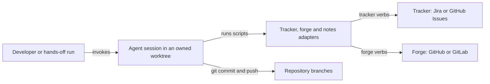

Caption: the small lane lives inside one agent session; tracker and forge are reached only through the existing adapters.

## §3 L2 — Service Boundaries & Integration

| Owner | Owns |
|-------|------|
| `/afk:diagnose` (utility, user-invocable) | intake, reproduction, spec comparison, root cause, verdict, fix proposal; writes `DIAGNOSIS.md`; never changes product code |
| `/afk:fix` (standalone only) | approval, test-first fix, every tier, proof, shipping through the ship script |
| shared fix procedure (markdown beside `/afk:fix`) | the in-place fix every agent caller reads: `/afk:execute` Steps 8, 10, 10.5, `/afk:preflight` PF-3/PF-4, `/afk:autopilot` between smoke-gate runs (ADR-0001) |
| `/afk:to-ticket` bug and ad-hoc mode | every tracker write (ADR-0009) |
| adapters | kind differences of trackers and forges (ADR-0009) |

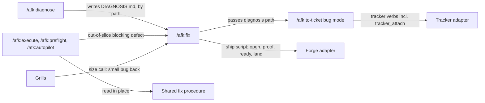

Caption: the diagnosis file is the only hand-off; agents fix in place from one shared procedure file, and only the bug mode reaches the tracker.

Integration style: skill-to-skill by file path (the diagnosis file); skill-to-system through adapter verbs (`ADAPTERS.md`). Versioning: the plugin's SemVer; this change ships as a major release (ADR-0011).

**API contract table** (HL-2, packets HL-2 R-1 as amended by HL-2b/HL-2c/HL-2d/HL-2e). Contract sources: skill frontmatter + body (`skills/utils/diagnose/SKILL.md`, `skills/afk/fix/SKILL.md`, `skills/afk/to-ticket/SKILL.md`), adapter verbs (`ADAPTERS.md`, `adapters/tracker/*/CONTRACT.md`, `adapters/forge/*/CONTRACT.md`).

| Surface | Permitted | Denied | Input and validation | Success output | Failure outputs | Re-run (idempotency) | Version / existing callers |
|---------|-----------|--------|----------------------|----------------|-----------------|----------------------|----------------------------|
| `/afk:diagnose` with a ticket key or a quoted description; a light diagnosis adds the reproduction it reuses (a check name with its output file, or a finding id) | a developer; an agent caller for B-8, B-9, B-10 | no role; a product-code change is refused to every caller | exactly one of: a ticket key the tracker returns, or a non-empty description; neither → asks when a person is present, else `blocked`. Run on a branch other than the base branch → asks once: that branch's tip or the base branch; records the answer | `DIAGNOSIS.md` in the spec folder, then `DIAGNOSIS: <verdict> <path>` and the plain-terms sentence; run alone, it offers the fix | `blocked` (input missing, ticket unreadable, spec folder unresolved). Cannot reproduce is a verdict, not a failure | rewrites verdict, root cause, proposal; empties approval; keeps ticket key, outside writes and the recorded starting branch | breaking: callers that relied on diagnose fixing move to `/afk:fix` (§14) |
| `/afk:fix` with a ticket key, a description, or a diagnosis file path | a developer; an agent caller for a blocking defect outside its slice, under prior approval | a caller with neither an approval nor a covering prior approval: stops before any code change | same input rule as diagnose; a diagnosis path must name a file the diagnosis check script accepts | `OUTCOME: fixed` with the change link and ticket key; for a diagnosis started from a feature branch: the pushed commit and that branch, no ticket, no change | `works_as_specified`, `cannot_reproduce`, `needs_grill`, `needs_decision`, `blocked`; a feature branch that keeps moving, or a red tier after the rebase → `blocked`, commits left on the diagnosis branch | reuses the diagnosis, ticket key and branch it recorded; skips listed outside writes; looks the change up by its branch before opening one and by its recorded number after; several GitLab changes on one branch → `blocked`, never a second change | compatible for humans; agent callers that fixed in place move to the shared fix procedure |
| shared fix procedure, read in place | an agent caller fixing inside its own branch | a human-invoked fix (goes through `/afk:fix`) | the failing check, finding or scenario the caller holds | `fixed` | `fail`, `blocked`, `design_conflict`, `needs_decision`, `adversary_fail`, `flaky` (ADR-0001) | re-runs the failure once before diagnosing; the caller's loop decides retries | compatible: the pointer moves from the skill to the file; `flaky` is new: every caller counts the check as passed for that run and writes one journal line naming it and both runs; no new executor status |
| `/afk:to-ticket` bug and ad-hoc mode, with a diagnosis file path or a description written to a file first, an optional type (bug or enhancement) and an optional ticket key | a developer; a run under prior approval that covers ticket writes | every other caller; a run with neither a person present nor that approval: refused, no write | the in-review key must be configured and match a transition (name or id), else refused with no write; Jira: an unknown fix version refused before any write; GitHub Issues: the type label must exist; a given key must be one the tracker returns; tracker kind `none` → refused before the first write | `TICKET: <key> <link>`, created or updated | refused (unknown state, unknown key, unknown fix version, tracker kind none), or the adapter error after the retries, with no further write after it | listed outside writes are skipped; a failed write retried at most twice, each after a read-back shows it did not take effect; dry-run first | new mode; writes the diagnosis summary as the description only on a ticket it creates, comments only on an existing ticket; PRD and meeting modes unchanged; spinoff tickets on Jira gain formatted text and the unknown-fix-version refusal through the adapter |
| `/afk:bug` | nobody | everybody | — | — | the harness finds no such skill | — | breaking for humans; no alias (ADR-0011) |

| Adapter family | Verbs | Called by | Change |
|----------------|-------|-----------|--------|
| tracker | get, create, edit, transition, comment | bug mode; get also by diagnose and fix | Jira create/comment send formatted text (markdown → Atlassian Document Format) |
| tracker | `tracker_attach` (new, tenth verb) | bug mode, for proof files | Jira: upload with the file's real content type, media embedded; each file's stored name and type read back after upload, a mismatch named in the comment. GitHub Issues: one comment with each image or video inline through `gh issue comment --attach`; another file type, GitHub Enterprise Server, gh older than 2.99.0, and kind `none` answer unsupported for that file |
| tracker | search, transitions, attachments, get (reads) | bug mode before a retry; get reads back a GitHub Issues attach through the ticket's comments | existing verbs, newly called |
| forge | change-create-draft, change-ready, change-reviewers, change-update-body, change-comment, ci-wait | ship script; change-update-body also by the executor for the dependency note | GitLab change-reviewers adds a reviewer instead of replacing the list, as on GitHub; the ship script routes `ci-wait` on exit code and output (§9b) |
| forge | change-view (by branch), note-list, change-fetch (reads) | ship script before a retry; change-fetch by the executor before every description rewrite | existing verbs, newly called |
| notes | resolve | diagnose, fix, bug mode | none |

## §4 L3 — Data Architecture

| State | Datastore | Partitioning | Replication | Retention | Schema-evolution policy | PII? | Audited? (Envers) |
|-------|-----------|--------------|-------------|-----------|--------------------------|------|-------------------|
| Diagnosis (`DIAGNOSIS.md`) | git: the bug's spec folder, on the diagnosis branch | one per work id | git remote once the fix ships | merges with the fix and stays | sections owned by the diagnosis format file; the check script and its table move with it | no; credentials redacted from proof | no |
| Failing test | git: the repository test tree, diagnosis branch | one per diagnosis | git remote once shipped | becomes the regression test; never merges if no fix ships | repository test conventions | no | no |
| Diagnosis branch | local git branch from the branch template, made from the Base tip | one per diagnosis | pushed only by `/afk:fix` | until a fix ships it or the developer deletes it; the plugin deletes none | — | no | no |
| Diagnosis worktree | a linked worktree off the Base branch, made in the owned mode (name and base given) | one per diagnosis | none | retired by `/afk:fix` at its end, from outside it, through the plugin's remove script, whose report fix reads; which keeps a dirty worktree or one with unpushed commits and reports it; a stopped diagnosis keeps its worktree and names it | — | no | no |
| Proof | tracker: evidence comment text + attachments; standalone change: one comment with P-1 and P-2 as text and a link to the ticket's evidence comment; feature-branch fix: one comment on that branch's open change, else the run report | one per diagnosis | tracker's own | tracker's own; never in git (ADR-0004); Jira attachments read back for stored name and type | evidence marker grammar in the diagnosis format file | credentials removed by the shared redaction rules | no |
| Proof files before upload | untracked folder in the fix worktree; names carry the diagnosis id, the kind and the step | one per diagnosis | none | removed with the worktree; a file the upload could not take stays named in the comment | — | redacted | no |
| Ticket | tracker | one per bug; a blocking out-of-slice defect has its own | tracker's own | tracker's own | — | no | no |
| Tracker settings read | repository config: `jira.transitions`, `github-issues.state-labels` | per repository | git | config | one in-review key on both trackers; scaffold key renamed; developer settings keep their K1-K5 ids; `none` means unset for assignee and reviewer (§14) | no | no |
| Old bug folders | main checkout `.claude/bugs` | — | none | left as they are; release notes give clean-up steps | no migration | no | no |

**Entity design — `DIAGNOSIS.md`** (HL-1, packet HL-1e). Identity: the work id (ticket key if one exists, else `bug-` + slug), unique per spec folder.

| Field | Type | Null? | Default | Unit / precision | Constraint | Indexed / unique | Note |
|-------|------|-------|---------|------------------|------------|------------------|------|
| Work id | text | no | ticket key, else `bug-{slug}` | — | changes only when the folder moves after a ticket is created | unique per spec folder | the bug mode re-resolves the folder with the key and git-moves it when the path differs |
| Ticket key | text | yes | empty | — | set by the bug mode only while empty; a later different key goes into Outside writes | — | — |
| Verdict | enum: obvious fix, several fixes, spec gap, works as specified, cannot reproduce (V-1..V-5) | no | none | — | set by diagnose; a re-run replaces it; needs a Reproduction or Attempts | — | — |
| Base | branch name + commit id | no | none | — | the branch the reproduction started from (base branch, or the feature branch the developer chose) and its commit | — | — |
| Diagnosis branch | branch name | no | from the branch template, made from the Base tip | — | lower-cased; passes `git.branch-pattern` | — | diagnose never pushes it |
| Symptom | text | no | none | — | as checked, not as reported | — | — |
| Spec comparison | text with citations | no | none | — | what PRD, SDD, verification plan or other specs say | — | — |
| Reproduction | test path, command, failing output; light diagnosis: the reused check or finding | yes only for cannot reproduce | none | — | the test fails on the Base commit | — | — |
| Attempts | list of attempt + result | yes unless cannot reproduce | none | — | required for cannot reproduce | — | — |
| Root cause | text with file and line | yes unless obvious fix, several fixes or spec gap | none | — | — | — | — |
| Fix proposal | one option or labelled options | yes unless obvious fix or several fixes | none | — | an approval covers it as it stood when approved | — | — |
| Approval | who; their words or the prior approval; what it covers (code, ticket writes, change); date | yes | empty | date: ISO 8601 | written by `/afk:fix` only; emptied by every diagnose rewrite; nothing checks it (ADR-0008) | — | — |
| Outside writes | list: ticket key, change link, each evidence comment marker, feature-branch push, in-review move | yes | empty | — | append-only; appended straight after each write succeeds, only through the outside-writes helper | — | a re-run skips listed writes and reads back the rest before retrying (ADR-0003) |

Every fact carries a certainty mark (evidence-bundle grades, AC-004).

| Relation | Target | Cardinality | Owning side | On delete / orphan | Fetch posture |
|----------|--------|-------------|-------------|--------------------|---------------|
| reproduces with | failing test | 1 : 0..1 | diagnosis | test stays as the regression test after the fix; never merges without a fix | read by path |
| lives on | diagnosis branch | 1 : 1 | diagnosis | branch kept until shipped or deleted by the developer | — |
| filed as | ticket | 1 : 0..1 (more keys go to Outside writes) | diagnosis | ticket stays in the tracker | tracker get |
| shipped by | change | 1 : 0..1 | diagnosis (Outside writes) | change stays on the forge | change-view by branch before opening; by recorded number after |

**Surface reachability.** Tracker tool schemas (the tracker MCP server): changes — gains `tracker_attach`. Import/export templates: no change, because the plugin has none. Public API DTOs: no change, because the plugin exposes none beyond skills and adapter verbs (§3).

**Migration & backfill.** No existing entity is altered. Tickets the old pipeline filed: none; their key passed to `/afk:fix` works (AC-037). Old `.claude/bugs` folders and fixer worktrees: untouched; the release Migration line gives clean-up steps. Config: the scaffold's Jira in-review key is renamed; no code read it before (INV-024). Reversible: yes, by pinning the previous plugin version.

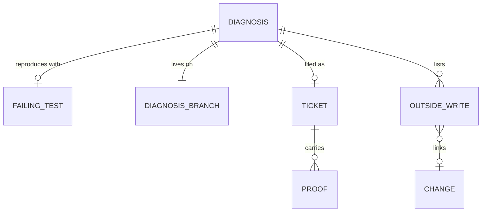

Caption: the diagnosis file is the root; ticket, change and proof hang off its append-only list of outside writes.

No cache.

## §5 L4 — Cross-Cutting & Quality Attributes

**AuthN.** Inherited: writes run as the developer with the existing tracker and forge credentials; no new log, no feature flag (D-15).

**AuthZ** (HL-3, packet HL-3b). One posture for every row: enforced by skill text only (ADR-0008); there is no UI surface.

| Surface | Permitted | Denied | Enforcement point |
|---------|-----------|--------|-------------------|
| Diagnose | developer; agent with or without prior approval | product-code change, every caller | `/afk:diagnose` text; no outside write exists to guard |
| Approve a fix proposal | developer; agent under `DECISIONS.md` for a blocking out-of-slice defect | `/afk:fix` itself; an agent without prior approval → `needs_decision` | `/afk:fix` text; approval recorded, not checked |
| Change product code for a fix | after approval or covering prior approval | any caller without both a real-bug verdict and approval | `/afk:fix` text |
| Create or update a ticket, post evidence | developer after approval or an explicit request; agent whose prior approval covers ticket writes (a hands-off run's start) | every other skill; a run with neither; the description of a ticket the bug mode did not create | `/afk:to-ticket` text |
| Commit an in-place fix on the feature branch | the executor; the fix helpers `/afk:autopilot` runs between smoke-gate runs and `/afk:preflight` runs in its final review | every other skill | `/afk:execute`, `/afk:autopilot`, `/afk:preflight` text |
| Open a change, mark ready, add reviewers | developer in a standalone fix; agent: one Draft change per blocking out-of-slice defect, never ready | in-place fix; ready in a hands-off run | `/afk:fix` text, ship script refuses an empty id and a protected target |
| Merge | nobody | everybody | structural: no forge adapter has a merge verb |

**Data-scoping.**

| Scoped item | Scope | Mechanism |
|-------------|-------|-----------|
| Ticket writes | the diagnosis's recorded ticket, the one created for it, or any key the caller gives | skill text; a given key is recorded or listed in Outside writes |
| File writes | the fix's own worktree and the bug's spec folder | the worktree guard, as today, and skill text |
| Changes | one per bug | change link in Outside writes; lookup by branch before opening, by recorded number after; several GitLab changes on one branch stop the run |
| Company or vendor data | none: the plugin holds no tenant data | not applicable |

**Idempotency** (ADR-0003).

| Surface | Key shape | Dedup window | Side-effect ledger |
|---------|-----------|--------------|--------------------|
| Ticket create | evidence marker in the ticket body, searched by tracker search | the life of the diagnosis | Outside writes: ticket key |
| Evidence comment, attach | visible evidence marker per comment | the life of the ticket | Outside writes: marker |
| Draft change | branch name (change-view by branch) | the life of the branch | Outside writes: change link |
| Feature-branch push | commit id on the remote feature branch | — | Outside writes: push |
| Dependency note | the executor's `afk:subtasks` checklist block, fetched before rewrite | — | the change description itself |

**Retry + timeout.**

| Call | Attempts | Backoff (s) | Timeout (s) |
|------|----------|-------------|-------------|
| Any outside write with a read-back | 1 + at most 2 retries, each after a read-back shows no effect | 5, then 20 | adapter default |
| Any outside write without a read-back | 1, no retry | — | adapter default |
| CI wait (`ci-wait`) | 1 tracked background job | poll every 180 | 5400 |
| Shared fix procedure on a failure | 1 re-run before diagnosing | — | caller's tier timeouts |
| Commit gates | as today, never `--no-verify` | — | 600 |

**Sync vs async.** CI wait runs as a tracked background job, like `/afk:preflight` (D-29).

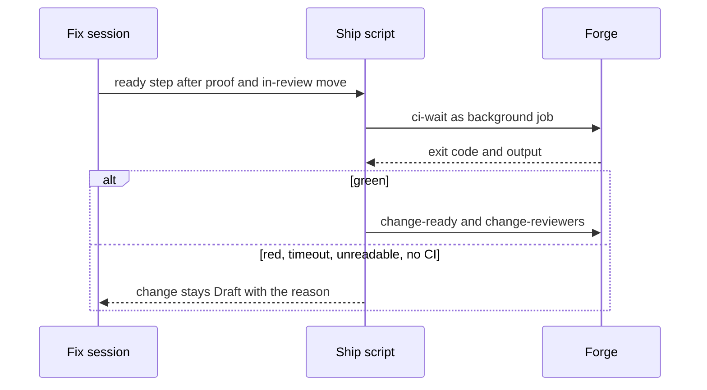

Caption: only a green CI wait flips the change to ready; every other answer leaves it Draft with a reason.

| Operation | Budget | Why async |
|-----------|--------|-----------|
| CI wait | up to 5400 s | a foreground wait blocks the session; outcome stays `fixed` either way |

**Rate limit.** None added: one ticket and one change per bug.

**Feature flags.** None (D-15).

**Observability.**

| Signal | Detects |
|--------|---------|
| `OUTCOME:` line + plain-terms sentence (`REPORTING.md`) | every fix ending, §7 matrix rows |
| three journal events: ticket written, separate change opened, defect parked — in the journal's park form, with three new park reasons, never the `pushed` token for the separate change, and a commit subject carrying the bug's work id | out-of-slice flows in hands-off runs |
| one `flaky` journal line: the check and both runs | checks that pass on re-run |
| autopilot run-report line for separate changes and tickets | the person's follow-up list |
| `plan/DECISIONS.md` entry + `decision(D-{n})` journal line | every automatic approval |

## §6 L5 — Domain Model

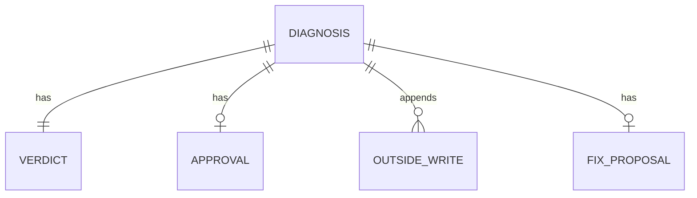

Caption: one aggregate, the diagnosis; verdict, proposal, approval and outside writes are value parts with one writer each.

| Invariant | Owner | Guardian |
|-----------|-------|----------|
| Diagnose never changes product code; the only code it adds is the failing test | diagnosis | `/afk:diagnose` text |
| A diagnosis has every part its verdict needs; a verdict needs a reproduction or a recorded attempt; facts carry certainty marks | diagnosis | diagnosis check script, run by diagnose at its end and by fix at its start |
| No code change without a V-1 verdict (or a grill's return) and an approval | diagnosis | `/afk:fix` text |
| An approval covers the proposal as it stood; a re-run or steer empties it | diagnosis | `/afk:diagnose`, which empties Approval on every rewrite |
| Each part has one writer; Outside writes is append-only | diagnosis | diagnosis format file, read by every writer; outside-writes helper |
| Ticket key set only while empty | diagnosis | bug-mode script |
| A tracker write runs only with a person present or a covering prior approval | ticket | `/afk:to-ticket` text |
| No agent merges | change | structure: no merge verb |
| A fix lands on a feature branch only when the diagnosis started from it, only as a fast-forward, never forced | diagnosis | `/afk:fix` text; the ship script fetches, checks fast-forward and refuses a protected target before a plain git push; the forge refuses a non-fast-forward push unless forced |
| A failing check that passes on one re-run is never fixed by a code change and never parks a run | — | shared fix procedure; every caller |
| A branch with several GitLab changes never gets a second one | change | `/afk:fix` text: lookup by recorded number |
| The bug mode writes a ticket description only on a ticket it created | ticket | bug-mode script |

Writers per part: diagnose — work id through fix proposal; `/afk:fix` — approval; bug mode — ticket key while empty; bug mode (ticket writes) and fix (change writes) — append to Outside writes.

State is derived from fields, never stored (ADR-0002):

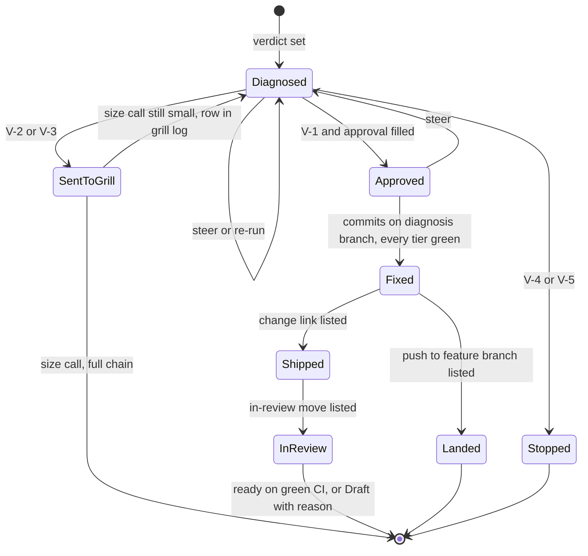

Caption: Landed, Stopped and the end of In review are terminal for the small lane; a red tier after Approved ends `blocked` with no state change.

| State | Read from |
|-------|-----------|
| Diagnosed | a verdict is set |
| Sent to a grill | verdict several fixes or spec gap; back to Diagnosed when the grill's log carries a "still small" size-call row |
| Stopped | verdict works as specified or cannot reproduce |
| Approved | Approval filled |
| Fixed | fix commits on the diagnosis branch, every tier green |
| Landed | a feature-branch push in Outside writes |
| Shipped | a change link in Outside writes |
| In review | the in-review move in Outside writes |

Domain events: none persisted. Run-level journal events: §5 Observability.

## §7 L6 — Process & Coordination

No transactions exist: every step is a file write, a git operation or an adapter call. Consistency is read-after-write through the read-back before each retry; ordering is the fixed write order below.

**Standalone fix** (B-1; D-28; HL-5 order).

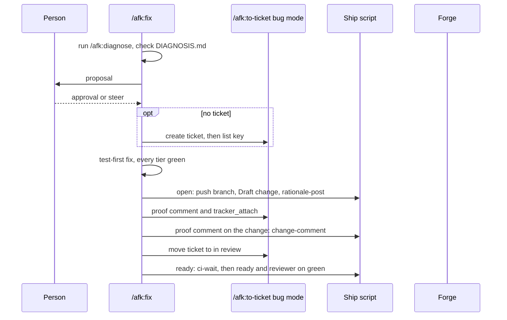

Caption: each outside write follows a fixed order and is listed in the diagnosis right after it succeeds.

**Blocking defect outside the slice** (B-9; ADR-0005).

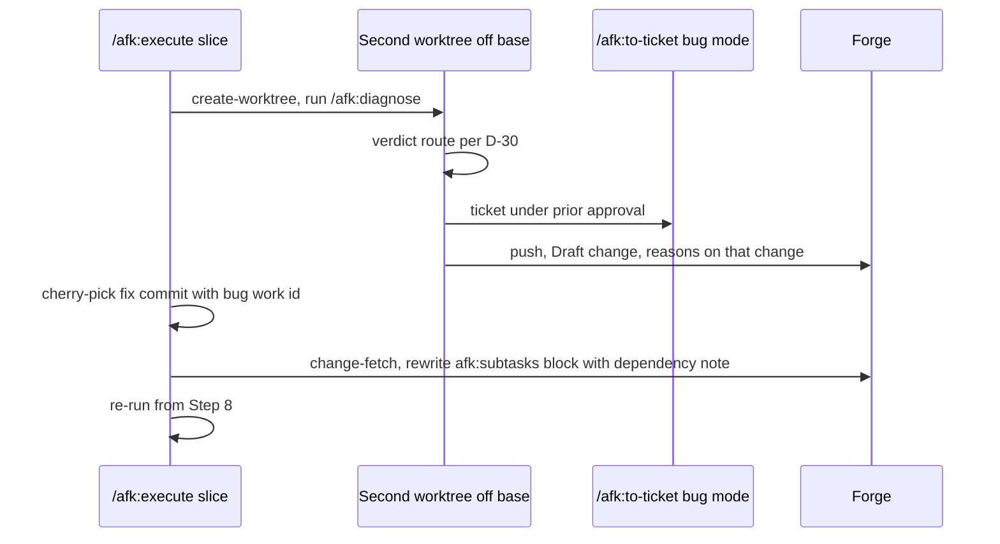

Caption: the separate change opens first, then the feature branch carries the same commit and names the dependency.

**Feature-branch fix** (B-8; ADR-0006): fix commits on the diagnosis branch made from the feature tip → every tier green → fetch, fast-forward check, push with upstream → proof comment on the feature's open change, else the run report. A moved tip → one rebase, every tier again, push; else `blocked`, commits stay on the diagnosis branch.

**Red smoke gate** (B-6; ADR-0007): gate run reports red → `/afk:autopilot` runs the shared fix procedure once per failing scenario through a fix helper that commits on the feature branch, rebuilds the app → one full gate re-run → second red ends the run red.

**Size call** (B-7; ADR-0002): a grill handed a diagnosis records its size call in its own grill-log section; "still small" sends the bug back to `/afk:fix`, which reads that row before changing code; "too big" goes to the requirements grill. A solution grill run without a PRD ends at the size call and never hands on to `/afk:to-sdd`.

| Use case | Trigger | Txn strategy | Consistency per read path | Concurrency control |
|----------|---------|--------------|---------------------------|---------------------|
| Standalone fix | developer runs `/afk:fix` | accept-eventual; ordered writes with Outside-writes list | read-back before retry | none; two sessions on one bug are not stopped (HL-4b risk) |
| Out-of-slice blocking defect | executor finds V-1 blocking defect | accept-eventual across two branches | change-fetch before description rewrite | one owned worktree per session (guard) |
| Feature-branch fix | person reports a bug on a feature branch | single push, fast-forward only | fetch before push | forge refuses non-fast-forward |
| Red smoke gate | gate red | sequential fixes, then one re-run | full re-run before stamping | one autopilot run per plan |
| Out-of-slice verdict routing (D-30) | executor diagnosis verdict | — | — | — |

| Out-of-slice verdict | Blocking | Not blocking |
|----------------------|----------|--------------|
| V-1, easy to undo, clear winner | fix (above) | ticket, slice continues |
| V-2, V-3 | ticket, park | ticket, slice continues |
| V-4 | no ticket; park `design_conflict` (cited) or `needs_decision` (uncited) | nothing |
| V-5 | no ticket; park | nothing |

**Failure & recovery matrix** (HL-5, packet HL-5c).

| Failure point | Detection signal | Automatic recovery | Manual recovery | Owner |
|---------------|------------------|--------------------|-----------------|-------|
| Ticket create fails | adapter `error` or `unavailable` answer, or an empty key (exit 0, INV-025) | read-back by marker search; ≤2 retries at 5 s / 20 s | close a duplicate by hand | bug mode |
| Fix branch push fails | git exit code | read-back: remote has the commit; retry | delete the remote branch | ship script |
| Feature-branch push rejected | non-fast-forward refusal | one rebase, every tier, push | pull; commits stay on the diagnosis branch | `/afk:fix` |
| Draft change open fails | forge error | change-view by branch; retry | close the change | ship script |
| Several changes on one GitLab branch | lookup error | none; `blocked`, never a second change | person picks the change | `/afk:fix` |
| Proof post or upload fails | adapter error / unsupported per file / stored name or type differs | read-back of comments and attachments; unsupported or mismatched file named in the comment | delete comment or attachment; add a named file by hand | bug mode |
| In-review move fails | adapter error; unconfigured key refused before write | read-back of state | move back by hand | bug mode |
| CI red, timeout, unreadable, no CI | `ci-wait` exit code and output | none; change stays Draft with the reason | mark ready by hand | ship script |
| Dependency note rewrite | change-fetch before update | none | remove the block | `/afk:execute` |
| Stopped diagnosis post | adapter error | read-back by marker | delete the comment | bug mode |
| Tracker or forge kind `none` | probe before the first write | fix stays local and stops | — | `/afk:fix` |
| Branch-pattern refusal | branch-name gate | none | person names the branch; hands-off parks `needs_decision` | `/afk:fix` |
| Worktree kept at the end | remove script report (it always exits 0) | none | developer removes it | `/afk:fix` |
| Flaky check | passes on the one re-run | carried on, journal line | fix the test later | every caller |

## §8 L7 — Module Decomposition

No new skill (D-35); each new file lives beside the skill that owns it. Dependency direction: the plugin's own; a downstream file never names its caller (C-3).

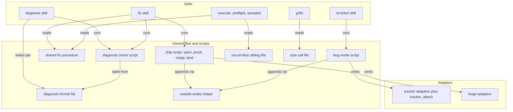

Caption: scripts depend on adapters and the shared helper; skills depend on files; nothing points upward.

| Module | Purpose | Public interface | Depends on | Owner aggregate (§6) |
|--------|---------|------------------|------------|----------------------|
| diagnose skill | writes the diagnosis | invocation per §3 | format file, check script, notes resolve, tracker get | diagnosis |
| diagnosis format file (beside diagnose) | sections, writers per part, evidence marker grammar | the file itself | — | diagnosis |
| diagnosis check script (beside diagnose) | required parts per verdict, evidence, certainty marks; derives state | path in → accept or refuse with the missing parts; state | format file | diagnosis |
| fix skill + shipping sibling | approval, fix, proof, ship | invocation per §3 | check script, procedure, ship script, bug mode | diagnosis |
| shared fix procedure (beside fix) | in-place fix; serves the PRD's "return in place" (M2) | failing check, finding or scenario in → one of 7 results | tiers, `tdd` | — |
| ship script (beside fix) | named steps open, proof, ready, land | step name + diagnosis path in → step result; skips listed steps | forge adapters, helper | diagnosis |
| out-of-slice sibling file (beside execute) | verdict routes, second worktree, cherry-pick, dependency note, journal lines | the file itself | fix skill, procedure | — |
| bug-mode sibling + script (beside to-ticket) | ticket create/update, in-review move, evidence, fix version | diagnosis path or description file + optional type and key → `TICKET:` line | tracker adapters (`tracker_api` load of `call`), helper | ticket |
| outside-writes helper (one) | only code that appends to Outside writes; read-back before retry | append(entry), retry(write, read-back) | format file | diagnosis |
| size-call file (beside grill-requirements, pointed at by grill-solution) | G-1 | the file itself | — | — |
| tracker adapters + MCP server | ten verbs incl. `tracker_attach` | adapter verbs (`ADAPTERS.md`) | tracker CLIs and REST | — |

Lockstep: format file ↔ helper ↔ check script move in one commit. Developer settings and their rule move to `CONFIG.md` (ADR-0010). Tests in the main test folder, stub tracker and forge, CI on Linux and Windows (C-2).

## §9 L8 — Tactical Patterns

| Concern | Pattern | ADR |
|---------|---------|-----|
| Required parts per verdict, derived state | Table-driven check (Specification table) | ADR-0002 |
| Outside writes in fixed order, skip done, retry with read-back | Named-step script (Template Method over a step list) + one helper | ADR-0003 |
| Tracker and forge kind differences | Strategy per adapter kind behind one verb set | ADR-0009 |
| In-place fix shared by many callers | Shared procedure file read in place | ADR-0001 |
| Registry check of verb names | Exact-match registry | ADR-0004 |

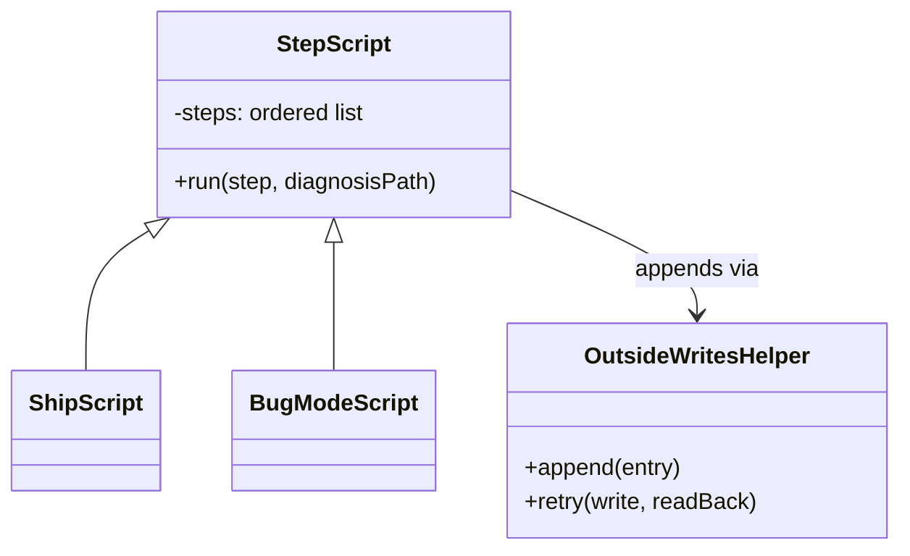

Caption: both outside-writing scripts are lists of named steps; a listed step is skipped, a failed one retried through the helper.

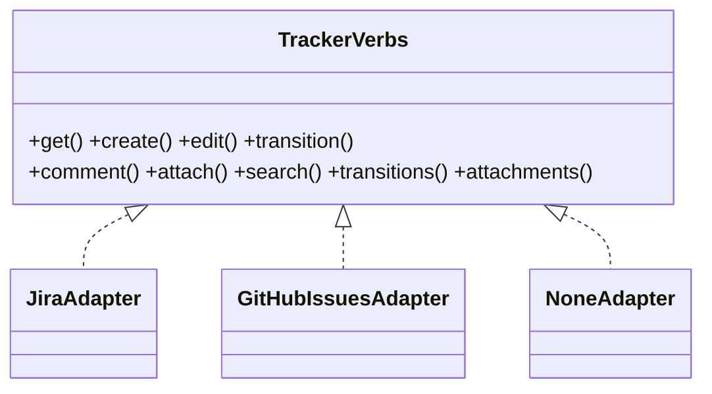

Caption: the bug-mode script calls one verb set; markdown-to-ADF, content types and gh `--attach` live inside each adapter.

## §9b External Seams & Failure Affordance

No UI seam. External seams are CLIs and REST services outside the repository; live checks run before release (GAP-7, §13).

| Boundary | Framework @ pin | What it does to our value | Failure surface | Seam-test |
|----------|-----------------|---------------------------|-----------------|-----------|
| GitHub Issues attach | gh ≥ 2.99.0 `gh issue comment --attach` (docs.github.com "Attaching files with GitHub CLI"; github.blog changelog 2026-09-01) | uploads image/video files and embeds them inline in the comment body | older gh, GitHub Enterprise Server, other types, no push access → unsupported per file, file named in the comment | stub-gh test asserting the argv carries one `--attach` per supported file and none for others; live run before release |
| Jira attachment upload | Jira Cloud REST attachments endpoint | stores the file; the stored type and same-name handling are undocumented (INV-024) | today hard-coded `image/png`; after upload the bug mode reads back each file's stored name and type and names a mismatch; proof names are unique per diagnosis | stub-HTTP test asserting the multipart content type equals the file's type; live run before release |
| Jira rich text | Atlassian Document Format | renders our markdown | today one plain paragraph (INV-024) | test asserting the ADF document structure for headings, lists, code, links |
| Forge CI wait | `ci-wait` forge verb | exit code + stdout carry green / red / timeout / unreadable; codes collide with other exits (INV-025) | routed on exit code and stdout together; a head commit with no checks, and forge `none`, exit 3 at once (INV-025) | stub-forge test per answer, incl. no CI |
| Forge change description | `change-fetch` / `change-update-body` | update replaces the whole body; fetch writes it only to the metadata file, never stdout, on both forges (INV-023) | read the metadata file before every rewrite | stub-forge test: rewrite keeps text outside the block |
| Feature-branch push | git push, fast-forward only | remote refuses a non-fast-forward | rebase once, else `blocked` | git-in-temp-dir test with a moved remote tip |
| Field truth | ticket key: tracker; in-review state: `jira.transitions` / `github-issues.state-labels` checked against tracker transitions; fix version: Jira project versions | — | unknown → refused before any write | stub-tracker tests per refusal |

## §10 NFRs

| Concern | Target | Measurement | Owner |
|---------|--------|-------------|-------|
| Retries per outside write (count) | ≤ 2, after 5 s and 20 s, each after a read-back | helper unit test | outside-writes helper |
| CI wait budget (s) | ≤ 5400, poll 180 | ship-script test with stub forge | ship script |
| Re-runs of a failure before diagnosing (count) | 1 | procedure-caller tests | shared fix procedure |
| Smoke-gate re-runs after in-place fixes (count) | 1 | autopilot plan test | `/afk:autopilot` |
| Duplicate tickets or changes on re-run (count) | 0 when the read-back sees the earlier write | stub tracker/forge re-run tests | bug mode, ship script |
| `/afk:bug` mentions outside `CHANGELOG.md` and spec folders (count) | 0 | new commit check | plugin-source gates |
| Test platforms (count) | 2: Windows and Linux (WSL locally, CI both) | CI matrix | every new test |
| Minimum gh version for inline images on GitHub Issues | 2.99.0 | `/afk:setup` probe, dependency register | `/afk:setup` |

## §11 Out of Scope

- `PRD.md` Out of Scope: medium and large lanes (#108), prototype logic branch, migration of old tickets, small enhancements.
- Live checks against real Jira, GitHub and GitLab: run before release, not during build (GAP-7).
- Existing drift found by the L9 walk, reported separately: preflight-evidence block missing from `AGENTS.md` and `README.md`; `JOURNAL-FORMAT.md` missing `unhomed_product_debt`; glossary miss-class count; provider parity rows for diagnose; raw worktree removal in `/afk:gc` and `/afk:settle-change`; `FRESHNESS.md:85` "both tracker kinds"; tracker contract files disagreeing with the code; `gc-check.sh:151` reads an unset variable; spinoff mode passes `epic`, which the tracker MCP server does not declare; registry check E config-key prefix match; parity claim that `/afk:to-subtasks` proved `tracker_create`; stale github-issues contract line.
- Plugin defects found while investigating, reported separately: unguarded `git push`; `update-ref` moving another worktree's branch; `--ignore-other-worktrees`; ledger merge folding.

## §12 Reversed Decisions

| Prior ADR | Superseded by | Reason |
|-----------|---------------|--------|
| Plugin ADR-0001 (two tracker writers; cited, no file) | requirement ADR-0003 of this feature; plugin-root `adr/0008` written by the build | `/afk:bug` is removed; `/afk:to-ticket` is the only tracker writer; `/afk:report-issue` stays a separate egress (ADR-0002/0007 of the plugin) |

## §13 Open Questions

| Question | Layer (L1-L9) | Blocks executor? | Owner | Target resolve date |
|----------|---------------|------------------|-------|---------------------|
| Live behaviour before release: GitLab branch lookup with several changes, `glab --ready` on a non-Draft change, Jira formatting and unknown-fix-version answers (§9b) | L9 | no | the developer, at release | before the major release |

Seam-investigation gate notes (`check_sdd_investigations.py`, written verbatim):

```text
note — `/afk:diagnose` never fixes: INV-022 left unverified, not load-bearing: the hit set holds every reference to afk:diagnose, afk:fix, ESCAPE-ANALYSIS, WORKFLOW-FEEDBACK, afk:grill-requirements, afk:grill-solution over the name forms this pass searched
note — `/afk:diagnose` never fixes: INV-022 stops at B14: another repository, deployment manifest, or live consumer
note — `/afk:fix` standalone, worktree via `create-worktree`: INV-025 left unverified, not load-bearing: the hit set holds every reference to afk:fix, ci-wait, change-create-draft, create-worktree, remove-worktree, worktree-remove, afk_adapter, tracker_api over the name forms this pass searched
note — `/afk:fix` standalone, worktree via `create-worktree`: INV-025 left unverified, not load-bearing: unverified: SDD 'on native Windows the payload goes through the environment' - adapters/forge/github/forge.sh:28-33 reads the payload from argv or stdin and no environment transport was found in the forge scripts read
note — `/afk:fix` standalone, worktree via `create-worktree`: INV-025 left unverified, not load-bearing: whether glab mr update --reviewer clears the Draft flag the way --description does is not settled: CONTRACT.md:82-89 records the observed clearing for --description, and glab 1.89.0 source resends the unchanged title
note — `/afk:fix` standalone, worktree via `create-worktree`: INV-025 stops at B14: live GitLab instance (glab mr view on a branch with several merge requests; glab mr update --ready on a merged/closed or non-draft MR; whether --reviewer clears Draft); live gh pr ready on an already-ready PR (write, not probed); live CI pipelines and checks; forge server-side branch protection, the only refusal of a push to a protected target; other repositories consuming the forge verbs; providers/CONFORMANCE.md:97-98 records an earlier live run of these verbs, not this snapshot
note — shared fix procedure from `/afk:fix` phases: INV-022 left unverified, not load-bearing: the hit set holds every reference to afk:diagnose, afk:fix, ESCAPE-ANALYSIS, WORKFLOW-FEEDBACK, afk:grill-requirements, afk:grill-solution over the name forms this pass searched
note — shared fix procedure from `/afk:fix` phases: INV-022 stops at B14: another repository, deployment manifest, or live consumer
note — `/afk:execute` fix points and limits: INV-023 left unverified, not load-bearing: the hit set holds every reference to afk:execute, afk:autopilot, afk:preflight, afk:smoke-test, DECISIONS, JOURNAL-FORMAT, afk:subtasks, change-update-body over the name forms this pass searched
note — `/afk:execute` fix points and limits: INV-023 left unverified, not load-bearing: Not checked by P3: live `gh pr edit --body` and `glab mr update --description` behaviour, a live GitLab instance, and description readers in consuming repositories.
note — `/afk:execute` fix points and limits: INV-023 stops at B14: another repository, deployment manifest, or live consumer; live `gh pr edit --body` behaviour (Draft side effect, body size) not run by P3; live GitLab instance (`glab mr update --description` Draft clearing and the `description` key) not run by P3 - key settled from glab/client-go source by the orchestrator; change-description readers in consuming repositories (bots, CI parsing the MR/PR body) not enumerable from this repository
note — hands-off rules: `DECISIONS.md`, `/afk:autopilot`: INV-023 left unverified, not load-bearing: the hit set holds every reference to afk:execute, afk:autopilot, afk:preflight, afk:smoke-test, DECISIONS, JOURNAL-FORMAT, afk:subtasks, change-update-body over the name forms this pass searched
note — hands-off rules: `DECISIONS.md`, `/afk:autopilot`: INV-023 left unverified, not load-bearing: Not checked by P3: live `gh pr edit --body` and `glab mr update --description` behaviour, a live GitLab instance, and description readers in consuming repositories.
note — hands-off rules: `DECISIONS.md`, `/afk:autopilot`: INV-023 stops at B14: another repository, deployment manifest, or live consumer; live `gh pr edit --body` behaviour (Draft side effect, body size) not run by P3; live GitLab instance (`glab mr update --description` Draft clearing and the `description` key) not run by P3 - key settled from glab/client-go source by the orchestrator; change-description readers in consuming repositories (bots, CI parsing the MR/PR body) not enumerable from this repository
note — `/afk:preflight` PF-3/PF-4 and the `afk:subtasks` block: INV-023 left unverified, not load-bearing: the hit set holds every reference to afk:execute, afk:autopilot, afk:preflight, afk:smoke-test, DECISIONS, JOURNAL-FORMAT, afk:subtasks, change-update-body over the name forms this pass searched
note — `/afk:preflight` PF-3/PF-4 and the `afk:subtasks` block: INV-023 left unverified, not load-bearing: Not checked by P3: live `gh pr edit --body` and `glab mr update --description` behaviour, a live GitLab instance, and description readers in consuming repositories.
note — `/afk:preflight` PF-3/PF-4 and the `afk:subtasks` block: INV-023 stops at B14: another repository, deployment manifest, or live consumer; live `gh pr edit --body` behaviour (Draft side effect, body size) not run by P3; live GitLab instance (`glab mr update --description` Draft clearing and the `description` key) not run by P3 - key settled from glab/client-go source by the orchestrator; change-description readers in consuming repositories (bots, CI parsing the MR/PR body) not enumerable from this repository
note — `/afk:smoke-test` red gate with `/afk:autopilot`: INV-023 left unverified, not load-bearing: the hit set holds every reference to afk:execute, afk:autopilot, afk:preflight, afk:smoke-test, DECISIONS, JOURNAL-FORMAT, afk:subtasks, change-update-body over the name forms this pass searched
note — `/afk:smoke-test` red gate with `/afk:autopilot`: INV-023 left unverified, not load-bearing: Not checked by P3: live `gh pr edit --body` and `glab mr update --description` behaviour, a live GitLab instance, and description readers in consuming repositories.
note — `/afk:smoke-test` red gate with `/afk:autopilot`: INV-023 stops at B14: another repository, deployment manifest, or live consumer; live `gh pr edit --body` behaviour (Draft side effect, body size) not run by P3; live GitLab instance (`glab mr update --description` Draft clearing and the `description` key) not run by P3 - key settled from glab/client-go source by the orchestrator; change-description readers in consuming repositories (bots, CI parsing the MR/PR body) not enumerable from this repository
note — `JOURNAL-FORMAT` events and `/afk:autopilot` report: INV-023 left unverified, not load-bearing: the hit set holds every reference to afk:execute, afk:autopilot, afk:preflight, afk:smoke-test, DECISIONS, JOURNAL-FORMAT, afk:subtasks, change-update-body over the name forms this pass searched
note — `JOURNAL-FORMAT` events and `/afk:autopilot` report: INV-023 left unverified, not load-bearing: Not checked by P3: live `gh pr edit --body` and `glab mr update --description` behaviour, a live GitLab instance, and description readers in consuming repositories.
note — `JOURNAL-FORMAT` events and `/afk:autopilot` report: INV-023 stops at B14: another repository, deployment manifest, or live consumer; live `gh pr edit --body` behaviour (Draft side effect, body size) not run by P3; live GitLab instance (`glab mr update --description` Draft clearing and the `description` key) not run by P3 - key settled from glab/client-go source by the orchestrator; change-description readers in consuming repositories (bots, CI parsing the MR/PR body) not enumerable from this repository
note — lesson capture links: `ESCAPE-ANALYSIS`, `WORKFLOW-FEEDBACK`: INV-022 left unverified, not load-bearing: the hit set holds every reference to afk:diagnose, afk:fix, ESCAPE-ANALYSIS, WORKFLOW-FEEDBACK, afk:grill-requirements, afk:grill-solution over the name forms this pass searched
note — lesson capture links: `ESCAPE-ANALYSIS`, `WORKFLOW-FEEDBACK`: INV-022 stops at B14: another repository, deployment manifest, or live consumer
note — grills: `/afk:grill-requirements`, `/afk:grill-solution`: INV-022 left unverified, not load-bearing: the hit set holds every reference to afk:diagnose, afk:fix, ESCAPE-ANALYSIS, WORKFLOW-FEEDBACK, afk:grill-requirements, afk:grill-solution over the name forms this pass searched
note — grills: `/afk:grill-requirements`, `/afk:grill-solution`: INV-022 stops at B14: another repository, deployment manifest, or live consumer
note — `/afk:to-ticket` bug mode, not through `publish_prd`: INV-024 left unverified, not load-bearing: the hit set holds every reference to afk:to-ticket, publish_prd, publish_meeting, tracker_create, upload_attachment, adapter_registry_check, state-labels, fixVersions over the name forms this pass searched
note — `/afk:to-ticket` bug mode, not through `publish_prd`: INV-024 left unverified, not load-bearing: Whether the bug mode's 'own region' (SDD.draft.md:560) can sit in a parent Enhancement description, which would make AGENTS.md:178 'Other prose belongs to the human' wrong, is not settled by the SDD rows read.
note — `/afk:to-ticket` bug mode, not through `publish_prd`: INV-024 left unverified, not load-bearing: What the MCP server does with the undeclared `epic` argument at run time (drop or refuse) was not checked.
note — `/afk:to-ticket` bug mode, not through `publish_prd`: INV-024 left unverified, not load-bearing: Jira Cloud docs give only a generic 400 for invalid field values on POST /rest/api/3/issue; whether an unknown fixVersions name is refused, and under which error key, is not documented for Cloud (a Jira Server thread reports errors.fixVersions). Not load-bearing: the design refuses an unknown fix version before any write (SDD.draft.md:99), so it never sends one
note — `/afk:to-ticket` bug mode, not through `publish_prd`: INV-024 left unverified, not load-bearing: Whether a literal newline inside an ADF text node renders as a line break is not documented (the text node page is silent). Not load-bearing: the design builds ADF nodes from markdown for Jira create and comment (SDD.draft.md:104, :561) instead of sending newlines inside one text node
note — `/afk:to-ticket` bug mode, not through `publish_prd`: INV-024 left unverified, not load-bearing: Not a design premise since R-9 C-34, kept for the release-time live check; Jira Cloud docs are silent on how the multipart part's Content-Type maps to the stored attachment mimeType and on any file-type restriction, and the adapter sends image/png for every file today (adapters/tracker/jira/api.py:189). The design no longer rests on it: after each Jira upload bug mode reads back the stored filename and mimeType through tracker_attachments and names any mismatch in its comment. That verb returns both per attachment today (adapters/tracker/jira/api.py:550-551), and upload_attachment returns the new attachment's id (:197) to match on, so the read-back needs no adapter change; needs a live Jira check before release.
note — `/afk:to-ticket` bug mode, not through `publish_prd`: INV-024 left unverified, not load-bearing: Not a design premise since R-9 C-34, kept for the release-time live check; Jira Cloud docs are silent on a REST upload whose file name an attachment on the issue already has (duplicate, rename or replace); UI evidence JRACLOUD-80252 says Jira renames. The design no longer rests on it: proof file names carry the diagnosis id, kind and step, so one run never uploads one name twice, and the stored filename read back through tracker_attachments (adapters/tracker/jira/api.py:550) shows any rename, which bug mode names in its comment; needs a live Jira check before release.
note — `/afk:to-ticket` bug mode, not through `publish_prd`: INV-024 stops at B14: another repository, deployment manifest, or live consumer
note — tracker adapters: `tracker_create`, `upload_attachment`, `fixVersions`, `state-labels`: INV-024 left unverified, not load-bearing: the hit set holds every reference to afk:to-ticket, publish_prd, publish_meeting, tracker_create, upload_attachment, adapter_registry_check, state-labels, fixVersions over the name forms this pass searched
note — tracker adapters: `tracker_create`, `upload_attachment`, `fixVersions`, `state-labels`: INV-024 left unverified, not load-bearing: Whether the bug mode's 'own region' (SDD.draft.md:560) can sit in a parent Enhancement description, which would make AGENTS.md:178 'Other prose belongs to the human' wrong, is not settled by the SDD rows read.
note — tracker adapters: `tracker_create`, `upload_attachment`, `fixVersions`, `state-labels`: INV-024 left unverified, not load-bearing: What the MCP server does with the undeclared `epic` argument at run time (drop or refuse) was not checked.
note — tracker adapters: `tracker_create`, `upload_attachment`, `fixVersions`, `state-labels`: INV-024 left unverified, not load-bearing: Jira Cloud docs give only a generic 400 for invalid field values on POST /rest/api/3/issue; whether an unknown fixVersions name is refused, and under which error key, is not documented for Cloud (a Jira Server thread reports errors.fixVersions). Not load-bearing: the design refuses an unknown fix version before any write (SDD.draft.md:99), so it never sends one
note — tracker adapters: `tracker_create`, `upload_attachment`, `fixVersions`, `state-labels`: INV-024 left unverified, not load-bearing: Whether a literal newline inside an ADF text node renders as a line break is not documented (the text node page is silent). Not load-bearing: the design builds ADF nodes from markdown for Jira create and comment (SDD.draft.md:104, :561) instead of sending newlines inside one text node
note — tracker adapters: `tracker_create`, `upload_attachment`, `fixVersions`, `state-labels`: INV-024 left unverified, not load-bearing: Not a design premise since R-9 C-34, kept for the release-time live check; Jira Cloud docs are silent on how the multipart part's Content-Type maps to the stored attachment mimeType and on any file-type restriction, and the adapter sends image/png for every file today (adapters/tracker/jira/api.py:189). The design no longer rests on it: after each Jira upload bug mode reads back the stored filename and mimeType through tracker_attachments and names any mismatch in its comment. That verb returns both per attachment today (adapters/tracker/jira/api.py:550-551), and upload_attachment returns the new attachment's id (:197) to match on, so the read-back needs no adapter change; needs a live Jira check before release.
note — tracker adapters: `tracker_create`, `upload_attachment`, `fixVersions`, `state-labels`: INV-024 left unverified, not load-bearing: Not a design premise since R-9 C-34, kept for the release-time live check; Jira Cloud docs are silent on a REST upload whose file name an attachment on the issue already has (duplicate, rename or replace); UI evidence JRACLOUD-80252 says Jira renames. The design no longer rests on it: proof file names carry the diagnosis id, kind and step, so one run never uploads one name twice, and the stored filename read back through tracker_attachments (adapters/tracker/jira/api.py:550) shows any rename, which bug mode names in its comment; needs a live Jira check before release.
note — tracker adapters: `tracker_create`, `upload_attachment`, `fixVersions`, `state-labels`: INV-024 stops at B14: another repository, deployment manifest, or live consumer
note — registry check E: `adapter_registry_check`: INV-024 left unverified, not load-bearing: the hit set holds every reference to afk:to-ticket, publish_prd, publish_meeting, tracker_create, upload_attachment, adapter_registry_check, state-labels, fixVersions over the name forms this pass searched
note — registry check E: `adapter_registry_check`: INV-024 left unverified, not load-bearing: Whether the bug mode's 'own region' (SDD.draft.md:560) can sit in a parent Enhancement description, which would make AGENTS.md:178 'Other prose belongs to the human' wrong, is not settled by the SDD rows read.
note — registry check E: `adapter_registry_check`: INV-024 left unverified, not load-bearing: What the MCP server does with the undeclared `epic` argument at run time (drop or refuse) was not checked.
note — registry check E: `adapter_registry_check`: INV-024 left unverified, not load-bearing: Jira Cloud docs give only a generic 400 for invalid field values on POST /rest/api/3/issue; whether an unknown fixVersions name is refused, and under which error key, is not documented for Cloud (a Jira Server thread reports errors.fixVersions). Not load-bearing: the design refuses an unknown fix version before any write (SDD.draft.md:99), so it never sends one
note — registry check E: `adapter_registry_check`: INV-024 left unverified, not load-bearing: Whether a literal newline inside an ADF text node renders as a line break is not documented (the text node page is silent). Not load-bearing: the design builds ADF nodes from markdown for Jira create and comment (SDD.draft.md:104, :561) instead of sending newlines inside one text node
note — registry check E: `adapter_registry_check`: INV-024 left unverified, not load-bearing: Not a design premise since R-9 C-34, kept for the release-time live check; Jira Cloud docs are silent on how the multipart part's Content-Type maps to the stored attachment mimeType and on any file-type restriction, and the adapter sends image/png for every file today (adapters/tracker/jira/api.py:189). The design no longer rests on it: after each Jira upload bug mode reads back the stored filename and mimeType through tracker_attachments and names any mismatch in its comment. That verb returns both per attachment today (adapters/tracker/jira/api.py:550-551), and upload_attachment returns the new attachment's id (:197) to match on, so the read-back needs no adapter change; needs a live Jira check before release.
note — registry check E: `adapter_registry_check`: INV-024 left unverified, not load-bearing: Not a design premise since R-9 C-34, kept for the release-time live check; Jira Cloud docs are silent on a REST upload whose file name an attachment on the issue already has (duplicate, rename or replace); UI evidence JRACLOUD-80252 says Jira renames. The design no longer rests on it: proof file names carry the diagnosis id, kind and step, so one run never uploads one name twice, and the stored filename read back through tracker_attachments (adapters/tracker/jira/api.py:550) shows any rename, which bug mode names in its comment; needs a live Jira check before release.
note — registry check E: `adapter_registry_check`: INV-024 stops at B14: another repository, deployment manifest, or live consumer
note — forge scripts: `ci-wait`, `change-create-draft`: INV-025 left unverified, not load-bearing: the hit set holds every reference to afk:fix, ci-wait, change-create-draft, create-worktree, remove-worktree, worktree-remove, afk_adapter, tracker_api over the name forms this pass searched
note — forge scripts: `ci-wait`, `change-create-draft`: INV-025 left unverified, not load-bearing: unverified: SDD 'on native Windows the payload goes through the environment' - adapters/forge/github/forge.sh:28-33 reads the payload from argv or stdin and no environment transport was found in the forge scripts read
note — forge scripts: `ci-wait`, `change-create-draft`: INV-025 left unverified, not load-bearing: whether glab mr update --reviewer clears the Draft flag the way --description does is not settled: CONTRACT.md:82-89 records the observed clearing for --description, and glab 1.89.0 source resends the unchanged title
note — forge scripts: `ci-wait`, `change-create-draft`: INV-025 stops at B14: live GitLab instance (glab mr view on a branch with several merge requests; glab mr update --ready on a merged/closed or non-draft MR; whether --reviewer clears Draft); live gh pr ready on an already-ready PR (write, not probed); live CI pipelines and checks; forge server-side branch protection, the only refusal of a push to a protected target; other repositories consuming the forge verbs; providers/CONFORMANCE.md:97-98 records an earlier live run of these verbs, not this snapshot
note — developer settings of `afk:bug`: INV-026 stops at B14: harness skill loaders; installed plugin caches; consuming repositories' .claude/bugs/ state and fixer worktrees; developers' user-level config holding K1-K5; live trackers and other repositories' steering; forge rationale lookup not run
note — `/afk:bug` skill removed: INV-026 stops at B14: harness skill loaders; installed plugin caches; consuming repositories' .claude/bugs/ state and fixer worktrees; developers' user-level config holding K1-K5; live trackers and other repositories' steering; forge rationale lookup not run
note — tracker-writer rule after `afk:bug`: INV-026 stops at B14: harness skill loaders; installed plugin caches; consuming repositories' .claude/bugs/ state and fixer worktrees; developers' user-level config holding K1-K5; live trackers and other repositories' steering; forge rationale lookup not run
note — registries, FRESHNESS, MANIFEST rows for `afk:bug`: INV-026 stops at B14: harness skill loaders; installed plugin caches; consuming repositories' .claude/bugs/ state and fixer worktrees; developers' user-level config holding K1-K5; live trackers and other repositories' steering; forge rationale lookup not run
note — new commit check for `afk:bug` mentions: INV-026 stops at B14: harness skill loaders; installed plugin caches; consuming repositories' .claude/bugs/ state and fixer worktrees; developers' user-level config holding K1-K5; live trackers and other repositories' steering; forge rationale lookup not run
note — `/afk:to-ticket` existing modes: `publish_prd`, `publish_meeting`, spinoff: INV-024 left unverified, not load-bearing: the hit set holds every reference to afk:to-ticket, publish_prd, publish_meeting, tracker_create, upload_attachment, adapter_registry_check, state-labels, fixVersions over the name forms this pass searched
note — `/afk:to-ticket` existing modes: `publish_prd`, `publish_meeting`, spinoff: INV-024 left unverified, not load-bearing: Whether the bug mode's 'own region' (SDD.draft.md:560) can sit in a parent Enhancement description, which would make AGENTS.md:178 'Other prose belongs to the human' wrong, is not settled by the SDD rows read.
note — `/afk:to-ticket` existing modes: `publish_prd`, `publish_meeting`, spinoff: INV-024 left unverified, not load-bearing: What the MCP server does with the undeclared `epic` argument at run time (drop or refuse) was not checked.
note — `/afk:to-ticket` existing modes: `publish_prd`, `publish_meeting`, spinoff: INV-024 left unverified, not load-bearing: Jira Cloud docs give only a generic 400 for invalid field values on POST /rest/api/3/issue; whether an unknown fixVersions name is refused, and under which error key, is not documented for Cloud (a Jira Server thread reports errors.fixVersions). Not load-bearing: the design refuses an unknown fix version before any write (SDD.draft.md:99), so it never sends one
note — `/afk:to-ticket` existing modes: `publish_prd`, `publish_meeting`, spinoff: INV-024 left unverified, not load-bearing: Whether a literal newline inside an ADF text node renders as a line break is not documented (the text node page is silent). Not load-bearing: the design builds ADF nodes from markdown for Jira create and comment (SDD.draft.md:104, :561) instead of sending newlines inside one text node
note — `/afk:to-ticket` existing modes: `publish_prd`, `publish_meeting`, spinoff: INV-024 left unverified, not load-bearing: Not a design premise since R-9 C-34, kept for the release-time live check; Jira Cloud docs are silent on how the multipart part's Content-Type maps to the stored attachment mimeType and on any file-type restriction, and the adapter sends image/png for every file today (adapters/tracker/jira/api.py:189). The design no longer rests on it: after each Jira upload bug mode reads back the stored filename and mimeType through tracker_attachments and names any mismatch in its comment. That verb returns both per attachment today (adapters/tracker/jira/api.py:550-551), and upload_attachment returns the new attachment's id (:197) to match on, so the read-back needs no adapter change; needs a live Jira check before release.
note — `/afk:to-ticket` existing modes: `publish_prd`, `publish_meeting`, spinoff: INV-024 left unverified, not load-bearing: Not a design premise since R-9 C-34, kept for the release-time live check; Jira Cloud docs are silent on a REST upload whose file name an attachment on the issue already has (duplicate, rename or replace); UI evidence JRACLOUD-80252 says Jira renames. The design no longer rests on it: proof file names carry the diagnosis id, kind and step, so one run never uploads one name twice, and the stored filename read back through tracker_attachments (adapters/tracker/jira/api.py:550) shows any rename, which bug mode names in its comment; needs a live Jira check before release.
note — `/afk:to-ticket` existing modes: `publish_prd`, `publish_meeting`, spinoff: INV-024 stops at B14: another repository, deployment manifest, or live consumer
note — feature-branch landing: plain git push, not `afk_adapter`: INV-025 left unverified, not load-bearing: the hit set holds every reference to afk:fix, ci-wait, change-create-draft, create-worktree, remove-worktree, worktree-remove, afk_adapter, tracker_api over the name forms this pass searched
note — feature-branch landing: plain git push, not `afk_adapter`: INV-025 left unverified, not load-bearing: unverified: SDD 'on native Windows the payload goes through the environment' - adapters/forge/github/forge.sh:28-33 reads the payload from argv or stdin and no environment transport was found in the forge scripts read
note — feature-branch landing: plain git push, not `afk_adapter`: INV-025 left unverified, not load-bearing: whether glab mr update --reviewer clears the Draft flag the way --description does is not settled: CONTRACT.md:82-89 records the observed clearing for --description, and glab 1.89.0 source resends the unchanged title
note — feature-branch landing: plain git push, not `afk_adapter`: INV-025 stops at B14: live GitLab instance (glab mr view on a branch with several merge requests; glab mr update --ready on a merged/closed or non-draft MR; whether --reviewer clears Draft); live gh pr ready on an already-ready PR (write, not probed); live CI pipelines and checks; forge server-side branch protection, the only refusal of a push to a protected target; other repositories consuming the forge verbs; providers/CONFORMANCE.md:97-98 records an earlier live run of these verbs, not this snapshot
note — outside-writes helper over `tracker_api`: INV-025 left unverified, not load-bearing: the hit set holds every reference to afk:fix, ci-wait, change-create-draft, create-worktree, remove-worktree, worktree-remove, afk_adapter, tracker_api over the name forms this pass searched
note — outside-writes helper over `tracker_api`: INV-025 left unverified, not load-bearing: unverified: SDD 'on native Windows the payload goes through the environment' - adapters/forge/github/forge.sh:28-33 reads the payload from argv or stdin and no environment transport was found in the forge scripts read
note — outside-writes helper over `tracker_api`: INV-025 left unverified, not load-bearing: whether glab mr update --reviewer clears the Draft flag the way --description does is not settled: CONTRACT.md:82-89 records the observed clearing for --description, and glab 1.89.0 source resends the unchanged title
note — outside-writes helper over `tracker_api`: INV-025 stops at B14: live GitLab instance (glab mr view on a branch with several merge requests; glab mr update --ready on a merged/closed or non-draft MR; whether --reviewer clears Draft); live gh pr ready on an already-ready PR (write, not probed); live CI pipelines and checks; forge server-side branch protection, the only refusal of a push to a protected target; other repositories consuming the forge verbs; providers/CONFORMANCE.md:97-98 records an earlier live run of these verbs, not this snapshot
note — release gate for `afk:bug` removal: INV-026 stops at B14: harness skill loaders; installed plugin caches; consuming repositories' .claude/bugs/ state and fixer worktrees; developers' user-level config holding K1-K5; live trackers and other repositories' steering; forge rationale lookup not run
check_sdd_investigations: every seam row cites a closed investigation
```

## §14 L9 — Implementation Seams & Change Impact

| Seam (class/method/contract) | Existing contract (INV-NNN) | Planned change | Impacted flows (INV-NNN) | Conventions / landmines | Verdict |
|------------------------------|-----------------------------|----------------|--------------------------|-------------------------|---------|
| `/afk:diagnose` never fixes | (INV-022): diagnoses, then fixes (Phase 5, `diagnose/SKILL.md:119-133`) and writes the regression test (Phase 6, `:139-147`); its Phase 2.5 heading is a managed-behaviour doctrine home (`BEHAVIORS.md:47`, `behavior_registry.py:283-299`; editing that row bumps its revision, `:316-317`) | writes `DIAGNOSIS.md` only; asks the starting branch off the base branch; drops the hand-off to an unshipped skill | (INV-022): `/afk:fix` delegates the fix to diagnose (`fix/SKILL.md:12,31,38,42,112`); behaviour registry gate (`behavior-registry-gate.sh:22`, `behavior-drift.sh:29-41`); pins `test_behavior_registry_gate.py:51`, `hook-smoke.sh:571`; provider parity rows (`PARITY.md:75`, `CONFORMANCE.md:44`) | keep the "§Phase 2.5 — Trace the path" heading word for word, the investigate and rationale-read steps, name, language pointer, hitl template; rewrite the description (`:3` says "→ fix → regression-test") and the Phase 2.5 cross-references to Phases 3 and 6 (`:91`) | reworked |
| `/afk:fix` standalone, worktree via `create-worktree` | (INV-025): `create-worktree` never fetches or lower-cases; owner record only in `--name` mode (`create-worktree:443-445`); `remove-worktree` always exits 0 and acts only on owned worktrees (`remove-worktree.py:518`); gc and settle-change also run raw `git worktree remove` | standalone: diagnose → approval → test-first fix → every tier → proof → ship script; cuts the worktree with `--name` and `--base`, retires it with `remove-worktree` from outside it and reads its report | (INV-025): in-place callers move to the procedure; branch-name gate | lower-case the name, fetch the base; pattern refusal → ask, or `needs_decision` hands-off | reworked |
| shared fix procedure from `/afk:fix` phases | (INV-022): fix phases incl. escape analysis, spec reconciliation, workflow lesson | new file beside fix: re-run once (`flaky`), records caller, input, failing path; test-first; every tier; 7 results | (INV-022): in-place callers `execute/SKILL.md:67,77,93,123`, `preflight/SKILL.md:99,125`, `bug/FIXER-PROMPT.md:29` (goes with `/afk:bug`); only `design_conflict` is routed today (`execute:67`); `grill-requirements/ROUND.md:162`, `review/checklists/refactor-safety.md:10`, `FRESHNESS.md:53`, `AGENTS.md:94`, `README.md:480,698,741` | six results map to existing statuses, `flaky` counts as passed with one journal line (§3); lesson lockstep (6 miss classes, unvalidated: `lesson-append.sh:59`); `fix/SKILL.md:14,107,110` no-commit rules move with the procedure | extends (ADR-0001) |
| `/afk:execute` fix points and limits | (INV-023): Step 8 red → retry → fix, Step 10 by class, 10.5; statuses `execute/SKILL.md:120-133`; out-of-Scope → `blocked`; no tracker `:12`; this branch `:30`; "only execute commits" `:142` | steps point at the procedure; step numbers and caps kept; "only execute commits" widens to autopilot's and preflight's fix helpers; V-4 out of slice → `design_conflict` cited, `needs_decision` uncited; out-of-slice sibling file | (INV-023): `test_execute_step_pointers.py:44`; mission-control insights regexes `insights.py:23-24`; `test_fail` text | cherry-pick carries the bug work id, not the slice prefix (`review/SKILL.md:23`); re-run from Step 8; never `--no-verify` | reworked |
| hands-off rules: `DECISIONS.md`, `/afk:autopilot` | (INV-023): `DECISIONS.md:23` external write never a two-way door; `:25` hard boundaries; autopilot `:24,64`; subagent prompt `:28-29` | a hands-off run's start is the prior approval for out-of-slice ticket and separate-change writes; merge and force push stay forbidden, and so does marking the separate change ready (the feature change still goes ready through preflight, `preflight/SKILL.md:215`) | (INV-023): `README.md:127,860-861`; `AGENTS.md:195`; no test pins | each automatic decision gets `D-{n}` + journal line | reworked |
| `/afk:preflight` PF-3/PF-4 and the `afk:subtasks` block | (INV-023): PF-3/PF-4 route to fix (`preflight/SKILL.md:99,125`); one block per writer (`:181-186`); `change-update-body` replaces the whole body; body only from `change-fetch` | procedure results map to PF park reasons; dependency note inside execute's `afk:subtasks` block; `change-fetch` before every rewrite | (INV-023): no test names `change-update-body`, `afk:subtasks`, `preflight-evidence` | V-2, V-3, V-5 need park reasons; GitLab description field unchecked live | extends (ADR-0005) |
| `/afk:smoke-test` red gate with `/afk:autopilot` | (INV-023): never patches a red run (`smoke-test/SKILL.md:53,80`); autopilot `:67` | autopilot runs the procedure once per failing scenario between gate runs; gate report-only; one re-run; second red ends red | (INV-023): app rebuild after a code change (autopilot `:36`); scoped runs never stamp (`:29`) | full re-run before stamping; comment gate and rationale on the fix commits | reworked |
| `JOURNAL-FORMAT` events and `/afk:autopilot` report | (INV-023): events `JOURNAL-FORMAT.md:31-37`; report `autopilot/SKILL.md:49-58` | three events in the park form, three new park reasons (`JOURNAL-FORMAT.md:51-54`), a `flaky` line, one report line; the separate change's push never uses `pushed` (`understand/SKILL.md:80`) | (INV-023): mission-control parser generic (`mc/journal.py:10-13`); journal fixture `test_contract.py:90-97`, commit join `:306` | new token = same-commit edit to `JOURNAL-FORMAT.md` | extends (ADR-0005) |
| lesson capture links: `ESCAPE-ANALYSIS`, `WORKFLOW-FEEDBACK` | (INV-022): links point at fix phases (`AGENTS.md:153`, lesson `LEDGER-FORMAT.md:79-88`) | point at the procedure file; workflow feedback uses the slice or finding id | (INV-022): lesson ledger lockstep | miss-class mapping pair moves together | extends (ADR-0001) |
| grills: `/afk:grill-requirements`, `/afk:grill-solution` | (INV-022): no diagnosis argument; grill-solution needs a PRD; `/afk:to-sdd` needs a PRD and `INDEX.md` (`to-sdd/SKILL.md:19,70`) | accept `DIAGNOSIS.md`; grill-solution runs without a PRD and then ends at the size call, never handing on to `/afk:to-sdd`; the size call is a new row shape in `GRILL-LOG-FORMAT.md`, written in the grill's own section; size-call file names fix only as a bounce target | (INV-022): `grill-solution/SKILL.md:3,14,16,49,115`, `grill-requirements/SKILL.md:3,104`; downstream-blind rule (`AGENTS.md:25`, no gate) | gap-routing may name the owner, never the caller; fix and grill-solution descriptions are unquoted YAML (`test_skill_frontmatter.py:86`) | extends (ADR-0002) |
| `/afk:to-ticket` bug mode, not through `publish_prd` | (INV-024): `publish_prd.py:67-75` loads Jira-only symbols at import; the Jira client has no create, transition or versions | one new script driving adapter verbs through `tracker_api.load(("call",))`; files only from a file on disk; the diagnosis summary is the description only of a ticket it creates, comments only on an existing ticket (one sentence added to the description-ownership rules, `AGENTS.md:178`); proof files read back after upload; dry-run first | (INV-024): no test imports `publish_prd`; skill text `to-ticket/SKILL.md:3,8,10,16,25,29,90`; `test_tracker_create_assignee.py:58` expects exactly one request to create | carry the old bug publisher's safeguards: dry-run, fix-version check, 4xx bodies, retry 5xx; the type check is new (the old publisher hard-codes `Bug`, `publish_bug.py:157`); `call()` catches only `KeyError` and `SystemExit` (`jira/api.py:634-642`) | extends (ADR-0009) |
| tracker adapters: `tracker_create`, `upload_attachment`, `fixVersions`, `state-labels` | (INV-024): create/comment flatten to one ADF paragraph (`jira/api.py:495-499`); upload hard-codes `image/png` (`:180-197`); nothing reads `jira.transitions` | `tracker_attach`; markdown → ADF; in-review key as name or id checked against transitions; unknown fix version refused; scaffold key renamed | (INV-024): `tracker_attach` edit list: 3 adapters (`none/api.py:4`, `github-issues/api.py:4`), MCP server (`server.py:138`), `ADAPTERS.md:51,58`, `MANIFEST.md:737-738`, `CONFORMANCE.md:96`, "nine verbs" claims; `test_tracker_jira.py:307` uploads a `.png` and stays green | live Jira checks before release; an unparseable `github-issues/adapter.json` silently disables the comment gate (`comment_gate.py:518-523`) | extends (ADR-0004) |
| registry check E: `adapter_registry_check` | (INV-024): substring match (`adapter_registry_check.py:94`) | whole-name match | (INV-024): `skill-registry-gate.sh:201,212`; `test_skill_registry_gate.py:59`; `test_plugin_source_gates.py:263,423,477`; CI `tests.yml:85,99` | config-key prefix match left as is | extends (ADR-0004) |
| forge scripts: `ci-wait`, `change-create-draft` | (INV-025): `ci-wait` exit codes collide; `Adapter.call` cannot route `ci-wait`; rationale-post on a Draft without assignee (`forge_ledger.py:1901-1904`) | ship script opens the change before rationale-post; routes `ci-wait` on exit and output; refuses an empty id and a protected target; looks the change up by recorded number; GitLab `change-reviewers` sends a `+` name so it adds (`gitlab/forge.sh:420`) | (INV-025): preflight PF-6 numbers match | `git push` is not guarded by the plugin | extends (ADR-0003) |
| developer settings of `afk:bug` | (INV-026): `bug/CONFIG.md:35-72` K1-K5, fail closed; `test_afk_config.py:356-380` | move to `CONFIG.md`; missing assignee or reviewer asked, or left unassigned and reported hands-off; literal `none` = unset for both keys; keep the K1-K5 ids | (INV-026): `CONFIG.md:136`, `MANIFEST.md:40,53,127,213-216,914`, `FRESHNESS.md:78`, `README.md:340`; `developer_values.py:148` | only the assignee maps `none` today (`afk-config.py:830`) and `test_afk_config_init.py:206` pins the reviewer's literal `none`; fail-closed applies only to assignee and reviewer (`bug/CONFIG.md:59-61`) | extends (ADR-0010) |
| `/afk:bug` skill removed | (INV-026): manifests `.claude-plugin/plugin.json:19`, `.codex-plugin/plugin.json:9`; gates; `test_publish_bug.py` imports the skill script | remove skill, manifests, test, every reference and 8 glossary headings (One-live-fixer among them) in one commit | (INV-026): text reference list; glossary usage test | `mrReviewer` and `change-reviewers` land with fix's ready step; glossary commit with `PRD.md`; bug-mode script test covers `tracker_api.load` (its only test goes, `test_publish_bug.py:43`) | reworked |
| tracker-writer rule after `afk:bug` | (INV-026): "exactly two" (`AGENTS.md:9,193-195`, `README.md`, `MANIFEST.md`, `GLOSSARY.md:262`); no code enforces it | one writer; `adr/0008` supersedes ADR-0001; `/afk:report-issue` a separate egress | (INV-026): report-issue writes this repository's tracker; rule statements also at `MANIFEST.md:858`, `CAPABILITIES.md:65`, `README.md:108,117` | `FRESHNESS.md:94` in the same commit | extends (ADR-0009) |
| registries, FRESHNESS, MANIFEST rows for `afk:bug` | (INV-026): FRESHNESS `:77-80,86`; MANIFEST H2, H6, S1, W2 | delete or edit rows (H2 and S1 edited, not deleted: `jira/adapter.json:27-30`); gh ≥ 2.99.0 floor row; `tracker_attach` at every home | (INV-026): gate E register ids; `test_setup_h6_probe.py:22-25`; FRESHNESS row 79 also owns `scripts/create-worktree`, row 78 names K1-K4 | same-commit rule | reworked |
| new commit check for `afk:bug` mentions | (INV-026): audit checks miss a bare `/afk:bug` in prose | gates entry, fixtures, hooks README row; excludes `CHANGELOG.md` and spec folders; also `/afk-toolkit:bug` | (INV-026): `plugin-source-gates.sh:97,186-188`; the gate list is pinned at `test_plugin_source_gates.py:33,313-314`, `test_behavior_registry_gate.py:70` | gate cost rules (check M requires `hooks/lib/bounded_scan.py`); exclude or edit `glossary_usage.py:28-31`, `test_glossary_usage.py:96,132`, `test_tracker_create_assignee.py:3` | extends (ADR-0011) |
| `/afk:to-ticket` existing modes: `publish_prd`, `publish_meeting`, spinoff | (INV-024): PRD mode refusals and dry-run (needs credentials; replaces figures before the prompt, `publish_prd.py:267-304,333`); meeting mode keyed by expand title and imports `publish_prd` (`publish_meeting.py:52`) | bug mode never touches the `afk:prd` block or Meeting Summaries; spinoff stubs go through the changed adapter create, so they gain formatted text and the unknown-fix-version refusal | (INV-024): spinoff passes `epic`, which the MCP server does not declare (`server.py:149-158`) | — | extends (ADR-0009) |
| feature-branch landing: plain git push, not `afk_adapter` | (INV-025): no forge kind has a `push` verb (`afk_adapter forge push` answers unsupported, exit 3); push is plain git | fetch, fast-forward check, push with upstream; refuse a protected target | (INV-025): SAFETY "one Draft change" satisfied by the feature's Draft change | one SAFETY sentence; no BEHAVIORS change | fits |
| outside-writes helper over `tracker_api` | (INV-025): adapter answers `error` and `unavailable` with exit 0 (`github-issues/api.py:95`, against `ADAPTERS.md:32`); create can return an empty key with no error (`:321-326`) | one helper appends and reads back before retry; an empty key or `unavailable` counts as a failed write | (INV-025): bug-mode and ship scripts | check each adapter answer | fits |
| release gate for `afk:bug` removal | (INV-026): `release-gate.sh:91-95` checks agreement; the major bump is the human's call (`CHANGELOG.md:23-27`) | major release; Migration line; remove `to-demo-plan` and `settle-mr` aliases | (INV-026): `update-notice.sh:124` surfaces `Migration:` (untested, `:123-150`) | the Migration line gives clean-up steps for `.claude/bugs` and fixer worktrees, which lose their purge owner (`gc/SKILL.md:89-90`) | fits |

Accepted compatibility-audit findings (`investigations/AUDIT-L9.md`); every other finding was resolved by R-8 C-4..C-26 and Q-6, or by the closing investigations and R-9 C-27..C-40:

- **Chain 11 — CI-wait numbers match preflight PF-6** — accepted because no conflict; the ship script reuses them (§5)
- **Doctrine 11 — a major release passes `release-gate.sh`; a skill removal trips the registry gate through the catalog rows** — accepted because expected; the removal commit updates the catalog rows (C-21)
- **Adapters 8 — with no CI, `ci-wait` exits 3 at once (INV-025 corrects the earlier 360 s inference)** — accepted because the ship script routes that exit to "no CI" and leaves the change Draft (§7); the adapter reads its payload from argv or stdin (`adapters/forge/github/forge.sh:28-34`)
