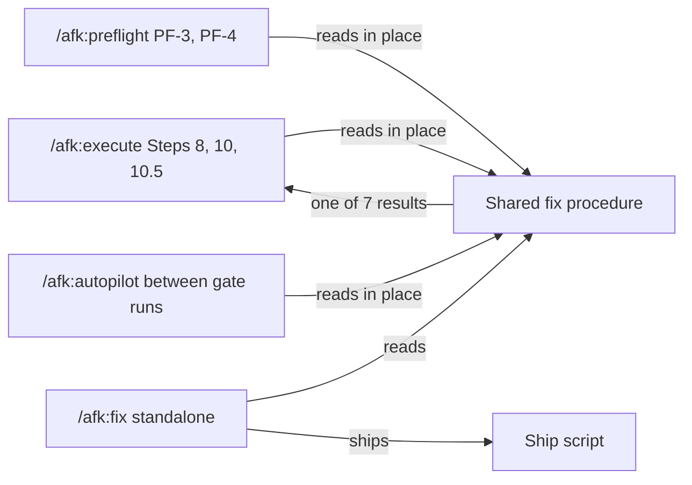

# ADR-0001 — In-place fix is a shared procedure file, not a mode of /afk:fix

> Status: Accepted
> Date: 2026-10-19
> Layer: L7
> Context ticket: small-lane

## Context

Five agent callers fix a defect inside their own branch: `/afk:execute` Steps 8, 10 and 10.5, `/afk:preflight` PF-3/PF-4, and `/afk:autopilot` between smoke-gate runs (SDD §3, §14). An in-place fix never commits, pushes, opens a change or writes a ticket (AC-022), while a standalone fix does all four. One skill serving both would need an argument that flips every outside write. Decided R-1 Q-1 = B; results R-7 D-39, R-8 C-5, C-9, C-10.

## Decision

The in-place fix is one markdown file beside `/afk:fix`, read in place by every agent caller. `/afk:fix` runs standalone only. The procedure re-runs a failure once before changing code (a pass returns `flaky` with both runs), records the caller, the input and the failing path, fixes test-first, runs every tier, and returns one of seven results: `fixed`, `fail`, `blocked`, `design_conflict`, `needs_decision`, `adversary_fail`, `flaky`. Six results map onto each caller's existing statuses; `flaky` counts as passed for that run, and the caller writes one journal line naming the check and both runs, with no new status. Step numbers and caps stay. The fix helpers `/afk:autopilot` and `/afk:preflight` run may commit on the feature branch. This file is how the PRD's "return in place" is served.

Caption: one procedure, many readers; only the standalone skill ships.

## Alternatives Considered

| Alternative | Pros | Cons | Reason rejected |
|-------------|------|------|-----------------|
| A: one `/afk:fix` with an in-place argument | one entry point | every outside write behind a flag; agent callers invoke a user-facing skill | the flag is the defect surface (R-1 Q-1) |
| B: shared procedure file (chosen) | no new skill; in-place and standalone share one fix body | callers must route a new `flaky` result (as passed, with a journal line) | — |
| C: each caller keeps its own fix text | no shared edit | five copies drift; breaks one-fact-one-home | duplication |

## Consequences

- **Positive** — in-place callers keep their loops and statuses; the lesson-capture links point at one file.
- **Negative** — every caller edits its routing in the same commit; `test_execute_step_pointers.py` pins step numbers.
- **Follow-ups** — none outside this feature.
