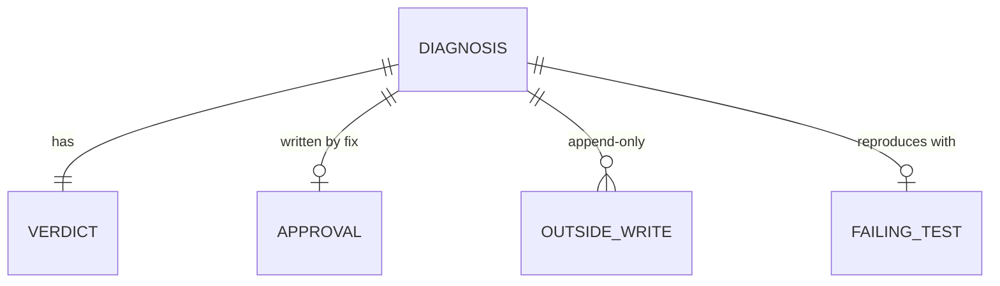

# ADR-0002 — The diagnosis file is the hand-off, and the bug's state is derived from it

> Status: Accepted
> Date: 2026-10-19
> Layer: L3
> Context ticket: small-lane

## Context

Diagnose, fix, the bug mode and the grills pass one bug between them, across sessions and re-runs (SDD §4, §6). Decided R-1 D-3, R-2 D-7, D-8, R-5 D-24..D-27, R-7 D-41, R-8 C-13.

## Decision

`DIAGNOSIS.md` in the bug's spec folder, committed with the failing test on a local diagnosis branch made from the Base tip, is the only hand-off: every skill receives its path. A bug with no ticket gets the work id `bug-{slug}`; the bug mode re-resolves the folder once the key exists and moves it when the path differs. Each part has one writer. The bug's state is never stored: a check script holds a table of the parts each verdict needs and derives the state from the fields. Diagnose runs the check at its end, fix at its start; fix refuses a file the check rejects. A diagnose re-run rewrites verdict, root cause and proposal and empties the approval. The grills accept the file as input. A grill records its size call in its own grill-log section; fix reads a "still small" row before changing code. A solution grill run without a PRD ends at the size call and never hands on to `/afk:to-sdd`.

Caption: one file carries the bug; state is read from its fields.

## Alternatives Considered

| Alternative | Pros | Cons | Reason rejected |
|-------------|------|------|-----------------|
| A stored state field | one read | two sources of truth drift | D-24 |
| A separate state file | state apart from prose | second file to keep in step | D-24 |
| Required parts checked by skill text | no script | missing parts reach the fix | D-26 |
| Diagnosis on the ticket only | readers see it at once | needs a tracker; no repository record | D-7, D-9 |

## Consequences

- **Positive** — a resumed or re-run fix needs no extra state; a hand-written file is checked like a generated one.
- **Negative** — the format file, the check script and the outside-writes helper move in lockstep.
- **Follow-ups** — two sessions on one bug are not stopped (HL-4 risk).
