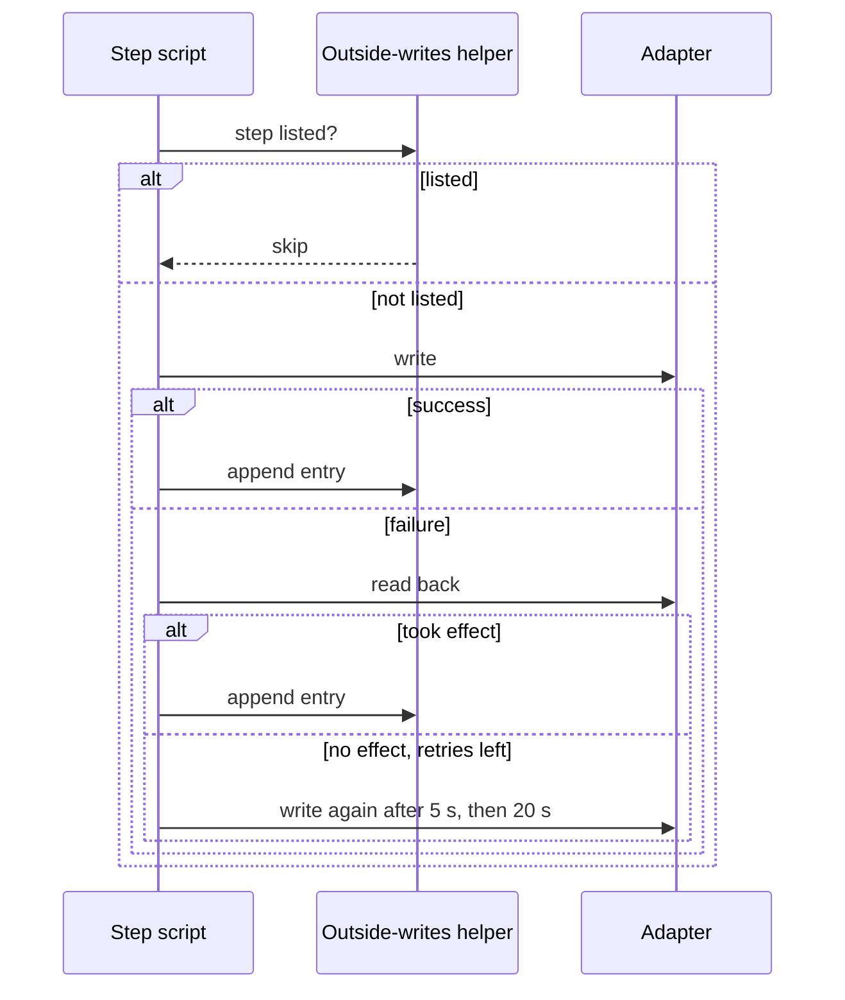

# ADR-0003 — Outside writes run as named steps over an append-only list, with a read-back before each retry

> Status: Accepted
> Date: 2026-10-19
> Layer: L6
> Context ticket: small-lane

## Context

A standalone fix writes to the tracker and the forge in a fixed order (SDD §7). A run can stop between writes and be re-run; an adapter answers `error` with exit 0 (INV-015); a write that seemed to fail can have taken effect. Decided R-2 D-11, D-13, R-3 D-17, R-5 D-28, R-7 D-36, D-37, D-42, R-8 C-19.

## Decision

Both outside-writing scripts (the ship script: open, proof, ready, land; the bug-mode script) are ordered lists of named steps. One helper is the only code that appends to the diagnosis's Outside writes list, straight after a write succeeds. A re-run skips listed steps. A failed write is retried at most twice, after 5 s and 20 s, and only after a read-back shows it did not take effect; a write with no read-back is never retried. The ship script opens the change before posting reasons, routes `ci-wait` on exit code and output together, refuses an empty change id and a protected target.

Caption: no write repeats unless a read-back proves the earlier attempt left nothing.

## Alternatives Considered

| Alternative | Pros | Cons | Reason rejected |
|-------------|------|------|-----------------|
| Retry on the local list alone | no read-back calls | duplicates when a failed write took effect | D-17 |
| No retry | simplest | transient errors stop the run | D-13 |
| Each script appends its own way | no shared helper | lockstep breaks across writers | D-37 |

## Consequences

- **Positive** — re-runs are safe; the list doubles as the reader's record.
- **Negative** — a search right after a create may miss the new ticket (unchecked live), so a duplicate stays possible.
- **Follow-ups** — live checks of read-back timing before release (SDD §13).
