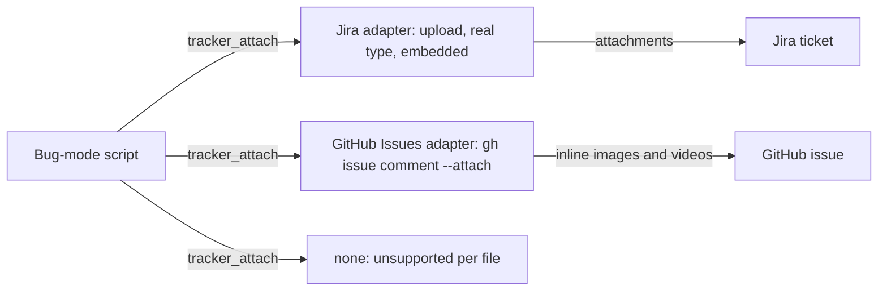

# ADR-0004 — Proof files live on the ticket only, through a new tracker_attach verb

> Status: Accepted
> Date: 2026-10-19
> Layer: L3
> Context ticket: small-lane

## Context

Proof P-1..P-3 (test output, tier results, captures) must reach a ticket reader (AC-018, AC-033). The tracker family has nine verbs and no upload on GitHub Issues; the Jira upload hard-codes `image/png` (INV-024). Decided R-2 D-9, Q-2, R-3 Q-4, D-16, R-4 D-21..D-23, R-7 D-38, R-8 C-15.

## Decision

Proof goes on the ticket, never into git. A standalone fix's change also gets one comment with P-1 and P-2 as text and a link to the ticket's evidence comment (R-5 D-28). The tracker family gains a tenth verb, `tracker_attach`: one evidence comment carrying the files. Jira uploads each file with its real content type and embeds the media; after upload the bug mode reads back each file's stored name and type and names a mismatch in the comment, since Jira documents neither. Proof file names carry the diagnosis id, the kind and the step. GitHub Issues posts one comment with each image or video inline through `gh issue comment --attach` (gh ≥ 2.99.0); another file type, GitHub Enterprise Server, an older gh and kind `none` answer unsupported for that file, which the comment names for the developer to add. The registry check matches whole verb names.

Caption: one verb, three kinds; unsupported files are named, never dropped.

## Alternatives Considered

| Alternative | Pros | Cons | Reason rejected |
|-------------|------|------|-----------------|
| Commit proof to the branch | no tracker change | git history grows; human answer R-2 rules it out | Q-2 |
| Jira-only upload script | no new verb | GitHub Issues gets no proof | D-16, Q-4 |
| Text only on GitHub Issues | no gh floor | images missing although gh supports them | Q-4 verified |

## Consequences

- **Positive** — one upload path for every tracker kind.
- **Negative** — "nine verbs" claims change in every adapter, the server and the docs in one commit; gh 2.99.0 becomes a dependency floor.
- **Follow-ups** — live Jira non-PNG and same-name checks before release.
