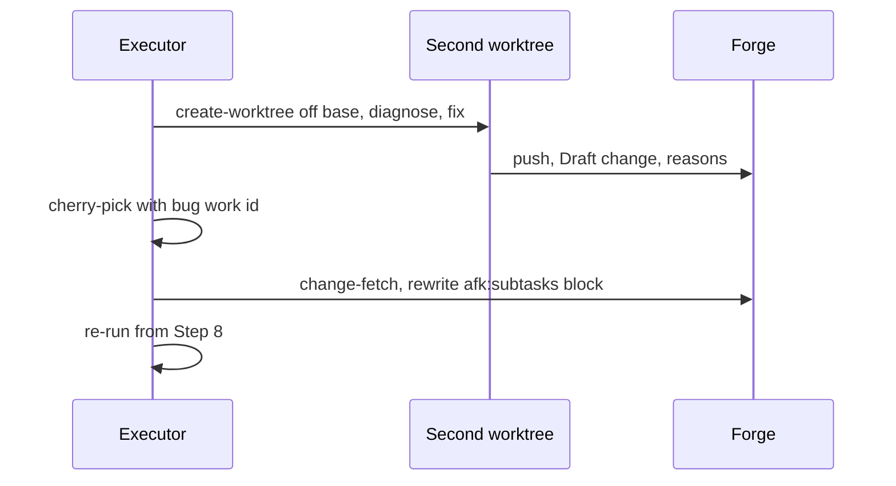

# ADR-0005 — A blocking defect outside the slice ships from a second worktree and rides the feature by cherry-pick

> Status: Accepted
> Date: 2026-10-19
> Layer: L6
> Context ticket: small-lane

## Context

B-9: a defect outside the slice blocks it; it needs its own ticket and change off the base branch, and the same fix on the feature branch (AC-026, AC-028). `/afk:execute` today never writes the tracker, works one branch, and blocks out-of-scope work (INV-023). Decided R-1 C-1, D-5, D-6, R-3 D-20, R-5 D-30, D-31, R-8 C-4..C-8.

## Decision

The executor runs the standalone fix itself in a second worktree it owns, made by `create-worktree` off the base branch, and routes the diagnosis verdict per SDD §7. After the separate Draft change opens (reasons posted on it), the executor cherry-picks the fix commit onto the feature branch with the bug's work id as its prefix, re-runs from Step 8, and writes a dependency note inside its own `afk:subtasks` checklist block, fetching the description first. A hands-off run's start is the prior approval for these ticket and Draft-change writes; merge and force push stay forbidden, and so does marking the separate change ready. Three journal events, in the journal's park form with three new park reasons and never the word pushed for the separate change, and one autopilot report line record it.

Caption: the separate change exists before the feature carries its commit.

## Alternatives Considered

| Alternative | Pros | Cons | Reason rejected |
|-------------|------|------|-----------------|
| Park the slice for a person | no new writes | hands-off runs stall on every blocking defect | AC-028 |
| Fix inside the slice | one change | out-of-scope files raise a scope finding; no standalone ticket | AC-026 |
| A second executor block in the description | separate ownership | breaks "one block per writer" (`preflight/SKILL.md:181-186`) | C-6 |
| Keep the slice prefix on the cherry-pick | one review | slice review blocks on scope | C-7 |

## Consequences

- **Positive** — the defect ships on its own; the feature keeps moving.
- **Negative** — `DECISIONS.md`, autopilot and execute limits are rewritten (HL-6).
- **Follow-ups** — the separate change stays Draft; a person marks it ready.
