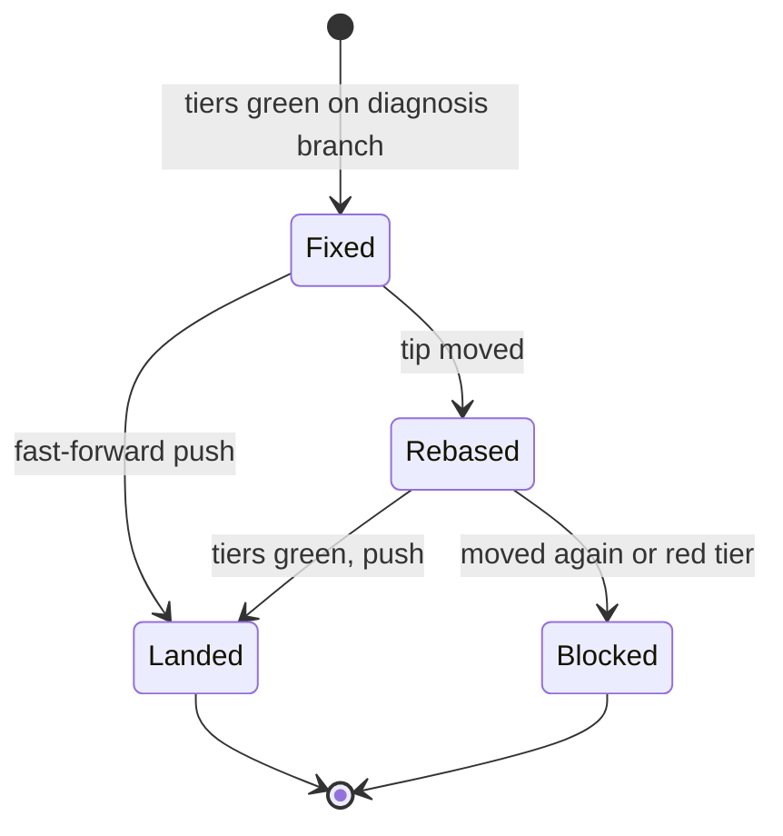

# ADR-0006 — A fix for a bug found on a feature branch lands by fast-forward push

> Status: Accepted
> Date: 2026-10-19
> Layer: L6
> Context ticket: small-lane

## Context

B-8: a person testing a feature branch reports a bug; the fix must reach that branch with no ticket and no new change (PRD Further Notes; R-5 Q-5 = A). The in-place fix may not commit (AC-022). Decided R-5 Q-5, R-6 D-32..D-34, R-8 C-19, C-26.

## Decision

Diagnose run off the base branch asks once which branch to start from and records it as Base. When Base is a feature branch, `/afk:fix` commits on the diagnosis branch made from its tip, runs every tier, fetches, checks the push is a fast-forward and pushes with upstream set by plain git (no forge adapter has a push verb), never forced, refusing a protected target. A moved tip gets one rebase and every tier again; otherwise the fix ends `blocked` with the commits on the diagnosis branch. Proof goes in one comment on that branch's open change, else the run report. The commit lands through the feature's own Draft change, so the one-Draft-change rule holds; one sentence in `SAFETY.md` says so.

Caption: one rebase at most; never a forced push.

## Alternatives Considered

| Alternative | Pros | Cons | Reason rejected |
|-------------|------|------|-----------------|
| A small change into the feature branch | reviewed merge | a merge step the person must do | Q-5 |
| The person commits by hand | no agent push | slower re-test loop | Q-5 |
| Stop at once on a moved tip | simpler | stalls on busy branches | D-33 |

## Consequences

- **Positive** — the tester pulls and re-tests the same day.
- **Negative** — a pushed fix reaches everyone who pulls; only a revert undoes it; the plugin's guard does not check pushes.
- **Follow-ups** — an executor on that branch is behind after the push and parks rather than losing work (inferred).
