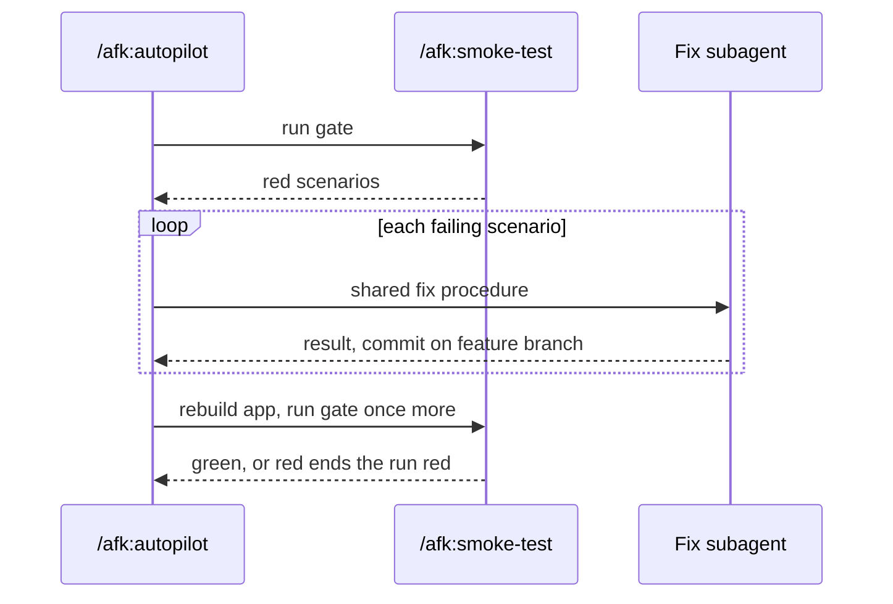

# ADR-0007 — A red smoke gate is fixed by autopilot between two gate runs

> Status: Accepted
> Date: 2026-10-19
> Layer: L9
> Context ticket: small-lane

## Context

B-6 gives a red feature smoke gate one in-place fix per failing scenario. `/afk:smoke-test` never patches a red run to green (`smoke-test/SKILL.md:53,80`), and autopilot repeats that rule (`autopilot/SKILL.md:67`) (INV-023). Decided R-8 Q-6 = A.

## Decision

The gate stays a pure check. On red, `/afk:autopilot` spawns a fix subagent per failing scenario that runs the shared fix procedure and commits on the feature branch, as slice executors do; autopilot rebuilds the app and runs the whole gate once more. A second red ends the run red. A person running the gate by hand gets today's red report.

Caption: the gate reports; autopilot fixes between two runs.

## Alternatives Considered

| Alternative | Pros | Cons | Reason rejected |
|-------------|------|------|-----------------|
| B: the gate fixes itself | one skill | the gate silences its own signal; rewrites its core rule | Q-6 |
| C: back to the owning slice | strongest review per fix | reverses a settled requirement; a slice run per scenario | Q-6 |

## Consequences

- **Positive** — the gate's rule and ownership stay; B-6 is met.
- **Negative** — autopilot's no-patching sentence is rewritten (HL-6); smoke fixes get only the feature review (PF-3), no slice review.
- **Follow-ups** — none.
