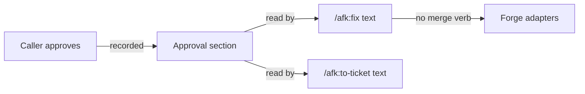

# ADR-0008 — Approval is held by skill text, recorded but not checked

> Status: Accepted
> Date: 2026-10-19
> Layer: L4
> Context ticket: small-lane

## Context

One approval covers the code change, the ticket writes and the change (AC-014); the fix never approves itself (AC-016). The question is what stops a write without approval (SDD §5). Decided R-2 Q-3 = A, R-3 D-18.

## Decision

The rule lives in the skill text of `/afk:fix` and `/afk:to-ticket`. The diagnosis keeps an approval section (who, their words or the prior approval, what it covers, date) as a record for a resumed run and for readers; no script or hook checks it. Merge stays structurally impossible: no forge adapter has a merge verb.

Caption: the text enforces; the section records.

## Alternatives Considered

| Alternative | Pros | Cons | Reason rejected |
|-------------|------|------|-----------------|
| B: a script refuses writes without an approval record | deterministic | an agent can write the record itself; false safety | Q-3 |
| C: a hook gates tracker and forge calls | outside the agent | large, harness-specific | Q-3 |

## Consequences

- **Positive** — no new gate; works on every harness.
- **Negative** — nothing outside the text stops a write without approval; a direct tracker tool call is not checked.
- **Follow-ups** — none.
