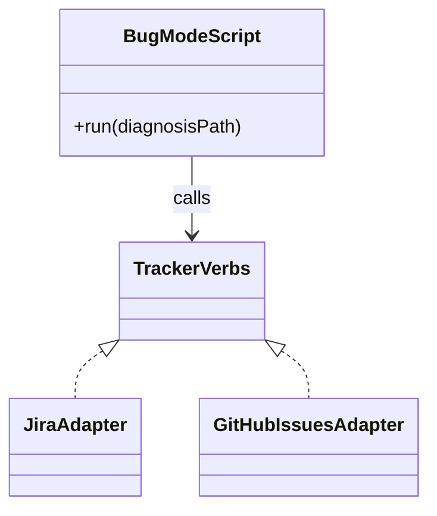

# ADR-0009 — The bug mode drives tracker adapter verbs from one script; kind differences stay in the adapters

> Status: Accepted
> Date: 2026-10-19
> Layer: L8
> Context ticket: small-lane

## Context

`/afk:to-ticket` becomes the only tracker writer (requirement ADR-0003) and must file bugs on Jira and GitHub Issues (AC-031). Its PRD publisher loads Jira-only code at import and exits on GitHub Issues (INV-024). Decided R-1 D-4, R-7 D-43, R-8 C-15, C-16, C-18, C-20, C-22.

## Decision

One new bug-mode script calls the tracker adapter verbs through the adapter loader and never imports the PRD publisher. It files only from a file on disk (the diagnosis, or a description written to the spec folder first), writes the diagnosis summary as the description only of a ticket it creates and only comments on an existing ticket, shows a dry run first with a person present, refuses an unconfigured in-review key, an unknown fix version (Jira) and tracker kind `none` before any write, and keeps the old bug publisher's safeguards, adding a type check the old publisher lacked. Spinoff tickets on Jira go through the same adapter create and so gain formatted text and the unknown-fix-version refusal. Markdown-to-Atlassian-Document-Format conversion, content types and `gh --attach` live inside each adapter. Plugin-root `adr/0008` supersedes ADR-0001; `/afk:report-issue` stays a separate egress.

Caption: one caller, one verb set, kind logic behind it.

## Alternatives Considered

| Alternative | Pros | Cons | Reason rejected |
|-------------|------|------|-----------------|
| Extend the PRD publisher | reuse | Jira-only at import; owns the PRD block | C-20 |
| Jira-only bug mode | smaller | GitHub Issues teams get no filing | D-4 |
| Kind branches in the script | one file | every new kind edits the script | D-43 |

## Consequences

- **Positive** — a new tracker kind needs only an adapter.
- **Negative** — Jira tool callers now get formatted text; the in-review key is renamed in the scaffold.
- **Follow-ups** — live Jira checks before release.
