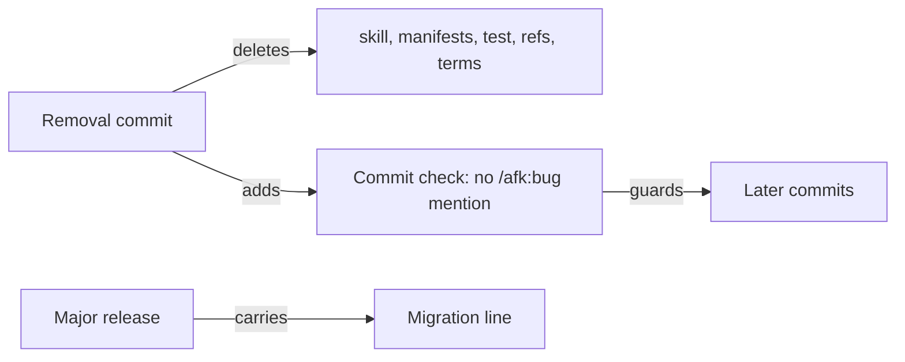

# ADR-0011 — /afk:bug is removed in one commit, kept out by a commit check, in a major release

> Status: Accepted
> Date: 2026-10-19
> Layer: L9
> Context ticket: small-lane

## Context

AC-038 asks that no `/afk:bug` reference survives outside `CHANGELOG.md`; AC-039 a major release with no alias. Existing audit checks miss a bare mention in prose (INV-026). Decided R-8 C-21, C-23, C-24, C-25.

## Decision

One commit removes the skill, both manifest entries, its test, every reference, the eight bug-pipeline glossary headings (One-live-fixer among them); the reviewer setting and `change-reviewers` gain their new consumer in the same change (fix's ready step). A new plugin-source commit check refuses `/afk:bug` and `/afk-toolkit:bug` outside `CHANGELOG.md` and spec folders. The release is a major version (the bump is the human's call) with a Migration line, and also removes the due `to-demo-plan` and `settle-mr` aliases.

Caption: the removal and its guard ship together.

## Alternatives Considered

| Alternative | Pros | Cons | Reason rejected |
|-------------|------|------|-----------------|
| Deprecated alias for one major | softer change | requirements rule out an alias | requirement ADR-0003 |
| Rely on `/afk:setup audit` | no new gate | misses bare prose mentions | C-23 |

## Consequences

- **Positive** — no stale reference can return unnoticed.
- **Negative** — one more commit-time gate to keep within gate cost rules.
- **Follow-ups** — clean-up steps for old bug folders live in the Migration line.
